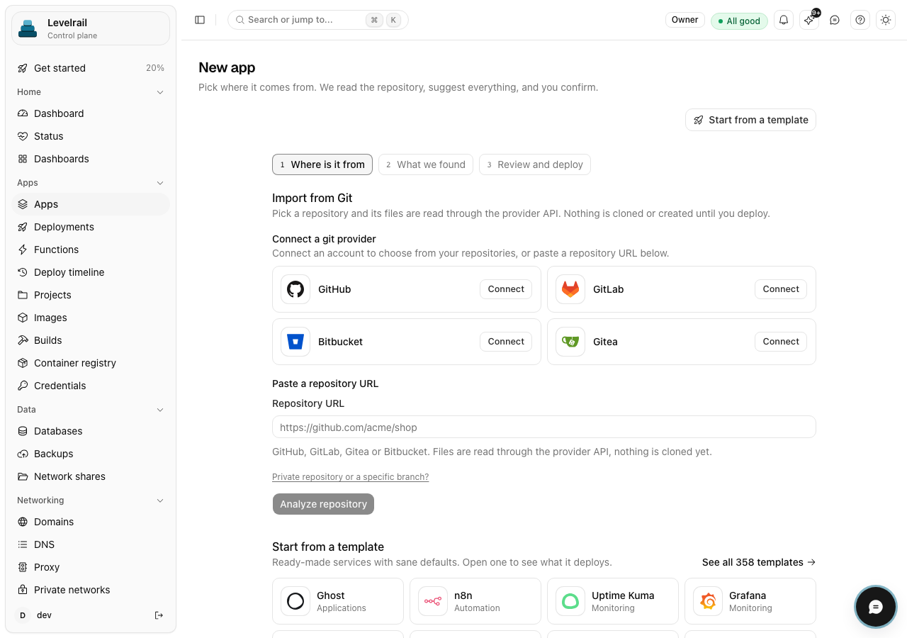
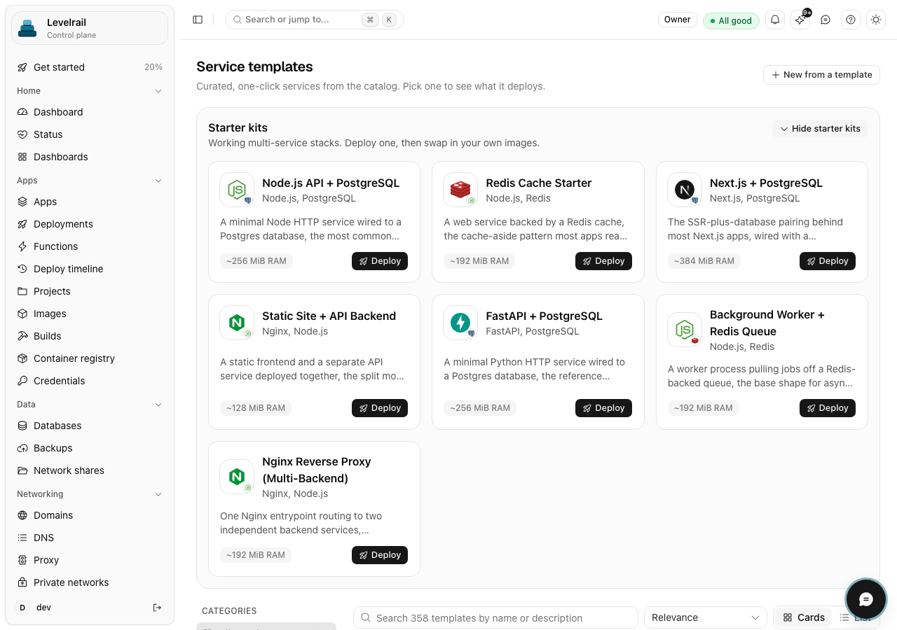
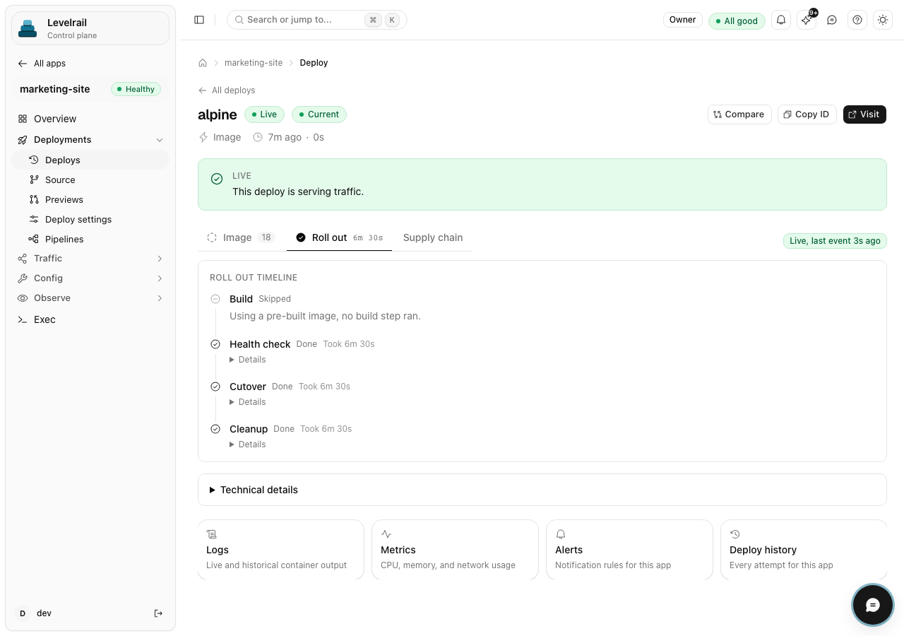
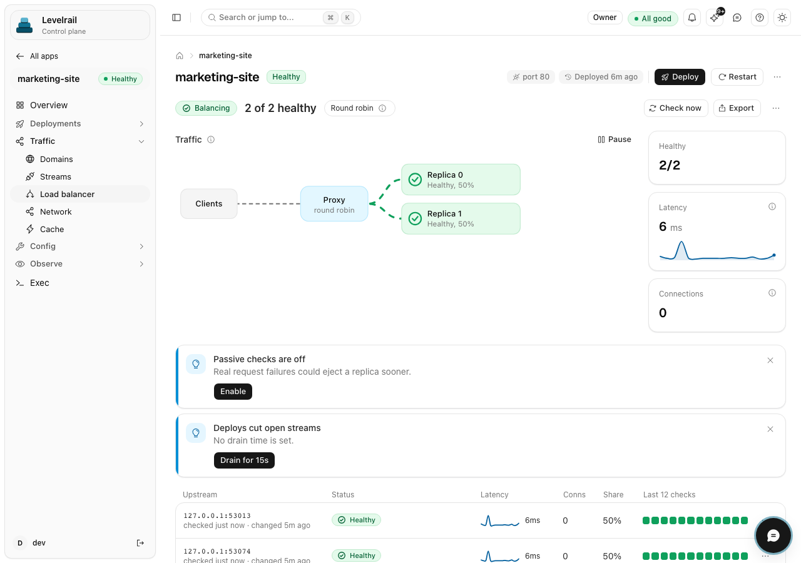
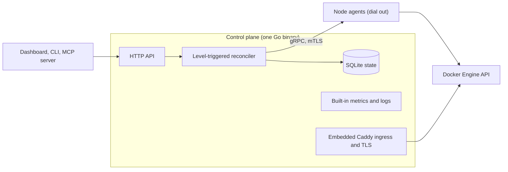

<div align="center">

<h1>Levelrail</h1>
<p><strong>Your own Vercel, on your own servers.</strong><br>
Push to deploy with HTTPS, logs, metrics and one-step rollback. One Go binary, no Kubernetes. Apache 2.0.</p>
<p>
  <a href="LICENSE"></a>
  <a href="https://github.com/glincker/levelrail/releases"></a>
  <a href="https://github.com/glincker/levelrail/actions/workflows/ci.yml"></a>
  <a href="docs/mcp.md"></a>
  <a href="https://discord.gg/Ar5pcaZB99"></a>
</p>
<p>
  <a href="https://levelrail.com">Website</a> &middot;
  <a href="https://docs.levelrail.com">Docs</a> &middot;
  <a href="#install">Install</a> &middot;
  <a href="#vs-coolify-dokploy-caprover-and-dokku">Compare</a> &middot;
  <a href="#faq">FAQ</a> &middot;
  <a href="docs/roadmap.md">Roadmap</a> &middot;
  <a href="https://github.com/glincker/levelrail/discussions">Discussions</a>
</p>
<!-- i18n-nav:start -->
<p>English &middot; <a href="docs/i18n/README.zh-Hans.md">简体中文</a> &middot; <a href="docs/i18n/README.es.md">Español</a> &middot; <a href="docs/i18n/README.pt-BR.md">Português (BR)</a> &middot; <a href="docs/i18n/README.de.md">Deutsch</a> &middot; <a href="docs/i18n/README.fr.md">Français</a> &middot; <a href="docs/i18n/README.ja.md">日本語</a></p>
<!-- i18n-nav:end -->
<picture><source media="(prefers-color-scheme: dark)" srcset="docs/assets/brand/social/github-social-1280x640.jpg"></picture>
</div>

Turn any Linux server into a private cloud: Git deploys, HTTPS, databases with verified backups, metrics, logs and alerts, without Kubernetes and without a monitoring stack to bolt on. Pre-1.0: single-server is production ready, multi-node is beta ([Feature status](docs/feature-status.md)).

## Install

```bash
curl -fsSL https://levelrail.com/install.sh | sudo sh
```

Needs Linux (amd64 or arm64) with systemd and root; the installer adds Docker. Open ports 80 and 443, open the setup link it prints, choose a password, then deploy from the CLI (the dashboard's **Connect your CLI** card gives you the login line):

```bash
levelrail-cli login --api-url http://127.0.0.1:8080 --code ABCD-EF23
levelrail-cli import https://github.com/your-org/your-app --deploy
```


<table>
  <tr>
    <td width="50%" valign="top" align="center">
      <br>
      <sub><b>Install, then deploy</b></sub>
    </td>
    <td width="50%" valign="top" align="center">
      <br>
      <sub><b>Gated deploy, one-step rollback</b></sub>
    </td>
  </tr>
</table>


[First 15 minutes](docs/first-15-minutes.md) &middot; [Installing](docs/installing.md) (Docker, pinned version, source build, troubleshooting) &middot; [CLI only](docs/installing.md#installing-just-the-cli) (`brew install glincker/tap/levelrail-cli`) &middot; [Free Arm VM](docs/install-on-oracle-cloud.md) &middot; [Migrate from Coolify, Dokploy, CapRover or Dokku](docs/migrate-to-levelrail.md) &middot; [Verify signed releases](docs/installing.md#verifying-release-binaries)

Using a coding agent? `npx skills add https://github.com/glincker/levelrail --skill levelrail`, then ask it to deploy your repo. See [Agents](docs/mcp.md).

## Why Levelrail

| | |
| --- | --- |
| **Lightweight** | About 200 MB of RAM and 1.5% of one CPU idle on a 2 vCPU, 8 GB box ([method](docs/benchmarks.md)). |
| **Safe deploys** | Readiness-gated rollouts, pinned images, canaries, approvals and one-step rollback. |
| **Observability built in** | Metrics, searchable logs, traces and alerts. No Grafana stack to install. |
| **Agents, not SSH** | Nodes dial out over mTLS. No inbound ports, no shelling out to `docker`. |
| **Secure by default** | Hash-chained audit log, encrypted secrets, passkeys, 2FA, OIDC, IAM, signed releases. |
| **Built for AI agents** | An MCP server with 240+ tools and a permission model. AI is never in the reconcile path. |

<table>
  <tr>
    <td width="33%" valign="top"><a href="docs/product-tour.mdx"><picture><source media="(prefers-color-scheme: dark)" srcset="docs/assets/screenshots/dashboard-home.png"></picture></a><br><sub><b>The control plane at a glance</b></sub></td>
    <td width="33%" valign="top"><a href="docs/frameworks.md"><picture><source media="(prefers-color-scheme: dark)" srcset="docs/assets/screenshots/framework-preset-picker.png"></picture></a><br><sub><b>Pick a framework preset and the build settings fill in</b></sub></td>
    <td width="33%" valign="top"><a href="docs/template-catalog.md"><picture><source media="(prefers-color-scheme: dark)" srcset="docs/assets/screenshots/templates-catalog.png"></picture></a><br><sub><b>Install a known service from the template catalog</b></sub></td>
  </tr>
  <tr>
    <td width="33%" valign="top"><a href="docs/deploying-apps.md"><picture><source media="(prefers-color-scheme: dark)" srcset="docs/assets/screenshots/deploy-live-log.png"></picture></a><br><sub><b>Live deploys</b></sub></td>
    <td width="33%" valign="top"><a href="docs/load-balancing.md"><picture><source media="(prefers-color-scheme: dark)" srcset="docs/assets/screenshots/load-balancer.png"></picture></a><br><sub><b>Load balance across replicas with health checks</b></sub></td>
    <td width="33%" valign="top"><a href="docs/deploying-apps.md"><picture><source media="(prefers-color-scheme: dark)" srcset="docs/assets/screenshots/apps-list.png"></picture></a><br><sub><b>Every app, its health, and its last deploy</b></sub></td>
  </tr>
</table>

All screenshots are captured from a real running control plane. More in the [Product tour](https://docs.levelrail.com/product-tour).

## vs Coolify, Dokploy, CapRover and Dokku

| | Levelrail | Coolify | Dokploy | CapRover | Dokku |
| --- | --- | --- | --- | --- | --- |
| Node control | Reverse-dialed agent | SSH + CLI | SSH + Engine API | Swarm API | Local bash |
| Built-in metrics and logs | Yes | Opt-in add-on | Separate binary | No | No |
| Rollback | Pinned images, readiness-gated | Health check off by default | Swarm rollback | Manual | Default scheduler: none |
| Backup verification | Automatic | Non-empty check | None | None | No backups |
| Audit log | Hash-chained, verifiable | See their docs | See their docs | See their docs | See their docs |

Positioning, not a ranking. Levelrail is the youngest project here, with fewer users and less production mileage. Sourced details: [Comparison](docs/comparison.md).

## Production ready, with receipts

Every feature is labelled stable or beta with its evidence in [Feature status](docs/feature-status.md). Failure handling is in [Resilience](docs/resilience.md), measured numbers in [Benchmarks](docs/benchmarks.md), and what is not proven yet in [Known limits](docs/known-limits.md). Releases are signed with Sigstore and carry a provenance attestation.

## How it works



Details: [Architecture](docs/architecture.md).

## Guides

[Next.js with Postgres](https://github.com/glincker/levelrail/discussions/1239) &middot; [Django with Postgres](https://github.com/glincker/levelrail/discussions/1243) &middot; [Push to deploy with GitHub](https://github.com/glincker/levelrail/discussions/1244) &middot; [How deploys stay safe](https://github.com/glincker/levelrail/discussions/1246) &middot; [Scale to zero on a small VPS](https://github.com/glincker/levelrail/discussions/1242)

Maintain an open-source app? Add a one-click button: [Deploy button](docs/deploy-button.md).

[](docs/deploy-button.md)

## FAQ

**Does it need Kubernetes?** No. One Go binary with a Docker runtime.

**What does it cost?** Nothing. Apache 2.0, one edition, no license key. You pay for your own servers ([Pricing](docs/pricing.md)).

**Can I migrate from Coolify?** Yes. `levelrail-cli import platform coolify --dry-run` shows what would be created first, and the old server keeps serving ([Migrate](docs/migrate-to-levelrail.md)).

**How do I upgrade?** Settings > Updates or `levelrail-cli upgrade --plan`. It verifies the release, snapshots your data and rolls back by itself if the new release is unhealthy ([Upgrade safely](docs/upgrade-safely.md)).

## Community

[Discussions](https://github.com/glincker/levelrail/discussions) &middot; [Issues](https://github.com/glincker/levelrail/issues) &middot; [Discord](https://discord.gg/Ar5pcaZB99) &middot; [support@levelrail.com](mailto:support@levelrail.com) &middot; [Security policy](.github/SECURITY.md) &middot; [Contributing](.github/CONTRIBUTING.md) &middot; [llms.txt](llms.txt) and [AGENTS.md](AGENTS.md) for AI agents

## Star the repo

If Levelrail saves you a weekend, a [star](https://github.com/glincker/levelrail) helps other self-hosters find it.

[](https://star-history.com/#glincker/levelrail&Date)

Apache 2.0, see [LICENSE](LICENSE). Built by Gagan Deep Singh of [GLINR STUDIOS](https://glinr.com) and [theSVG](https://thesvg.org).

<div align="center">

<a href="https://glinr.com">
  <picture>
    <source media="(prefers-color-scheme: dark)" srcset="docs/assets/brand/glincker-light.svg">
    
  </picture>
</a>

<sub>Powered by <a href="https://glinr.com"><b>GLINR STUDIOS</b></a> &middot; icon from <a href="https://thesvg.org/icon/glincker">theSVG</a></sub>

</div>
