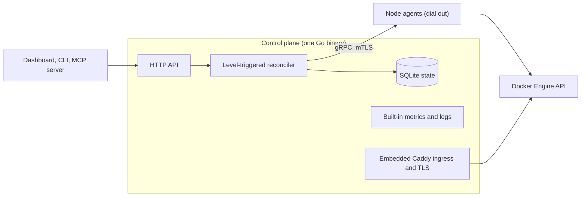

<div align="center">

<h1>Levelrail</h1>
<p><strong>Self-hosted PaaS: deploy on git push to your own servers, with logs, metrics, HTTPS and rollback.</strong><br>
One Go binary, Docker runtime, no Kubernetes. Apache 2.0.</p>
<p>
  <a href="LICENSE"></a>
  <a href="https://github.com/glincker/levelrail/releases"></a>
  <a href="https://github.com/glincker/levelrail/actions/workflows/ci.yml"></a>
  <a href="go.mod"></a>
<br>
  <a href="docs/mcp.md"></a>
  <a href="https://docs.levelrail.com"></a>
  <a href="https://discord.gg/Ar5pcaZB99"></a>
  <a href="https://codespaces.new/glincker/levelrail"></a>
</p>
<p>
  <a href="https://levelrail.com">Website</a> &middot;
  <a href="https://docs.levelrail.com">Docs</a> &middot;
  <a href="#quickstart">Install</a> &middot;
  <a href="#production-ready-with-receipts">Production ready</a> &middot;
  <a href="#levelrail-vs-coolify-dokploy-caprover-and-dokku">Compare</a> &middot;
  <a href="#faq">FAQ</a> &middot;
  <a href="docs/roadmap.md">Roadmap</a> &middot;
  <a href="CHANGELOG.md">Changelog</a> &middot;
  <a href="https://github.com/glincker/levelrail/discussions">Discussions</a>
</p>
<!-- i18n-nav:start -->
<p>English &middot; <a href="docs/i18n/README.zh-Hans.md">简体中文</a> &middot; <a href="docs/i18n/README.es.md">Español</a> &middot; <a href="docs/i18n/README.pt-BR.md">Português (BR)</a> &middot; <a href="docs/i18n/README.de.md">Deutsch</a> &middot; <a href="docs/i18n/README.fr.md">Français</a> &middot; <a href="docs/i18n/README.ja.md">日本語</a></p>
<!-- i18n-nav:end -->
<picture><source media="(prefers-color-scheme: dark)" srcset="docs/assets/brand/social/github-social-1280x640.jpg"></picture>
</div>

Levelrail is an open source (Apache 2.0) **self-hosted PaaS** for developers and small teams who want a Vercel, Heroku or Railway style workflow on servers they own. It runs on any Linux server, from a small VPS to a rack (the one measured host is a 2 vCPU, 8 GB box), and turns plain servers into a private cloud with Git deploys (forge webhooks), HTTPS, databases with verified backups, metrics, logs and alerts, without Kubernetes and without the monitoring stack you would otherwise bolt on.

**Status:** pre-1.0 (v0.x). Single-server is production ready per [Feature status](docs/feature-status.md); multi-node is beta.

## Which install is for me?

| I am... | Run | Doc |
| --- | --- | --- |
| On a Linux server (VPS or bare metal) and want to deploy apps | `curl -fsSL https://levelrail.com/install.sh \| sudo sh` | [Installing](docs/installing.md) |
| Trying it locally first | Open the dev container in [Codespaces](https://codespaces.new/glincker/levelrail) | [Installing](docs/installing.md#option-3-build-from-source) |
| Only needing the CLI on my laptop | `brew install glincker/tap/levelrail-cli` or `npm install -g levelrail-cli` | [Installing just the CLI](docs/installing.md#installing-just-the-cli) |
| Running Docker and want a container | `docker pull ghcr.io/glincker/levelrail` | [Docker](docs/installing.md#option-2-docker) |
| Using a coding agent | `npx skills add https://github.com/glincker/levelrail --skill levelrail` | [MCP server](docs/mcp.md) |

The server installs on Linux only. macOS and Windows are CLI-only targets.

## Table of contents

[Quickstart](#quickstart-install-a-self-hosted-vercel-alternative) &middot; [How it works](#how-it-works) &middot; [Verify what you install](#verify-what-you-install) &middot; [Why Levelrail](#why-people-pick-levelrail) &middot; [Production ready](#production-ready-with-receipts) &middot; [Coolify alternative](#levelrail-vs-coolify-dokploy-caprover-and-dokku-coolify-alternative) &middot; [Features](#what-you-get) &middot; [Guides](#guides) &middot; [FAQ](#faq) &middot; [For AI agents](#for-ai-agents-and-crawlers)

## Quickstart (install a self-hosted Vercel alternative)

You need a Linux server (`amd64` or `arm64`) with systemd and root. The installer adds Docker if it is missing.

### 1. Install the server

```bash
curl -fsSL https://levelrail.com/install.sh | sudo sh
```

> **Note:** HTTPS is self-signed until you enable Let's Encrypt. The first sign-in offers a one-click free certificate for `<dashed-ip>.sslip.io`, or add your own domain.

The last lines of output include the dashboard address and a one-time setup link:

```text
Levelrail vX.Y.Z installed and running.

Open the dashboard:
  http://203.0.113.10:8080/login#setup=<token>
```

### 2. Create the admin account

Open the setup link and choose a password. The token sits in the `#` fragment, so it never reaches the server or its logs; lost it? `sudo APP_DATA_DIR=/var/lib/levelrail-data levelrail setup-token` prints it again. The first sign-in opens one screen that turns on a free certificate for `<dashed-ip>.sslip.io` with one click (no DNS needed) and deploys your first app.

### 3. Deploy an app

On the server, the installer already put `levelrail-cli` in `/usr/local/bin`. Sign in once, then import a repository (`levelrail-cli apps create --interactive` asks for everything step by step):

```bash
levelrail-cli login --api-url http://<server-ip>:8080 --code ABCD-EF23
levelrail-cli import https://github.com/your-org/your-app --deploy
```

Prefer containers, a pinned version or a source build? See [Installing](docs/installing.md). Want it as light as Dokku, or everything on? `install.sh --profile minimal|standard|suite`, see [Server profiles](docs/profiles.md). Coming from another platform? See [Migrate to Levelrail](docs/migrate-to-levelrail.md): Coolify, Dokploy, CapRover, Dokku and compose files each get a dry run first, and the old server keeps serving.

After setup, the dashboard home shows a **Connect your CLI** card. Press **Show my command**, paste the line into your terminal, and the CLI signs in with a single-use code that expires in minutes (no password, no approval step):

```text
logged in as "you@example.com"
token tk_9fQ2x saved to ~/.config/levelrail-cli/credentials under profile "default", expires 2027-01-18
```

Signing in with your password from a new device needs approval: the CLI prints the dashboard page to approve it on and the number to type. `login --device` also still works.

Without `--deploy`, `import` only prints the deployment plan. To see the app's address, run `levelrail-cli open your-app`. It prints the custom domain first, then the automatic URL.

### Or let your coding agent do it

Install the skill once, then ask your agent in plain words. It deploys, waits for the rollout to actually converge, reads the failure if there is one, and rolls back safely:

```bash
npx skills add https://github.com/glincker/levelrail --skill levelrail
```

> Deploy this repo to my Levelrail and tell me when it is live.

The skill is also listed at [skills.sh](https://www.skills.sh/glincker/levelrail/levelrail). Details: [Agents](docs/agents.md).

### If something fails

| Step | Error you see | Fix |
| --- | --- | --- |
| Install | `control plane did not become healthy within 60s` | `systemctl status levelrail` and `journalctl -u levelrail -n 100 --no-pager`. A port already in use is a common cause. |
| Install | `could not list releases from GitHub. Set LEVELRAIL_VERSION=vX.Y.Z to pin one.` | The server cannot reach GitHub. Check outbound HTTPS, or pin a release. |
| Install | `checksum mismatch for ...` | Do not continue. Run the installer again. Do not set `LEVELRAIL_SKIP_CHECKSUM=1` to get past it. |
| Login | `start device login: ... connection refused` | The CLI points at the wrong address. Run `export APP_API_URL=http://127.0.0.1:<dashboard port>` and try again. |
| Import | `plan import: ... connection refused` | The control plane is not running. Start it with `systemctl start levelrail`. |

More fixes: [Troubleshooting](docs/troubleshooting.md). Full install options (Docker image, pinned version, source build): [Installing](docs/installing.md). Deploy from a local project with `levelrail-cli up`: [One command quickstart](docs/quickstart-one-command.md). Server profiles (`install.sh --profile minimal|standard|suite`): [Server profiles](docs/profiles.md). Migrating from another platform? `levelrail-cli import platform coolify|dokploy|caprover --dry-run` shows what would be created first, and the old server keeps serving. Full guide: [Migrate to Levelrail](docs/migrate-to-levelrail.md). Publishing an open-source project? Add a one-click button to its README: [Deploy to Levelrail button](docs/deploy-button.md).

<table>
  <tr>
    <td width="50%" valign="top" align="center">
      <br>
      <sub><b>Install, then deploy</b></sub>
    </td>
    <td width="50%" valign="top" align="center">
      <br>
      <sub><b>Gated deploy, one-step rollback</b></sub>
    </td>
  </tr>
</table>

### Install the CLI only

For your laptop or a CI runner, to control a server that already runs Levelrail:

```bash
brew install glincker/tap/levelrail-cli
npm install -g levelrail-cli
curl -fsSL https://levelrail.com/install-cli.sh | sh
irm https://levelrail.com/install-cli.ps1 | iex
```

The first two work on any supported platform, the third is for macOS and Linux, the last for Windows PowerShell.

## How it works



The control plane keeps desired state in embedded SQLite and a reconciler makes Docker match it, retrying safely because it works from observed state each time. Each node runs an agent that dials out to the control plane over mTLS and talks to the Docker Engine API directly, so nodes need no inbound port. Metrics and logs are stored per node and queried together. Caddy is embedded for ingress and certificates. Details: [Architecture](docs/architecture.md).

## Verify what you install

Releases publish a Sigstore signature for `checksums.txt` and a build provenance attestation. Replace `v0.1.0` with the release tag.

```bash
V=v0.1.0
BASE=https://github.com/glincker/levelrail/releases/download/$V
curl -fsSLO $BASE/checksums.txt -O $BASE/checksums.txt.sigstore.json -O $BASE/levelrail-linux-amd64
cosign verify-blob --bundle checksums.txt.sigstore.json \
  --certificate-identity-regexp 'https://github.com/glincker/levelrail/\.github/workflows/release\.yml@.*' \
  --certificate-oidc-issuer https://token.actions.githubusercontent.com checksums.txt
sha256sum --check --ignore-missing checksums.txt
gh attestation verify levelrail-linux-amd64 --repo glincker/levelrail
```

The installer checks the checksums itself. Container images are on GHCR (`ghcr.io/glincker/levelrail`, multi-arch). More: [Installing](docs/installing.md).

## Why people pick Levelrail

- **Lightweight.** About 200 MB of RAM and roughly 1.5% of one CPU idle, measured on a 2 vCPU, 8 GB Linux test box with no apps under load and the default feature set (one run, 2026-10-19). [Numbers and method](docs/benchmarks.md).
- **Agents, not SSH.** Each node runs a small agent that dials out over mTLS and talks to Docker's Engine API directly. No inbound ports, no shelling out to the `docker` CLI, no polling loops.
- **Observability included.** Per-node metrics at 15 second resolution, searchable logs, deploy markers, traces, SLO burn, alert inbox and an idle-footprint health page. No Grafana stack to install.
- **Deploys that protect you.** Readiness-gated rollouts, pinned images for rollback, canary releases that roll back on errors, deploy diffs, approvals and freezes.
- **Secure by default.** Hash-chained audit log you can verify, SSRF-guarded outbound calls, envelope-encrypted secrets with key rotation, scoped tokens, passkeys and TOTP 2FA, OAuth and OIDC sign-in, IAM policies, signed releases. SAML single sign-on and SCIM provisioning are available as a [beta feature](docs/sso-saml.md), off by default.
- **Built for AI agents.** An MCP server with over 240 tools in on-demand toolsets (small default list, about 2.4k tokens; see [tool surface](docs/mcp-tool-surface.md)), a scoped-token permission model and an agent skill.

## Production ready, with receipts

Single-server deployments are production ready today. Multi-node and a handful of newer features are labelled beta, and every label links to its evidence.

| Claim | Evidence |
| --- | --- |
| Every feature is labelled stable or beta | [Feature status](docs/feature-status.md): the tests, live e2e runs and docs behind each label |
| Survives failures | [Resilience](docs/resilience.md): disk full, agent link loss, database damage with guided restore, safe-mode boot, reconcile storm protection |
| Safe upgrades and rollback | Tested upgrade matrix, downgrade refusal, one-click [rollback](docs/rollback.md) and clean shutdown |
| Measured, not promised | [Benchmarks](docs/benchmarks.md): idle footprint, ingress throughput, limits, with the method next to every number |
| Verified backups | Every backup is re-downloaded and checksummed, with scheduled restore drills |
| Tamper-evident security | Verifiable audit chain, [security policy](.github/SECURITY.md), signed releases and SBOM scanning |

## Levelrail vs Coolify, Dokploy, CapRover and Dokku (Coolify alternative)

Most self-hosted platforms in this category manage servers by SSHing in and shelling out to the `docker` CLI, then parsing text, which tends to force polling loops. Levelrail uses a reverse-dialed agent and a level-triggered reconciler instead.

| | Levelrail | Coolify | Dokploy | CapRover | Dokku |
| --- | --- | --- | --- | --- | --- |
| Node control | Reverse-dialed agent | SSH + CLI | SSH + Engine API | Swarm API | Local bash |
| Orchestration | Level-triggered reconciler | Compose | Swarm | Swarm | Bash scheduler |
| Built-in metrics and logs | Yes | Opt-in add-on | Separate binary | No | No |
| Rollback | Pinned images, readiness-gated | Health check off by default | Swarm rollback | Manual | Default scheduler: none |
| Backup verification | Automatic, all 8 engines | Non-empty check | None | None | No backups |
| SSO and provisioning | OAuth (20 providers) and generic OIDC; SAML and SCIM (beta, off by default) | See their docs | See their docs | See their docs | See their docs |
| Audit log | Hash-chained, verifiable, CSV export, forwarding to syslog, webhook or bucket | See their docs | See their docs | See their docs | See their docs |
| IAM | Allow and Deny policies per app or database, scoped tokens | See their docs | See their docs | See their docs | See their docs |

This is positioning, not a ranking, and every project here is worth using. Where Levelrail trails: it is the youngest project here, with fewer users and less production mileage, and its SAML single sign-on and SCIM provisioning are beta ([details](docs/sso-saml.md)). Its template catalog (about 360 entries) is in the same range as Coolify's, but only a sample is deployed end to end ([ADR 015](adr/015-service-template-catalog-reversal.md)). The full, sourced comparison is in [Comparison](docs/comparison.md).

## What you get

- **Deploys:** Push to your git host (GitHub, GitLab, Bitbucket, Gitea webhooks), deploys start from a forge webhook (a native `git push` remote is beta and off by default), preview environments per pull request (stable on GitHub, beta on GitLab and Bitbucket), framework presets (Next.js, Go, React, Spring Boot and more), Dockerfile, Compose or image deploys, canary and blue-green rollouts. Readiness-gated cutover is live-tested with zero failed requests on a single node; multi-node is beta. [Deploying apps](docs/deploying-apps.md)
- **Domains and TLS:** Embedded Caddy ingress. The default certificate is internal (self-signed). Public Let's Encrypt is one toggle and was verified in one live run; renewal and DNS-01 wildcards are unverified. Custom certificates can be uploaded. Per-app abuse protection. [Domains](docs/domains-and-ingress.md)
- **Databases:** Postgres, MySQL, MariaDB, MongoDB, Redis, KeyDB, Dragonfly and ClickHouse with scheduled backups, Postgres point-in-time recovery, restore, and password rotation. [Databases](docs/managing-databases.md)
- **One search for everything:** Cmd+K across apps, databases, nodes, templates and actions, filtered by what you may do. [Search](docs/search.md)
- **Servers:** Add nodes with a one-time token, WireGuard mesh, zones and failure-domain spreading, placement what-if. [Multi-node](docs/multi-node.md)
- **Templates:** about 360 one-click services, with a smoke test that brings up the top 50 (48 pass today, [status](docs/templates-status.md)). [Catalog](docs/template-catalog.md)
- **Identity and access:** Password, passkeys, TOTP, OAuth with 20 providers plus generic OIDC, IAM policies, teams, a hash-chained audit log with CSV export. SAML single sign-on and SCIM provisioning are beta and off by default. [Identity and access](docs/identity-and-access.md), [SAML and SCIM](docs/sso-saml.md)
- **Plugins:** A signed plugin marketplace with one-click install, dashboard panels and first-party alert channels. [Plugins](docs/plugins.md)
- **Automation:** One HTTP API behind the dashboard, a CLI and an MCP server. AI never sits in the reconciliation path. [CLI](docs/cli-reference.md), [AI control](docs/ai-control.md)
- **Pipelines, previews, cost budgets, sleep when idle, status pages** and more. See [Product tour](https://docs.levelrail.com/product-tour).

<table>
  <tr>
    <td width="33%" valign="top"><a href="docs/product-tour.mdx"><picture><source media="(prefers-color-scheme: dark)" srcset="docs/assets/screenshots/dashboard-home.png"></picture></a><br><sub><b>The control plane at a glance</b></sub></td>
    <td width="33%" valign="top"><a href="docs/frameworks.md"><picture><source media="(prefers-color-scheme: dark)" srcset="docs/assets/screenshots/framework-preset-picker.png"></picture></a><br><sub><b>Pick a framework preset and the build settings fill in</b></sub></td>
    <td width="33%" valign="top"><a href="docs/template-catalog.md"><picture><source media="(prefers-color-scheme: dark)" srcset="docs/assets/screenshots/templates-catalog.png"></picture></a><br><sub><b>Install a known service from the template catalog</b></sub></td>
  </tr>
  <tr>
    <td width="33%" valign="top"><a href="docs/deploying-apps.md"><picture><source media="(prefers-color-scheme: dark)" srcset="docs/assets/screenshots/deploy-live-log.png"></picture></a><br><sub><b>Live deploys</b></sub></td>
    <td width="33%" valign="top"><a href="docs/load-balancing.md"><picture><source media="(prefers-color-scheme: dark)" srcset="docs/assets/screenshots/load-balancer.png"></picture></a><br><sub><b>Load balance across replicas with health checks</b></sub></td>
    <td width="33%" valign="top"><a href="docs/deploying-apps.md"><picture><source media="(prefers-color-scheme: dark)" srcset="docs/assets/screenshots/apps-list.png"></picture></a><br><sub><b>Every app, its health, and its last deploy</b></sub></td>
  </tr>
</table>

More screens (metrics, logs, backups, domains, security, plugins) are in the [Product tour](https://docs.levelrail.com/product-tour).

All screenshots are captured from a real running control plane.

## Guides

Step by step walkthroughs, each tested against a real install:

| Guide | What you learn |
| --- | --- |
| [Deploy a Next.js app with Postgres](https://github.com/glincker/levelrail/discussions/1239) | Repo to HTTPS in about ten minutes |
| [Deploy a Django app with Postgres](https://github.com/glincker/levelrail/discussions/1243) | Plus the four errors everyone hits |
| [Push to deploy with GitHub](https://github.com/glincker/levelrail/discussions/1244) | Webhooks, previews and the delivery log |
| [How deploys stay safe](https://github.com/glincker/levelrail/discussions/1246) | Health gates, blue-green cutover, rollback |
| [Logs, traces and errors without a stack](https://github.com/glincker/levelrail/discussions/1240) | Observability and Grafana |
| [Scale to zero on a small VPS](https://github.com/glincker/levelrail/discussions/1242) | Run many projects on one box |
| [Levelrail vs Coolify, Dokploy, CapRover, Dokku and Kamal](https://github.com/glincker/levelrail/discussions/1235) | Where each one fits |

## Add a Deploy button to your project

Maintain an open-source app? Let people run it on their own server in a few clicks.

[](docs/deploy-button.md)

Copy-paste snippets and the four badge styles: [Deploy button](docs/deploy-button.md) and the [Brand kit](docs/brand.md).

## What is next

Planned, not promised. Dates are targets and items can move or drop. Full list in the [roadmap](docs/roadmap.md).

- Real-host runs for the multi-node mesh and an idle-footprint number.
- Public ACME checks: renewal near expiry and DNS-01 wildcards.
- More upgrade and downgrade testing across releases.
- Release snapshots and environment bindings.
- A first stable release, only when the hardening evidence is in. No date is set.

## FAQ

**Is Levelrail production ready?** Single-server deployments are production ready; multi-node and some newer features are beta. Every label is in [Feature status](docs/feature-status.md). The project is pre-1.0.

**Does it need Kubernetes?** No. It is one Go binary with a Docker runtime, and a Kubernetes compatibility layer is a deliberate non-goal ([Comparison](docs/comparison.md)).

**What does it cost?** Nothing. It is Apache 2.0, one edition, no license key and no paid tier. You pay for your own servers ([Pricing](docs/pricing.md)).

**How is it different from Coolify or Dokploy?** Nodes are managed by a reverse-dialed agent and a level-triggered reconciler instead of SSH and the `docker` CLI, and metrics and logs are built in. See the [comparison table](#levelrail-vs-coolify-dokploy-caprover-and-dokku-coolify-alternative), including where Levelrail trails.

**Can I migrate from Coolify?** Yes. `levelrail-cli import platform coolify --dry-run` shows what would be created first, and the old server keeps serving. Dokploy, CapRover, Dokku and compose files work too: [Migrate to Levelrail](docs/migrate-to-levelrail.md).

**Does it support AI agents and MCP?** Yes. `levelrail-mcp` exposes the same API and permission model, and an agent skill is included. AI is never in the reconciliation path: [MCP](docs/mcp.md), [AI control](docs/ai-control.md).

**How do I upgrade?** Use Settings > Updates or `levelrail-cli upgrade --plan`. The upgrade verifies the release, snapshots your data and rolls back by itself if the new release is not healthy: [Upgrade safely](docs/upgrade-safely.md).

**Where is my data stored?** On your servers. The control plane keeps SQLite, the master key and the setup token in `/var/lib/levelrail-data` by default; metrics and logs stay on each node ([Installing](docs/installing.md), [Architecture](docs/architecture.md)).

## For AI agents and crawlers

- **Agent skill:** [`skills/levelrail/SKILL.md`](skills/levelrail/SKILL.md) teaches a coding agent to deploy, wait, diagnose and roll back safely.
- **MCP server:** `levelrail-mcp` exposes the same API and permission model. Start in `read-only` mode. See [MCP](docs/mcp.md) and [AI control](docs/ai-control.md).
- **Repo guide:** [`AGENTS.md`](AGENTS.md) for working in this codebase, and [`llms.txt`](llms.txt) as the index. Docs for LLMs: [llms.txt](https://docs.levelrail.com/llms.txt) and [llms-full.txt](https://docs.levelrail.com/llms-full.txt).

## Community and support

- [GitHub Discussions](https://github.com/glincker/levelrail/discussions) for questions, ideas and show and tell, and [Issues](https://github.com/glincker/levelrail/issues) for bugs.
- [GLINR Discord](https://discord.gg/Ar5pcaZB99): live chat with the maintainers, in the `#levelrail` forum channel.
- [support@levelrail.com](mailto:support@levelrail.com) for direct help, and the [Security policy](.github/SECURITY.md) to report a vulnerability privately.
- [Contributing](.github/CONTRIBUTING.md): dev loop, tests and commit conventions. Build from source needs Go 1.26 or newer and Docker: see [Installing](docs/installing.md#option-3-build-from-source).

## Star the repo

If Levelrail saves you a weekend, a [star on GitHub](https://github.com/glincker/levelrail) helps other self-hosters find it. Bug reports and honest feedback help even more.

[](https://star-history.com/#glincker/levelrail&Date)

<a href="https://github.com/glincker/levelrail/graphs/contributors"></a>

## License

Apache 2.0, see [LICENSE](LICENSE).

## Built by

Levelrail is built by Gagan Deep Singh, founder of [GLINR STUDIOS](https://glinr.com) and [theSVG](https://thesvg.org). Sister projects: [theSVG](https://thesvg.org) (brand icon library), [theauth](https://github.com/glincker/theauth) (open-source auth for AI agents and humans) and [AskVerdict AI](https://askverdict.ai). Say hello at [thegdsks.com](https://thegdsks.com).

<div align="center">

<a href="https://glinr.com">
  <picture>
    <source media="(prefers-color-scheme: dark)" srcset="docs/assets/brand/glincker-light.svg">
    
  </picture>
</a>

<sub>Powered by <a href="https://glinr.com"><b>GLINR STUDIOS</b></a> &middot; icon from <a href="https://thesvg.org/icon/glincker">theSVG</a></sub>

</div>
