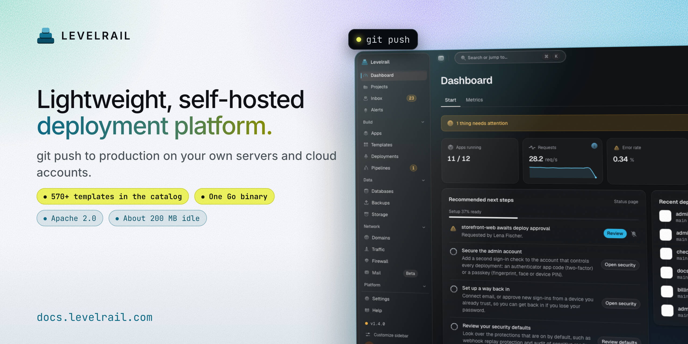
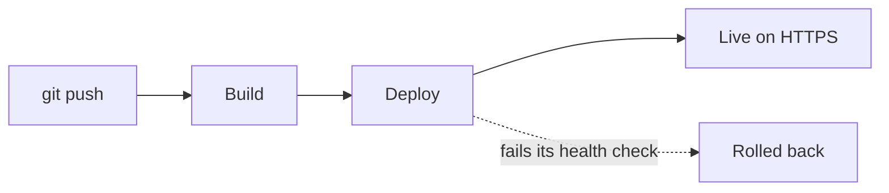
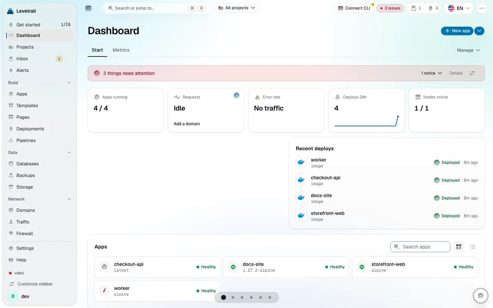
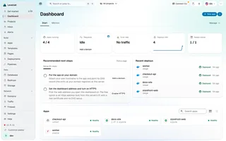
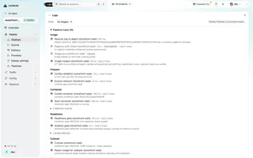
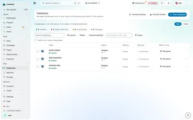
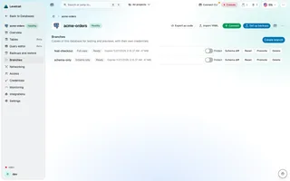
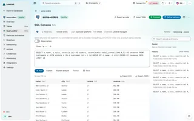
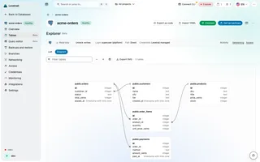

<div align="center">
<p><a href="https://levelrail.com"><picture><source media="(prefers-color-scheme: dark)" srcset="docs/assets/brand/levelrail-lockup-dark.svg"></picture></a></p>
<p><strong>Git push to production on your own servers.</strong><br>
A self-hosted deployment platform in one Go binary. The control plane idles at about 200 MB of RAM (<a href="docs/performance.md">measured</a>), with 570+ one-click apps, rollbacks, previews, HTTPS and databases built in.</p>
<p><code>brew install glincker/tap/levelrail-cli</code> &middot; <a href="#install"><b>Install</b></a> &middot; <a href="https://demo.levelrail.com"><b>Try the live demo</b></a></p>
<p>
  <a href="https://github.com/glincker/levelrail/stargazers"></a>
  <a href="LICENSE"></a>
  <a href="https://github.com/glincker/levelrail/releases"></a>
  <a href="https://github.com/glincker/levelrail/actions/workflows/ci.yml"></a>
  <a href="https://demo.levelrail.com"></a>
</p>
<p>
  <a href="https://levelrail.com?utm_source=github&amp;utm_medium=readme&amp;utm_campaign=nav">Website</a> &middot;
  <a href="https://docs.levelrail.com?utm_source=github&amp;utm_medium=readme&amp;utm_campaign=nav">Docs</a> &middot;
  <a href="#install">Install</a> &middot;
  <a href="#quickstart">Quickstart</a> &middot;
  <a href="#what-sets-levelrail-apart">Why Levelrail</a> &middot;
  <a href="docs/faq.md">FAQ</a> &middot;
  <a href="docs/roadmap.md">Roadmap</a> &middot;
  <a href="https://github.com/glincker/levelrail/discussions">Discussions</a>
</p>
<!-- i18n-nav:start -->
<sub>English &middot; <a href="docs/i18n/README.zh-Hans.md">简体中文</a> &middot; <a href="docs/i18n/README.es.md">Español</a> &middot; <a href="docs/i18n/README.pt-BR.md">Português (BR)</a> &middot; <a href="docs/i18n/README.de.md">Deutsch</a> &middot; <a href="docs/i18n/README.fr.md">Français</a> &middot; <a href="docs/i18n/README.ja.md">日本語</a> &middot; <a href="docs/i18n/README.ru.md">Русский</a></sub>
<!-- i18n-nav:end -->
<a href="https://demo.levelrail.com"></a>
</div>

Levelrail is an open source, self-hosted PaaS that fits in one Go binary. It is a lighter alternative to Coolify, Dokku, Dokploy, CapRover and Kamal, and it gives you the Heroku, Vercel, Netlify or Railway workflow on servers you own: push to git, get a build, HTTPS and a URL.

Running your own apps usually means gluing together Docker, a reverse proxy, certificates, CI, backups, a database and some monitoring, then keeping all of it patched. Levelrail is that glue, already assembled. The control plane idles at about 200 MB of RAM ([measured](docs/performance.md)), so a small VPS or a spare homelab machine is enough, and you can add more servers later with the node agent (beta). It suits solo developers, small teams, homelabs and agencies, and coding agents can drive it through an MCP server.



<p align="center"><picture><source media="(prefers-color-scheme: dark)" srcset="docs/assets/readme/carousel-dark.webp"></picture></p>

<p align="center">
<a href="docs/assets/screenshots/dashboard-home.png"><picture><source media="(prefers-color-scheme: dark)" srcset="docs/assets/readme/thumb-1-dashboard-home-dark.webp"></picture></a>
<a href="docs/assets/screenshots/deploy-live-log.png"><picture><source media="(prefers-color-scheme: dark)" srcset="docs/assets/readme/thumb-2-deploy-live-log-dark.webp"></picture></a>
<a href="docs/assets/screenshots/databases-list.png"><picture><source media="(prefers-color-scheme: dark)" srcset="docs/assets/readme/thumb-3-databases-list-dark.webp"></picture></a>
<a href="docs/assets/screenshots/database-branches.png"><picture><source media="(prefers-color-scheme: dark)" srcset="docs/assets/readme/thumb-4-database-branches-dark.webp"></picture></a>
<a href="docs/assets/screenshots/database-sql-editor.png"><picture><source media="(prefers-color-scheme: dark)" srcset="docs/assets/readme/thumb-5-database-sql-editor-dark.webp"></picture></a>
<a href="docs/assets/screenshots/database-schema-map.png"><picture><source media="(prefers-color-scheme: dark)" srcset="docs/assets/readme/thumb-6-database-schema-map-dark.webp"></picture></a>
</p>

**Get started:** [install on a Linux server in one line](#install), [try the live demo](https://demo.levelrail.com) first, or follow [First 15 minutes](docs/first-15-minutes.md). Coming from Coolify, Dokku, Dokploy, CapRover, Kamal, Heroku, Railway, Netlify, Vercel or Cloud Run? The [side by side pages](docs/comparison.md) cover each: [Coolify](docs/coolify-alternative.md), [Dokku](docs/dokku-alternative.md), [Dokploy](docs/dokploy-alternative.md), [CapRover](docs/caprover-alternative.md), [Kamal](docs/kamal-alternative.md), [Heroku](docs/heroku-alternative.md), [Railway](docs/railway-alternative.md), [Netlify](docs/netlify-alternative.md), [Vercel](docs/vercel-alternative.md), [Cloud Run](docs/cloud-run-alternative.md).

v1.x. Single-server is production ready, multi-node is beta. Levelrail works with the Kubernetes clusters and cloud accounts you already have, and every feature carries a stable, beta or experimental label in [Feature status](docs/feature-status.md).

<p align="center"><sub>Levelrail is an actively maintained product of <a href="https://glinr.com">GLINR Studios</a>, with frequent releases. See the <a href="https://github.com/glincker/levelrail/releases">releases</a> and the <a href="CHANGELOG.md">changelog</a>.</sub></p>

## Install

**On a Linux server (amd64 or arm64, systemd), run this as a user that can use `sudo`:**

```bash
curl -fsSLO https://github.com/glincker/levelrail/releases/latest/download/install.sh && sudo sh install.sh
```

The installer is saved to disk before it runs, so you can read it first. It checks the host, installs the control plane binary and a systemd unit, and prints a setup link for the admin account. If Docker or Podman is already there it uses it, and it installs Docker (through `get.docker.com`) only when neither is found. Re-running it is safe. `sudo sh install.sh check` shows what it would do without changing anything.

Other ways to install. Release assets on GitHub are the primary source: every binary, `install.sh`, `install-cli.sh` and `checksums.txt` ship with each [release](https://github.com/glincker/levelrail/releases/latest).

- **Homebrew (CLI):** `brew install glincker/tap/levelrail-cli`
- **Docker (server):** `docker pull ghcr.io/glincker/levelrail:latest` (see [Installing](docs/installing.md) for the full run command with volumes and ports)
- **Verified install:** check the installer against the signed `checksums.txt` before running it, see the next section.

<details>
<summary>Advanced: verify the installer against checksums.txt first</summary>

Download, verify and run as three separate steps, with no pipe to a shell.

```bash
curl -fsSLO https://github.com/glincker/levelrail/releases/latest/download/install.sh
curl -fsSLO https://github.com/glincker/levelrail/releases/latest/download/checksums.txt
grep ' install.sh$' checksums.txt | sha256sum -c -
sudo sh install.sh
```

On macOS use `shasum -a 256 -c -` instead of `sha256sum -c -`. `checksums.txt` is signed with cosign keyless (`checksums.txt.sigstore.json` sits next to it). See [Installing](docs/installing.md#verifying-release-binaries) for how to check the signature.

</details>

## Quickstart

You need a Linux server (amd64 or arm64) with systemd and root. Levelrail runs apps in containers: the installer uses the Docker or Podman already on the host and installs Docker only if neither is found. Open ports 80 and 443. Install first with one of the options in [Install](#install).

1. Open the setup link the installer prints and choose a password. That creates the admin account.
2. In the dashboard, copy the login line from the **Connect your CLI** card and run it (it looks like `levelrail-cli login --api-url http://127.0.0.1:8080 --code ABCD-EF23`).
3. Deploy your first app:

```bash
levelrail-cli import https://github.com/your-org/your-app --deploy
```

If something fails, run `levelrail-cli doctor` and see [Installing](docs/installing.md#troubleshooting). Next: [First 15 minutes](docs/first-15-minutes.md). CLI only: `brew install glincker/tap/levelrail-cli` or `npx levelrail-cli --help`.

Want a look first? [Try the live demo](https://demo.levelrail.com), a hosted read-only demo of the dashboard with fictional data ([how it runs](docs/run-a-read-only-demo.md)).

## Where you can use it

| Surface | Start | Docs |
| --- | --- | --- |
| Web dashboard | Open the setup link the installer prints | [First 15 minutes](docs/first-15-minutes.md) |
| CLI |  `brew install glincker/tap/levelrail-cli`, `npx levelrail-cli --help` or `npm install --global levelrail-cli` | [Installing](docs/installing.md) |
| HTTP API | Bearer token, `/api/v1` | [API reference](docs/api-reference.md) |
| Terraform and OpenTofu |   `source = "glincker/levelrail"` | [Terraform provider](docs/terraform-provider.md) |
| MCP and coding agents |  259 tools | [MCP](docs/mcp.md) |
| Mobile API (beta, off by default) | Enable in Settings, Beta features | [Mobile API](docs/mobile-api.md) |
| Desktop runtime on Mac (experimental) | Private Linux VM on your Mac | [Desktop runtime](docs/desktop-runtime.md) |

## What you get

Maturity follows [Feature status](docs/feature-status.md).

| Area | In one line | Works with |
| --- | --- | --- |
| [Deploy](docs/deploying-apps.md) | Git push from GitHub, GitLab, Bitbucket, Gitea or Forgejo, readiness-gated rollouts, one-step rollback, previews and canaries |      |
| [Templates](docs/template-catalog.md) | 570+ templates in the catalog, 346 with a recorded real-engine pass |    |
| [Edge and HTTPS](docs/domains-and-ingress.md) | Automatic certificates including wildcards, firewall, bot lists, per-domain headers and redirects |   |
| [Nodes and clouds](docs/node-provisioning.md) | Join any Linux host with a token, provision nodes at 6 clouds (beta), existing Kubernetes clusters as targets (experimental) |    |
| [Databases and backups](docs/managing-databases.md) | 13 engines, backups to S3-compatible, R2 or local disk, [restore drills](docs/prove-your-backups-work.md) |        |
| [Observability](docs/observability.md) | Built-in metrics, log search, alerts to 18 channel kinds, OTLP ingest, status page. Grafana reads logs through a [Loki-compatible API](docs/loki-api.md) |     |
| [Security and access](docs/identity-and-access.md) | OAuth and OIDC sign-in, passkeys, TOTP, IAM policies, hash-chained audit log |   |
| [Automation](docs/cli-reference.md) | CLI, HTTP API, [Terraform and OpenTofu provider](docs/terraform-provider.md), 259 [MCP tools](docs/mcp.md) for coding agents |    |

<details>
<summary>All deploy features</summary>

- Git push or webhook deploys from GitHub, GitLab, Bitbucket, Gitea and Forgejo. See [Git integrations](docs/git-integrations.md) and [Git push deploy](docs/git-push-deploy.md).
- Dockerfile, Compose and Railpack builds (Railpack is beta) with a build queue. See [Build Center](docs/build-center.md).
- Readiness-gated rollouts and one-step rollback. See [Zero-downtime deploys](docs/zero-downtime-deploys.md) and [Rollback](docs/rollback.md).
- Canaries and split tests. See [Canary deploys](docs/canary-deploys.md) and [Split testing](docs/split-testing.md).
- Preview environments per pull request: stable on GitHub, beta on GitLab and Bitbucket. See [Deploy previews](docs/deploy-previews.md).
- Deploy approvals and deploy freezes. See [Deploy safety](docs/deploy-safety.md).
- Functions in Node, Python or Go (beta). See [Functions](docs/functions.md).
</details>
<details>
<summary>All template details</summary>

- 574 catalog entries (565 active, 9 deprecated) in 22 categories.
- 346 entries have a recorded real-engine pass.
- 228 entries are marked preview: installable, with no recorded pass yet.
</details>
<details>
<summary>All edge features</summary>

- Embedded ingress with automatic TLS through HTTP-01 and DNS-01 wildcards.
- Per-domain headers, forwarders, geo rules, caching and redirects. See [Domain traffic controls](docs/domain-traffic-controls.md).
- Firewall rules, IP lists, browser challenge, bot lists and attack mode. See [Firewall](docs/firewall.md).
- Per-app rate limits and deny lists (beta). See [Abuse defense](docs/abuse-defense.md).
- Round-robin balancing across replicas. See [Load balancing](docs/load-balancing.md).
- Private networks and a WireGuard mesh (beta). See [Multi-node](docs/multi-node.md).
</details>
<details>
<summary>All node and cloud features</summary>

- Provision nodes at Hetzner, DigitalOcean, AWS, Azure, GCP or Oracle Cloud (beta).
- Join any Linux host with a single-use token over mTLS. See [Add a node anywhere](docs/add-node-anywhere.md).
- DNS at Cloudflare and Route53, image registries on ECR, Artifact Registry and ACR. See [Cloud integrations](docs/cloud-integrations.md) for per-cloud status.
- Works with the clusters and cloud accounts you already have (experimental): connect existing Kubernetes clusters and deploy to them, off by default. See [Kubernetes clusters](docs/kubernetes-clusters.md).
</details>
<details>
<summary>All data and backup features</summary>

- 13 database engines in code. 9 are live-verified. 4 (Meilisearch, Qdrant, Typesense, Memcached) are built but not yet live-verified.
- Backups to S3-compatible, R2 or local targets. See [Backups and storage](docs/backups-and-storage.md).
- Restore drills that prove a backup works. See [Prove your backups work](docs/prove-your-backups-work.md).
- Point-in-time recovery for Postgres.
</details>
<details>
<summary>All observability features</summary>

- Built-in metrics, log search and log archive. See [Log explorer](docs/log-explorer.md) and [Log archive](docs/log-archive.md).
- OTLP ingest. See [OTLP ingest](docs/otlp-ingest.md).
- Public status page. See [Status page](docs/status-page.md).
- Deploy traces and traffic export. See [Deploy trace](docs/deploy-trace.md) and [Traffic export](docs/traffic-export.md).
- Alerts to 18 notification channel kinds. See [Alerts](docs/alerts.md).
- HTTP, TCP, heartbeat and TLS uptime monitors (experimental). See [Monitors](docs/monitors.md).
</details>
<details>
<summary>All security and access features</summary>

- Passwords, passkeys and TOTP.
- OAuth sign-in with 20 providers plus generic OIDC. See [OIDC](docs/sso-oidc.md).
- SAML and SCIM (beta, off by default). See [SAML and SCIM](docs/sso-saml.md).
- IAM policies and teams. See [Teams and roles](docs/teams-and-roles.md).
- Hash-chained audit log. See [Audit log](docs/audit-log.md).
- Encrypted secrets. See [Environment and secrets](docs/environment-and-secrets.md).
- Signed releases. See [Verify a release](docs/verify-a-release.md).
</details>
<details>
<summary>All automation features</summary>

- `levelrail-cli` and an HTTP API. See [API reference](docs/api-reference.md).
- Terraform and OpenTofu provider. See [Terraform provider](docs/terraform-provider.md), the [Terraform registry](https://registry.terraform.io/providers/glincker/levelrail/latest) and the [OpenTofu registry](https://search.opentofu.org/provider/glincker/levelrail/latest).
- YAML platform as code (experimental). See [Platform as code](docs/platform-as-code.md).
- CI pipelines. See [Pipelines](docs/pipelines.md).
- 11 per-app integrations: Sentry, PostHog, GlitchTip, OneUptime, Plausible, Datadog, Axiom, Better Stack, LogSnag, Bugsnag and New Relic. See [Alerts](docs/alerts.md).
- Signed plugins for notification channels. See [Plugins](docs/plugins.md).
- 259 MCP tools for coding agents. See [MCP](docs/mcp.md) and [Tool surface](docs/mcp-tool-surface.md).
- A mail server template with mailboxes and DNS records (experimental). See [Mail template](docs/mail-template.md).
</details>

All features, with maturity labels: [docs/features.md](docs/features.md).

## Built for coding agents

259 [MCP tools](docs/mcp.md), scoped to the token's abilities, confirm-gated for writes and audited. Add the skill with `npx skills add https://github.com/glincker/levelrail --skill levelrail`, then ask your agent to deploy your repo. To install with an agent, paste this into Claude Code, Cursor or any agent that can run shell commands on your server:

```text
Install Levelrail on this server: run `sudo sh install.sh` (download and verify it first, see [GitHub release](https://github.com/glincker/levelrail/releases/latest)).
Open the setup link it prints and tell me, because I choose the password myself.
Then run `levelrail-cli doctor` and `levelrail-cli status` and report anything that fails.
Do not write any token or password to a file or into this chat.
```

## Production ready, with receipts

| Claim | Evidence |
| --- | --- |
| Every feature labelled stable or beta | [Feature status](docs/feature-status.md) |
| Survives failures | [Resilience](docs/resilience.md) |
| Measured, not promised | [Benchmarks](docs/benchmarks.md) |
| Tested against real containers | [CI](.github/workflows/ci.yml) and [`test/e2e`](test/e2e) |
| Signed releases | [Verify them](docs/installing.md#verifying-release-binaries) |
| Honest about gaps | [Known limits](docs/known-limits.md) |

## What sets Levelrail apart

Each claim links to the page that backs it. The status column follows [Feature status](docs/feature-status.md).

| What you get | Status | Evidence |
| --- | --- | --- |
| A control plane that idles at about 200 MB of RAM, in one Go binary | measured | [Performance](docs/performance.md), [Benchmarks](docs/benchmarks.md) |
| `git push` to your own server over HTTPS, no provider, webhook or SSH key (GitHub webhook deploys are stable) | beta | [Deploy with git push](docs/git-push-deploy.md) |
| Pinned-image rollback, readiness-gated rollouts and automatic rollback on a post-deploy watch | stable (latency signal beta) | [Deploy safety](docs/deploy-safety.md) |
| Backups that are verified, with restore drills into a scratch resource | Postgres stable, other engines beta | [Prove your backups work](docs/prove-your-backups-work.md), [Backups and storage](docs/backups-and-storage.md) |
| A hash-chained audit log you can verify, filter and export | on by default | [Audit log](docs/audit-log.md) |
| A node agent that dials out to the control plane over mTLS, so managed nodes need no inbound ports | multi-node beta | [Architecture](docs/architecture.md), [Multi-node](docs/multi-node.md) |
| An MCP server with ability-scoped tools and confirm-gated writes, never in the reconcile path | beta | [MCP](docs/mcp.md), [Tool surface](docs/mcp-tool-surface.md) |

Moving from another platform: [Migrate to Levelrail](docs/migrate-to-levelrail.md). Architecture notes: [Comparison](docs/comparison.md).

## Questions people ask

### What is Levelrail?

An open source (Apache 2.0) self-hosted PaaS in one Go binary. You push to git and it builds, deploys, serves HTTPS, rolls back and runs your databases on servers you own.

### Is it an alternative to Coolify, Dokku or Dokploy?

They solve the same problem: deploying apps to your own servers. Levelrail is one Go binary whose control plane idles around 200 MB, and it comes with databases (backups and branches), preview environments, a multi-node agent (beta) and an MCP server. Side by side: [Coolify](docs/coolify-alternative.md), [Dokku](docs/dokku-alternative.md), [Dokploy](docs/dokploy-alternative.md).

### Can it replace Heroku, Vercel, Netlify or Railway?

For git push deploys, previews, HTTPS, rollbacks and databases on your own servers, yes. See the [Heroku](docs/heroku-alternative.md), [Vercel](docs/vercel-alternative.md), [Netlify](docs/netlify-alternative.md) and [Railway](docs/railway-alternative.md) pages, and [Migrate to Levelrail](docs/migrate-to-levelrail.md).

### What does it run on?

Linux (amd64 or arm64, systemd), using Docker or Podman for containers. A small VPS or a homelab box is enough for a single server.

### Does it work with Kubernetes and the cloud?

It can use existing Kubernetes clusters as deploy targets (experimental) and create nodes on cloud accounts you already have. [Feature status](docs/feature-status.md) shows where each feature stands.

## Community

[Discussions](https://github.com/glincker/levelrail/discussions) &middot; [Issues](https://github.com/glincker/levelrail/issues) &middot; [Discord](https://discord.gg/Ar5pcaZB99) &middot; [support@levelrail.com](mailto:support@levelrail.com) &middot; [Security policy](.github/SECURITY.md)

If Levelrail saves you a weekend, a [star](https://github.com/glincker/levelrail) helps other self-hosters find it.

## Star history

<a href="https://star-history.com/#glincker/levelrail&Date"><picture><source media="(prefers-color-scheme: dark)" srcset="https://api.star-history.com/svg?repos=glincker/levelrail&type=Date&theme=dark"></picture></a>

## Contributors

<a href="https://github.com/glincker/levelrail/graphs/contributors"></a>

## License

Apache 2.0, see [LICENSE](LICENSE). Levelrail is built and maintained by [GLINR Studios](https://glinr.com) (Gagan Singh, aka GDS K S), who also make [theSVG](https://thesvg.org).

