<div align="center">

<h1>Levelrail</h1>
<p><strong>Your own Vercel, on your own servers.</strong><br>
Push to deploy with HTTPS, logs, metrics and one-step rollback. One Go binary, no Kubernetes. Apache 2.0.</p>
<p>
  <a href="https://github.com/glincker/levelrail/stargazers"></a>
  <a href="LICENSE"></a>
  <a href="https://github.com/glincker/levelrail/releases"></a>
  <a href="https://github.com/glincker/levelrail/actions/workflows/ci.yml"></a>
  <a href="https://github.com/glincker/levelrail/commits/main"></a>
  <a href="https://www.npmjs.com/package/levelrail-cli"></a>
  <a href="docs/mcp.md"></a>
  <a href="https://discord.gg/Ar5pcaZB99"></a>
</p>
<p>
  <a href="https://levelrail.com?utm_source=github&amp;utm_medium=readme&amp;utm_campaign=nav">Website</a> &middot;
  <a href="https://docs.levelrail.com?utm_source=github&amp;utm_medium=readme&amp;utm_campaign=nav">Docs</a> &middot;
  <a href="#install">Install</a> &middot;
  <a href="#vs-coolify-dokploy-caprover-and-dokku">Compare</a> &middot;
  <a href="#faq">FAQ</a> &middot;
  <a href="docs/roadmap.md">Roadmap</a> &middot;
  <a href="https://github.com/glincker/levelrail/discussions">Discussions</a>
</p>
<!-- i18n-nav:start -->
<p>English &middot; <a href="docs/i18n/README.zh-Hans.md">简体中文</a> &middot; <a href="docs/i18n/README.es.md">Español</a> &middot; <a href="docs/i18n/README.pt-BR.md">Português (BR)</a> &middot; <a href="docs/i18n/README.de.md">Deutsch</a> &middot; <a href="docs/i18n/README.fr.md">Français</a> &middot; <a href="docs/i18n/README.ja.md">日本語</a></p>
<!-- i18n-nav:end -->
<picture><source media="(prefers-color-scheme: dark)" srcset="docs/assets/brand/social/github-social-1280x640.jpg">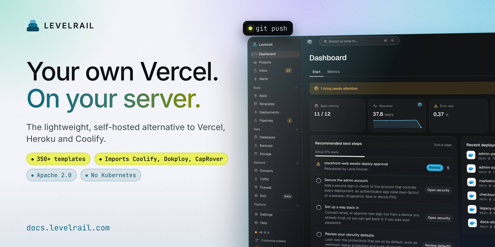</picture>
</div>

Turn any Linux server into a private cloud: Git deploys, HTTPS, databases with verified backups, metrics, logs and alerts, without Kubernetes and without a monitoring stack to bolt on. Pre-1.0: single-server is production ready, multi-node is beta ([Feature status](docs/feature-status.md)).

<p align="center">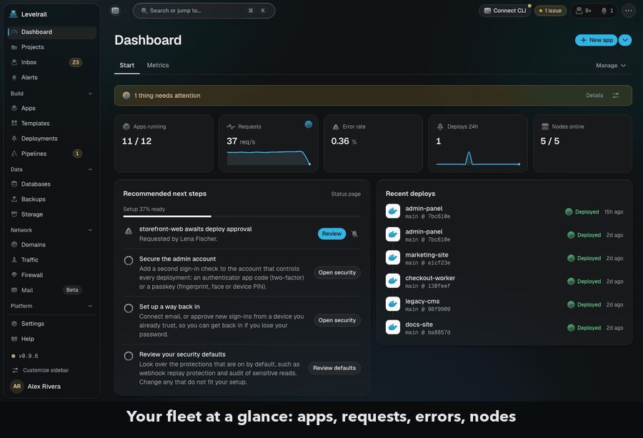</p>

<table>
  <tr>
    <td align="center"><h3>200 MB</h3><sub>idle RAM, 1.5% of one CPU<br><a href="docs/benchmarks.md">measured, method included</a></sub></td>
    <td align="center"><h3>1 binary</h3><sub>Go control plane, Docker runtime<br>no Kubernetes</sub></td>
    <td align="center"><h3>360</h3><sub>one-click service templates<br><a href="docs/templates-status.md">smoke-tested</a></sub></td>
    <td align="center"><h3>240+</h3><sub>MCP tools for coding agents<br><a href="docs/mcp.md">scoped, read-only by default</a></sub></td>
  </tr>
</table>

## Install

```bash
curl -fsSL https://levelrail.com/install.sh | sudo sh
```

Needs Linux (amd64 or arm64) with systemd and root; the installer adds Docker. Open ports 80 and 443, open the setup link it prints, choose a password, then deploy from the CLI (the dashboard's **Connect your CLI** card gives you the login line; pass `--api-url` always, and `--profile NAME` if you manage more than one server):

```bash
levelrail-cli login --api-url http://127.0.0.1:8080 --code ABCD-EF23
levelrail-cli import https://github.com/your-org/your-app --deploy
```


<table>
  <tr>
    <td width="50%" valign="top" align="center">
      <br>
      <sub><b>Install, then deploy</b></sub>
    </td>
    <td width="50%" valign="top" align="center">
      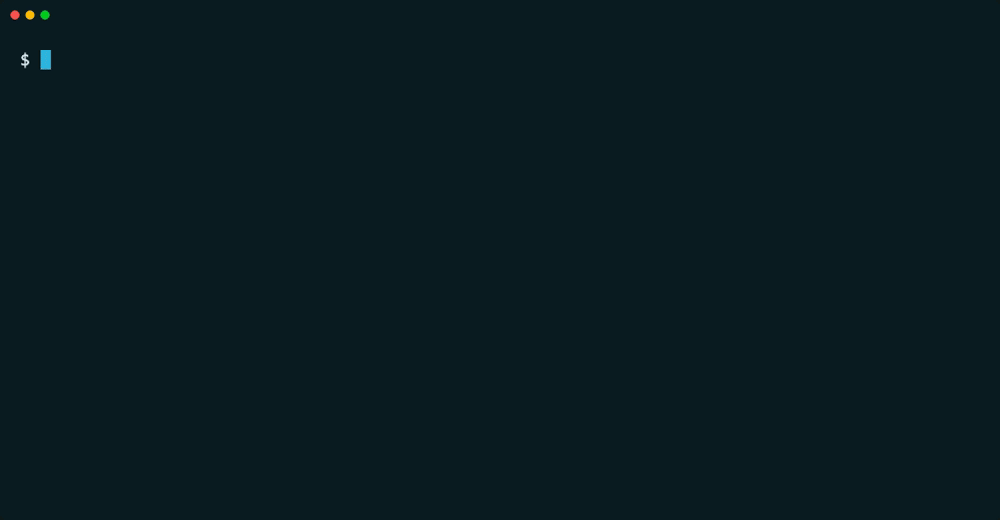<br>
      <sub><b>Gated deploy, one-step rollback</b></sub>
    </td>
  </tr>
</table>


[First 15 minutes](docs/first-15-minutes.md) &middot; [Installing](docs/installing.md) (Docker, pinned version, source build, troubleshooting) &middot; [CLI only](docs/installing.md#installing-just-the-cli) (`brew install glincker/tap/levelrail-cli` or `npx levelrail-cli`) &middot; [Free Arm VM](docs/install-on-oracle-cloud.md) &middot; [Migrate from Coolify, Dokploy, CapRover or Dokku](docs/migrate-to-levelrail.md) &middot; [Verify signed releases](docs/installing.md#verifying-release-binaries)

Using a coding agent? `npx skills add https://github.com/glincker/levelrail --skill levelrail`, then ask it to deploy your repo. See [Agents](docs/mcp.md).

### Install with your coding agent

Paste this into Claude Code, Cursor or any agent that can run shell commands on your server:

```text
Install Levelrail on this server: run `curl -fsSL https://levelrail.com/install.sh | sudo sh`.
Open the setup link it prints and tell me, because I choose the password myself.
Then run `levelrail-cli doctor` and `levelrail-cli status` and report anything that fails.
Do not write any token or password to a file or into this chat.
```

## Why Levelrail

**Deploys that do not surprise you. Servers that explain themselves. Agents that stay in their lane.**

<table>
  <tr>
    <td width="33%" valign="top"><b>Safe deploys</b><br><i>Ship on a Friday.</i><br>Readiness-gated rollouts, canaries, approvals, one-step rollback.</td>
    <td width="33%" valign="top"><b>Observability built in</b><br><i>See everything. Install nothing.</i><br>Metrics, logs, traces and alerts. No Grafana stack.</td>
    <td width="33%" valign="top"><b>Agents, not SSH</b><br><i>No inbound ports to defend.</i><br>Nodes dial out over mTLS. No shelling out to <code>docker</code>.</td>
  </tr>
  <tr>
    <td width="33%" valign="top"><b>Verified backups</b><br><i>A backup you never restored is a hope.</i><br>Every backup is re-downloaded and checksummed, with restore drills.</td>
    <td width="33%" valign="top"><b>Secure by default</b><br><i>Secure before you configure.</i><br>Hash-chained audit log, encrypted secrets, passkeys, signed releases.</td>
    <td width="33%" valign="top"><b>Made for AI agents</b><br><i>Let agents deploy. Keep the keys.</i><br>MCP server plus a skill. AI is never in the reconcile path.</td>
  </tr>
</table>

<table>
  <tr>
    <td width="33%" valign="top"><a href="docs/product-tour.mdx"><picture><source media="(prefers-color-scheme: dark)" srcset="docs/assets/screenshots/dashboard-home.png">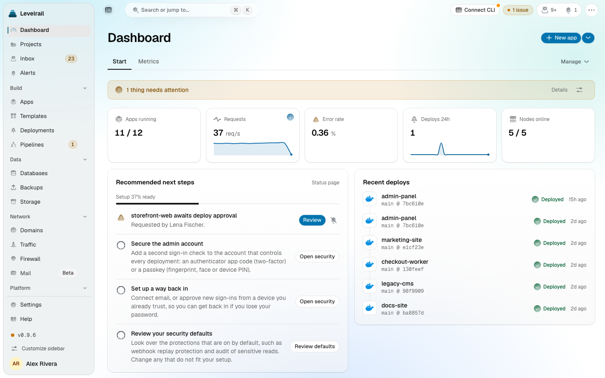</picture></a><br><sub><b>The control plane at a glance</b></sub></td>
    <td width="33%" valign="top"><a href="docs/deploying-apps.md"><picture><source media="(prefers-color-scheme: dark)" srcset="docs/assets/screenshots/apps-list.png">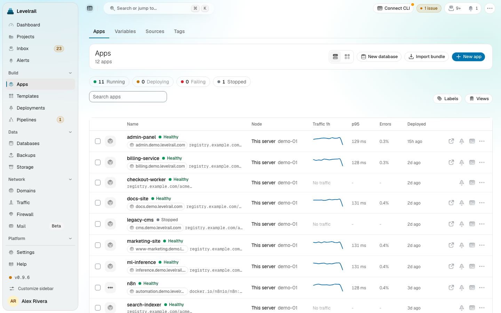</picture></a><br><sub><b>Every app, its health and its last deploy</b></sub></td>
    <td width="33%" valign="top"><a href="docs/deploying-apps.md"><picture><source media="(prefers-color-scheme: dark)" srcset="docs/assets/screenshots/deploy-history.png">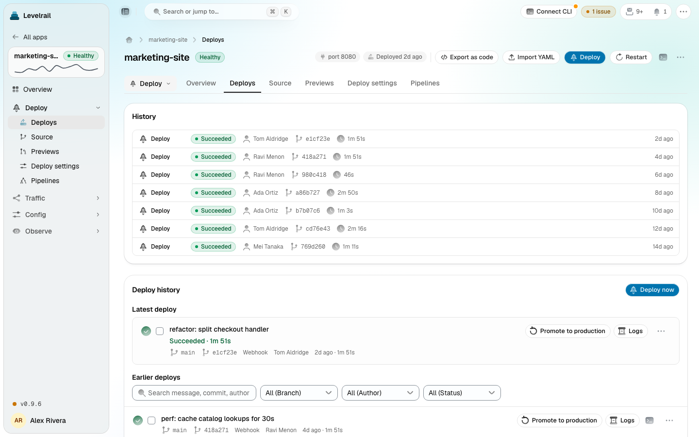</picture></a><br><sub><b>Deploy history, promote and rollback</b></sub></td>
  </tr>
  <tr>
    <td width="33%" valign="top"><a href="docs/product-tour.mdx"><picture><source media="(prefers-color-scheme: dark)" srcset="docs/assets/screenshots/app-overview.png">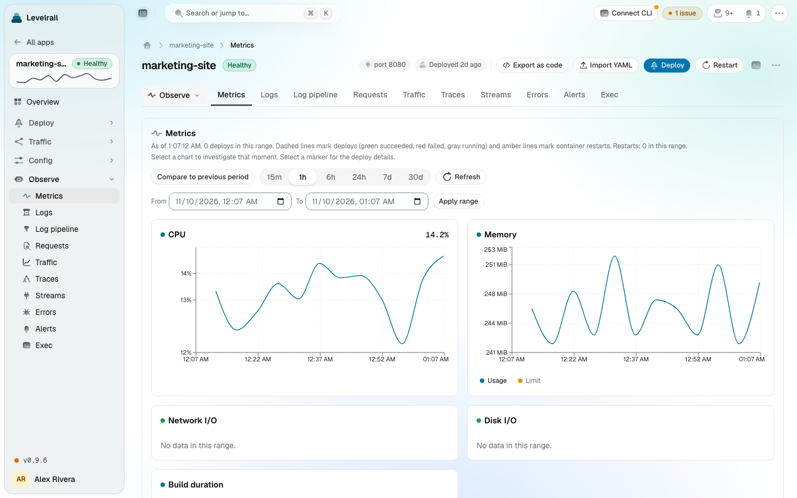</picture></a><br><sub><b>Metrics and logs, no Grafana stack</b></sub></td>
    <td width="33%" valign="top"><a href="docs/multi-node.md"><picture><source media="(prefers-color-scheme: dark)" srcset="docs/assets/screenshots/nodes.png">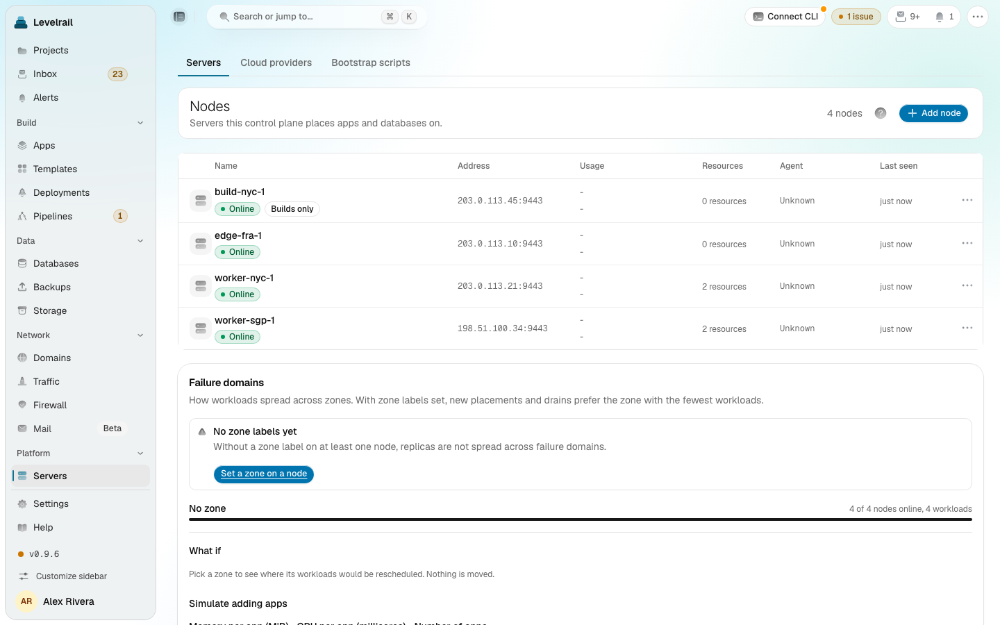</picture></a><br><sub><b>Nodes and their capacity</b></sub></td>
    <td width="33%" valign="top"><a href="docs/deploying-apps.md"><picture><source media="(prefers-color-scheme: dark)" srcset="docs/assets/screenshots/new-app-wizard.png">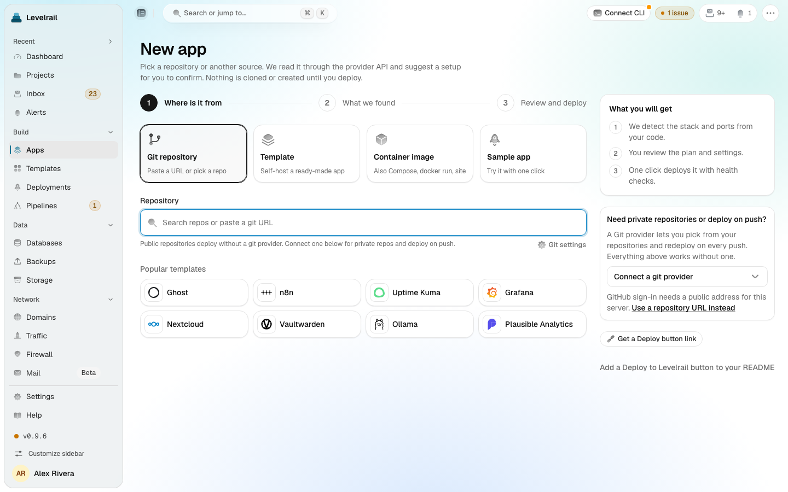</picture></a><br><sub><b>New app from a repo, template or image</b></sub></td>
  </tr>
</table>

All screenshots are captured from a real running control plane. More in the [Product tour](https://docs.levelrail.com/product-tour?utm_source=github&utm_medium=readme&utm_campaign=tour).

## Who it is for

**Whoever you are, you start with one line.**

| You are | You get | Start |
| --- | --- | --- |
| A solo developer with one VPS | Git deploys, HTTPS in one click and about 200 MB idle, no Kubernetes | `curl -fsSL https://levelrail.com/install.sh \| sudo sh` |
| Building with Claude Code, Cursor or another coding agent | An MCP server that deploys, waits, diagnoses and rolls back inside the token's limits | `npx skills add https://github.com/glincker/levelrail --skill levelrail` |
| An agency or team | Approvals, deploy freezes, IAM policies, a verifiable audit log, OIDC sign-in | [Identity and access](docs/identity-and-access.md) |
| On Coolify, Dokploy, CapRover or Dokku today | A dry run first, and the old server keeps serving | `levelrail-cli import platform coolify --url https://coolify.example.com --dry-run` |
| Running a homelab or a free Arm VM | arm64 builds and a minimal profile | [Server profiles](docs/profiles.md), [Arm VM](docs/install-on-oracle-cloud.md) |

## Built for coding agents

**Let your agent ship. You keep the keys.**

```text
Deploy this repo to my Levelrail and tell me when it is live.
```

- **Inside the token's limits.** The tool list follows the abilities of the token: a read token never sees a deploy tool, and `--readonly` refuses to start with a write token.
- **Writes need a confirmation.** Mutations are confirm-gated and off until you pass `--allow-write`.
- **Cheap to load.** About 2.4k tokens of tools by default, 240+ on demand in toolsets ([tool surface](docs/mcp-tool-surface.md)).
- **Audited.** Every call is recorded with the caller surface (CLI, dashboard, MCP or API).
- **Not in the control loop.** AI never sits in the reconcile path, so a wrong guess cannot wedge your servers.
- **A skill, not just tools.** It deploys, waits for the rollout to converge, reads the failure and rolls back ([skill](skills/levelrail/SKILL.md), [MCP](docs/mcp.md), [threat model](docs/mcp.md#threat-model)).

## vs Coolify, Dokploy, CapRover and Dokku

**Same job, fewer moving parts, more proof.**

| | Levelrail | Coolify | Dokploy | CapRover | Dokku |
| --- | --- | --- | --- | --- | --- |
| **Agent access (MCP)** | Read and write, ability-scoped, confirm-gated, audited | Official server, read-only | MCP server repo exists | Not documented | Not documented |
| **Switching in** | Dry-run importers for all four, old server keeps serving | n/a | n/a | n/a | n/a |
| Node control | Reverse-dialed agent | SSH + CLI | SSH + Engine API | Swarm API | Local bash |
| Built-in metrics and logs | Yes | Opt-in add-on | Separate binary | No | No |
| Rollback | Pinned images, readiness-gated | Retained images | Swarm rollback | Manual | Default scheduler: none |
| Backup verification | Automatic | Non-empty check | None | None | No backups |
| Audit log | Hash-chained, verifiable | Not documented | Not documented | Not documented | Not documented |

Cells state only what each project's public docs say (last checked 2026-11-07), and "Not documented" means we found nothing, not that it is missing. Coolify's MCP: [their docs](https://coolify.io/docs/integrations/mcp). This is positioning, not a ranking. Levelrail is the youngest project here, with fewer users and less production mileage. Sourced details: [Comparison](docs/comparison.md).

## Production ready, with receipts

| Claim | Evidence |
| --- | --- |
| Every feature labelled stable or beta | [Feature status](docs/feature-status.md) |
| Survives failures | [Resilience](docs/resilience.md): disk full, link loss, database damage, safe-mode boot |
| Measured, not promised | [Benchmarks](docs/benchmarks.md) |
| Tested against real containers | [CI](.github/workflows/ci.yml) and [`test/e2e`](test/e2e) |
| Signed releases | Sigstore signature and provenance attestation, [verify them](docs/installing.md#verifying-release-binaries) |
| Honest about gaps | [Known limits](docs/known-limits.md) |

## How it works

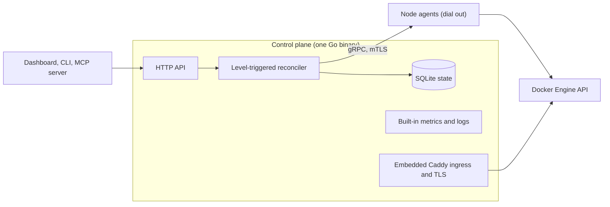

Details: [Architecture](docs/architecture.md).

## Guides

[Next.js with Postgres](https://github.com/glincker/levelrail/discussions/1239) &middot; [Django with Postgres](https://github.com/glincker/levelrail/discussions/1243) &middot; [Push to deploy with GitHub](https://github.com/glincker/levelrail/discussions/1244) &middot; [How deploys stay safe](https://github.com/glincker/levelrail/discussions/1246) &middot; [Scale to zero on a small VPS](https://github.com/glincker/levelrail/discussions/1242)

Maintain an open-source app? Add a one-click button: [Deploy button](docs/deploy-button.md).

[](docs/deploy-button.md)

## FAQ

**Does it need Kubernetes?** No. One Go binary with a Docker runtime.

**What does it cost?** Nothing. Apache 2.0, one edition, no license key. You pay for your own servers ([Pricing](docs/pricing.md)).

**Can I migrate from Coolify?** Yes. `levelrail-cli import platform coolify --url https://coolify.example.com --dry-run` (with the source token in `APP_IMPORT_SOURCE_TOKEN`) shows what would be created first, and the old server keeps serving ([Migrate](docs/migrate-to-levelrail.md)).

**How do I upgrade?** Settings > Updates or `levelrail-cli upgrade --plan`. It verifies the release, snapshots your data and rolls back by itself if the new release is unhealthy ([Upgrade safely](docs/upgrade-safely.md)).

## Community

[Discussions](https://github.com/glincker/levelrail/discussions) &middot; [Issues](https://github.com/glincker/levelrail/issues) &middot; [Discord](https://discord.gg/Ar5pcaZB99) &middot; [support@levelrail.com](mailto:support@levelrail.com) &middot; [Security policy](.github/SECURITY.md) &middot; [Contributing](.github/CONTRIBUTING.md) &middot; [llms.txt](llms.txt) and [AGENTS.md](AGENTS.md) for AI agents

## Star the repo

If Levelrail saves you a weekend, a [star](https://github.com/glincker/levelrail) helps other self-hosters find it.

<a href="https://github.com/glincker/levelrail/graphs/contributors"></a>

[](https://star-history.com/#glincker/levelrail&Date)

Apache 2.0, see [LICENSE](LICENSE). Built by Gagan Deep Singh of [GLINR STUDIOS](https://glinr.com) and [theSVG](https://thesvg.org).

<div align="center">

<a href="https://glinr.com">
  <picture>
    <source media="(prefers-color-scheme: dark)" srcset="docs/assets/brand/glincker-light.svg">
    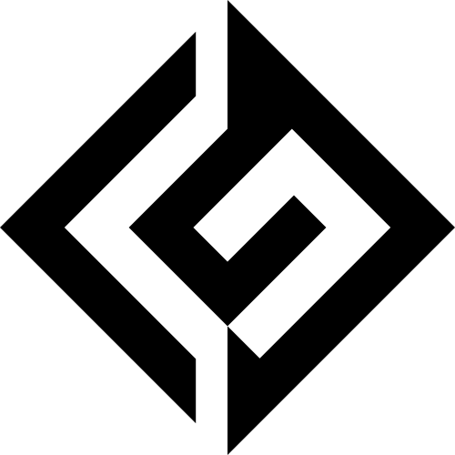
  </picture>
</a>

<sub>Powered by <a href="https://glinr.com"><b>GLINR STUDIOS</b></a> &middot; icon from <a href="https://thesvg.org/icon/glincker">theSVG</a></sub>

</div>
