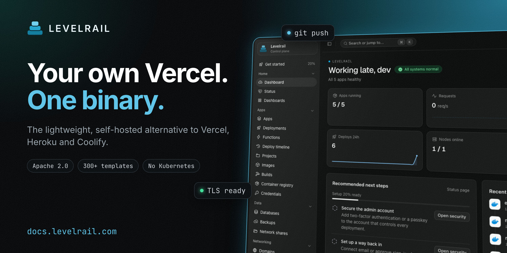

<div align="center">

<h1>Levelrail</h1>
<p><strong>The lightweight, self-hosted alternative to Vercel, Heroku and Coolify.</strong><br>
Push to git. Get HTTPS, logs, metrics and one-click rollback on your own servers.</p>
<p>One Go binary &middot; Docker runtime &middot; agents instead of SSH &middot; observability built in &middot; no Kubernetes</p>
<p>
  <a href="https://github.com/glincker/levelrail/releases"></a>
  <a href="LICENSE"></a>
  <a href="https://github.com/glincker/levelrail/stargazers"></a>
  <a href="https://github.com/glincker/levelrail/actions/workflows/ci.yml"></a>
  <a href="https://discord.gg/Ar5pcaZB99"></a>
</p>
<p>
  <a href="docs/feature-status.md"></a>
  <a href="https://github.com/glincker/levelrail/pkgs/container/levelrail"></a>
  <a href="go.mod"></a>
  <a href="docs/mcp.md"></a>
  <a href="https://docs.levelrail.com"></a>
  <a href="https://github.com/glincker/levelrail/commits/main"></a>
  <a href="CONTRIBUTING.md"></a>
</p>
<p>
  <a href="https://levelrail.com">Website</a> &middot;
  <a href="https://docs.levelrail.com">Docs</a> &middot;
  <a href="#install-in-one-command">Install</a> &middot;
  <a href="#production-ready-with-receipts">Production ready</a> &middot;
  <a href="#levelrail-vs-coolify-dokploy-caprover-and-dokku">Compare</a> &middot;
  <a href="#guides">Guides</a> &middot;
  <a href="docs/roadmap.md">Roadmap</a> &middot;
  <a href="CHANGELOG.md">Changelog</a> &middot;
  <a href="https://github.com/glincker/levelrail/discussions">Discussions</a> &middot;
  <a href="https://discord.gg/Ar5pcaZB99">Discord</a>
</p>

</div>

Levelrail is an open source (Apache 2.0) **self-hosted PaaS**: a Vercel and Heroku alternative that runs on any Linux server you own, from a $5 VPS to a rack. It turns plain servers into a private cloud with Git deploys, automatic HTTPS, databases with verified backups, metrics, logs and alerts, without Kubernetes and without the monitoring stack you would otherwise bolt on.

## Install in one command

Needs a Linux server (`amd64` or `arm64`) with systemd and root. Docker is installed for you if it is missing.

```bash
curl -fsSL https://levelrail.com/install.sh | sudo sh
```

Open the URL it prints, pick a password, and deploy your first app from the setup wizard or the CLI:

```bash
levelrail-cli import https://github.com/your-org/your-app --deploy
```

Prefer containers, a pinned version or a source build? See [Installing](docs/installing.md). Coming from another platform? `levelrail-cli migrate coolify|dokploy|caprover` plans the move and shows a dry-run diff first.

<table>
  <tr>
    <td width="50%" valign="top" align="center">
      <br>
      <sub><b>Install, then deploy</b></sub>
    </td>
    <td width="50%" valign="top" align="center">
      <br>
      <sub><b>Gated deploy, one-step rollback</b></sub>
    </td>
  </tr>
</table>

## Why people pick Levelrail

- **Lightweight.** About 200 MB of RAM and roughly 2% of one CPU idle, measured on a real 2 vCPU server running three apps with the default feature set. [Numbers and method](docs/benchmarks.md).
- **Agents, not SSH.** Each node runs a small agent that dials out over mTLS and talks to Docker's Engine API directly. No inbound ports, no shelling out to the `docker` CLI, no polling loops.
- **Observability included.** Per-node metrics at 15 second resolution, searchable logs, deploy markers, traces, SLO burn, alert inbox and an idle-footprint health page. No Grafana stack to install.
- **Deploys that protect you.** Readiness-gated rollouts, pinned images so rollback always works, canary releases that roll back on errors, deploy diffs, approvals and freezes.
- **Secure by default.** Hash-chained audit log you can verify, SSRF-guarded outbound calls, envelope-encrypted secrets with key rotation, scoped tokens, passkeys and 2FA, signed releases.
- **Built for AI agents.** An MCP server with a small default tool list (about 2.4k tokens, more load on demand), a scoped-token permission model and an agent skill.

## Production ready, with receipts

Single-server deployments are production ready today. Multi-node and a handful of newer features are labelled beta, and every label links to its evidence.

| Claim | Evidence |
| --- | --- |
| Every feature is labelled stable or beta | [Feature status](docs/feature-status.md): the tests, live e2e runs and docs behind each label |
| Survives failures | [Resilience](docs/resilience.md): disk full, agent link loss, database damage with guided restore, safe-mode boot, reconcile storm protection |
| Safe upgrades and rollback | Tested upgrade matrix, downgrade refusal, one-click [rollback](docs/rollback.md) and clean shutdown |
| Measured, not promised | [Benchmarks](docs/benchmarks.md): idle footprint, ingress throughput, limits, with the method next to every number |
| Verified backups | Every backup is re-downloaded and checksummed, with scheduled restore drills |
| Tamper-evident security | Verifiable audit chain, [security policy](SECURITY.md), signed releases and SBOM scanning |

## Levelrail vs Coolify, Dokploy, CapRover and Dokku

Most self-hosted platforms in this category manage servers by SSHing in and shelling out to the `docker` CLI, then parsing text, which tends to force polling loops. Levelrail uses a reverse-dialed agent and a level-triggered reconciler instead.

| | Levelrail | Coolify | Dokploy | CapRover | Dokku |
| --- | --- | --- | --- | --- | --- |
| Node control | Reverse-dialed agent | SSH + CLI | SSH + Engine API | Swarm API | Local bash |
| Orchestration | Level-triggered reconciler | Compose | Swarm | Swarm | Bash scheduler |
| Built-in metrics and logs | Yes | Opt-in add-on | Separate binary | No | No |
| Rollback | Pinned images, readiness-gated | Health check off by default | Swarm rollback | Manual | Default scheduler: none |
| Backup verification | Automatic, all 8 engines | Non-empty check | None | None | No backups |

This is positioning, not a ranking, and every project here is worth using. Where Levelrail trails: Coolify's template catalog is larger, and Levelrail bets on a smaller curated one ([ADR 015](adr/015-service-template-catalog-reversal.md)). The full, sourced comparison is in [Comparison](docs/comparison.md).

## What you get

- **Deploys:** Git push (GitHub, GitLab, Bitbucket, Gitea), preview environments per pull request, framework presets (Next.js, Go, React, Spring Boot and more), Dockerfile, Compose or image deploys, canary and blue-green rollouts. [Deploying apps](docs/deploying-apps.md)
- **Domains and TLS:** Embedded Caddy ingress, automatic certificates, wildcard and custom certificates, per-app abuse protection. [Domains](docs/domains-and-ingress.md)
- **Databases:** Postgres, MySQL, MariaDB, MongoDB, Redis, KeyDB, Dragonfly and ClickHouse with scheduled backups, Postgres point-in-time recovery, restore, and password rotation. [Databases](docs/managing-databases.md)
- **One search for everything:** Cmd+K across apps, databases, nodes, templates and actions, filtered by what you may do. [Search](docs/search.md)
- **Servers:** Add nodes with a one-time token, WireGuard mesh, zones and failure-domain spreading, placement what-if. [Multi-node](docs/multi-node.md)
- **Templates:** 300+ one-click services, with a smoke test that brings up the top 50 (48 pass today, [status](docs/templates-status.md)). [Catalog](docs/template-catalog.md)
- **Plugins:** A signed plugin marketplace with one-click install, dashboard panels and first-party alert channels. [Plugins](docs/plugins.md)
- **Automation:** One HTTP API behind the dashboard, a CLI and an MCP server. AI never sits in the reconciliation path. [CLI](docs/cli-reference.md), [AI control](docs/ai-control.md)
- **Pipelines, previews, cost budgets, sleep when idle, status pages** and more. See [Product tour](docs/product-tour.mdx).

<table>
  <tr>
    <td width="33%" valign="top"><a href="docs/deploying-apps.md"><picture><source media="(prefers-color-scheme: dark)" srcset="docs/assets/screenshots/deploy-live-log.png"></picture></a><br><sub><b>Live deploys</b></sub></td>
    <td width="33%" valign="top"><a href="docs/search.md"><picture><source media="(prefers-color-scheme: dark)" srcset="docs/assets/screenshots/command-palette.png"></picture></a><br><sub><b>One search for everything</b></sub></td>
    <td width="33%" valign="top"><a href="docs/control-plane-health.md"><picture><source media="(prefers-color-scheme: dark)" srcset="docs/assets/screenshots/control-plane-health.png"></picture></a><br><sub><b>Health and footprint</b></sub></td>
  </tr>
  <tr>
    <td width="33%" valign="top"><a href="docs/managing-databases.md"><picture><source media="(prefers-color-scheme: dark)" srcset="docs/assets/screenshots/database-backups.png"></picture></a><br><sub><b>Verified backups</b></sub></td>
    <td width="33%" valign="top"><a href="docs/plugins.md"><picture><source media="(prefers-color-scheme: dark)" srcset="docs/assets/screenshots/plugins-marketplace.png"></picture></a><br><sub><b>Plugin marketplace</b></sub></td>
    <td width="33%" valign="top"><a href="docs/security.md"><picture><source media="(prefers-color-scheme: dark)" srcset="docs/assets/screenshots/security-center.png"></picture></a><br><sub><b>Security center</b></sub></td>
  </tr>
</table>

More screens, captured from a real running control plane: [Product tour](docs/product-tour.mdx).

## Guides

Step by step walkthroughs, each tested against a real install:

| Guide | What you learn |
| --- | --- |
| [Deploy a Next.js app with Postgres](https://github.com/glincker/levelrail/discussions/1239) | Repo to HTTPS in about ten minutes |
| [Deploy a Django app with Postgres](https://github.com/glincker/levelrail/discussions/1243) | Plus the four errors everyone hits |
| [Push to deploy with GitHub](https://github.com/glincker/levelrail/discussions/1244) | Webhooks, previews and the delivery log |
| [How deploys stay safe](https://github.com/glincker/levelrail/discussions/1246) | Health gates, blue-green cutover, rollback |
| [Logs, traces and errors without a stack](https://github.com/glincker/levelrail/discussions/1240) | Observability and Grafana |
| [Scale to zero on a small VPS](https://github.com/glincker/levelrail/discussions/1242) | Run many projects on one box |
| [Levelrail vs Coolify, Dokploy, CapRover, Dokku and Kamal](https://github.com/glincker/levelrail/discussions/1235) | Where each one fits |

## For AI agents and crawlers

- **Agent skill:** [`skills/levelrail/SKILL.md`](skills/levelrail/SKILL.md) teaches a coding agent to deploy, wait, diagnose and roll back safely.
- **MCP server:** `levelrail-mcp` exposes the same API and permission model. Start in `read-only` mode. See [MCP](docs/mcp.md) and [AI control](docs/ai-control.md).
- **Repo guide:** [`AGENTS.md`](AGENTS.md) for working in this codebase, and [`llms.txt`](llms.txt) as the index. Docs for LLMs: [llms.txt](https://docs.levelrail.com/llms.txt) and [llms-full.txt](https://docs.levelrail.com/llms-full.txt).

## Community and support

- [GitHub Discussions](https://github.com/glincker/levelrail/discussions) for questions, ideas and show and tell, and [Issues](https://github.com/glincker/levelrail/issues) for bugs.
- [GLINR Discord](https://discord.gg/Ar5pcaZB99): live chat with the maintainers, in the `#levelrail` forum channel.
- [support@levelrail.com](mailto:support@levelrail.com) for direct help, and the [Security policy](SECURITY.md) to report a vulnerability privately.
- [Contributing](CONTRIBUTING.md): dev loop, tests and commit conventions. Build from source needs Go 1.26 or newer and Docker: see [Installing](docs/installing.md#option-3-build-from-source).

## Star the repo

If Levelrail saves you a weekend, a [star on GitHub](https://github.com/glincker/levelrail) helps other self-hosters find it. Bug reports and honest feedback help even more.

[](https://star-history.com/#glincker/levelrail&Date)

<a href="https://github.com/glincker/levelrail/graphs/contributors"></a>

## License

Apache 2.0, see [LICENSE](LICENSE).

## Built by

Levelrail is built by Gagan Deep Singh, founder of [GLINR STUDIOS](https://glinr.com) and [theSVG](https://thesvg.org). Sister projects: [theSVG](https://thesvg.org) (brand icon library), [theauth](https://github.com/glincker/theauth) (open-source auth for AI agents and humans) and [AskVerdict AI](https://askverdict.ai). Say hello at [thegdsks.com](https://thegdsks.com).

<div align="center">

<a href="https://glinr.com">
  <picture>
    <source media="(prefers-color-scheme: dark)" srcset="docs/assets/brand/glincker-light.svg">
    
  </picture>
</a>

<sub>Powered by <a href="https://glinr.com"><b>GLINR STUDIOS</b></a> &middot; icon from <a href="https://thesvg.org/icon/glincker">theSVG</a></sub>

</div>
