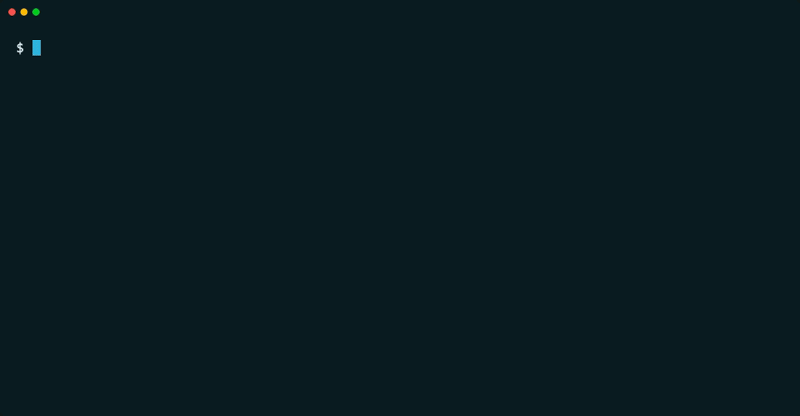
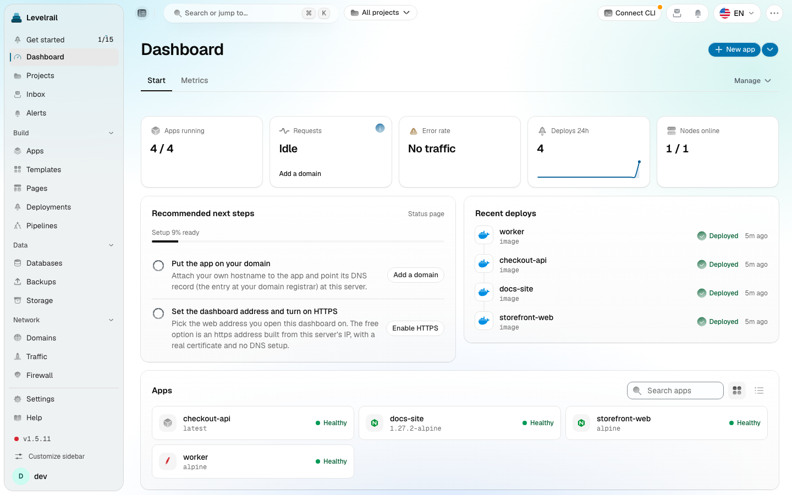
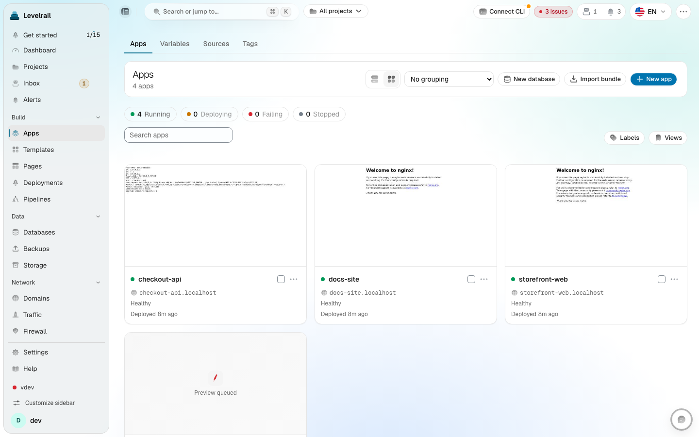
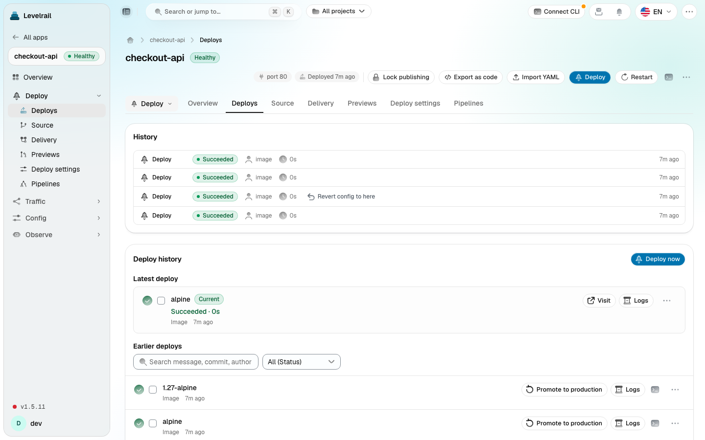
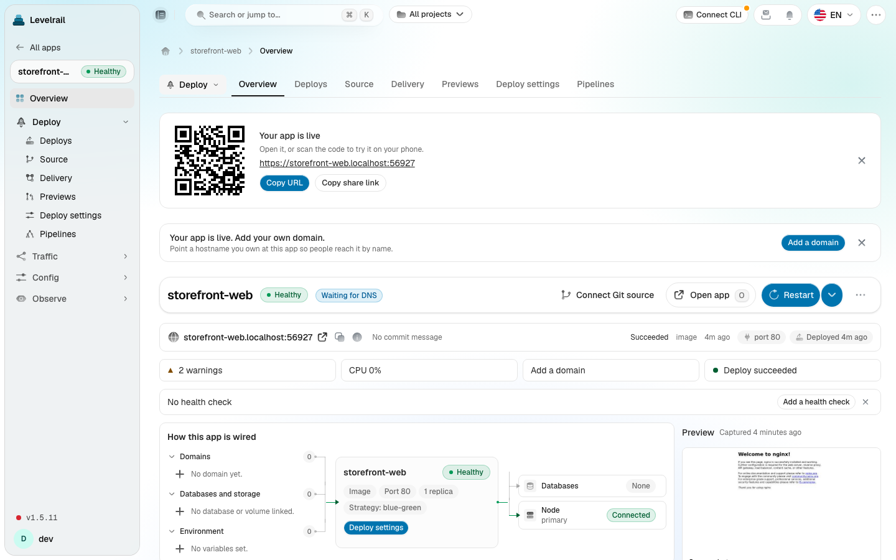
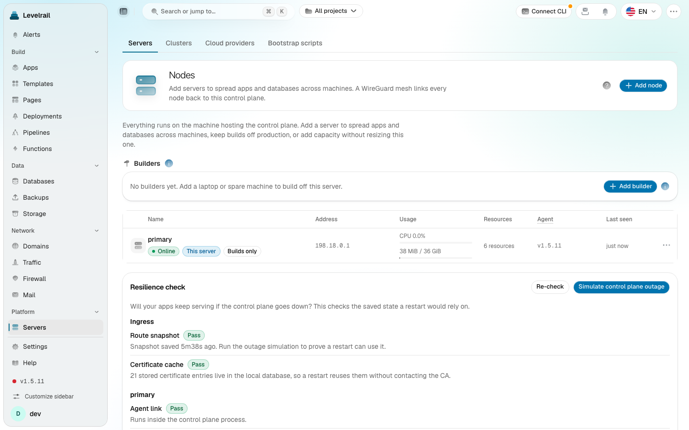
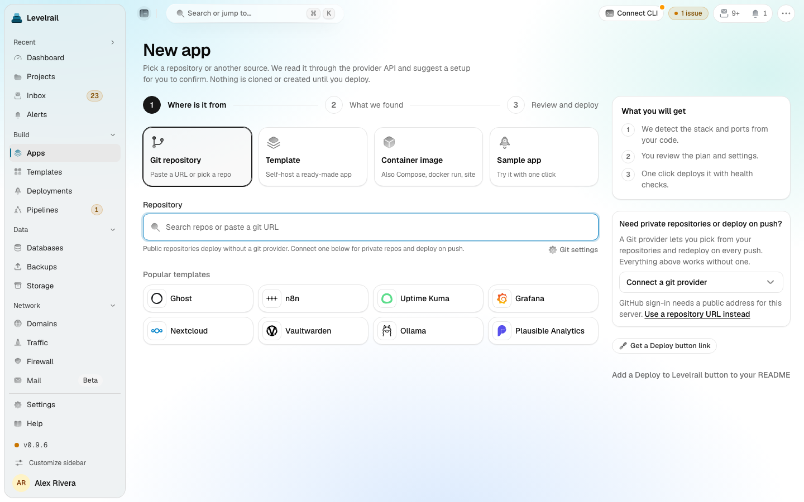
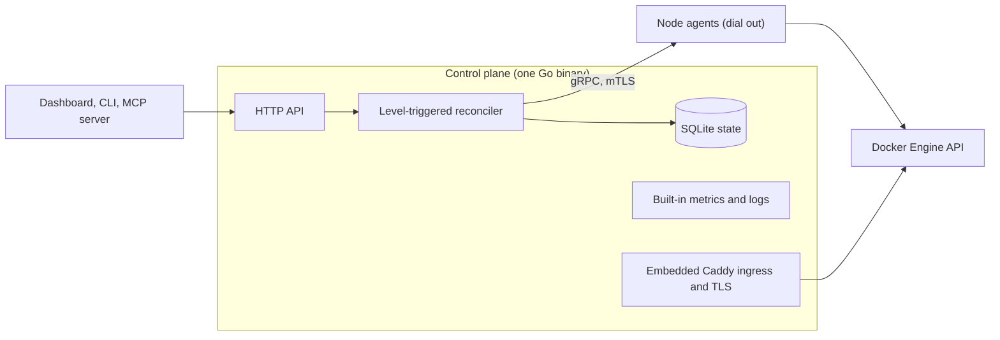
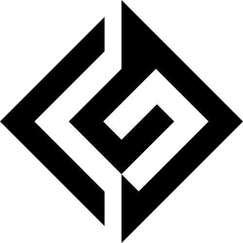

<div align="center">

<h1>Levelrail</h1>
<p><strong>Lightweight, self-hosted deployment platform: git push to production on your own servers and cloud accounts.</strong><br>
Git deploys, 570+ templates in the catalog (346 proven on a real engine), edge and TLS, nodes at six clouds, managed databases with restore-drilled backups, and built-in observability. Lightweight: the control plane idles at about 200 MB of RAM and 1.5 percent of one CPU on a 2 vCPU box, one Go binary ([measured idle footprint](docs/performance.md), [method](docs/benchmarks.md)). Apps you deploy use their own resources on top. Apache 2.0.</p>
<p>
  <a href="https://github.com/glincker/levelrail/stargazers"></a>
  <a href="LICENSE"></a>
  <a href="https://github.com/glincker/levelrail/releases"></a>
  <a href="https://github.com/glincker/levelrail/actions/workflows/ci.yml"></a>
  <a href="https://github.com/glincker/levelrail/actions/workflows/codeql.yml"></a>
  <a href="https://www.npmjs.com/package/levelrail-cli"></a>
  <a href="https://hub.docker.com/r/levelrail/levelrail"></a>
  <a href="https://discord.gg/Ar5pcaZB99"></a>
</p>
<p>
  <a href="https://docs.levelrail.com?utm_source=github&amp;utm_medium=readme&amp;utm_campaign=nav">Docs</a> &middot; <a href="docs/features.md">Features</a> &middot; <a href="docs/faq.md">FAQ</a> &middot; <a href="https://github.com/glincker/levelrail/discussions">Discussions</a> &middot; <a href="https://discord.gg/Ar5pcaZB99">Discord</a>
</p>
<p>
  <a href="https://levelrail.com?utm_source=github&amp;utm_medium=readme&amp;utm_campaign=nav">Website</a> &middot;
  <a href="https://docs.levelrail.com?utm_source=github&amp;utm_medium=readme&amp;utm_campaign=nav">Docs</a> &middot;
  <a href="#install">Install</a> &middot;
  <a href="#vs-coolify-dokploy-caprover-and-dokku">Compare</a> &middot;
  <a href="#faq">FAQ</a> &middot;
  <a href="docs/roadmap.md">Roadmap</a> &middot;
  <a href="https://github.com/glincker/levelrail/discussions">Discussions</a>
</p>
<!-- i18n-nav:start -->
<p>English &middot; <a href="docs/i18n/README.zh-Hans.md">简体中文</a> &middot; <a href="docs/i18n/README.es.md">Español</a> &middot; <a href="docs/i18n/README.pt-BR.md">Português (BR)</a> &middot; <a href="docs/i18n/README.de.md">Deutsch</a> &middot; <a href="docs/i18n/README.fr.md">Français</a> &middot; <a href="docs/i18n/README.ja.md">日本語</a></p>
<!-- i18n-nav:end -->
<picture><source media="(prefers-color-scheme: dark)" srcset="docs/assets/brand/social/github-social-1280x640.jpg"></picture>
</div>

<p align="center"><a href="docs/performance.md"><b>~200 MB</b> control plane idle</a> &middot; <a href="docs/architecture.md"><b>1</b> binary</a> &middot; <a href="docs/template-catalog.md"><b>570+</b> templates in the catalog</a> &middot; <a href="docs/node-provisioning.md"><b>6</b> clouds</a> &middot; <a href="docs/managing-databases.md"><b>13</b> database engines</a> &middot; <a href="docs/alerts.md"><b>18</b> alert channels</a></p>

Levelrail turns Linux servers into a private cloud and works with the Kubernetes clusters and cloud accounts you already have. Single-server is production ready, multi-node is beta. Every feature carries a stable, beta or experimental label in [Feature status](docs/feature-status.md), and the labels below follow it.

<p align="center"></p>

## What you get

Maturity follows [Feature status](docs/feature-status.md). Open the list under each area for every capability.

**[Ship with git push](docs/deploying-apps.md)**
- Push to GitHub, GitLab, Bitbucket, Gitea or Forgejo and it deploys
- Rollouts wait for readiness, rollback is one step
- [Preview environments](docs/deploy-previews.md) for every pull request
- [Canaries and split tests](docs/canary-deploys.md) before full traffic

<details>
<summary>All deploy features</summary>

- Git push or webhook deploys from GitHub, GitLab, Bitbucket, Gitea and Forgejo. See [Git integrations](docs/git-integrations.md) and [Git push deploy](docs/git-push-deploy.md).
- Dockerfile, Compose and Railpack builds (Railpack is beta) with a build queue. See [Build Center](docs/build-center.md).
- Readiness-gated rollouts and one-step rollback. See [Zero-downtime deploys](docs/zero-downtime-deploys.md) and [Rollback](docs/rollback.md).
- Canaries and split tests. See [Canary deploys](docs/canary-deploys.md) and [Split testing](docs/split-testing.md).
- Preview environments per pull request: stable on GitHub, beta on GitLab and Bitbucket. See [Deploy previews](docs/deploy-previews.md).
- Deploy approvals and deploy freezes. See [Deploy safety](docs/deploy-safety.md).
- Functions in Node, Python or Go (beta). See [Functions](docs/functions.md).

</details>

**[One-click templates](docs/template-catalog.md)**
- 570+ templates in the catalog, 346 with a recorded real-engine pass
- 22 categories, from databases to AI tools
- [How templates work](docs/templates-and-registry.md)

<details>
<summary>All template details</summary>

- 574 catalog entries (565 active, 9 deprecated) in 22 categories.
- 346 entries have a recorded real-engine pass.
- 228 entries are marked preview: installable, with no recorded pass yet.

</details>

**[Automatic HTTPS and edge](docs/domains-and-ingress.md)**
- Certificates issued and renewed for you, wildcards included
- [Firewall, bot lists and attack mode](docs/firewall.md) built in
- Headers, redirects, geo rules and caching per domain
- [Private networks](docs/multi-node.md) between nodes (beta)

<details>
<summary>All edge features</summary>

- Embedded ingress with automatic TLS through HTTP-01 and DNS-01 wildcards.
- Per-domain headers, forwarders, geo rules, caching and redirects. See [Domain traffic controls](docs/domain-traffic-controls.md).
- Firewall rules, IP lists, browser challenge, bot lists and attack mode. See [Firewall](docs/firewall.md).
- Per-app rate limits and deny lists (beta). See [Abuse defense](docs/abuse-defense.md).
- Round-robin balancing across replicas. See [Load balancing](docs/load-balancing.md).
- Private networks and a WireGuard mesh (beta). See [Multi-node](docs/multi-node.md).

</details>

**[Spin up nodes on any cloud](docs/node-provisioning.md)**
- Provision nodes at 6 clouds (beta)
- [Join any Linux host](docs/add-node-anywhere.md) with a single-use token
- DNS and registries at the clouds you already use
- [Existing Kubernetes clusters](docs/kubernetes-clusters.md) as deploy targets (experimental)

<details>
<summary>All node and cloud features</summary>

- Provision nodes at Hetzner, DigitalOcean, AWS, Azure, GCP or Oracle Cloud (beta).
- Join any Linux host with a single-use token over mTLS. See [Add a node anywhere](docs/add-node-anywhere.md).
- DNS at Cloudflare and Route53, image registries on ECR, Artifact Registry and ACR. See [Cloud integrations](docs/cloud-integrations.md) for per-cloud status.
- Works with the clusters and cloud accounts you already have (experimental): connect existing Kubernetes clusters and deploy to them, off by default. See [Kubernetes clusters](docs/kubernetes-clusters.md).

</details>

**[Managed databases and backups](docs/managing-databases.md)**
- 13 database engines from one place
- [Backups](docs/backups-and-storage.md) to S3-compatible, R2 or local disk
- [Restore drills](docs/prove-your-backups-work.md) prove a backup works
- Point-in-time recovery for Postgres

<details>
<summary>All data and backup features</summary>

- 13 database engines in code. 9 are live-verified. 4 (Meilisearch, Qdrant, Typesense, Memcached) are built but not yet live-verified.
- Backups to S3-compatible, R2 or local targets. See [Backups and storage](docs/backups-and-storage.md).
- Restore drills that prove a backup works. See [Prove your backups work](docs/prove-your-backups-work.md).
- Point-in-time recovery for Postgres.

</details>

**[Built-in metrics, logs and alerts](docs/observability.md)**
- Alerts to 18 channel kinds, from Slack to PagerDuty
- Metrics and [log search](docs/log-explorer.md) with no extra stack
- [OTLP ingest](docs/otlp-ingest.md) for your own telemetry
- [Public status page](docs/status-page.md) for your users

<details>
<summary>All observability features</summary>

- Built-in metrics, log search and log archive. See [Log explorer](docs/log-explorer.md) and [Log archive](docs/log-archive.md).
- OTLP ingest. See [OTLP ingest](docs/otlp-ingest.md).
- Public status page. See [Status page](docs/status-page.md).
- Deploy traces and traffic export. See [Deploy trace](docs/deploy-trace.md) and [Traffic export](docs/traffic-export.md).
- Alerts to 18 notification channel kinds. See [Alerts](docs/alerts.md).
- HTTP, TCP, heartbeat and TLS uptime monitors (experimental). See [Monitors](docs/monitors.md).

</details>

**[SSO, RBAC and audit log](docs/identity-and-access.md)**
- Sign in with 20 OAuth providers plus generic [OIDC](docs/sso-oidc.md)
- Passkeys and TOTP for local accounts
- [IAM policies and teams](docs/teams-and-roles.md)
- [Hash-chained audit log](docs/audit-log.md) you can verify

<details>
<summary>All security and access features</summary>

- Passwords, passkeys and TOTP.
- OAuth sign-in with 20 providers plus generic OIDC. See [OIDC](docs/sso-oidc.md).
- SAML and SCIM (beta, off by default). See [SAML and SCIM](docs/sso-saml.md).
- IAM policies and teams. See [Teams and roles](docs/teams-and-roles.md).
- Hash-chained audit log. See [Audit log](docs/audit-log.md).
- Encrypted secrets. See [Environment and secrets](docs/environment-and-secrets.md).
- Signed releases. See [Verify a release](docs/verify-a-release.md).

</details>

**[CLI, API, Terraform and MCP](docs/cli-reference.md)**
- 259 [MCP tools](docs/mcp.md) for coding agents
- [Terraform and OpenTofu provider](docs/terraform-provider.md)
- [HTTP API](docs/api-reference.md) and `levelrail-cli`
- 11 per-app integrations, from error tracking to analytics

<details>
<summary>All automation features</summary>

- `levelrail-cli` and an HTTP API. See [API reference](docs/api-reference.md).
- Terraform and OpenTofu provider. See [Terraform provider](docs/terraform-provider.md).
- YAML platform as code (experimental). See [Platform as code](docs/platform-as-code.md).
- CI pipelines. See [Pipelines](docs/pipelines.md).
- 11 per-app integrations: Sentry, PostHog, GlitchTip, OneUptime, Plausible, Datadog, Axiom, Better Stack, LogSnag, Bugsnag and New Relic. See [Alerts](docs/alerts.md).
- Signed plugins for notification channels. See [Plugins](docs/plugins.md).
- 259 MCP tools for coding agents. See [MCP](docs/mcp.md) and [Tool surface](docs/mcp-tool-surface.md).
- A mail server template with mailboxes and DNS records (experimental). See [Mail template](docs/mail-template.md).

</details>

[All features, with maturity labels](docs/features.md)

Runs on Linux amd64 and arm64 with systemd and Docker ([benchmarks](docs/benchmarks.md)).

## Install

```bash
curl -fsSL https://levelrail.com/install.sh | sudo sh
```

Needs Linux (amd64 or arm64) with systemd and root; the installer adds Docker. Open ports 80 and 443, open the setup link it prints, choose a password, then deploy from the CLI (the dashboard's **Connect your CLI** card gives you the login line; pass `--api-url` always, and `--profile NAME` if you manage more than one server):

```bash
levelrail-cli login --api-url http://127.0.0.1:8080 --code ABCD-EF23
levelrail-cli import https://github.com/your-org/your-app --deploy
```


<table>
  <tr>
    <td width="50%" valign="top" align="center">
      <br>
      <sub><b>Install, then deploy</b></sub>
    </td>
    <td width="50%" valign="top" align="center">
      <br>
      <sub><b>Gated deploy, one-step rollback</b></sub>
    </td>
  </tr>
</table>


[First 15 minutes](docs/first-15-minutes.md) &middot; [Installing](docs/installing.md) (Docker, pinned version, source build, troubleshooting) &middot; [CLI only](docs/installing.md#installing-just-the-cli) (`brew install glincker/tap/levelrail-cli` or `npx levelrail-cli`) &middot; [Free Arm VM](docs/install-on-oracle-cloud.md) &middot; [Migrate from Coolify, Dokploy, CapRover or Dokku](docs/migrate-to-levelrail.md) &middot; [Verify signed releases](docs/installing.md#verifying-release-binaries)

Using a coding agent? `npx skills add https://github.com/glincker/levelrail --skill levelrail`, then ask it to deploy your repo. See [Agents](docs/mcp.md).

### Install with your coding agent

Paste this into Claude Code, Cursor or any agent that can run shell commands on your server:

```text
Install Levelrail on this server: run `curl -fsSL https://levelrail.com/install.sh | sudo sh`.
Open the setup link it prints and tell me, because I choose the password myself.
Then run `levelrail-cli doctor` and `levelrail-cli status` and report anything that fails.
Do not write any token or password to a file or into this chat.
```

<table>
  <tr>
    <td width="33%" valign="top"><a href="docs/product-tour.mdx"><picture><source media="(prefers-color-scheme: dark)" srcset="docs/assets/screenshots/dashboard-home.png"></picture></a><br><sub><b>The control plane at a glance</b></sub></td>
    <td width="33%" valign="top"><a href="docs/deploying-apps.md"><picture><source media="(prefers-color-scheme: dark)" srcset="docs/assets/screenshots/apps-list.png"></picture></a><br><sub><b>Every app, its health and its last deploy</b></sub></td>
    <td width="33%" valign="top"><a href="docs/deploying-apps.md"><picture><source media="(prefers-color-scheme: dark)" srcset="docs/assets/screenshots/deploy-history.png"></picture></a><br><sub><b>Deploy history, promote and rollback</b></sub></td>
  </tr>
  <tr>
    <td width="33%" valign="top"><a href="docs/product-tour.mdx"><picture><source media="(prefers-color-scheme: dark)" srcset="docs/assets/screenshots/app-overview.png"></picture></a><br><sub><b>Metrics and logs, no Grafana stack</b></sub></td>
    <td width="33%" valign="top"><a href="docs/multi-node.md"><picture><source media="(prefers-color-scheme: dark)" srcset="docs/assets/screenshots/nodes.png"></picture></a><br><sub><b>Nodes and their capacity</b></sub></td>
    <td width="33%" valign="top"><a href="docs/deploying-apps.md"><picture><source media="(prefers-color-scheme: dark)" srcset="docs/assets/screenshots/new-app-wizard.png"></picture></a><br><sub><b>New app from a repo, template or image</b></sub></td>
  </tr>
</table>

All screenshots are captured from a real running control plane. More in the [Product tour](https://docs.levelrail.com/product-tour?utm_source=github&utm_medium=readme&utm_campaign=tour).

## Who it is for

**Whoever you are, you start with one line.**

| You are | You get | Start |
| --- | --- | --- |
| A solo developer with one VPS | Git deploys, HTTPS in one click and about 200 MB idle | `curl -fsSL https://levelrail.com/install.sh \| sudo sh` |
| Building with Claude Code, Cursor or another coding agent | An MCP server that deploys, waits, diagnoses and rolls back inside the token's limits | `npx skills add https://github.com/glincker/levelrail --skill levelrail` |
| An agency or team | Approvals, deploy freezes, IAM policies, a verifiable audit log, OIDC sign-in | [Identity and access](docs/identity-and-access.md) |
| On Coolify, Dokploy, CapRover or Dokku today | A dry run first, and the old server keeps serving | `levelrail-cli import platform coolify --url https://coolify.example.com --dry-run` |
| Running a homelab or a free Arm VM | arm64 builds and a minimal profile | [Server profiles](docs/profiles.md), [Arm VM](docs/install-on-oracle-cloud.md) |

## Built for coding agents

**Let your agent ship. You keep the keys.**

```text
Deploy this repo to my Levelrail and tell me when it is live.
```

- **Inside the token's limits.** The tool list follows the abilities of the token: a read token never sees a deploy tool, and `--readonly` refuses to start with a write token.
- **Writes need a confirmation.** Mutations are confirm-gated and off until you pass `--allow-write`.
- **Cheap to load.** About 2.4k tokens of tools by default, 259 tools in total, on demand in toolsets ([tool surface](docs/mcp-tool-surface.md)).
- **Audited.** Every call is recorded with the caller surface (CLI, dashboard, MCP or API).
- **Not in the control loop.** AI never sits in the reconcile path, so a wrong guess cannot wedge your servers.
- **A skill, not just tools.** It deploys, waits for the rollout to converge, reads the failure and rolls back ([skill](skills/levelrail/SKILL.md), [MCP](docs/mcp.md), [threat model](docs/mcp.md#threat-model)).

## vs Coolify, Dokploy, CapRover and Dokku

**Same job, fewer moving parts, more proof.**

| | Levelrail | Coolify | Dokploy | CapRover | Dokku |
| --- | --- | --- | --- | --- | --- |
| **Agent access (MCP)** | Read and write, ability-scoped, confirm-gated, audited | Official server, read-only | MCP server repo exists | Not documented | Not documented |
| **Switching in** | Dry-run importers for all four, old server keeps serving | n/a | n/a | n/a | n/a |
| Node control | Reverse-dialed agent | SSH + CLI | SSH + Engine API | Swarm API | Local bash |
| Built-in metrics and logs | Yes | Opt-in add-on | Separate binary | No | No |
| Rollback | Pinned images, readiness-gated | Retained images | Swarm rollback | Manual | Default scheduler: none |
| Backup verification | Automatic | Non-empty check | None | None | No backups |
| Audit log | Hash-chained, verifiable | Not documented | Not documented | Not documented | Not documented |

Cells state only what each project's public docs say (last checked 2026-11-07), and "Not documented" means we found nothing, not that it is missing. Coolify's MCP: [their docs](https://coolify.io/docs/integrations/mcp). This is positioning, not a ranking. Levelrail is the youngest project here, with fewer users and less production mileage. Sourced details: [Comparison](docs/comparison.md).

## Production ready, with receipts

| Claim | Evidence |
| --- | --- |
| Every feature labelled stable or beta | [Feature status](docs/feature-status.md) |
| Survives failures | [Resilience](docs/resilience.md): disk full, link loss, database damage, safe-mode boot |
| Measured, not promised | [Benchmarks](docs/benchmarks.md) |
| Tested against real containers | [CI](.github/workflows/ci.yml) and [`test/e2e`](test/e2e) |
| Signed releases | Sigstore signature and provenance attestation, [verify them](docs/installing.md#verifying-release-binaries) |
| Honest about gaps | [Known limits](docs/known-limits.md) |

## How it works



Details: [Architecture](docs/architecture.md).

## Guides

[Next.js with Postgres](https://github.com/glincker/levelrail/discussions/1239) &middot; [Django with Postgres](https://github.com/glincker/levelrail/discussions/1243) &middot; [Push to deploy with GitHub](https://github.com/glincker/levelrail/discussions/1244) &middot; [How deploys stay safe](https://github.com/glincker/levelrail/discussions/1246) &middot; [Scale to zero on a small VPS](https://github.com/glincker/levelrail/discussions/1242)

Maintain an open-source app? Add a one-click button: [Deploy button](docs/deploy-button.md).

[](docs/deploy-button.md)

## FAQ

**Does it need Kubernetes?** No. The control plane is one Go binary with a Docker runtime. If you already run Kubernetes, you can connect a cluster and deploy to it (experimental, off by default). See [Kubernetes clusters](docs/kubernetes-clusters.md).

**What does it cost?** Nothing. Apache 2.0, one edition, no license key. You pay for your own servers ([Pricing](docs/pricing.md)).

**Can I migrate from Coolify?** Yes. `levelrail-cli import platform coolify --url https://coolify.example.com --dry-run` (with the source token in `APP_IMPORT_SOURCE_TOKEN`) shows what would be created first, and the old server keeps serving ([Migrate](docs/migrate-to-levelrail.md)).

**How do I upgrade?** Settings > Updates or `levelrail-cli upgrade --plan`. It verifies the release, snapshots your data and rolls back by itself if the new release is unhealthy ([Upgrade safely](docs/upgrade-safely.md)).

## Community

[Discussions](https://github.com/glincker/levelrail/discussions) &middot; [Issues](https://github.com/glincker/levelrail/issues) &middot; [Discord](https://discord.gg/Ar5pcaZB99) &middot; [support@levelrail.com](mailto:support@levelrail.com) &middot; [Security policy](.github/SECURITY.md) &middot; [Support](SUPPORT.md) &middot; [Accessibility](ACCESSIBILITY.md) &middot; [Versioning and version tracker](VERSIONING.md) &middot; [Contributing](.github/CONTRIBUTING.md) &middot; [llms.txt](llms.txt) and [AGENTS.md](AGENTS.md) for AI agents

## Star the repo

If Levelrail saves you a weekend, a [star](https://github.com/glincker/levelrail) helps other self-hosters find it.

<a href="https://github.com/glincker/levelrail/graphs/contributors"></a>

[](https://star-history.com/#glincker/levelrail&Date)

Apache 2.0, see [LICENSE](LICENSE). Built by Gagan Deep Singh of [GLINR STUDIOS](https://glinr.com) and [theSVG](https://thesvg.org).

<div align="center">

<a href="https://glinr.com">
  <picture>
    <source media="(prefers-color-scheme: dark)" srcset="docs/assets/brand/glincker-light.svg">
    
  </picture>
</a>

<sub>Powered by <a href="https://glinr.com"><b>GLINR STUDIOS</b></a> &middot; icon from <a href="https://thesvg.org/icon/glincker">theSVG</a></sub>

</div>
