<div align="center">


<h1>Levelrail</h1>

<p><strong>Push to git, get a running app with TLS, logs, metrics, and rollback, on your own Linux boxes.</strong></p>

<p>
  <a href="https://github.com/glincker/levelrail/releases"></a>
  <a href="LICENSE"></a>
  <a href="https://github.com/glincker/levelrail/stargazers"></a>
  <a href="https://github.com/glincker/levelrail/actions/workflows/ci.yml"></a>
  <a href="https://discord.gg/Ar5pcaZB99"></a>
  <a href="CONTRIBUTING.md"></a>
</p>

<p>
  <a href="https://github.com/glincker/levelrail/commits/main"></a>
  <a href="https://github.com/glincker/levelrail/graphs/contributors"></a>
  <a href="https://github.com/glincker/levelrail/issues"></a>
  <a href="https://github.com/glincker/levelrail/discussions"></a>
  <a href="go.mod"></a>
  <a href="https://github.com/glincker/levelrail/pkgs/container/levelrail"></a>
  <a href="docs/mcp.md"></a>
  <a href="https://docs.levelrail.com"></a>
</p>

<p>
  <a href="https://docs.levelrail.com">Docs</a> ·
  <a href="#quick-start">Quickstart</a> ·
  <a href="#what-you-get">Features</a> ·
  <a href="#how-it-compares">Compare</a> ·
  <a href="docs/roadmap.md">Roadmap</a> ·
  <a href="https://discord.gg/Ar5pcaZB99">Discord</a>
</p>

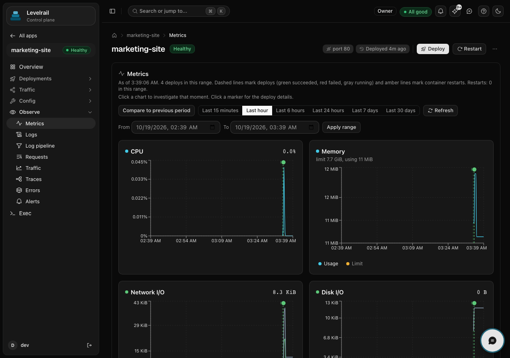

</div>

Levelrail is open source (Apache 2.0) and ships as one Go binary that uses Docker as the runtime. It turns Linux servers you already own into a private cloud, without Kubernetes.

## Why Levelrail

- **Push to deploy.** Webhooks from GitHub, GitLab, Bitbucket or Gitea start a build, and the app is served over HTTPS with automatic certificates.
- **Safe rollback.** Deploys wait for a readiness probe, and prior images are pinned, so one click rolls back and garbage collection cannot remove the target.
- **Logs, metrics and traces built in.** Each node keeps its own metrics (15 second resolution) and searchable logs, with deploy markers. Traces are opt-in per app. No Grafana stack to install.
- **Previews per pull request.** Stable on GitHub, beta on GitLab and Bitbucket.
- **Add servers without opening ports.** Agents dial out over mTLS. Multi-node is beta.

> **Status: early.** Single node is the most tested path, and multi-node is beta. Each feature is labelled stable or beta, with the evidence, on the [feature status](docs/feature-status.md) page.

## Quick start

You need a Linux server (`amd64` or `arm64`) with systemd, root access, and ports 80 and 443 open. Docker is installed for you if it is missing.

1. **Install on the server.**

   ```
   curl -fsSL https://levelrail.com/install.sh | sudo sh
   ```

   The installer prints a dashboard URL with a one-time setup token.

2. **Finish setup in the browser.** Open the URL, choose a password, and follow the setup wizard for a domain, a git provider and your first app.

3. **Deploy a repository from the CLI.**

   ```
   levelrail-cli import https://github.com/your-org/your-app --deploy
   ```

   Without `--deploy` it prints the deployment plan and stops.

Next: [Getting started](docs/getting-started.md) for the full walkthrough, then [Deploying apps](docs/deploying-apps.md) and [Observability](docs/observability.md). Prefer containers, a pinned version or a source build? See [Installing](docs/installing.md) and [Docker](docs/docker.md).

<table>
  <tr>
    <td width="50%" valign="top" align="center">
      <br>
      <sub><b>Install, then deploy</b></sub>
    </td>
    <td width="50%" valign="top" align="center">
      <br>
      <sub><b>Gated deploy, one-step rollback</b></sub>
    </td>
  </tr>
</table>

## Why not Coolify or Dokploy?

Coolify manages servers over SSH, and Dokploy builds on Docker Swarm. Levelrail makes different architecture choices:

- **Agents dial out over mTLS.** Each node runs an agent that talks to Docker's Engine API directly. There is no SSH, no inbound port, and no shelling out to the `docker` CLI.
- **Observability is part of the core.** Metrics, logs and alerting ship in the same binary, so there is no separate stack to install.
- **Metrics and logs stay on each node.** The control plane queries them on demand instead of collecting them into a central store.

## What you get

| Area | What it does | Docs |
| --- | --- | --- |
| Deploys | Rolling, recreate, or blue-green, gated on real readiness probes. Import a repo URL, an image, a `docker run` command, or a compose file. | [Deploying apps](docs/deploying-apps.md), [Importing apps](docs/importing-apps.md) |
| Domains and TLS | Embedded Caddy ingress with automatic certificates and routing. | [Domains and ingress](docs/domains-and-ingress.md) |
| Databases | Postgres, Redis, MySQL, MongoDB, MariaDB, KeyDB, Dragonfly, and ClickHouse, with scheduled backups, restore, and an automatic re-download and checksum after every backup. | [Managing databases](docs/managing-databases.md), [Backups](docs/backups-and-storage.md) |
| Observability | Node-local metrics and full-text log search with deploy markers, per-app log pipelines (multiline, redact, drop, parse), a Loki-compatible read API for Grafana, Prometheus remote write, OTLP traces with a waterfall, Sentry-compatible error tracking, and log exports to New Relic, Datadog, Axiom and Better Stack. | [Observability](docs/observability.md), [Loki API](docs/loki-api.md), [Tracing](docs/tracing.md), [Error tracking](docs/error-tracking.md) |
| Safety | Prior images are pinned, so rollback is always one click and garbage collection cannot remove the target. Deploy approvals and freezes. | [Deploy safety](docs/deploy-safety.md) |
| Access | Allow and Deny IAM policies scoped to a single app or database, with an audit log and CSV export, in the free Apache 2.0 core. | [Access control](docs/access-control.md) |
| Automation | One HTTP API behind the dashboard, a CLI, and an MCP server. AI never sits in the reconciliation path. | [CLI reference](docs/cli-reference.md), [AI control](docs/ai-control.md) |

<details>
<summary><b>More features</b></summary>
<br>

- **Sleep when idle.** An app with no requests for a time you choose stops and uses no memory or CPU, then starts on the next request. See [Sleep when idle](docs/sleep-when-idle.md).
- **Many servers, no open ports.** Add nodes with a one-time token. Agents dial out over mTLS, with WireGuard mesh networking, internal DNS, cordon, and drain. See [Multi-node](docs/multi-node.md).
- **Git-native.** GitHub, GitLab, Bitbucket, and Gitea webhooks and preview environments per pull request.
- **A large catalog of one-click templates** for self-hosted services, each a compose file the platform deploys and manages. See [Template catalog](docs/template-catalog.md).
- **Alerting.** Threshold, crashloop, and certificate expiry rules delivered over many notification channels, including Slack, Discord, email, Telegram, PagerDuty, ntfy, and a generic webhook.
- **Pipelines.** CI/CD runs on your own nodes, defined in a YAML file. See [Pipelines](docs/pipelines.md).

</details>

### A tour of the dashboard

Every image is captured from a real, running control plane by [`scripts/screenshots/capture.sh`](scripts/screenshots/capture.sh). Click one to open the guide for that screen.

<table>
  <tr>
    <td width="33%" valign="top">
      <a href="docs/installing.md#first-sign-in">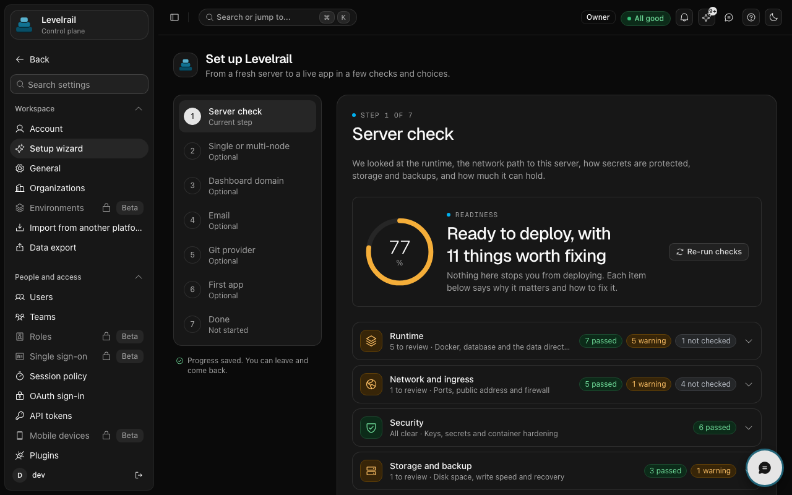</a><br>
      <b>1. Install and sign in</b><br>
      <sub>The setup wizard checks the server and walks you to a first app.</sub>
    </td>
    <td width="33%" valign="top">
      <a href="docs/git-integrations.md">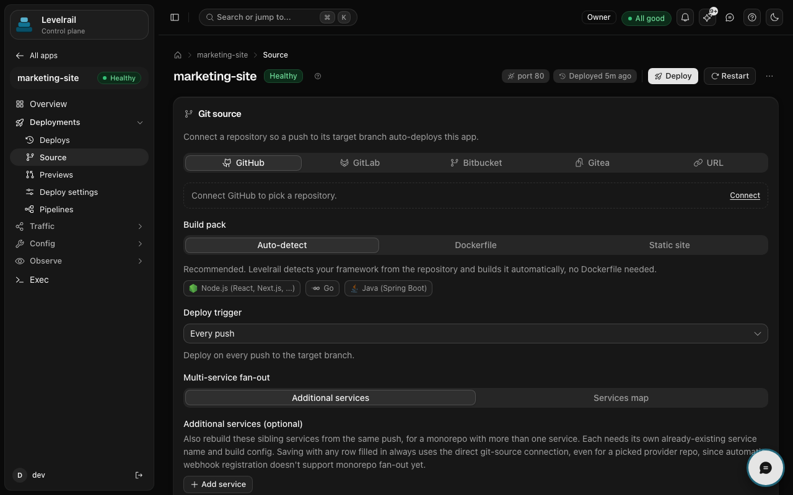</a><br>
      <b>2. Connect a repo</b><br>
      <sub>Pick a provider, let auto-detect choose the build.</sub>
    </td>
    <td width="33%" valign="top">
      <a href="docs/deployments-page.md">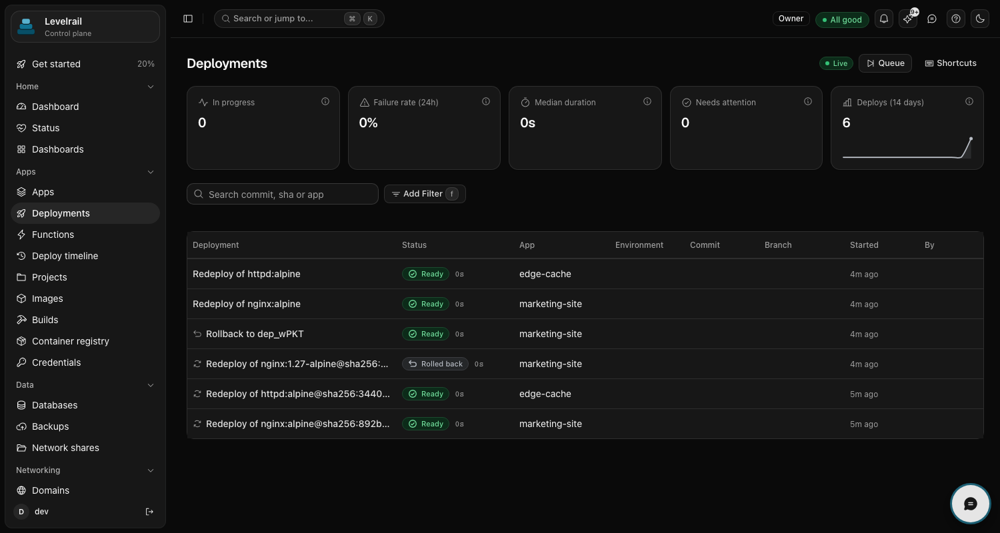</a><br>
      <b>3. Watch it ship</b><br>
      <sub>Every deploy is listed live, and rolling back is one click.</sub>
    </td>
  </tr>
  <tr>
    <td width="33%" valign="top">
      <a href="docs/observability.md">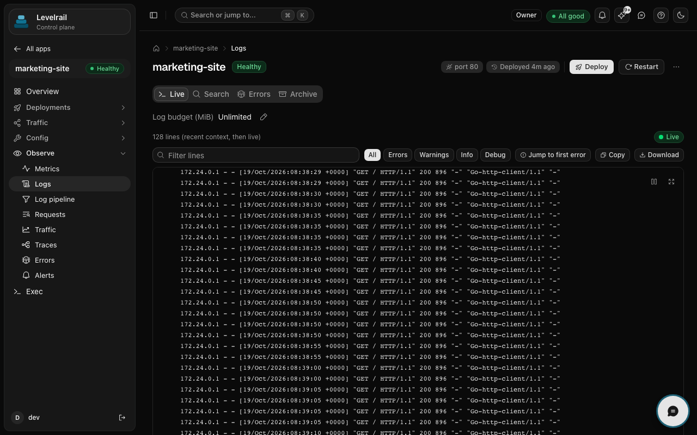</a><br>
      <b>Live logs</b><br>
      <sub>Full-text search and live tail, stored on the node.</sub>
    </td>
    <td width="33%" valign="top">
      <a href="docs/managing-databases.md">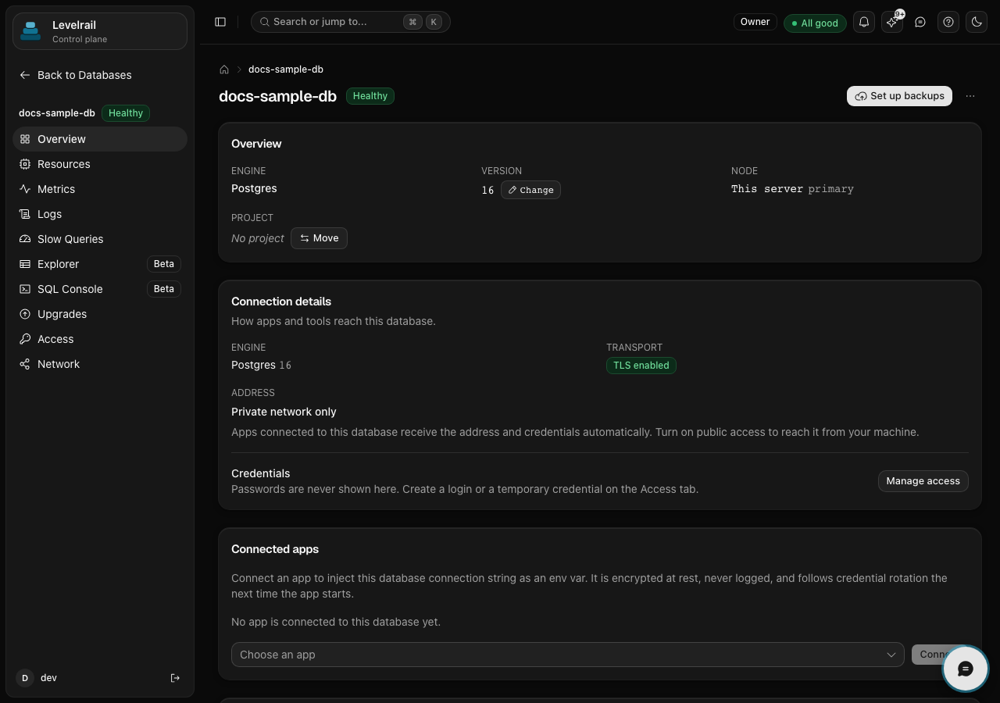</a><br>
      <b>Databases</b><br>
      <sub>TLS, host-port exposure, and backups in one place.</sub>
    </td>
    <td width="33%" valign="top">
      <a href="docs/domains-and-ingress.md">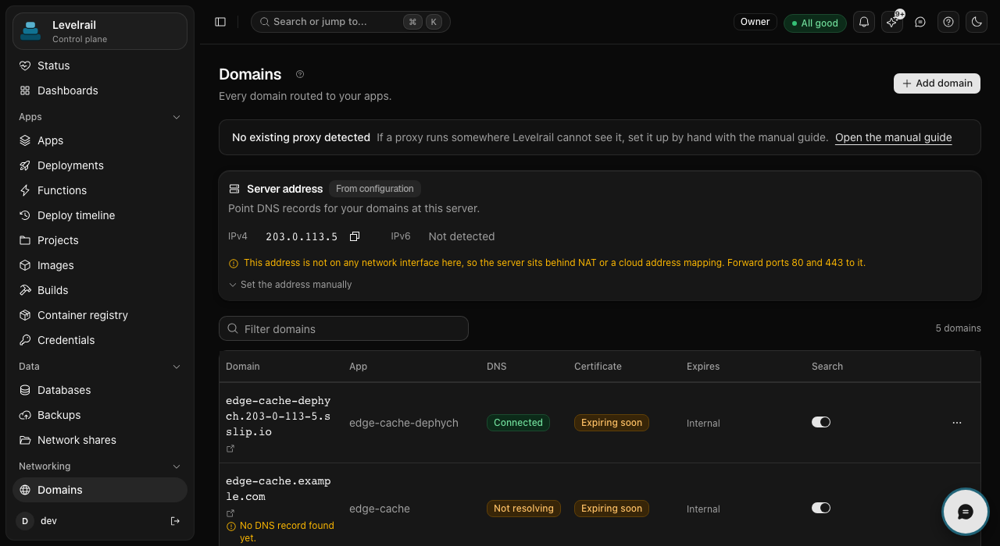</a><br>
      <b>Domains and TLS</b><br>
      <sub>Primary domain, ACME certificates, and HSTS.</sub>
    </td>
  </tr>
</table>

<details>
<summary><b>More screenshots</b></summary>
<br>

<table>
  <tr>
    <td width="50%" valign="top">
      <a href="docs/managing-apps-at-scale.md">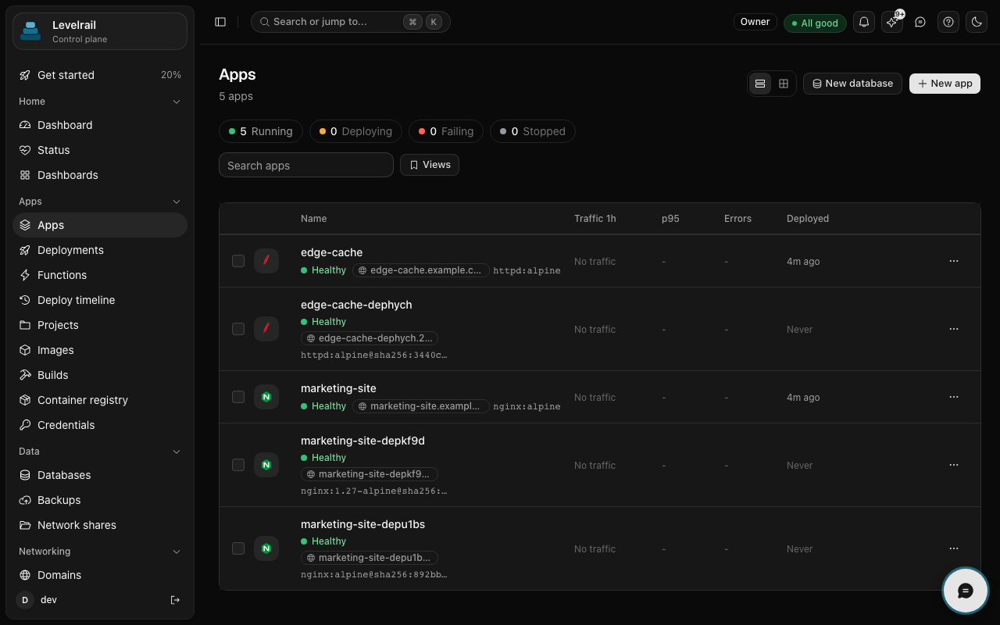</a><br>
      <b>Apps</b>
    </td>
    <td width="50%" valign="top">
      <a href="docs/deploy-safety.md">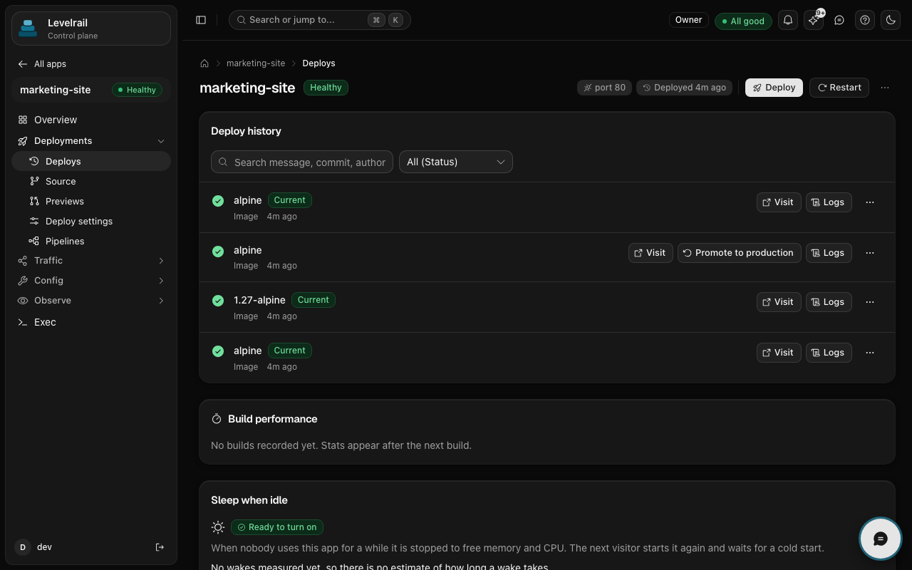</a><br>
      <b>Deploy history and rollback</b>
    </td>
  </tr>
  <tr>
    <td width="50%" valign="top">
      <a href="docs/deploying-apps.md">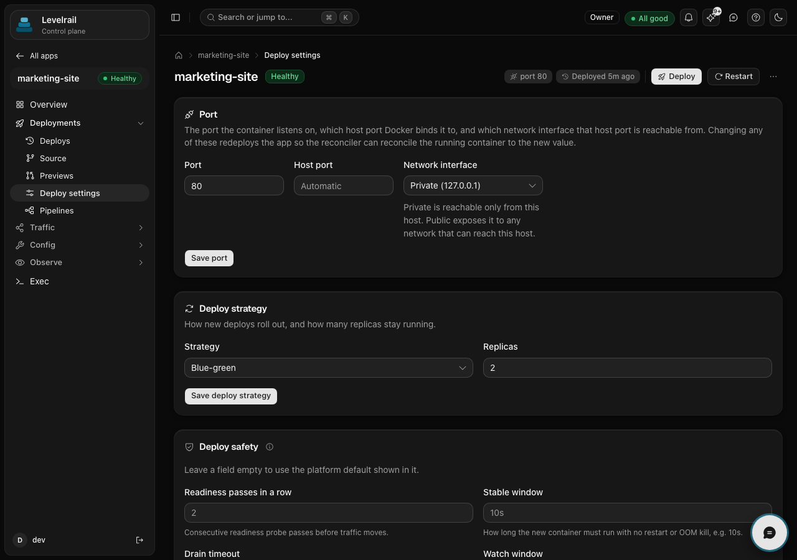</a><br>
      <b>Deploy strategy</b>
    </td>
    <td width="50%" valign="top">
      <a href="docs/cost-estimate.md">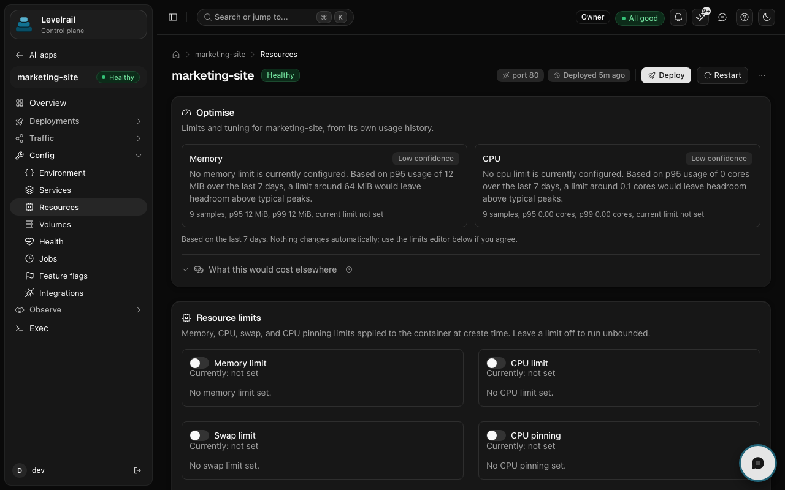</a><br>
      <b>Right-sizing and cost</b>
    </td>
  </tr>
  <tr>
    <td width="50%" valign="top">
      <a href="docs/deploying-apps.md">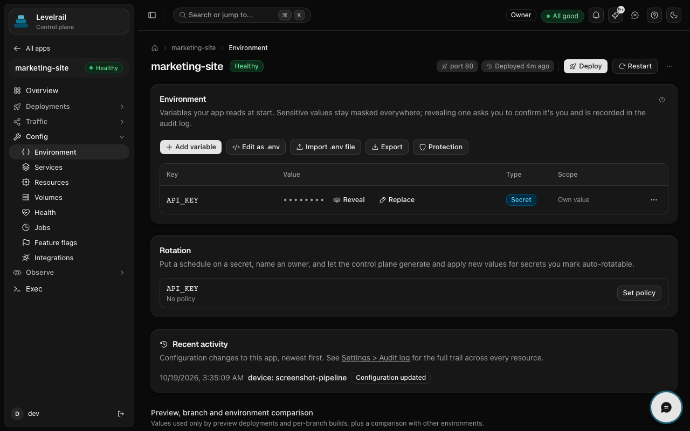</a><br>
      <b>Environment and secrets</b>
    </td>
    <td width="50%" valign="top">
      <a href="docs/backups-and-storage.md">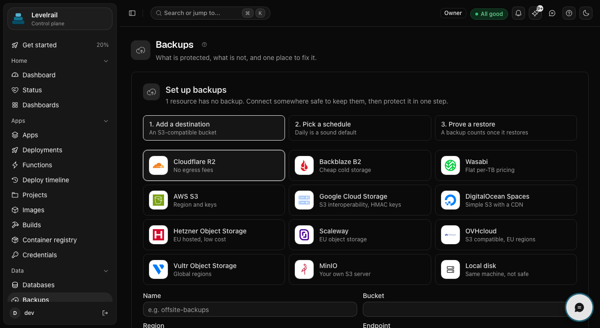</a><br>
      <b>Backups</b>
    </td>
  </tr>
  <tr>
    <td width="50%" valign="top">
      <a href="docs/multi-node.md"></a><br>
      <b>Nodes</b>
    </td>
    <td width="50%" valign="top">
      <a href="docs/network-topology.md"></a><br>
      <b>Network topology</b>
    </td>
  </tr>
  <tr>
    <td width="50%" valign="top">
      <a href="docs/pipelines.md">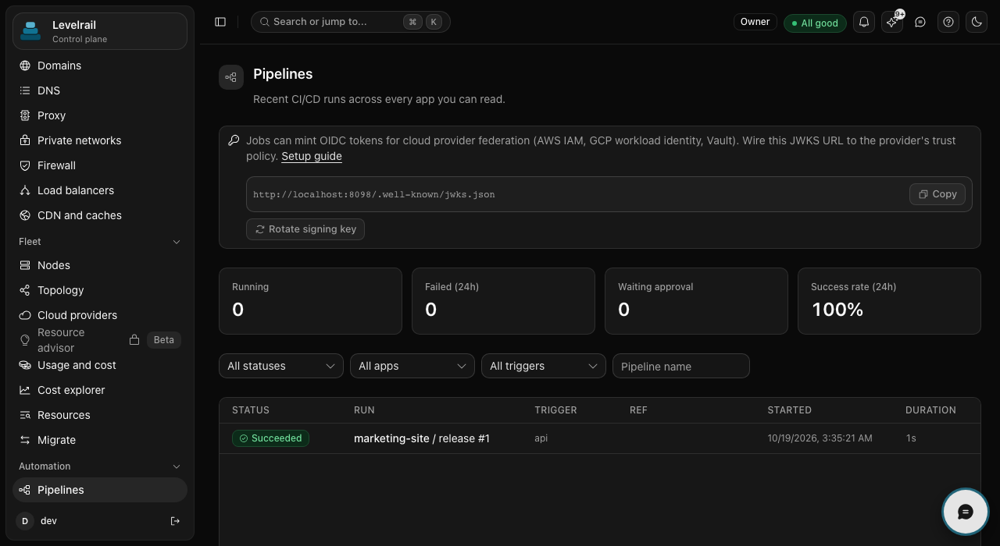</a><br>
      <b>Pipelines</b>
    </td>
    <td width="50%" valign="top">
      <a href="docs/template-catalog.md">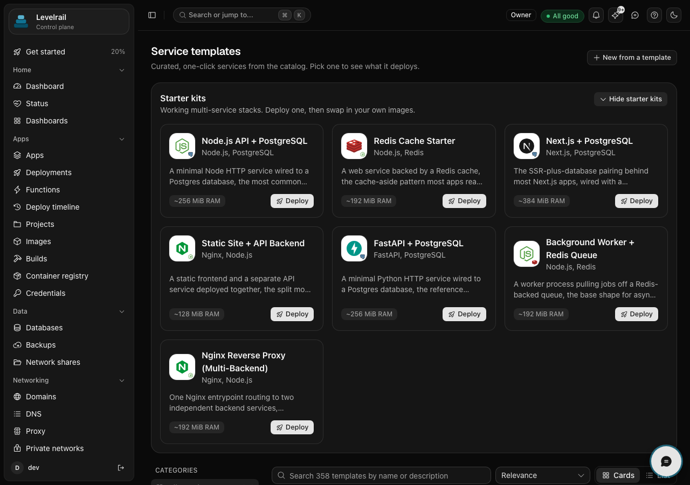</a><br>
      <b>Template catalog</b>
    </td>
  </tr>
  <tr>
    <td width="50%" valign="top">
      <a href="docs/load-balancing.md">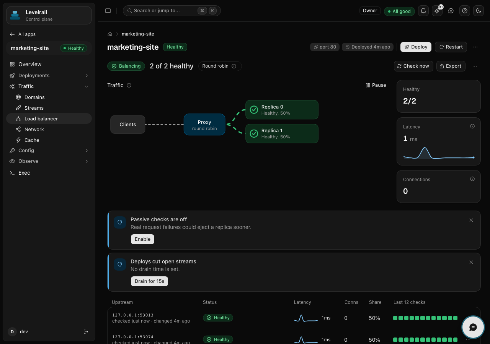</a><br>
      <b>Load balancer</b>
    </td>
    <td width="50%" valign="top">
      <a href="docs/status-page.md">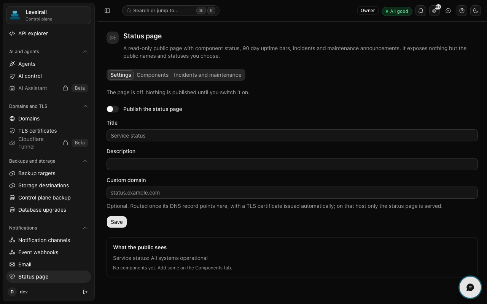</a><br>
      <b>Public status page</b>
    </td>
  </tr>
</table>

</details>

## How it works

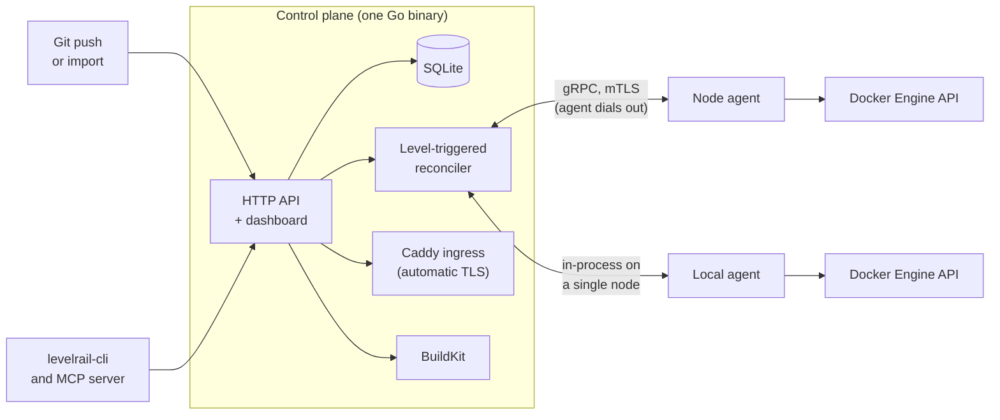

- **Control plane** (`cmd/levelrail`): one Go binary with the dashboard embedded. It reconciles declarative desired state against observed Docker state, the Kubernetes controller pattern without the rest of Kubernetes.
- **Node agent** (`cmd/levelrail-agent`): dials out to the control plane and streams Docker events up. In single-node mode it runs in-process, so one node and ten nodes share one code path.
- **Ingress:** [Caddy](https://caddyserver.com/) embedded as a library. **Builds:** [BuildKit](https://github.com/moby/buildkit) as a library, with Railpack detection for apps without a Dockerfile. **State:** SQLite in WAL mode, pure Go.
- **CLI and MCP:** `levelrail-cli` and `levelrail-mcp` are thin clients over the same HTTP API under `/api/v1`.

Details: [Architecture](docs/architecture.md).

## How it compares

Most self-hosted platforms in this category manage servers by SSHing in and shelling out to the `docker` CLI, then parsing text, which tends to force polling loops. Levelrail uses a reverse-dialed agent and a level-triggered reconciler instead.

| | Levelrail | Coolify | Dokploy | CapRover | Dokku | Kamal |
| --- | --- | --- | --- | --- | --- | --- |
| Node control | Reverse-dialed agent | SSH + CLI | SSH + Engine API | Swarm API | Local bash | SSH, one-shot |
| Orchestration | Level-triggered reconciler | Compose | Swarm | Swarm | Bash scheduler | None |
| Built-in metrics and logs | Yes | Opt-in add-on | Separate binary | No | No | No |
| Rollback | Pinned images, readiness-gated | Health check off by default | Swarm rollback | Manual | Default scheduler: none | Proxy health gate |
| Backup verification | Automatic, all 8 engines | Non-empty check | None | None | No backups | No backups |

This is positioning, not a ranking, and all of them are worth using. The one area where Levelrail trails is breadth of templates: a smaller curated catalog than Coolify's, an intentional bet on curation (see [ADR 015](adr/015-service-template-catalog-reversal.md)). The full, sourced comparison is in [Comparison](docs/comparison.md).

**Footprint.** Measured on an Apple M4 Max with a dev build and a loopback client, the idle control plane used 67.7 MB RSS and 0.03% CPU with 0 apps, and 90.8 MB RSS and 1.60% CPU with 500 suspended apps. No containers were running in that benchmark, so real apps add load it does not measure. Method and caveats: [Performance](docs/performance.md).

## Status

Releases are listed on the [releases page](https://github.com/glincker/levelrail/releases), and every feature is labelled stable or beta, with the evidence behind it, on [Feature status](docs/feature-status.md). Single node is the best-tested path. Anything marked beta works but has less real-world mileage, and a few areas stay off by default behind [`APP_EXPERIMENTAL`](docs/experimental-features.md). The [roadmap](docs/roadmap.md) lists what is done and what is next.

## Guides

Step by step walkthroughs, each tested against a real install:

| Guide | What you learn |
| --- | --- |
| [What is Levelrail and who is it for](https://github.com/glincker/levelrail/discussions/1233) | The overview, with an FAQ |
| [Deploy a Next.js app with Postgres](https://github.com/glincker/levelrail/discussions/1239) | Repo to HTTPS in about ten minutes |
| [Deploy a Django app with Postgres](https://github.com/glincker/levelrail/discussions/1243) | Plus the four errors everyone hits |
| [Push to deploy with GitHub](https://github.com/glincker/levelrail/discussions/1244) | Webhooks, previews and the delivery log |
| [How deploys stay safe](https://github.com/glincker/levelrail/discussions/1246) | Health gates, blue-green cutover, rollback |
| [Logs, traces and errors without a stack](https://github.com/glincker/levelrail/discussions/1240) | Observability and Grafana |
| [Scale to zero on a small VPS](https://github.com/glincker/levelrail/discussions/1242) | Run many projects on one box |
| [Levelrail Pages](https://github.com/glincker/levelrail/discussions/1245) | Static sites from git |
| [Levelrail vs Coolify, Dokploy, CapRover, Dokku and Kamal](https://github.com/glincker/levelrail/discussions/1235) | Where each one fits |

## For AI agents and crawlers

- **Agent skill:** [`skills/levelrail/SKILL.md`](skills/levelrail/SKILL.md) teaches a coding agent to deploy, wait, diagnose and roll back safely.
- **MCP server:** `levelrail-mcp` exposes the same API and permission model. Start in `read-only` mode. See [MCP](docs/mcp.md) and [AI control](docs/ai-control.md).
- **Repo guide:** [`AGENTS.md`](AGENTS.md) for working in this codebase, and [`llms.txt`](llms.txt) as the index.
- **Docs for LLMs:** [llms.txt](https://docs.levelrail.com/llms.txt) and [llms-full.txt](https://docs.levelrail.com/llms-full.txt).

## Documentation

- [docs.levelrail.com](https://docs.levelrail.com): the hosted docs, with getting started, architecture, app spec reference, and the full index.
- [docs.levelrail.com/llms.txt](https://docs.levelrail.com/llms.txt): the docs index in a plain format for LLMs and AI assistants.
- [docs/](docs/README.md): the same content as Markdown, for browsing on GitHub.
- Start here: [Getting started](docs/getting-started.md), [Installing](docs/installing.md), [App spec reference](docs/app-spec-reference.md), [CLI reference](docs/cli-reference.md).

## Community and support

- [GitHub Discussions](https://github.com/glincker/levelrail/discussions): questions, ideas, show and tell.
- [GitHub Issues](https://github.com/glincker/levelrail/issues): bug reports and feature requests.
- [GLINR Discord](https://discord.gg/Ar5pcaZB99): live chat with maintainers and other users, with a dedicated `#levelrail` forum channel.
- [support@levelrail.com](mailto:support@levelrail.com): direct email support.
- [Security policy](SECURITY.md): report a vulnerability privately.
- [Contributing](CONTRIBUTING.md): dev loop, tests, and commit conventions.

### Build from source

Needs Go 1.26 or newer and Docker.

```
go build ./cmd/levelrail
go build ./cmd/levelrail-agent
go build ./cmd/levelrail-cli
```

The frontend is a Vite project in `web/` that is embedded into the control plane at build time. See [Installing](docs/installing.md#option-3-build-from-source). Generic, stdlib-only Go packages (SSRF-safe HTTP client, cron parsing, health probes, and more) live in a separate module, [`kit/`](kit/README.md), usable without the platform.

## Contributors

<a href="https://github.com/glincker/levelrail/graphs/contributors"></a>

## Star the repo

If Levelrail saves you a weekend, a [star on GitHub](https://github.com/glincker/levelrail) helps other self-hosters find it. Bug reports and honest feedback help more.

[](https://star-history.com/#glincker/levelrail&Date)

## License

Apache 2.0, see [LICENSE](LICENSE).

## Founding partners

Founding partner sites and libraries, from the same studio:

| | |
| --- | --- |
| [**theSVG**](https://thesvg.org) | A searchable library of brand SVG icons for developers and designers. |
| [**theauth**](https://github.com/glincker/theauth) | Open-source auth for AI agents and humans, with MCP OAuth 2.1 and audit. |
| [**AskVerdict AI**](https://askverdict.ai) | Structured multi-agent decisions for teams, with verdicts and action items. |

Levelrail is built by Gagan Deep Singh, founder of [GLINR STUDIOS](https://glinr.com) and [theSVG](https://thesvg.org). Say hello at [thegdsks.com](https://thegdsks.com).

<div align="center">

<a href="https://glinr.com">
  <picture>
    <source media="(prefers-color-scheme: dark)" srcset="docs/assets/brand/glincker-light.svg">
    
  </picture>
</a>

<sub>Powered by <a href="https://glinr.com"><b>GLINR STUDIOS</b></a> · icon from <a href="https://thesvg.org/icon/glincker">theSVG</a></sub>

</div>
