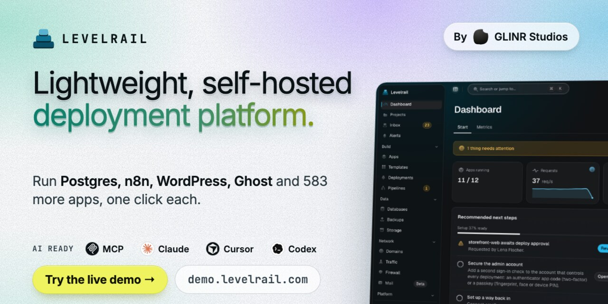

# levelrail-mcp

<p align="center"></p>

The MCP server for [Levelrail](https://levelrail.com), a self-hosted deployment platform. It wraps the REST API of your own Levelrail instance so an MCP client can list, inspect and manage your deployments. There is no hosted endpoint: you run it yourself with an API token from your instance.

```
APP_API_URL=https://levelrail.example.com APP_API_TOKEN=<token> npx -y levelrail-mcp
```

It speaks MCP over stdio by default. `APP_API_URL` is your control plane URL and `APP_API_TOKEN` an API token you created there. Read-only and write modes, toolsets and the optional HTTP transport are described in the [AI assistant docs](https://docs.levelrail.com/ai-assistant).

Apache 2.0.
