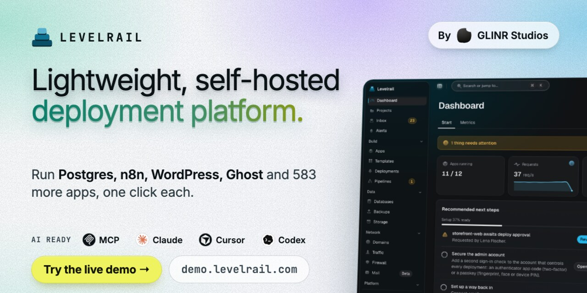

# levelrail

<p align="center"></p>

Command line client for [Levelrail](https://levelrail.com), a self-hosted deployment platform.

```
npx levelrail help
npm install --global levelrail
levelrail auth login --device
```

This package is a thin forwarder to the canonical [`levelrail-cli`](https://www.npmjs.com/package/levelrail-cli) package, pinned to the same version. It installs the client only, never the server. Binary name: `levelrail`.

Docs: [docs.levelrail.com](https://docs.levelrail.com), CLI reference: [docs.levelrail.com/cli-reference](https://docs.levelrail.com/cli-reference).

Apache 2.0.
