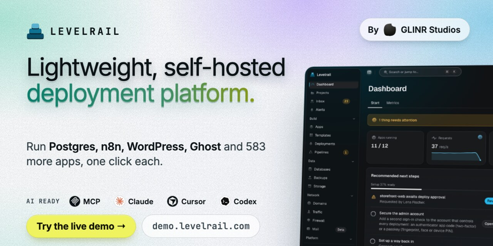

# @levelrail/cli

<p align="center"></p>

Command line client for [Levelrail](https://levelrail.com), a self-hosted deployment platform.

```
npx @levelrail/cli help
npm install --global @levelrail/cli
levelrail-scoped auth login --device
```

This package is the scoped alias of the canonical [`levelrail-cli`](https://www.npmjs.com/package/levelrail-cli) package, pinned to the same version. It installs the client only, never the server.

Binary name: `levelrail-scoped`. It is deliberately not `levelrail-cli` (owned by the canonical package) or `levelrail` (owned by the unscoped `levelrail` package), so installing several of these globally never fails with EEXIST. `npx @levelrail/cli` works because the package has a single bin.

Docs: [docs.levelrail.com](https://docs.levelrail.com), CLI reference: [docs.levelrail.com/cli-reference](https://docs.levelrail.com/cli-reference).

Apache 2.0.
