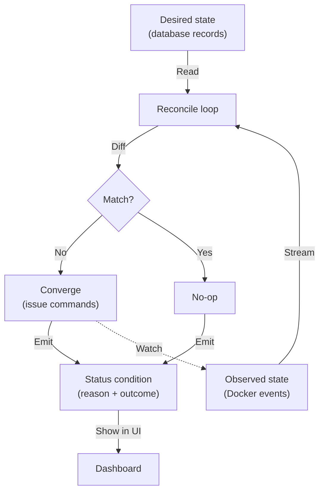
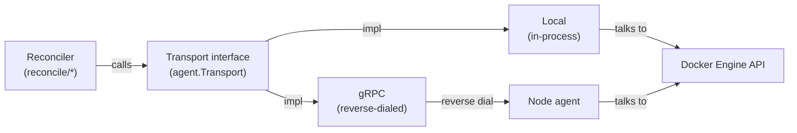
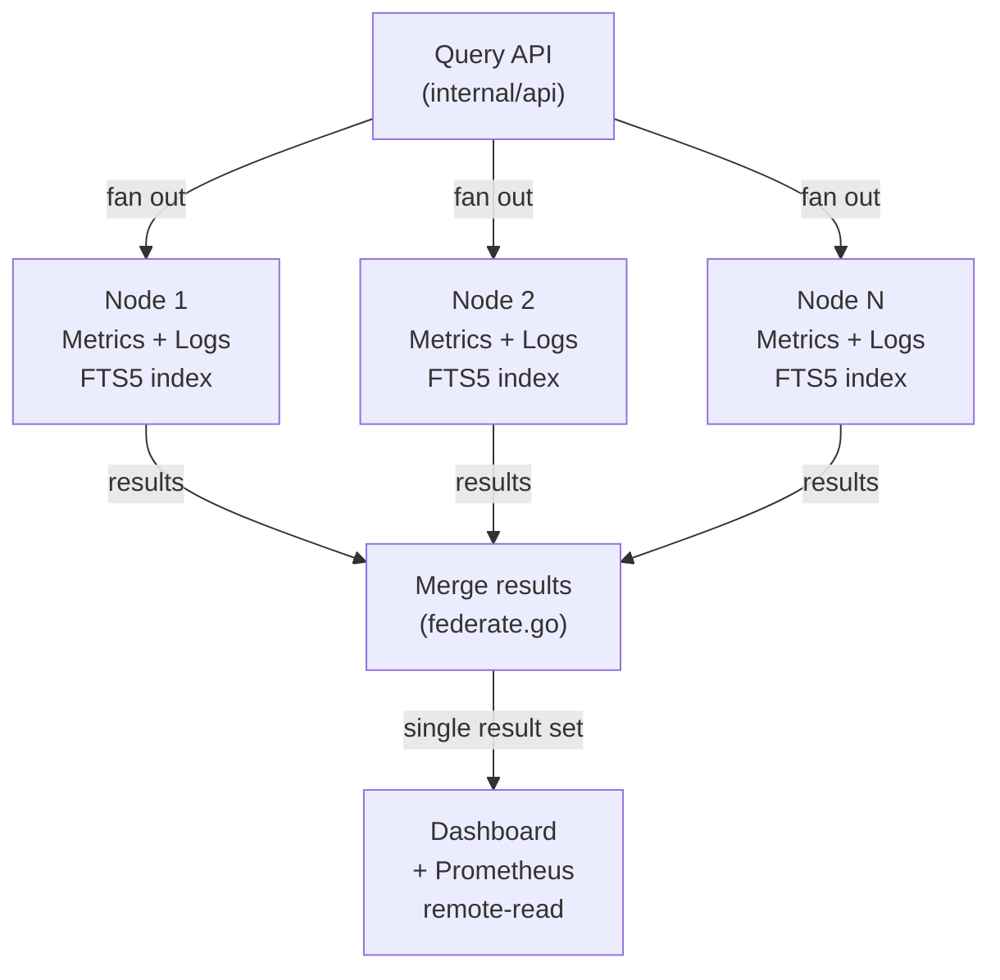

This page explains how Levelrail is built, for contributors and for operators who want to know what runs on their server. It describes the code as it is today. To use the platform, start with [Getting started](/getting-started). For maturity per feature, see [feature status](/feature-status).

## Control plane

Package: `internal/reconcile` (see `internal/reconcile/engine.go`, and the per-resource controllers under `internal/reconcile/application`, `internal/reconcile/database`, `internal/reconcile/ingress`, `internal/reconcile/mesh`, `internal/reconcile/nodehealth`).

The core loop is a reconciler, not an imperative deploy script. Desired state lives in the database as declarative resource records. Each controller compares desired state against what Docker reports and makes the two match. The pattern comes from Kubernetes controllers, without the rest of the Kubernetes runtime.

Every controller is idempotent and level-triggered, never edge-triggered. `Reconcile` never assumes it's continuing a previous partial operation. On every call it works out what to do from current observed state alone.

That makes it safe to interrupt and safe to retry. Call it again after a half-finished attempt and it converges, instead of double-applying or corrupting state.

Every reconcile also emits a status condition with a reason string. A failure shows up in the UI with an explanation, not a spinner that never resolves.

## Node agent

Packages: `internal/agent` (see `internal/agent/transport.go`, `internal/agent/grpc_transport.go`, `internal/agent/server.go`) and `internal/docker` (see `internal/docker/client.go`).

The node agent dials out to the control plane, not the other way around, so managed servers never need an inbound port open. It talks to the local Docker Engine API directly and never shells out to the `docker` CLI.

The transport is an interface (`agent.Transport`) with two implementations:
- `Local` - calls a `docker.Runtime` in-process (single-node)
- `GRPCTransport` - dispatches the same calls over a real reverse-dialed gRPC connection with mTLS ([multi-node](/multi-node))

Both ship today, along with node enrollment (one-time join tokens exchanged for client certificates), a real `levelrail-agent` binary, and cross-node service placement. Reconcilers and everything above the transport boundary don't know which implementation they're talking to, so single-node and multi-node run the same code path.

Two more pieces sit alongside the agent:
- WireGuard mesh: `internal/network` (built on `wireguard-go`) is designed to give every node a peer and internal DNS names that resolve across machines. It is beta and not yet verified across real hosts, see [feature status](/feature-status)
- Dedicated build nodes: nodes marked build-capable run builds so they don't compete with production containers for CPU

## Builds

Package: `internal/build` (see `internal/build/client.go`, `internal/build/solve.go`).

Builds go through BuildKit's Go client, not `docker build`. That gives you a remote build cache and parallel stage execution, which the CLI path doesn't offer.

Three build types are supported:
- Dockerfile builds go through the `dockerfile.v0` frontend
- Railpack (`github.com/railwayapp/railpack`) detects a build plan for apps that don't ship a Dockerfile
- Static sites (`build.type: static`) take their own path with no container involved

The remote cache is registry-backed (`internal/build/cache.go`), with an S3 option (`internal/build/cache_s3.go`). Dedicated [build nodes](/build-node-routing) share it instead of each rebuilding from scratch.

## Ingress

Package: `internal/ingress` (see `internal/ingress/driver.go`, `internal/ingress/certstorage.go`).

Caddy (`github.com/caddyserver/caddy/v2`) is embedded as a library and driven in-process through its admin API, instead of running as a separate container with its own config. You get automatic TLS and HTTP/3 without a second moving part to operate.

Certificates and ACME account keys live in the database (`internal/ingress/certstorage.go` implements `certmagic.Storage` over `internal/store`), so certs are shared across nodes rather than pinned to whichever machine issued them. On first start after an upgrade, `internal/ingress/certimport.go` copies any certificates Caddy had written to its on-disk storage into the database, so nothing re-issues. Saving a different CA drops the other issuers' certificates (`internal/ingress/certpurge.go`), because certmagic reuses a valid certificate from any issuer.

`internal/ingress/publicip.go` resolves the server's public IP at startup (`APP_PUBLIC_HOST`, else a probe of public what-is-my-IP services). That gives zero-DNS hostnames: `<dashed-ip>.sslip.io` is built from it for the dashboard (one-click Enable HTTPS, `internal/api/ingress_https.go`) and `<app>.<dashed-ip>.sslip.io` for every app with no domain (`internal/ingress/fallback_domain.go`, toggle in `ingress_settings.fallback_domains_disabled`).

When the HTTP ingress port can be bound, Caddy's automatic redirect server owns it (`308` to https) and also serves HTTP-01 challenges. Otherwise the port stays closed outside challenges.

An `events` subscription (`internal/ingress/acme_events.go`) records certmagic's `cert_failed` events per hostname, so the API can report the CA's own error and a hint (`GET /api/v1/settings/ingress/https`).

TLS issuance works like this:
- Defaults to an internal, self-signed issuer
- A real Caddy ACME issuer, settings toggle, and form validation are built and wired end to end
- Verified: real Let's Encrypt issuance over `<dashed-ip>.sslip.io` on a public VPS (see [the recorded run](/acme-verification-runbook#recorded-run-2026-10-05)). Renewal and DNS-01 wildcards are still not exercised live

## State

Package: `internal/store` (see `internal/store/store.go`,
`internal/store/database.go`, `internal/store/migrate.go`).

State is embedded SQLite in WAL mode, opened via `modernc.org/sqlite`
(pure Go, no cgo), which keeps cross-compiling the control plane binary
simple. Schema changes go through embedded, versioned, forward-only
migrations.

## Observability

Package: `internal/telemetry` (see `internal/telemetry/collector.go`, `internal/telemetry/logs.go`, `internal/telemetry/federate.go`).

Each node keeps its own data:
- A metrics store: a local time-series store at 15s resolution (CPU, memory, disk IO, network IO, deploy count, build duration)
- A log store: local logs with full-text search (FTS5) and structured JSON log parsing

Nothing is centrally indexed by default, so idle cost stays near zero as you add apps.

Federated query is shipped, not planned. `internal/telemetry/federate.go` defines a `MetricsSource` interface that both the local, single-node store and a remote node's data satisfy identically. The query API (`internal/api`) fans a query out and merges results across nodes.

A Prometheus remote-read endpoint exposes the same data, so you can point your own Grafana at it.

Alerting and detection sit on top of the metrics and log layer:
- Alerting rules (threshold, crashloop, certificate expiry, and more) delivered over 18 notification kinds, from Slack, Discord, email, and Telegram to PagerDuty, ntfy, a generic webhook, and browser push
- Crashloop detection that surfaces the last 200 lines of a failing container's logs directly in the UI

## Secrets

Package: `internal/secrets` (see `internal/secrets/manager.go`, `internal/secrets/dek.go`).

Secrets use envelope encryption: a per-app data encryption key, wrapped by a master key the control plane holds. Agents receive decrypted environment variables only at container-create time and never write them to disk. The crypto primitives come from `filippo.io/age`.

## Frontend

Directory: `web/` (React, Vite, TypeScript, Tailwind, TanStack Router and Query).

The frontend builds to static assets and is embedded into the control plane binary via `embed.FS`, so there's no separate Node process to run in production.

Route-level code splitting keeps bundles small. The log viewer's bundle, for example, stays out of the initial dashboard load.

Live build logs and app log tailing use server-sent events (SSE) instead of websockets, because SSE reconnects cleanly through proxies.

## See also

- [Comparison](/comparison): how this architecture compares to Coolify, Dokploy, and others
- [Security overview](/security): how secrets, tokens, and TLS fit into this design
- [Feature status](/feature-status): maturity of each layer
- [ADRs](https://github.com/glincker/levelrail/tree/main/adr): the decisions behind this design
