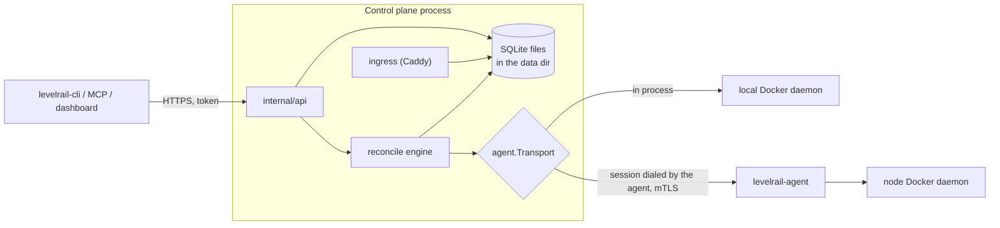
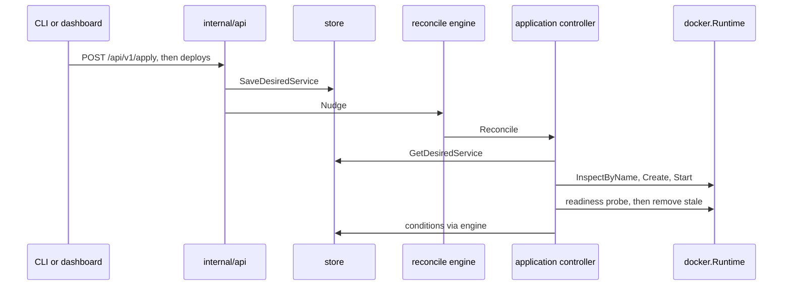

This page is for contributors and for operators who want to know what runs on their server. It describes the code as it is on this branch. Every claim maps to a path in [Where to look](#where-to-look). To use the platform, start with [Getting started](/getting-started). For maturity per feature, see [Feature status](/feature-status). For the checks that protect these boundaries, see [Which guard catches what](/contributing-guards).

## Components

| Component | What it is | Code |
| --- | --- | --- |
| Control plane | One Go binary. Serves the REST API, the embedded dashboard, ingress, the reconcile engine and background workers. | `cmd/levelrail` |
| CLI | `levelrail-cli`. Talks to the control plane over HTTP only. It may not import the store or the Docker client (enforced by a lint rule). | `cmd/levelrail-cli`, `internal/apiclient` |
| Node agent | `levelrail-agent`. Runs on an extra server, dials the control plane, and executes container operations on that server's Docker daemon. | `cmd/levelrail-agent`, `internal/agent` |
| MCP server | `levelrail-mcp`. Wraps REST calls as MCP tools over stdio or loopback HTTP. Write tools are hidden unless `--allow-write` is set. | `cmd/levelrail-mcp`, `internal/mcptools` |
| Reconcile engine | Level-triggered controllers that move observed state toward desired state. | `internal/reconcile` |
| Store | Embedded SQLite through a pure Go driver, forward-only embedded migrations. | `internal/store` |
| API | `net/http` router, ability checks, audit rows, OpenAPI served at `/api/v1/openapi.json`. | `internal/api` |
| Dashboard | React and TypeScript, built to static files and embedded in the binary when built with the `embedweb` tag. | `web`, `web/embed_real.go` |
| Ingress | Caddy embedded as a library. Certificates are kept in the store. | `internal/ingress` |
| Builds | BuildKit client for Dockerfile builds, Railpack for apps without a Dockerfile, a separate path for static sites. | `internal/build`, `internal/deploy` |
| Plugins | Out-of-process extensions with a signed, digest-pinned package and an approved ability list. | `internal/plugin` |
| Backup | Database backups, and verified control plane snapshots under the data dir. | `internal/backup`, `internal/cpbackup` |
| DNS and CDN | Zone management at Cloudflare and Route53 through the DNS provider. | `internal/dnszones` |
| Templates | A curated set of one-click service templates and bundled starter stacks. | `internal/catalog`, `internal/stacktemplates` |

## Process model

On a single host there is one control plane process. It opens its SQLite files in the data dir, starts the reconcile engine against the local Docker daemon, binds the API and the ingress, and serves the dashboard from the embedded files. `agent.Local` calls the Docker runtime in the same process.

With extra nodes, each node runs `levelrail-agent` next to its own Docker daemon. The agent connects out to the control plane, so a managed node needs no inbound port for control traffic. The control plane holds the other end of that session as `agent.GRPCTransport`. Controllers call the same `agent.Transport` interface either way.

## Deploy data flow

The same path serves the dashboard, the CLI and the MCP tools, because they all call the REST API. `levelrail-cli apply -f` is the declarative entry. The verb `apps apply` is different: it restarts an app so saved env, secret and config changes reach the running container.

1. `levelrail-cli apply -f` validates the files, asks `POST /api/v1/apply/plan` for a plan, prints it, and sends `POST /api/v1/apply` with the plan hash it saw. The server recomputes the plan and returns a conflict if it changed. Apply re-issues each change through the ordinary routes with the caller's own credentials, so ability checks and audit rows are the same as for a manual change.
2. A deploy is `POST /api/v1/apps/{name}/deploys`, guarded by the deploy ability on that app. `handleTriggerDeploy` loads the desired service, resolves the image or release, applies environment protection (a protected environment turns the deploy into a pending approval), and records a deploy attempt.
3. For git or source builds, `deploy.Pipeline.Deploy` builds the image (Dockerfile through BuildKit, Railpack otherwise, static sites separately) and then saves desired state with `SaveDesiredService`. Image deploys write the new image into desired state directly. Neither step creates a container.
4. The reconcile engine runs when a Docker event arrives, when `Engine.Nudge` is called, and on a periodic resync. The application controller for that service reads desired state in `Controller.Reconcile`.
5. By strategy (`reconcileBlueGreen`, `reconcileRolling`, `reconcileRecreate`) it computes target container names from the service, image, restart nonce and replica index, and calls `ensureReplicaRunning` for each. A missing target is created and started through the `docker.Runtime` interface (`createAndStart`).
6. `waitReady` runs the readiness probe, and a watch for early exit or OOM kill where the runtime can report it. A replica that fails readiness stops the pass and the failure is recorded.
7. When every target is ready, stale containers of earlier releases are retired (`retireStale`), subject to the drain window and the previous-release hold. The controller returns conditions with a reason string, and the engine stores them for the dashboard.

## Reconcile loop invariants

These are properties the code and its tests rely on. Controllers in `internal/reconcile` must keep them.

- Idempotent and level-triggered. A call derives what to do from desired and observed state, never from the memory of a half-finished call.
- A settled pass creates no containers. The application controller tests run `Reconcile` twice and assert the create count did not change. Recreate has an explicit no-op check, because without it a healthy set would be recreated on every resync.
- Every pass returns conditions with a reason. A maintenance hold, a suspended app and an app still waiting for its first build each return their own reason instead of silence.
- A maintenance hold wins over everything else. While `DesiredService.MaintenanceHold` is set, the controller leaves the containers to whoever set the hold.
- Suspended means zero containers. The controller removes the service's containers and returns early.
- A deploy that lands mid-pass owns the next verdict. If desired state changed while a pass ran, that pass's result is dropped and the nudge from the deploy queues the next one.
- Drain and hold. A retired release is removed only after its drain window, measured from when traffic left it (`DrainTracker`), and the previous release can be kept for a configured hold (`heldFilter`). Both are in memory, so after a restart the timers fall back to creation times.
- Rolling waves. `reconcileRolling` replaces replicas in waves bounded by max surge and max unavailable from the rollout policy.
- Storm protection. The engine rate limits passes and opens a per-controller circuit breaker after repeated failures. The limits are read from `APP_RECONCILE_*` environment variables, and `NudgeController` closes a breaker when a change makes a retry worthwhile.
- Shutdown. A pass in progress can finish for a drain timeout after a stop signal before its context is cancelled.

## Trust boundaries

| Boundary | What enforces it |
| --- | --- |
| Client to API | Bearer tokens with abilities (read, write, deploy, root). Routes check the ability, and many check it per resource. The authz matrix test fails a route that skips this. |
| Control plane to agent | gRPC over TLS 1.3. Agent certificates are issued from a CA the control plane holds. Enrollment uses a one-time join token and a CSR, and the agent can pin the CA fingerprint. Client certificates are requested and verified in code so a rejection can name the node. See ADRs 003, 021 and 032. |
| Control plane to Docker | Docker is driven through its API, not through a shell. `dockerguard` is a Unix socket proxy that forwards an allowlisted set of endpoints and rejects container configurations that would hand a container the host. See [Docker access](/docker-access). |
| App containers | Run as separate containers on Docker networks the controller ensures. Hardening options are applied in `internal/docker`. Decrypted secrets are resolved when a container is created. |
| Plugins | Run as containers with only the abilities an operator approved. Root and write abilities are refused. With no declared hosts a plugin has no network. With `APP_PLUGIN_EGRESS_MODE=proxy` outbound traffic goes through an allowlisting proxy sidecar. See [Plugins](/plugins). |
| Builds | Builds run through BuildKit on the control plane or on a build-capable node. Build secrets are resolved in `internal/deploy/build_secrets.go`. Build output is a container image run like any other. |
| Secrets at rest | Per-owner data keys wrapped by a master key. The key lives in `master.key` in the data dir by default, or comes from `APP_MASTER_KEY` or `APP_MASTER_KEY_FILE`. See [Security](/security). |
| Process spawning | A whole-tree test fails when non-test Go code starts a host process from a file not on a reviewed list. |

## Where state lives

The data dir is `APP_DATA_DIR`, default `./data` for the binary. Installers set their own path.

| State | Location |
| --- | --- |
| Desired state, settings, deploy history, audit rows, encrypted secret values | `levelrail.db` (SQLite, WAL journal) |
| Metrics, logs and traces | `telemetry.db` |
| Alert rules and state | `alerting.db` |
| Master key | `master.key` unless `APP_MASTER_KEY` or `APP_MASTER_KEY_FILE` is used |
| Published static sites | `static/` |
| Control plane snapshots | A directory under the data dir managed by `internal/cpbackup` |
| Certificates and ACME account keys | In the store, not on disk, so they follow the database |
| Agent identity | On the agent node, in `APP_AGENT_STORAGE_DIR` or the file named by `APP_AGENT_IDENTITY_FILE` |

Separate SQLite files for telemetry and alerting keep their write load away from the main store. Container state is not copied anywhere: Docker is the source of truth for what is running, and desired state is the source of truth for what should run.

Migrations live in `internal/store/migrations/*.sql`, are embedded in the binary and applied in version order at start. The migration version check fails on duplicate numbers. An upgrade that fails to open or migrate the store starts safe mode instead of a normal boot.

## API and generated files

Routes are registered in `internal/api/routes_*.go`. `scripts/gen-api-reference` reads them and writes `docs/api-reference.md`, `docs/public/openapi.json` and `internal/api/openapi_gen.go`. These are committed. `scripts/code-gen-check.sh` runs every generator and fails if any tracked file changes. The route tree for the dashboard is generated by `scripts/gen-route-tree.mjs` and is not committed.

## Ingress

Caddy runs inside the control plane process and is driven through its admin API. Certificates and ACME account keys are stored through a `certmagic.Storage` implementation over the store, so they are shared across nodes. The default issuer is internal and self-signed until HTTPS is enabled for a hostname. Real Let's Encrypt issuance has been run over a `<dashed-ip>.sslip.io` name on a public host, see the [recorded run](/acme-verification-runbook#recorded-run-2026-10-05). Renewal and DNS-01 wildcards are not verified on a real host.

## Extension points

- Templates. `internal/catalog` holds the one-click templates as compose bodies. A test parses and validates every one against the supported compose subset. See [Adding a service template](https://github.com/glincker/levelrail/blob/main/.github/CONTRIBUTING.md).
- Plugins. The manifest kinds are `notification_channel`, `dns_provider` and `panel_provider`. A plugin runs out of process and reaches the control plane only through the abilities it was granted. See [Plugins](/plugins) and ADR 034.
- Notification channels. Built-in channels live in `internal/alerting`. A plugin of kind `notification_channel` adds more.
- Platform as code. Resource kinds and their JSON schema live in `internal/iac`, and the schema is published to `docs/schemas/resources.schema.json`.

## Where to look

| Topic | Path |
| --- | --- |
| Boot sequence and wiring | `cmd/levelrail/boot_run.go`, `cmd/levelrail/boot_stores.go`, `cmd/levelrail/boot_loaders.go` |
| Safe mode | `cmd/levelrail/boot_safemode.go`, `internal/safemode` |
| Reconcile engine and storm protection | `internal/reconcile/engine.go`, `internal/reconcile/guard.go` |
| Application controller | `internal/reconcile/application/controller.go`, `drain.go`, `image_truth.go`, `rollout_waves.go` |
| Docker runtime interface | `internal/docker/runtime.go` |
| Agent transport and session | `internal/agent/transport.go`, `internal/agent/grpc_transport.go`, `internal/agent/mux.go` |
| Agent certificates | `internal/agent/credentials.go`, `internal/agent/pki_csr.go` |
| Agent entry point | `cmd/levelrail-agent/main.go` |
| Declarative apply | `cmd/levelrail-cli/apply.go`, `internal/apiclient/iac.go`, `internal/api/iac.go`, `internal/iac` |
| Deploy trigger | `internal/api/deploys.go`, `internal/deploy/deploy.go`, `internal/deploy/order.go` |
| Routes and OpenAPI | `internal/api/routes_*.go`, `scripts/gen-api-reference` |
| Store and migrations | `internal/store/store.go`, `internal/store/migrate.go`, `internal/store/migrations` |
| Secrets | `internal/secrets`, `internal/vault` |
| Docker socket guard | `internal/dockerguard`, `test/execgate` |
| Plugins and egress | `internal/plugin`, `internal/plugin/egress`, `cmd/levelrail/plugin_egress.go` |
| MCP server | `cmd/levelrail-mcp`, `internal/mcptools` |
| Ingress | `internal/ingress` |
| Builds | `internal/build`, `internal/deploy` |
| Backup | `internal/backup`, `internal/cpbackup` |
| Dashboard | `web`, `web/embed_real.go` |
| Decisions | `adr/` |
