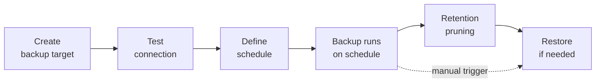

<div className="flex flex-wrap items-center gap-2 not-prose"><span className="inline-flex h-9 w-9 items-center justify-center rounded-lg bg-white p-1.5 ring-1 ring-black/10"></span><span className="inline-flex h-9 w-9 items-center justify-center rounded-lg bg-white p-1.5 ring-1 ring-black/10"></span></div>

This guide covers three related resources:

1. Backup targets: S3-compatible buckets where database and app volume backups are stored.
2. Registry credentials: authentication for pulling private images from external registries.
3. The built-in registry: Levelrail's own `registry:2` container for pushing and caching images locally.

All three share one pattern: an external system that needs a working credential, which you test on demand instead of finding out it is broken mid-deploy or mid-backup. For the database side of backups (restore, point-in-time recovery, verification), see [Managing databases](/managing-databases). For backing up the control plane itself, see [Control plane backup](/control-plane-backup) and [Disaster recovery](/disaster-recovery).

## Backup lifecycle at a glance



## Quick start

<Steps>
<Step title="Connect a backup target">

```bash
levelrail-cli backup-targets create \
  --name "primary-r2" \
  --provider r2 \
  --endpoint https://<account-id>.r2.cloudflarestorage.com \
  --bucket levelrail-backups \
  --access-key-id AKIA... \
  --secret-access-key ...
```

The response never echoes the credentials back. `--provider` accepts `aws`, `r2`, or `custom`. `--endpoint` is required for `r2` and `custom`, and `aws` must omit it (AWS resolves its own endpoint per region). For Backblaze B2, Wasabi, or MinIO, use [Object storage](/object-storage) to connect the bucket as a storage destination: the same record shows up under backup targets.

</Step>
<Step title="Test the credential">

```bash
levelrail-cli backup-targets test bkt_9f2a1c...
```

The command exits non-zero with a specific message ("authentication rejected", "bucket not found") if the credential does not work, and succeeds silently if it does.

</Step>
<Step title="Schedule a database's backups against it">

```bash
levelrail-cli backups schedule set my-postgres \
  --target bkt_9f2a1c... \
  --cron "0 3 * * *" \
  --retain 7 \
  --retain-days 30
```

</Step>
<Step title="Schedule an app volume's backups against the same target">

```bash
levelrail-cli app-volume-backups schedule set my-app uploads \
  --target bkt_9f2a1c... \
  --cron "0 4 * * *" \
  --retain 14
```

</Step>
</Steps>

## Why a backup target is its own resource

A backup target is not a field on a database or volume. It is a separate resource that any number of databases and app volumes reference by ID. You connect a bucket once in **Settings, Backup targets**, every backup schedule references it by `target_id`, and rotating a leaked access key happens in one place.

### Credentials are write-only

Credentials never round-trip through the API.

- `access_key_id` and `secret_access_key` are accepted only in create and update request bodies.
- They are written to the secrets store before the backup target record is saved, so a failed save never orphans a credential.
- `GET` and `PUT` responses never echo credential fields, and error responses never include them.

Registry credentials follow the same pattern: only the `password` field is accepted, it is written to the secrets store first, and it is never echoed back. When you reference a registry credential in `app.yaml` by name, the deploy authenticates without the password being stored in the file.

Every write endpoint on this page returns `501` if the control plane has no master key configured, because none of these resources can hold a working credential without one.

## Test a connection before it is needed

Both resources expose a `POST .../test` endpoint that validates the credential without doing the real operation.


<Tabs>
<Tab title="Backup target">

`POST /api/v1/backup-targets/{id}/test` calls `HeadBucket` against the bucket. Nothing is uploaded or deleted.

- `401` or `403`: authentication rejected. Check the access key ID and secret access key.
- `404`: bucket not found. Check the bucket name, region, and endpoint.
- Anything else: the backup target could not be reached.

CLI: `levelrail-cli backup-targets test <id>`. Dashboard: the **Test connection** button on each row of the Backup targets table.

`HeadBucket` proves the bucket exists and can be reached, but not that the key can write or delete, which backups and pruning need. A storage destination's connection test (`levelrail-cli storage test <id>`) does a full write, read, and delete round trip, see [Object storage](/object-storage#what-the-connection-test-does).

</Tab>
<Tab title="Registry credential">

`POST /api/v1/registry-credentials/{id}/test` authenticates the stored username and password against the registry host the same way a real image pull does. No image is pulled.

- Unauthorized response: authentication rejected by the registry. Check the username and password.
- Anything else: the registry could not be reached.

CLI: `levelrail-cli registry-credentials test <id>`. Dashboard: the **Test connection** button on each row of the Registry credentials table.

</Tab>
</Tabs>

<Tip>
Better to find a stale credential here than from a failed 3am backup or a deploy that dies mid-pull.
</Tip>

## Database and app volume backups

A backup target does not know what it is backing up: databases and app volumes reference the same `target_id`.

| Resource | Trigger | History | Schedule |
| --- | --- | --- | --- |
| Database | `POST /api/v1/databases/{name}/backups` | `GET /api/v1/databases/{name}/backups` | `PUT`/`DELETE /api/v1/databases/{name}/backup-schedule` |
| App volume | `POST /api/v1/apps/{name}/volumes/{volume}/backups` | `GET /api/v1/apps/{name}/volumes/{volume}/backups` | `PUT`/`DELETE /api/v1/apps/{name}/volumes/{volume}/backup-schedule` |

Both trigger endpoints validate `target_id` against a real backup target, create a backup history record, start the dump-and-upload (or volume-tar-and-upload) in the background, and return `202 Accepted` immediately. Poll the history endpoint to see the result: status starts at `running`.

A database dump and a volume archive both stream from their source to the bucket and never touch local disk. The one local write is the backup's own history row, in the control plane's SQLite database under `APP_DATA_DIR`. Before starting, the control plane checks free space there and fails fast with `507` instead of failing confusingly partway through. The floor is `APP_MIN_BACKUP_DISK_MB` (default `256`); an unconfigured or unreadable data directory skips the check.

### Schedules

Database schedules are stored on the database itself. App volume schedules are stored per named volume, because a service can declare several named volumes in `app.yaml` and there is no single "app" to attach one schedule to. Both use the same cron validation (a bad cron string returns `400` at request time), the same retention fields, and the same check that the target exists before saving.

On the dashboard, a database's schedule form is on its Overview page and an app volume's is on the app's Volumes tab. Backup targets themselves are configured account-wide under **Settings, Backup targets**.

### Volume backup commands

App volume backups have the same lifecycle as database backups:

```bash
levelrail-cli app-volume-backups trigger <app> <volume> --target ID
levelrail-cli app-volume-backups list <app> <volume>
levelrail-cli app-volume-backups verify <app> <volume> --backup ID
levelrail-cli app-volume-backups restore <app> <volume> --backup ID --confirm APP/VOLUME
levelrail-cli app-volume-backups restore-as-new <app> <volume> --backup ID
```

### Compression, encryption and consistency

New app volume backups are streamed as tar, compressed with zstd and encrypted with age on the control plane before upload, so the bucket only ever holds ciphertext. Each backup records its encoding, so backups from before this feature stay restorable. The key, retention buckets, consistency hooks and size and time budgets are covered in [Prove your backups work](/prove-your-backups-work).

Database dumps are not re-encoded: they stream straight from the dump command as before.

### Restore to a new volume, app or node

`POST /api/v1/apps/{name}/volumes/{volume}/restore-to` restores a volume backup into a new volume and never writes to an existing one. It takes an optional `target_app` (names the volume for that app so deploying it mounts the data), an optional `node_id`, and an optional `new_volume_name`. On the CLI:

```bash
levelrail-cli backups volumes restore <app> <volume> --backup ID [--target-app APP] [--node NODE] [--new-volume NAME]
```

### Instance-wide backup visibility

`GET /api/v1/backups` (newest first, cursor-paginated with `?limit=&before=`) lists backups across every database and app volume. Each entry carries `resource_kind` (`database` or `volume`) and identity fields (`database_name`, or `service_name` and `volume_name`).

On the CLI the attempt history is `levelrail-cli backups list-all [--limit N] [--before RFC3339]` and the health view is `levelrail-cli backups health`.

### Coverage: what is and is not protected

The top-level **Backups** page leads with coverage, not history. It answers "is everything backed up, and has a restore been proven?" at a glance:

- A summary: how many resources are protected, the last verified restore, the next run and the storage used.
- One row for every database and every app volume, protected or not, each with a state and one primary action.
- A compact card for encryption and bucket safety, a small timeline of restore drills, an **Orphaned data** panel, and a collapsed **Recent activity** section holding the attempt history.

Each resource is in exactly one state:

| State | Meaning | Primary action |
| --- | --- | --- |
| Protected and verified | Scheduled, has a backup, and a restore drill passed | Restore |
| Protected, not verified | Scheduled and backed up, but no restore has been proven | Restore (and Prove restore) |
| Scheduled, never ran | A schedule exists but no backup has completed | Back up now |
| Backups failing | Every attempt failed, or the last drill failed | Back up now |
| Not protected | No schedule or no target. A backup taken by hand does not count | Protect |

A resource counts as protected only when it is scheduled and has a successful backup. [Preview environments](/previews) and canaries are marked **Scratch** and left out of the totals.

**Protect everything** (`POST /api/v1/backups/protect-all`) schedules every unprotected resource in one step. You pick a destination (or connect one inline from a provider preset: Cloudflare R2, Backblaze B2, Wasabi, AWS S3, MinIO, or local disk), a schedule, and how many backups to keep. The dialog previews the plan first, and nothing changes until you apply. Scratch resources are off unless you opt in. The same flow on the CLI:

```bash
levelrail-cli backups coverage [--unprotected]
levelrail-cli backups protect-all --target ID                       # prints the plan, changes nothing
levelrail-cli backups protect-all --target ID --apply [--schedule "0 3 * * *"] [--retain 7] [--retain-days 30]
```

The default schedule and retention come from `APP_BACKUP_DEFAULT_SCHEDULE` (default `0 3 * * *`), `APP_BACKUP_DEFAULT_RETAIN` (default 7) and `APP_BACKUP_DEFAULT_RETAIN_DAYS` (default 30). They are suggestions: a database without a schedule shows them on its own Backups card once a destination exists, and applies them only when you click. The dashboard also shows a recommendation when resources are not backed up.

### Local directory target

For a single box, or to try backups before you have a bucket, add a `local` target. Backups, retention pruning, listing and restore verification work as with S3.

```bash
levelrail-cli backup-targets create --name nightly --provider local --path nightly
```

The directory lives under `APP_BACKUP_LOCAL_ROOT` (default `backups/` under `APP_DATA_DIR`, which must be an absolute path; otherwise local targets are refused until one is set). The path must be relative and cannot leave the root, symlinks included. Directories are created with mode `0700`. Each write checks free space against `APP_MIN_BACKUP_DISK_MB` (default `256`) and refuses with an error when the disk is below it.

<Warning>
A local target lives on the server it protects. It does not help if the server is lost, wiped or its disk fails. Use an off-server target (S3, R2, B2) for data you care about.
</Warning>

<Warning>
The **Local disk** preset points at an S3 server on this machine. Backups stored on the machine they protect are lost with it. It is fine to try things out and wrong for anything you care about.
</Warning>

#### The encryption key

The card shows whether new volume backups are encrypted. The public key is never printed on the page: use **Copy public key** in the disclosure. The private key must be stored off this server, or encrypted backups cannot be restored after a disaster. Until you confirm that you did (`POST /api/v1/backups/encryption-key/ack`), the card keeps a warning. The confirmation is a statement from you, not something the control plane can verify, and it is tied to the public key, so rotating the key asks again.

### Orphaned data

Deleting a database or app does not delete its Docker volumes, so a mistaken delete never destroys data. Volumes this control plane created whose database or app no longer exists are listed under **Orphaned data** with size, age, which resource they belonged to, and the last backup of it (a volume with no backup is flagged).

- **Inspect** shows the volume, its role (data, certificates, WAL archive), its creation time and its last backup.
- **Reclaim** deletes the volume after you type its name. The server re-checks that it is still orphaned and not mounted, so a volume an app started using again is refused.
- Nothing is ever deleted automatically.
- When orphaned data exceeds `APP_ATTENTION_ORPHAN_BYTES` (default 1 GiB), a recommendation appears on the dashboard.

To destroy the data together with the resource, tick **Also delete the data** in the database or app delete dialog, or pass `--delete-data --confirm NAME` on `levelrail-cli databases delete` and `levelrail-cli apps delete`. The API takes `?delete_data=true&confirm=NAME` and needs `write:sensitive`. It only works for resources on the control plane's own node, and the volumes are removed after the containers are gone, so a teardown that has not finished leaves them listed as orphaned data instead.

```bash
levelrail-cli backups orphans list
levelrail-cli backups orphans reclaim db-orders-data --confirm db-orders-data
```

Coverage, protect-all and orphaned data are instance wide. Members of non-default teams cannot reach them.

## Retention

Retention has two independent dimensions, both optional:

- `retain` (count): keep the newest N successful backups by `started_at`.
- `retain_days` (age): keep only backups less than N days old.

They combine, so a backup is deleted when either rule would remove it. With `retain: 7` and `retain_days: 30`, you keep at most the 7 newest backups, and never anything older than 30 days. `0` disables a dimension, and `0` for both disables pruning.

<Warning>
Only succeeded backups are ever pruned. Running and failed attempts are kept regardless of age or count, since you may need a failed attempt's logs.
</Warning>

Pruning runs after every scheduled backup that succeeds, not after manual ones. A pruning failure is logged and does not fail the backup, which is already durably recorded. The dashboard's schedule form defaults a new database's "keep last N backups" to 7 and "delete backups older than (days)" to 0 (no age limit).

## Delete one backup on demand

Retention removes old backups automatically. To delete one specific backup right now without touching the schedule:

- CLI: `levelrail-cli backups delete <database> <backup-id>` or `levelrail-cli app-volume-backups delete <app> <volume> <backup-id>`
- API: `DELETE /api/v1/databases/{name}/backups/{historyId}` or `DELETE /api/v1/apps/{name}/volumes/{volume}/backups/{historyId}`
- Dashboard: the Delete action on every non-running backup row, behind a confirm dialog.

Naming the exact backup ID is the confirmation, so there is no `--confirm` flag. The stored object is removed first (best effort), then the history row. If the object is already gone, the target was deleted, or storage returns an error, the failure is logged and the row is removed anyway, so an explicit delete is never stuck in the history. A backup that is still `running` cannot be deleted (`409`). The endpoint needs `write:sensitive`.

## Alert on a missing or failing backup

A `restore_drill_failed` rule fires while any resource's latest restore drill is failed. A `backup_missing` alert rule watches each database's and app volume's backup schedule. It fires when the last successful backup trails the expected interval by more than the rule's `for_duration` (default 6 hours). It reads the same schedule and history rows the scheduler uses, so it catches both a schedule that silently stopped running and repeated failures with no recent success. It notifies through your normal alert channels. See [Observability](/observability#alert-rules) for the rule table and setup.

## Registry credentials

Registry credentials authenticate to external registries such as Docker Hub or ghcr.io, so deploys can pull private images.

<Steps>
<Step title="Create the credential">

```bash
levelrail-cli registry-credentials create \
  --name ghcr-private \
  --registry-host ghcr.io \
  --username you \
  --password ghp_...
```

`--expires-at RFC3339` records an expiry you already know, such as a GitHub token's.

</Step>
<Step title="Reference it from app.yaml">

```yaml
services:
  web:
    build:
      type: image
      image: ghcr.io/you/private-app:latest
      registryCredential: ghcr-private
```

</Step>
<Step title="Test it before the next deploy relies on it">

```bash
levelrail-cli registry-credentials test <id>
```

</Step>
</Steps>

`expires_at` is informational: it drives a healthy, expiring soon, or expired badge (like TLS certificates), and nothing blocks a deploy from using an expired credential. There is no automatic rotation.

## The built-in container registry

The built-in registry is Levelrail's own `registry:2` container, a local image distribution point with no external dependency. It is separate from registry credentials above.

### Enable it

```bash
levelrail-cli registry enable --host registry.internal.example
```

This calls `PUT /api/v1/settings/registry` with `enabled: true` and the host. It generates the fixed username `levelrail` and a random password, and returns the password once. If you lose it, disable and re-enable to get a new one. Later calls (changing the host, re-enabling) leave existing credentials untouched.

```text
enabled:         true
host:            registry.internal.example
username:        levelrail
has_credentials: true
status:          running

password:        <printed once, never again>

This password is shown once and never again. Store it now, e.g.:
  docker login registry.internal.example -u levelrail
```

`levelrail-cli registry disable` (`DELETE /api/v1/settings/registry`) clears the generated credentials and is idempotent.

### Browse repositories and tags

Repositories and tags come from the running registry's HTTP API v2 catalog, authenticated server-side, so the caller never needs the password. On the dashboard, the "Existing image" picker when creating an app uses this. On the CLI:

```bash
levelrail-cli registry repositories
levelrail-cli registry tags --repository NAME
levelrail-cli registry-credentials repositories <id>
levelrail-cli registry-credentials tags <id> <repository>
```

## What has been tested, and limits

These ran end to end against a real S3-compatible endpoint (SeaweedFS) and real database containers:

| Check | Result |
| --- | --- |
| Backup and restore-as-new for Postgres, MySQL, MariaDB, MongoDB, and Redis (TLS on) | Row and document counts match the source |
| Backup, verify, and restore-as-new for ClickHouse, KeyDB, and Dragonfly (hyphenated names) | Rows and keys match the source |
| Flip one byte of a stored backup, then verify | Verification fails with a checksum mismatch |
| Restore from that corrupted object | Refused before the database is touched |
| Postgres restore of a dump with a failing statement | Fails and leaves the existing data untouched |
| Postgres point-in-time restore, including after deleting both the data volume and the WAL archive volume | Returns exactly the data from before the target time, from the copy shipped to the bucket |
| MySQL and MariaDB point-in-time restore into a new database, with a row written after the base backup and another after the target time | The new database has the base backup rows and the row before the target, not the later one; the source is unchanged |
| Backup, verify and restore-as-new for MySQL, MariaDB and MongoDB through the API | Seeded rows match in the new database |
| App volume backup and restore-as-new with a directory owned by uid 1234:5678 (mode 750), a 640 file with an old mtime, and a symlink | Owners, modes, mtimes, and the symlink are identical |
| Create a database with the name of a deleted one | Refused until you choose to reuse or discard the old data |
| Free-space floor set absurdly high | Manual triggers return `507`; a major upgrade fails in its first phase and the database is never stopped |

Limits to know about:

- A backup is a logical dump (`pg_dump`, `mysqldump`, `mongodump`, an RDB snapshot). It is consistent per database but not a physical copy. For Postgres, MySQL and MariaDB, use point-in-time restore when you need to recover to an exact second.
- Verification catches a damaged or truncated object. It does not prove the dump restores cleanly. Restore drills do: they restore into a scratch resource, validate it and destroy it, automatically once a week by default. See [Prove your backups work](/prove-your-backups-work).
- Deleting a database keeps its data volume and your backups. See [Managing databases](/managing-databases#stop-start-and-delete).
- The free-space floor protects the control plane's data directory. Nothing watches the Docker host's own disk for a major upgrade's snapshot copy: a copy that runs out of space fails the upgrade before it changes anything.
- WAL and binary logs for point-in-time restore are shipped to the backup target only for databases on the control plane's own node.
- A storage endpoint must resolve to a public address unless `APP_NOTIFY_ALLOW_PRIVATE_NETWORKS=true` is set, which a MinIO on the same private network needs.
- Deleting a backup target leaves its stored access key and secret in the secrets store, unreferenced and unreachable through the API but not erased at rest. Registry credentials behave the same way.

## API reference

| Method | Path | Ability |
| --- | --- | --- |
| `GET` | `/api/v1/backup-targets` | `read` |
| `POST` | `/api/v1/backup-targets` | `write:sensitive` |
| `GET` | `/api/v1/backup-targets/{id}` | `read` |
| `PUT` | `/api/v1/backup-targets/{id}` | `write:sensitive` |
| `DELETE` | `/api/v1/backup-targets/{id}` | `write:sensitive` |
| `POST` | `/api/v1/backup-targets/{id}/test` | `write:sensitive` |
| `GET` | `/api/v1/registry-credentials` | `read` |
| `POST` | `/api/v1/registry-credentials` | `write:sensitive` |
| `GET` | `/api/v1/registry-credentials/{id}` | `read` |
| `PUT` | `/api/v1/registry-credentials/{id}` | `write:sensitive` |
| `DELETE` | `/api/v1/registry-credentials/{id}` | `write:sensitive` |
| `POST` | `/api/v1/registry-credentials/{id}/test` | `write:sensitive` |
| `GET` | `/api/v1/registry-credentials/{id}/repositories` | `read:sensitive` |
| `GET` | `/api/v1/registry-credentials/{id}/tags?repository=...` | `read:sensitive` |
| `GET` | `/api/v1/settings/registry` | `read` |
| `PUT` | `/api/v1/settings/registry` | `root` |
| `DELETE` | `/api/v1/settings/registry` | `root` |
| `GET` | `/api/v1/registry/repositories` | `read` |
| `GET` | `/api/v1/registry/tags?repository=...` | `read` |
| `GET` | `/api/v1/backups?limit=&before=` | `read` |
| `POST` | `/api/v1/databases/{name}/backups` | `write:sensitive` |
| `GET` | `/api/v1/databases/{name}/backups?limit=&before=` | `read` |
| `DELETE` | `/api/v1/databases/{name}/backups/{historyId}` | `write:sensitive` |
| `PUT` | `/api/v1/databases/{name}/backup-schedule` | `write:sensitive` |
| `DELETE` | `/api/v1/databases/{name}/backup-schedule` | `write:sensitive` |
| `GET` | `/api/v1/backups/health` | `read` |
| `GET` | `/api/v1/backups/coverage` | `read` |
| `POST` | `/api/v1/backups/protect-all` | `write:sensitive` |
| `POST` | `/api/v1/backups/encryption-key/ack` | `write:sensitive` |
| `GET` | `/api/v1/storage/orphans` | `read` |
| `DELETE` | `/api/v1/storage/orphans/{id}` | `write:sensitive` |
| `GET` | `/api/v1/backups/drills?service=&volume=&database=&limit=` | `read` |
| `GET` | `/api/v1/backups/drills/{id}` | `read` |
| `POST` | `/api/v1/backups/drills` | `write:sensitive` |
| `POST` | `/api/v1/backups/protection/refresh` | `write:sensitive` |
| `GET` | `/api/v1/apps/{name}/volumes/{volume}/backup-policy` | `read` |
| `PUT` | `/api/v1/apps/{name}/volumes/{volume}/backup-policy` | `write:sensitive` |
| `POST` | `/api/v1/apps/{name}/volumes/{volume}/restore-to` | `write:sensitive` |
| `POST` | `/api/v1/apps/{name}/volumes/{volume}/backups` | `write:sensitive` |
| `GET` | `/api/v1/apps/{name}/volumes/{volume}/backups?limit=&before=` | `read` |
| `DELETE` | `/api/v1/apps/{name}/volumes/{volume}/backups/{historyId}` | `write:sensitive` |
| `GET` | `/api/v1/apps/{name}/volumes/{volume}/backup-schedule` | `read` |
| `PUT` | `/api/v1/apps/{name}/volumes/{volume}/backup-schedule` | `write:sensitive` |
| `DELETE` | `/api/v1/apps/{name}/volumes/{volume}/backup-schedule` | `write:sensitive` |

## CLI

```bash
levelrail-cli backup-targets list
levelrail-cli backup-targets get <id>
levelrail-cli backup-targets delete <id>
levelrail-cli backup-targets test <id>
levelrail-cli backup-targets create --name NAME --provider PROVIDER --bucket BUCKET --access-key-id ID --secret-access-key KEY [--endpoint URL] [--region REGION]
# --endpoint is required for r2 and custom, --region is also required for custom.
levelrail-cli backup-targets update <id> --name NAME --provider PROVIDER --bucket BUCKET [--access-key-id ID --secret-access-key KEY] [--endpoint URL] [--region REGION]

levelrail-cli registry-credentials list
levelrail-cli registry-credentials get <id>
levelrail-cli registry-credentials delete <id>
levelrail-cli registry-credentials test <id>
levelrail-cli registry-credentials create --name NAME --registry-host HOST --username USER --password PASS [--expires-at RFC3339]
levelrail-cli registry-credentials update <id> --name NAME --registry-host HOST --username USER [--password PASS] [--expires-at RFC3339]
levelrail-cli registry-credentials repositories <id>
levelrail-cli registry-credentials tags <id> <repository>

levelrail-cli registry status
levelrail-cli registry enable --host HOST
levelrail-cli registry disable
levelrail-cli registry repositories
levelrail-cli registry tags --repository NAME

levelrail-cli backups schedule set <database> --target ID --cron EXPR [--retain N] [--retain-days N]
levelrail-cli backups schedule clear <database>
levelrail-cli backups delete <database> <backup-id>
levelrail-cli backups list-all [--limit N] [--before RFC3339]
levelrail-cli backups health
levelrail-cli backups protection [--refresh]
levelrail-cli backups drill run --backup ID
levelrail-cli backups drill list [--app A --volume V | --database D]
levelrail-cli backups drill show <drill-id>
levelrail-cli backups volumes list <app> <volume>
levelrail-cli backups volumes policy get|set <app> <volume> [--retain-daily N --retain-weekly N --retain-monthly N --pre-hook CMD --post-hook CMD --pause]
levelrail-cli backups volumes restore <app> <volume> --backup ID [--target-app APP] [--node NODE] [--new-volume NAME]

levelrail-cli app-volume-backups schedule set <app> <volume> --target ID --cron EXPR [--retain N] [--retain-days N]
levelrail-cli app-volume-backups schedule clear <app> <volume>
levelrail-cli app-volume-backups delete <app> <volume> <backup-id>
```

## Troubleshooting

### Scheduled backup not running or missing

Likely cause: The backup schedule is not set, the backup target is not reachable, or the reconciler has not processed the backup task yet.

How to confirm: Check if a schedule is configured: `levelrail-cli backups schedule <database>` or check the database's Backups tab in the dashboard. If a schedule exists, check the target: `levelrail-cli backup-targets test <target-id>` should report success. For recent backups, check the list: `levelrail-cli backups list <database> --limit 10`.

Fix: Set a backup schedule if one does not exist: `levelrail-cli backups schedule set <database> --target <target-id> --cron "0 3 * * *" --retain 7`. If the target fails the test, fix the credentials or connectivity to the backup storage and try again. Wait a few minutes for the next reconcile pass to trigger the next backup.

Still stuck: See [Backup targets](/backups-and-storage#backup-targets) for target setup, or check control plane logs for backup errors with `levelrail logs --since 1h | grep backup`.

### Backup target test fails with "connection refused" or "access denied"

Likely cause: The network path to the backup storage is blocked, or the credentials (access key, secret, or bucket name) are incorrect.

How to confirm: From the node running the control plane, test the connection manually. For S3: `aws s3 ls s3://<bucket> --endpoint <endpoint> --region <region>` with the stored credentials. Check the exact error message: `levelrail-cli backup-targets test <target-id>` shows the failure reason.

Fix: Verify the credentials match your storage provider (check in your provider's console). Verify the bucket name is correct and exists. If using a custom endpoint, ensure the URL is reachable from the control plane network. Update the target if needed: `levelrail-cli backup-targets update <target-id> --access-key-id <id> --secret-access-key <secret>`, then test again.

Still stuck: See [Backup targets](/backups-and-storage#backup-targets) for each provider's setup steps.

### Backup is old, "Health: 1 missing backup" warning

Likely cause: A scheduled backup failed or is delayed. The most recent backup is older than expected based on the schedule.

How to confirm: Check the backup history: `levelrail-cli backups list <database> --limit 5` and note the timestamp on the most recent backup. Compare it to the cron schedule set on the database. Check for backup health: `levelrail-cli backups health` shows overall status. If health is not OK, check the Backups page in the dashboard for individual backup statuses and errors.

Fix: Wait for the next scheduled backup to run (the reconciler checks every 15 seconds). If the backup is still not running after the scheduled time passes, trigger a manual backup: `levelrail-cli backups trigger <database> --target <target-id>`. If the trigger fails, check the backup target connectivity as described above.

Still stuck: Check control plane logs for the backup reconciler: `levelrail logs --since 1h backup | tail -30`.

### Restore fails or restored data is wrong

Likely cause: The backup file is corrupted, the restore target has incompatible schema, or the backup verification drill never ran.

How to confirm: List available backups: `levelrail-cli backups list <database> --limit 5`. Check the backup status: each backup should show "completed". Run a restore drill to verify: `levelrail-cli backups drill run --backup <backup-id>`. A drill that fails means the backup may not restore cleanly.

Fix: Use a different backup from the list (backups older than the failed one are usually safer). Run a drill first to catch issues before attempting a real restore. For a real restore: `levelrail-cli backups restore <database> --backup <backup-id> --confirm <database-name>`. This creates a new database instance from the backup, and you can switch traffic after verifying.

Still stuck: See [Point-in-time restore](/database-upgrades) and [Restore drills](/backups-and-storage) for detailed recovery procedures.

### Registry credentials test fails with "authentication failed"

Likely cause: The username, password, or registry host does not match what the provider has on file, or the token has expired.

How to confirm: Check the credentials are correct: `levelrail-cli registry-credentials get <id>` shows the registry host and username (password is never returned). Test manually from the control plane: `docker login <host> --username <user> --password <password>` should succeed.

Fix: Update the credentials: `levelrail-cli registry-credentials update <id> --username <user> --password <password>`. If the token has an expiry, rotate it at your registry provider first, then update here. Test again: `levelrail-cli registry-credentials test <id>`.

Still stuck: See [Registry credentials](/backups-and-storage#registry-credentials) for setup per provider.

## Next steps

<CardGroup cols={2}>
<Card title="Managing databases" href="/managing-databases">

Restore, point-in-time recovery, and backup verification.

</Card>
<Card title="Object storage" href="/object-storage">

Connect Backblaze B2, Wasabi, MinIO, and other S3-compatible buckets.

</Card>
<Card title="Observability" href="/observability">

Alert rules, including `backup_missing`.

</Card>
<Card title="Deploying apps" href="/deploying-apps">

Deploy apps that use registry credentials.

</Card>
</CardGroup>
