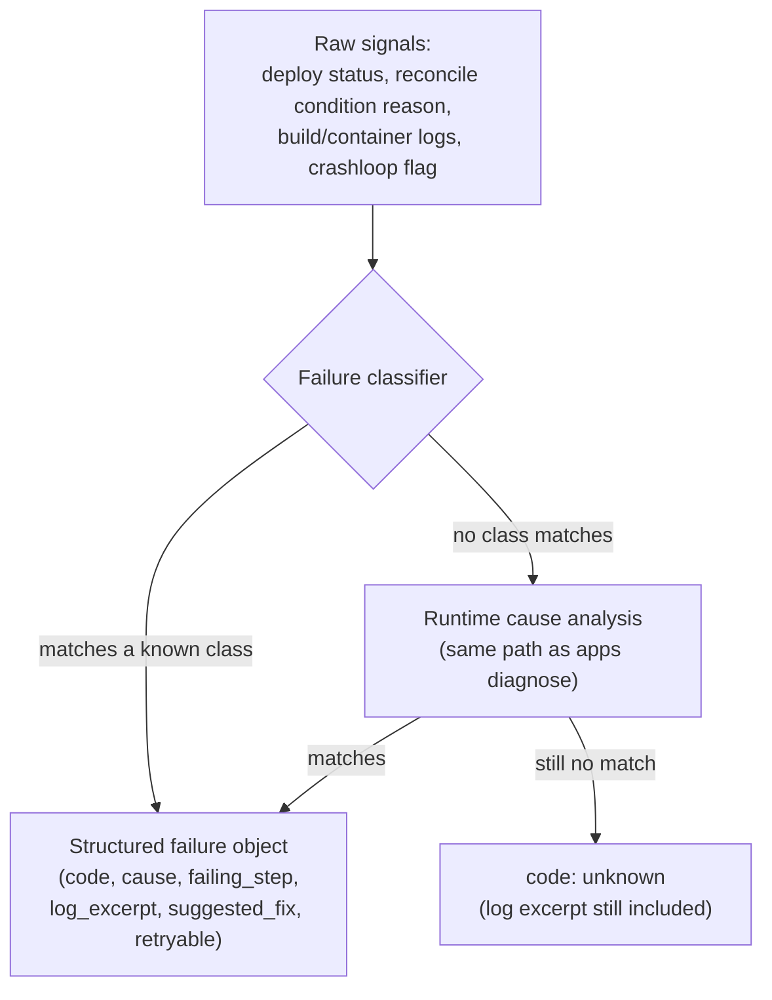

A deploy that fails, is held, or does not become healthy carries one structured `failure` object. The same object comes back from the API, the CLI and the MCP tools, so a person and an agent read the same explanation.



```json
{
  "code": "dockerfile_error",
  "cause": "The Dockerfile is invalid or a file it references is missing from the build context.",
  "failing_step": "building",
  "log_excerpt": "failed to read dockerfile: open Dockerfile: no such file or directory",
  "suggested_fix": "Check build.path and build.baseDirectory in the app spec ...",
  "docs_url": "/deploy-failures#dockerfile_error",
  "retryable": false,
  "deploy_id": "da_8f2c",
  "app": "web",
  "at": "2026-09-26T10:02:11Z"
}
```

`log_excerpt` is the last relevant lines, capped and passed through the same secret redaction as the rest of the platform. Set `APP_FAILURE_EXCERPT_LINES` (default 20) and `APP_FAILURE_EXCERPT_BYTES` (default 4000) to change the caps. `retryable` is true when running the same deploy again can succeed without changing anything (a transient registry error, a freeze window that ends). Unrecognised failures get code `unknown` with the excerpt so nothing is hidden.

## Where to read it

- API: `GET /api/v1/apps/{name}/deploys/{deployId}` (`deployId` may be `latest`), and the additive `failure` field on `GET /api/v1/apps/{name}/deploy-attempts`, `GET /api/v1/deploys/failed`, `GET /api/v1/deployments` (next to the existing `error_summary`) and `GET /api/v1/apps/{name}/diagnose`.
- CLI: `levelrail-cli apps deploys show <name> [deploy-id]` (add `--json` for the raw object). `apps diagnose` prints it too.
- MCP: `get_deploy` (a deploy id or `latest`), and the `failure` field of `diagnose_app_failure`, `list_deployments` and `list_failed_deploys`.

The first stage is a table of known classes. When none matches, the runtime cause analysis behind `apps diagnose` is consulted before falling back to `unknown`.

When several classes match one log, the most specific wins (the table is ordered most specific first) and the others are listed in `also_matched`. ANSI colour codes are stripped before matching, and only the last 5000 log lines are scanned. The deploy page timeline shows each stage with its duration and marks the stage that failed; `apps deploys steps <name> <deploy-id>` prints the pipeline steps in the terminal.

To try it, deploy `test/fixtures/failing-build`: it fails with `lockfile_out_of_sync`.

## Waiting for a deploy

`GET /api/v1/apps/{name}/deploys/{deployId}` also returns an `outcome`: `in_progress`, `healthy`, `failed`, `canceled`, `superseded` or `blocked` (held by a freeze window or an approval). It is keyed on that one deploy: a container that reports serving this deploy's image is healthy, and rollout failures only count for the app's newest deploy, so a later restart or deploy cannot change an earlier deploy's result.

- CLI: `levelrail-cli apps deploys wait <name> [deploy-id] [--timeout 10m]` blocks and prints the final status plus the failure. Exit codes: 0 healthy, 7 failed, canceled, superseded or blocked, 6 timeout. Without a deploy id the newest deploy is resolved once and followed by id. The older `apps wait` keeps its flags and exit codes (5 failed) and now also pins the deploy it started on.
- MCP: `wait_for_deploy` blocks at most `APP_MCP_WAIT_WINDOW_SECONDS` (default 55) per call, because MCP call timeouts are shorter than deploys. When the deploy is still running it returns `{"status":"in_progress","poll_again":true,"deploy_id":"..."}`: call again with that `deploy_id` until `poll_again` is false. `APP_MCP_WAIT_POLL_SECONDS` (default 2) sets the poll period.

## Failure codes

### dockerfile_error
The Dockerfile is invalid or a file it references is missing. Check `build.path` and `build.baseDirectory`, fix the syntax, and make sure every `COPY` source is committed and not excluded by `.dockerignore`. A repo with no Dockerfile builds with `build.type: railpack` (`--build-type railpack`), which a manual rebuild does not remember.

When a build fails because the Dockerfile path in the git source is wrong, the failed deploy's diagnosis lists the Dockerfiles the repository really has and offers a **Build from this one instead** fix. Applying it updates the build settings and starts a new build.

### dependency_install_failed
A dependency install step in the build failed. Read the failing command in the excerpt, fix the lockfile or version pin, and confirm the package registry is reachable from the [build node](/build-node-routing).

### compile_error
The application code failed to compile (tsc, Next.js, go build, cargo, javac). The excerpt shows the compiler line with the file and position. Fix it, confirm it builds locally, then redeploy.

### build_config_error
The build could not tell what to build or run: a script the build calls is missing from `package.json`, or no start command was detected. Add the script or set an explicit start command or Dockerfile in the [app spec](/app-spec-reference).

### build_out_of_memory
The build was killed for memory. Give the build node more memory, lower build parallelism, or build a smaller target.

### build_timeout
The build passed its time limit. Retryable. Enable the remote build cache or split slow stages.

### image_pull_failed
The image could not be pulled: wrong name or tag, or the registry denied access. Check the name and add or refresh the registry credential.

### registry_auth_failed
The registry rejected the credentials or none was supplied for a private registry (`no basic auth credentials`, `unauthorized: authentication required`). Add or refresh the registry credential for that host and check its token scope and expiry.

### platform_mismatch
The image targets a different CPU architecture than the node (`exec format error`, `no matching manifest for linux/amd64`). Build for the node's platform or pick a tag that publishes it.

### lockfile_out_of_sync
A locked install refused to run because the lockfile is missing or stale (`npm ci can only install packages when ... are in sync`, `ERR_PNPM_NO_LOCKFILE`). Run the install locally, commit the lockfile, and keep it out of `.dockerignore`.

### port_not_listening
The container started but nothing listens on the configured port. Bind `0.0.0.0` on the spec port (the `PORT` env var is injected) or fix the spec port.

### health_check_failed
The container never passed its readiness check. Confirm `health.readiness.path` answers quickly, or raise `health.readyTimeout` for a slow start.

### container_crashed
The container exited or is restarting. Read the excerpt for what happens right after start (bad command, missing file, config error), then fix and redeploy or roll back.

### oom_killed
The running container was killed for exceeding its memory limit. Raise the memory limit or reduce usage.

### missing_env
A required environment variable or secret has no value. Set it on the app and redeploy.

### registry_push_failed
Pushing the built image failed. Retryable. Check the registry credential, repository permissions and reachability.

### disk_full
The host ran out of disk, or the build disk preflight found less free space than `APP_MIN_BUILD_DISK_MB`. Prune unused images and build cache, then retry. Deploys, backups and pulls are also refused before they start when the data or Docker volume is below `APP_DISK_CRITICAL_FREE_MB`; use **Free space now** on the System status page.

### docker_unreachable
The control plane could not reach the Docker daemon on the target node. Retryable once the daemon is back.

### build_engine_unsupported
The container engine has no BuildKit (Podman), so Dockerfile and Railpack source builds cannot run. Deploy a prebuilt image, or run Docker for source builds. See [container runtimes](/container-runtimes).

### git_host_unreachable
The git host could not be reached and the commit is not in the source cache. Retryable: redeploy a known commit, roll back, or use **Deploy from cache**. See [Deploying through git host outages](/git-host-outages).

### source_not_cached
Deploy from cache was requested but the cache does not hold the commit. Deploy it once while the git host is reachable, or raise `APP_SOURCE_CACHE_MAX_BYTES` and `APP_SOURCE_CACHE_MAX_AGE` if it was pruned.

### image_corrupt
The image or one of its layers is corrupt or incomplete on the node. Retryable: redeploy so it is pulled or rebuilt again, and prune the node's image cache if it repeats. See [Resilience](/resilience).

### freeze_window_hold
The deploy is held by a freeze window. Retryable: it is released when the window ends, or redeploy with an explicit override and a reason.

### approval_pending
The deploy waits for an approval. An approver approves or rejects it under deploy approvals.

### scan_gate_blocked
The supply chain scan gate blocked the release. Fix the vulnerable packages or record a reasoned override.

### rollback_target_gone
The rollback image was garbage collected. Redeploy from source and raise the retained rollback image count.

### unknown
No known class matched. The excerpt and the full deploy log (`apps deploys logs <name> <deploy-id>`) are the source of truth.

## Troubleshooting

### Failure is not listed above or unclear from the code

**Likely cause:** The failure is either `unknown` (no classifier matched), or it is a transient issue that resolved itself.

**How to confirm:** Run `levelrail-cli apps deploys show <name>`. The failure code will be listed, and the excerpt will show the last relevant log lines.

**Fix:** Read the excerpt for context, then run `levelrail-cli apps deploys logs <name> <deploy-id>` to see the full log. The log contains the source of truth for what went wrong.

### Failure is transient and can be retried

**Likely cause:** The app has a failure code marked as retryable, such as `build_timeout` or `docker_unreachable`.

**How to confirm:** Check the structured failure object returned by the API or CLI. The `retryable` field will be true.

**Fix:** Redeploy the app. For `build_timeout`, enable the remote build cache or split slow build stages. For `docker_unreachable`, wait for the Docker daemon to be ready.

### Rollback target is gone

**Likely cause:** The rollback image was garbage collected, or older than the retained images.

**How to confirm:** The failure code will be `rollback_target_gone`.

**Fix:** Redeploy from source (git push or `apps builds trigger`). To keep more rollback images in the future, increase `APP_DEPLOY_ROLLBACK_PINS` on the control plane.

### Still stuck

For the structured failure object with all fields, check the API response: `GET /api/v1/apps/{name}/deploys/{deployId}`. Read the failure's `suggested_fix` field for specific guidance. If the issue persists, run `levelrail-cli apps diagnose <name>` for system information.

### Fixes matched from the build log

When a build fails, the log is also matched against common errors (registry timeouts, out of memory, no space left, missing credentials, a missing base image, peer dependency conflicts, missing modules, an old Go image, permission errors). Each match is a typed fix under `failure.fixes` with a `kind`: `rerun` (the dashboard shows a Retry button), `raise_memory`, `free_disk`, `set_secret` or `edit_source` (each links to the page where it is applied). `levelrail-cli apps deploys show` prints them as `match:` lines.
