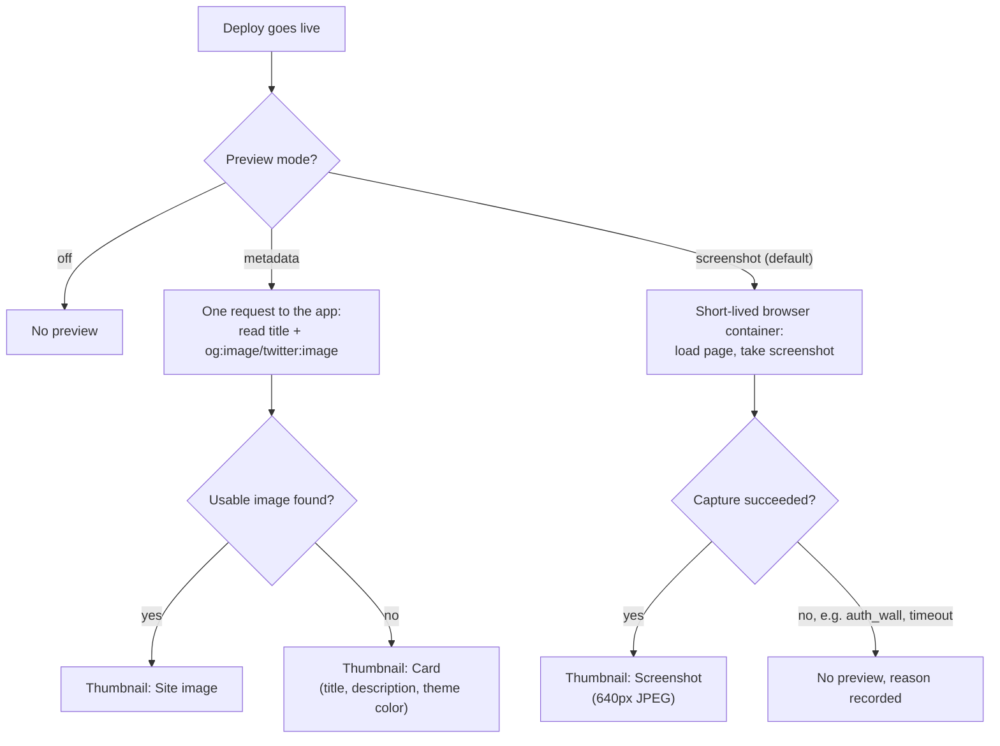

When a deploy goes live, the control plane can save a small thumbnail of the running app and show it in the app's deploy history. There are three modes per app. By default, app cards show a real screenshot of the running page, rendered once and cached, so the app list shows what your app actually looks like.



| Mode | What it does | Cost |
| --- | --- | --- |
| `off` | No preview. | None. |
| `metadata` | One small request to the app, reads its title and social image (`og:image` or `twitter:image`). Uses that image as the thumbnail, or a text card when there is none. | No browser, no container, no browser image download. One request of at most 5 seconds and 512 KB, plus at most one 2 MB social image. |
| `screenshot` (default) | A real screenshot from a short-lived browser container. | Up to 512 MB of memory and 1 CPU for about 10 seconds per render, at most one render per app per hour, and a browser image of about 143 MB downloaded once. |

New apps start in the server's default mode, `screenshot`, which you can change with the runtime setting `preview.default_mode` (`metadata` or `screenshot`). A per-app choice always wins.

## When a screenshot renders

- Only **web and static apps** that serve a page render. API, worker, cron and database apps never do: their cards are type specific.
- A render is queued in the background when an app's card is first listed without a screenshot, and when a new release goes live. It is never done while a request waits, and at most one render is queued per app.
- Renders are rate limited per app by `preview.min_interval_seconds` (default one hour), so a burst of redeploys costs one render. A manual recapture ignores the limit.
- Only `preview.max_concurrent` renders run at once (default 1).
- If the app is not running, answers an error, shows a login or times out, the card shows a quiet text card and the render is **not** retried in a loop. It tries again on the next deploy, or when you recapture.
- The list API reports `preview.state` for each web or static app: `none`, `queued`, `rendering`, `ready` or `failed` (with a `reason`). The dashboard shows a skeleton while a render is queued or running.
- An app on another node is rendered through its public address (its first domain) from the control plane, when it has one. The address goes through the same outbound guard as webhooks: internal addresses are refused, and the host name is pinned to the address that was checked. Without a public address the card says `remote_node`.

## Memory cost and how to turn it off

The headless browser is started on demand and stopped `preview.idle_stop_seconds` (default 120) after the last render, so nothing sits in memory between bursts. While running it is capped by `preview.browser_memory_mb` (default 512) and `preview.browser_cpu_millis` (default 1000). Set `preview.idle_stop_seconds` to 0 to stop it right after each render.

To turn real renders off, set `preview.default_mode` to `metadata` (no browser, ever), or set an app to `off`. `APP_PREVIEW_ENABLED=false` switches the whole feature off.

## Choose a mode

<Tabs>
<Tab title="UI">

Open the app, then **Deploy settings**, then **Deploy previews**, and pick a mode.

</Tab>
<Tab title="CLI">

```bash
levelrail-cli preview enable web --mode metadata
levelrail-cli preview enable web --mode screenshot --path /pricing
levelrail-cli preview disable web
levelrail-cli preview status web
levelrail-cli preview capture web
```

</Tab>
</Tabs>

`preview enable` without `--mode` means `screenshot`, as `enabled: true` always did. The next successful deploy gets a thumbnail. **Recapture** in deploy history (or `levelrail-cli preview capture`) redoes the current release on demand. Each thumbnail carries a badge saying where it came from: Screenshot, Site image or Card.

## What the metadata mode does

- Requests the configured path (default `/`) on the app itself, through the app's published loopback port, the same route the ingress uses. It never contacts the public internet for the page, and you never supply a URL, only a path.
- Sends no cookies or credentials. A 401 or 403, or a redirect to a login page, is recorded as skipped with a reason. Redirects that leave the app are refused, and at most 3 are followed.
- Reads at most 512 KB of HTML with a real HTML tokenizer and keeps the title, `og:title`, `og:description`, `og:image`, `twitter:image`, `theme-color` and icon links.
- If there is an `og:image` (or `twitter:image`), it is resolved against the page, must be an `http` or `https` URL, and is downloaded through the same outbound guard the webhooks use: loopback, private, link-local and metadata-service addresses are refused at connect time, including after redirects. The app's own origin and its own domains are read from the app itself. Limit 2 MB.
- JPEG and PNG images are supported. The image is decoded, scaled down to fit 640 by 400 (never up) and centered on a neutral background, then stored as a JPEG. Images under 120 pixels on a side and single-color images are rejected.
- When there is no usable image, the preview is a card: the deploy history composes it from the page title, description and theme color, with the app name and commit. A card stores about 100 bytes of text and no image file.

Because the page is read as an anonymous visitor would see it, an app whose home page shows a login gets no preview, not a picture of the login.

## What a screenshot capture does

- Pulls the browser image the first time it is needed (`docker.io/chromedp/headless-shell`, pinned to a version, about 140 MB compressed).
- Starts one container with a 512 MB memory cap, 1 CPU, a read-only root filesystem, a small tmpfs, all capabilities dropped, a non-root user and a process limit.
- Attaches it to the app's own Docker network and nothing else. It reaches the app by service name and port. You never supply a URL, only a path on the app.
- Loads the page at 1280x800 without cookies or credentials, waits for the page to settle (at most about 10 seconds), takes a screenshot, and stops the container. The whole capture has a 30 second limit.
- Shrinks the screenshot to a 640 pixel wide JPEG, usually 20 to 60 KB.

A capture takes 2 to 15 seconds after the first one. It runs one at a time across all apps. A burst of deploys queues, and a newer deploy of an app replaces its older queued capture.

## Cost

| Resource | `metadata` | `screenshot` |
| --- | --- | --- |
| Idle | Zero memory, zero CPU. One coarse cleanup pass per hour. | Same. No container, no resident browser. |
| Per deploy | One HTTP request to the app (5 second limit) and at most one image download (2 MB cap). | Up to 512 MB of memory and 1 CPU for about 10 seconds. |
| Download | None. | The browser image, about 143 MB, once. |
| Disk | About 50 KB or less per deploy for a site image, about 100 bytes for a card. | The browser image, plus roughly 40 KB per deploy. |

Screenshot captures are skipped, with the reason recorded, when the host has less than 768 MB of free memory or less than 2 GB of free disk. The metadata mode is not gated on either, because it needs neither.

To use a different browser image, point `APP_PREVIEW_IMAGE` at it. It must expose the DevTools port on 9222 like `headless-shell` does.

## Privacy

A preview is a picture of what the app served, so treat it like the app.

- Screenshots are the default for web and static apps. If you prefer that nothing renders a browser, set `preview.default_mode` to `metadata`, which reads only the public head of your page and at most one image the page itself names.
- Internal pages can leak. If the path you pick shows internal data to anyone who can reach the app, the thumbnail shows it too. Pick a public page, such as `/`.
- The browser never logs in. It sends no cookies and no tokens, and a 401 or 403, or a redirect to a login page, is recorded as skipped with no image stored.
- The image has the same access as the app. It is served only to people who can read the app, through the authenticated API. It is never public and never appears on the public [status page](/status-page).
- This is not a sandbox for hostile apps. The page is loaded by a real browser next to the app. The container limits above contain a browser bug, but only capture apps you run.
- The browser's debugging port is published on the host loopback interface for the length of a capture, on a random port, so other processes on the host can reach it during that window.

## What is skipped

The deploy history shows a "No preview" note with the reason when a capture does not produce an image:

| Reason | Meaning |
| --- | --- |
| `low_ram`, `low_disk` | The host was under the free memory or disk floor. |
| `auth_wall` | The app answered 401 or 403, or redirected to a login page. |
| `http_status` | The app answered a non-2xx status. |
| `unreachable` | The app did not answer on its private network. |
| `blank_image` | The page rendered a single flat color. |
| `no_app_network` | The app has no per-app network or declares no port. |
| `remote_node` | The app runs on another node and has no public address to render. |
| `blocked_target` | The public address resolves to an internal address and was refused. |
| `browser_image_unavailable` | The browser image could not be pulled. |
| `not_html` | The page answered something other than HTML (metadata mode). |
| `redirect` | The page redirected away from the app (metadata mode). |
| `timeout`, `capture_failed`, `bad_image` | The capture itself failed. |

Any of these also appears as the `reason` of a failed card state. A failed recapture never replaces a preview that already exists (image or card), and a card never replaces a site image or screenshot.

## How cards load

The apps list never loads your sites live. `GET /api/v1/apps` carries each app's latest thumbnail URL (or card text) and its render `state` in a `preview` field, so one request describes every card. A card fetches its image only once it scrolls into view. The image URL carries the capture version, and the server answers it with an `ETag`, `Cache-Control: private, max-age=31536000, immutable` (with `?v=`) and Range support, so the browser downloads each deploy's thumbnail once. If the image is missing the card shows the text card, then a plain placeholder. Thumbnails stay JPEG.

## Retention and cleanup

These rules apply to every source alike: screenshots, site images and cards.

- The newest 5 previews of each app are kept, plus the preview of the release now serving.
- Previews older than 30 days are deleted, except the live release's.
- If all previews together pass 200 MB, the least recently viewed go first.
- Previews are deleted when the app is deleted.
- Every capture container carries a role label. On startup and every hour, any older than twice the capture timeout (left by a crash) is removed.
- The browser image is removed after 14 idle days, or at the next cleanup pass once the server switch is off, but only if this control plane pulled it and no container uses it. An image you pulled yourself is never touched.
- **Prune now** (or `levelrail-cli preview prune <app>`) applies these rules immediately. `--all` deletes every preview of the app.

## Settings

The render settings are runtime settings: change them in **Settings**, with `levelrail-cli settings set <key> <value>` or through the API, and they apply to the next render without a restart. The environment variable only seeds the default. See the [runtime settings reference](/runtime-settings).

| Setting | Default | Meaning |
| --- | --- | --- |
| `preview.default_mode` | `screenshot` | Mode of an app nobody has configured: `metadata` or `screenshot`. |
| `preview.max_concurrent` | `1` | Renders at once, 1 to 8. |
| `preview.min_interval_seconds` | `3600` | Least seconds between renders of one app. 0 turns the limit off. |
| `preview.render_timeout_seconds` | `30` | Time limit for one render. |
| `preview.idle_stop_seconds` | `120` | Stop the browser this long after the last render. |
| `preview.browser_memory_mb` | `512` | Browser memory cap. |
| `preview.browser_cpu_millis` | `1000` | Browser CPU cap in thousandths of a core. |

The variables below are read at start, and unset or malformed values fall back to the default.

| Variable | Default | Meaning |
| --- | --- | --- |
| `APP_PREVIEW_ENABLED` | `true` | Global switch. When off, nothing runs in any mode and manual captures are refused. |
| `APP_PREVIEW_META_TIMEOUT` | `5s` | Limit for each request of the metadata mode. |
| `APP_PREVIEW_META_MAX_HTML_KB` | `512` | Most HTML read from a page. |
| `APP_PREVIEW_META_MAX_IMAGE_KB` | `2048` | Largest social image downloaded. |
| `APP_PREVIEW_META_MAX_REDIRECTS` | `3` | Redirects followed, all on the app itself. |
| `APP_PREVIEW_META_MIN_IMAGE_PX` | `120` | Smallest side of a social image worth using. |
| `APP_PREVIEW_THUMB_HEIGHT` | `400` | Height of the canvas a social image is fitted onto. Between 64 and 2048. |
| `APP_PREVIEW_IMAGE` | pinned `chromedp/headless-shell` | Browser image. Point it at your own digest-pinned copy if you prefer. |
| `APP_PREVIEW_TIMEOUT` | `30s` | Seed for the render time limit, and the age after which a leftover capture container is swept. |
| `APP_PREVIEW_PULL_TIMEOUT` | `5m` | Limit for the first image pull. |
| `APP_PREVIEW_CPUS` | `1.0` | Seed for the browser CPU cap. |
| `APP_PREVIEW_VIEWPORT` | `1280x800` | Browser window size. |
| `APP_PREVIEW_THUMB_WIDTH` | `640` | Thumbnail width in pixels. Between 64 and 2048. |
| `APP_PREVIEW_QUALITY` | `72` | JPEG quality. |
| `APP_PREVIEW_MAX_THUMB_KB` | `200` | Largest thumbnail accepted. |
| `APP_PREVIEW_BLANK_RATIO` | `0.995` | Share of one color at which a page counts as blank. |
| `APP_PREVIEW_KEEP_PER_APP` | `5` | Previews kept per app, besides the live one. |
| `APP_PREVIEW_TTL_DAYS` | `30` | Age after which previews are deleted. |
| `APP_PREVIEW_MAX_TOTAL_MB` | `200` | Global storage budget. |
| `APP_PREVIEW_IMAGE_TTL_DAYS` | `14` | Idle days before the browser image is removed. |
| `APP_PREVIEW_MIN_FREE_RAM_MB` | `768` | Skip captures below this much free memory. |
| `APP_PREVIEW_MIN_FREE_DISK_MB` | `2048` | Skip captures below this much free disk. |
| `APP_PREVIEW_QUEUE_DEPTH` | `8` | Captures that may wait. The oldest is dropped when full. |
| `APP_PREVIEW_SWEEP_INTERVAL` | `1h` | How often cleanup runs. |

## API

| Route | Use |
| --- | --- |
| `GET /api/v1/apps/{name}/preview` | Settings, storage used and the latest result. |
| `PUT /api/v1/apps/{name}/preview` | Change `mode` (`off`, `metadata`, `screenshot`), `path` or `wait_ms`. `enabled` is still accepted: `true` means `screenshot`, `false` means `off`. `mode` wins when both are sent. |
| `POST /api/v1/apps/{name}/preview/capture` | Queue a recapture of the current release. |
| `POST /api/v1/apps/{name}/preview/prune` | Prune now. Body `{"all": true}` deletes everything. |
| `GET /api/v1/apps/{name}/preview/history` | One record per deployment, with status, reason, `source` (`screenshot`, `og_image` or `card`) and, for cards, `meta`. |
| `GET /api/v1/apps/{name}/deployments/{id}/preview` | The thumbnail (JPEG). Cards have no image, only `meta`. |

Reading needs the app read ability. Changing settings, capturing and pruning need write. `GET /api/v1/apps/{name}/deploy-attempts` includes `preview_image_url` on each attempt that has a thumbnail.

## Limits

- Apps on other nodes render through their public address only, with no agent change. Without one they are skipped.
- Screenshots skip apps without a per-app network or a declared port. Metadata needs only a running container with a published port.
- WebP and other formats are not decoded for site images, only JPEG and PNG.
- The page is requested by service name, so an app that routes by `Host` header shows its default site.
- Only the viewport is captured, not the full page. Cookie banners and late-loading content appear as the app renders them.
