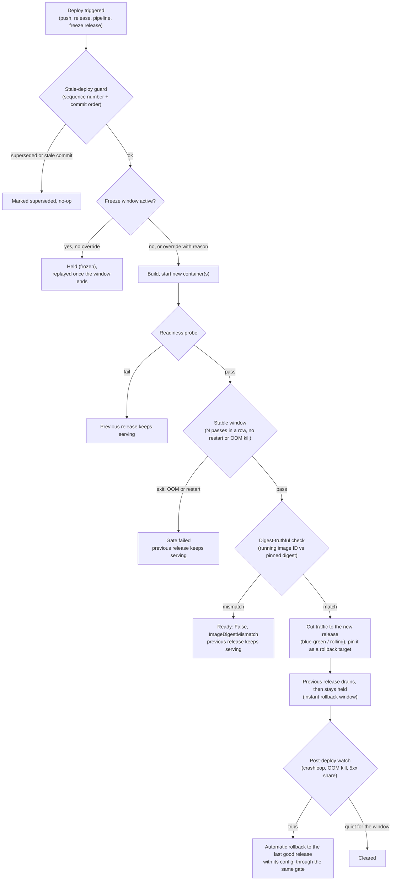

Between "a deploy was triggered" and "that exact content is serving",
Levelrail runs a series of checks. A release has to pass a readiness gate
and hold it for a stable window. The previous release drains. Rollback
targets are pinned, and a post-deploy watch rolls a bad release back. On
top of that there are digest checks, a stale-deploy guard, freeze windows,
and a short hold of the previous release after cutover. The diagram shows
the order.



## Readiness gate

A new container takes traffic only when all of these hold:

- its readiness probe passed `APP_DEPLOY_SUCCESS_THRESHOLD` times in a row
  (default `2`; a failed probe resets the streak),
- it has been running for `APP_DEPLOY_STABLE_WINDOW` (default `10s`),
- it did not exit, restart or get OOM-killed inside that window. The
  controller compares Docker's `RestartCount`, `StartedAt`, `OOMKilled` and
  exit code against what it saw when the window began.

An app with no readiness probe but a declared port is gated on a TCP
connect to that port, with the same consecutive passes and stable window as
any probe. A connection that is accepted and then dropped (what Docker's
published-port proxy does when nothing listens behind it) counts as a
failure, so an image that never listens fails the deploy and the previous
release keeps serving. An app with neither a port nor a probe has nothing to
check: readiness is only "the container is running". The gate timeline says
so in a note, and the deploy suggestions recommend adding a health check.

An app with no readiness probe still has to survive the stable window. A
container that fails the gate is stopped and the deploy attempt is marked
failed with a reason (`OOMKilledDuringStableWindow`,
`ExitedDuringStableWindow`, `RestartedDuringStableWindow`,
`StabilityGateTimeout`, or the existing `ReadinessFailed`,
`OOMKilledDuringReadiness`, `ExitedDuringReadiness`). The previous release
never stops serving: ingress keeps routing to it because the new release
never reports ready. The next reconcile retries the new release under the
crash restart backoff.

Any exit counts, code 0 included: a service container that stops is not
serving, whatever its exit code says. A container that exits while its
readiness probe is still being waited on is noticed within a second, not at
the probe's own interval. The condition, the deploy history and the gate
timeline then say exactly what happened, for example
`Container exited with code 0 after 2s, before it became ready`, and the
last 200 lines the container printed are captured with the failed deploy and
shown on the deploy page, the app overview and the logs page. With the
stable window set to `0` for an app that also has nothing to probe, the
release must still keep running for `APP_DEPLOY_STARTUP_WATCH` (default `3s`,
`0` disables it). Scheduled tasks and job runs are one-shot containers and
are not gated: for them exit 0 is success.

Multi-replica releases are gated replica by replica. With blue-green,
nothing from the old release is retired until every new replica passed its
own gate, so a release where replica 0 passes and replica 1 is OOM-killed
leaves the old release fully in place.

## Drain

After cutover the previous release keeps running for at least
`APP_DEPLOY_DRAIN_TIMEOUT` (default `15s`), measured from the cutover
itself, so requests already in flight on it finish before it is stopped.
Ingress moves new requests to the new release in the same reconcile pass.
With a drain configured, rolling deploys also stop retiring old replicas
mid-pass: they all drain together after the pass, because ingress keeps
balancing over them until then. The drain timeout is a floor on the hold
described in [Holding the previous release](#holding-the-previous-release).

## Rollback pins

Every release that takes traffic is pinned: its image gets an extra local
tag (`<short-name>-rollback/<app>:<deploy-id>`) and a row in the store. A
tagged image is never dangling, so image cleanup can never remove a
rollback target, even after a rebuild moved the original tag to new
content. The newest `APP_DEPLOY_ROLLBACK_PINS` (default `3`) per app are
kept; older pins are untagged without force, so Docker still refuses to
remove an image a container uses.

Rolling back to a deploy (dashboard **Roll back to this**,
`apps deploys rollback-to`, `POST .../deploys/{id}/rollback`) deploys its
registry digest when it has one, otherwise its pin. It restores that
deploy's config too: literal env values, port, health checks, replicas,
strategy, resources and labels. Secret, database and vault references keep
their current values, and domains, volumes and host ports stay as they are
now. `?config=false` keeps the current config. The rollback is an ordinary
deploy, so it passes the same readiness gate.

## Post-deploy watch

For `APP_DEPLOY_WATCH_WINDOW` (default `5m`) after cutover the release is
watched every `APP_DEPLOY_WATCH_INTERVAL` (default `10s`). The watch trips
when:

| Trigger | Default | Reason |
| --- | --- | --- |
| A container was OOM-killed | always | `PostDeployOOMKilled` |
| Restarts (or an exit) reach the limit | `APP_DEPLOY_WATCH_MAX_RESTARTS=2` | `PostDeployCrashloop`, `PostDeployExited` |
| Share of 5xx answers through the ingress | `APP_DEPLOY_WATCH_ERROR_RATE=0.2` after `APP_DEPLOY_WATCH_MIN_REQUESTS=20` requests | `PostDeployErrorRate` |

The 5xx share comes from the ingress request metrics the app already has.
The first metrics sample after cutover is left out, since it can still hold
answers from the previous release.

A p95 latency regression is a soft signal: the new release's p95 must reach
`APP_DEPLOY_WATCH_LATENCY_RATIO` (default `2`) times the previous release's
p95 over the window before cutover, rise by at least
`APP_DEPLOY_WATCH_LATENCY_MIN_DELTA` (default `100ms`), have
`APP_DEPLOY_WATCH_MIN_REQUESTS` requests on both sides, and hold for
`APP_DEPLOY_WATCH_SOFT_TICKS` (default `3`) checks in a row, so one slow
request never counts. A soft signal only sends an alert (reason
`PostDeployLatencyRegression`) unless the app opted in to soft rollback
(`APP_DEPLOY_WATCH_SOFT_ROLLBACK`, or per app) and its mode is `auto`.
A ratio of `0` turns the check off.

The watch has a mode, set by `APP_DEPLOY_WATCH_MODE` (default `notify`) or
per app: `off` does not watch, `notify` alerts on a trip, `auto` also rolls
back. `APP_DEPLOY_AUTO_ROLLBACK=true` is still read and means `auto`.

While a watch is open, the deploy detail page shows its progress with
**Stop watching** and **Roll back now** buttons. The same are
`levelrail-cli apps watch stop web` and `apps rollback`, and
`POST /api/v1/apps/{name}/watch/stop`.

When a hard signal trips the watch, the deploy attempt is marked failed with the reason,
an alert goes out through the app's deploy notification channels, and in
`auto` mode the app is rolled back to the
newest pinned release that is still marked succeeded, with that release's
config. A release the watch already tripped on is failed, so rollbacks never
ping-pong, and a release that is itself an automatic rollback is never
rolled back again: that points at something outside the app, so it is left
for an operator. With auto-rollback on, the previous release is held for the
whole watch window, so the rollback target is still running if the watch
trips.

## Gate timeline

Each deploy records its gate as a timeline: readiness, stable window,
cutover, drain, rollback pin, watch and rollback steps with a status, a
reason and a message. The deploy detail page shows it under **Roll out**,
refreshing until the release clears its watch, fails or is replaced.

```bash
levelrail-cli deploy status web --watch          # newest deploy, follow it
levelrail-cli apps deploys gate web dep_abc123   # one deploy, once
levelrail-cli apps deploys rollback-to web dep_abc123 --watch
```

`deploy status` exits `7` when the release failed its gate, tripped its
watch or was rolled back. The API is
`GET /api/v1/apps/{name}/deploys/{deployId}/gate` (`latest` works as the
id).

## Per-app settings

Every `APP_DEPLOY_*` value above is the platform default. An app can
override the gate and watch thresholds in **Deploy settings → Deploy
safety**, with the CLI, or with `PUT /api/v1/apps/{name}/deploy-safety`
(deploy permission). A `null` field, an empty dashboard field or the CLI
value `default` inherits the platform default. Windows are capped at 30
minutes so one app cannot stall the reconcile loop.

```bash
levelrail-cli apps deploy-safety show web
levelrail-cli apps deploy-safety set web --stable-window 30s --success-threshold 3
levelrail-cli apps deploy-safety set web --auto-rollback false --watch-window default
levelrail-cli apps deploy-safety targets web
levelrail-cli apps watch set web --mode auto --watch-window 10m --latency-ratio 2
levelrail-cli apps watch get web
```

In **Deploy settings** the **Auto rollback** card holds the mode, window and
thresholds. An automatic rollback is recorded in the deploy history (reason
and the measured numbers) and in the audit log as `deploy.auto_rollback`.

## How this is tested

`test/e2e/reconcile/deploy_safety_live_test.go` runs the real application
and ingress controllers on a real reconcile engine against Docker, with the
request metrics pipeline and the watch, while four clients hammer the
ingress. It deploys a good release, a release that exits inside its stable
window, and a release that answers 5xx until the watch rolls it back. The
fixture app drops in-flight requests on `SIGTERM`, so only a real drain
keeps them alive. A run on Docker Desktop: 2617 requests, 0 failed
(transport errors or proxy 5xx), the bad release's own 500s excluded. With
the drain turned off the same test loses requests at cutover.

## Digest-truthful deploys

A floating tag such as `nginx:latest`, `main` or `1.27` names different
content over time. If a platform compares tags or container names, a
redeploy of the same tag can report success while the old image keeps
running.

Every image deploy (dashboard, `apps deploy`, API, pipeline deploy step,
`build.type: image` in `app.yaml`) resolves the tag to its content
digest at deploy time and pins the desired image to it, for example
`nginx:latest@sha256:3f1c...`. For a multi-arch image the digest is the
manifest list, so each node still pulls its own platform. Because the
pinned reference is part of the container identity, new content always
gets a new container and goes through the normal blue-green, rolling or
recreate cutover.

Builds are identified by the local image ID the build produced. Rebuilding
the same commit with different content (a newer base image, different
build args) therefore replaces the container instead of silently keeping
the old one.

The application controller then checks that the running container's image
ID matches what the pinned reference resolves to on its node. If it does
not, the app is reported `Ready: False` with reason `ImageDigestMismatch`
and the previous release keeps serving. It never reports `Deployed` while
the running content differs.

### How the digest was obtained

Each deploy in the history carries a digest and a reason:

| Reason | Meaning |
| --- | --- |
| `Resolved` | The registry answered for the tag at deploy time. |
| `AlreadyPinned` | The reference already carried a digest (a rollback, or you deployed `image@sha256:...`). |
| `LocalBuild` | The image ID of the image this deploy built. |
| `PullFailedUsingCached` | The registry could not be reached, so the locally cached image for the tag was deployed. The dashboard marks this in amber. |
| `Unresolved` | Neither the registry nor the local cache knew the tag; the node resolves it when it creates the container. |

To refuse a cached fallback, deploy with pull:

```bash
levelrail-cli apps deploy web --pull              # re-resolve the current tag
levelrail-cli apps deploy web --image nginx:1.27 --pull
```

With `--pull` (API: `"pull": true`) a deploy fails with 502 when the
registry is unreachable instead of deploying the cached image.

`apps deploys list` shows the digest, the rollout state the controller
last observed (`serving` or `mismatch`) and any reason.

### Rollback

History rows store the pinned reference, so rolling back to a row deploys
exactly the content that row ran, even for a floating tag that has since
moved. Older rows that hold only a tag are re-resolved when you roll back to them.

## Stale-deploy guard

Webhooks can arrive out of order, and a slow build can finish after a
faster, newer one. Every automatic deploy (git push, release event,
pipeline deploy step, a released freeze hold) gets a per-app sequence
number when it is triggered, plus the commit ordering the git provider
sent (`before` and `after` SHAs and the head commit timestamp). When it is
about to write desired state it is compared, in the same transaction, with
the last deploy that actually applied:

- a deploy triggered earlier than one already applied is `superseded`;
- a push whose commit is the parent of the deployed commit, or whose
  commit is older by timestamp, is `superseded` with a `stale commit`
  reason;
- redelivery of the commit that is already deployed is allowed.

Manual deploys and explicit rollbacks are never rejected. They do advance
the sequence, so an older build still in flight cannot undo a rollback.
Superseded deploys show in the history with their reason.

## Freeze windows

A freeze window starts at every match of a 5-field cron expression,
evaluated in a timezone (default UTC), and lasts a duration. Windows can
be set per app and globally; both apply.

While a window is active:

- git push and release webhooks, and pipeline deploy steps, are **held**:
  recorded as `Held (frozen)` in the deploy history and replayed
  automatically once the window ends. If several deploys are held for one
  app, only the newest is replayed; the others are marked superseded.
- manual deploys from the dashboard, CLI or API return 423 unless they
  carry an override with a reason. The reason is recorded on the deploy.

```bash
levelrail-cli apps freeze set web --cron "0 17 * * 5" --duration 64h \
  --timezone Europe/Berlin --reason "weekend freeze"
levelrail-cli apps freeze show web
levelrail-cli apps deploy web --image app:hotfix --override-freeze --override-reason "CVE fix"
levelrail-cli apps freeze clear web
```

In the dashboard, app **Deploy settings** has a **Deploy freeze** card, and
the deploy form asks for an override reason while a freeze is active.
Global windows are managed through `PUT /api/v1/settings/deploy-freeze`
(root only). The MCP server exposes `get_deploy_freeze` read-only.

Held deploys are checked every `APP_DEPLOY_HELD_RELEASE_INTERVAL`
(default `30s`).

## Holding the previous release

After a successful blue-green or rolling cutover the most recent previous
release's running containers are kept for `APP_DEPLOY_PREVIOUS_RELEASE_HOLD`
(default `3m`, `0` disables). The window is measured from the newest
release's first container, so scaling up does not extend it. Only one
previous release is ever held: as soon as a newer previous release exists,
older running releases are removed, so deploying five times in a minute
leaves the current release plus one previous one, not five containers.
During the window a rollback to the held release is instant (no pull, no
cold start), and routes that still point at it keep working. Once the window
passes, the next reconcile removes it. Rolling deploys retire old replicas one at a time but keep the old release's first replica, the one ingress still dials, until the pass ends, so routing never points at a removed container. The `recreate` strategy never holds
anything, since it stops the old release before starting the new one.

`GET /api/v1/apps/{name}` reports `previous_release_held_until` (RFC3339)
while a release is held, and `levelrail-cli apps status <name>` prints it.

## What visitors see during a deploy

The ingress never serves a bare `502` or a TLS error for a domain that was recently routed. When a deploy leaves a domain without a ready container (a `recreate` deploy, a crash, a restart), the domain keeps its route and its certificate for `APP_INGRESS_HOLD_WINDOW` (default `10m`) and answers a styled `503` with `Retry-After` and a page that reloads itself. A request whose container refuses the connection is retried for `APP_INGRESS_RETRY_WINDOW` (default `2s`) first, and with two or more replicas it moves to another replica immediately. The windows that remain, with measured numbers, are listed in [resilience](/resilience#ingress-availability-windows-measured), and every knob is in [Edge limits, client IPs and failover](/domains-and-ingress#edge-limits-client-ips-and-failover).

## Pinned host ports

An app with a pinned host port (`--host-port`) cannot run two releases at once, because the port can only be bound once. For these apps blue-green and rolling deploys stop the serving release, start the new one, and wait for readiness. This is a short outage (the new container's start plus its readiness time), not a zero-downtime cutover. If the new release fails to start or never becomes ready, the new container is removed and the previous release is started again on the same port, and the next attempt is delayed by `APP_DEPLOY_PINNED_PORT_RETRY` (default `5m`) so a broken image does not repeat the outage every reconcile pass. The condition reason is `PinnedPortHandoffBackoff` while waiting. Apps without a pinned port keep the full overlap and are unaffected. A container that Docker starts without publishing the pinned port is removed and recreated (`PinnedPortNotPublished`) instead of being reported as healthy.

## Required secrets

A secret declared `required: true` that has no value fails the deploy with reason `RequiredSecretMissing` and leaves the serving release untouched, whichever way the deploy was triggered.

## Queue, cancel and rollback to a release

Deploys of one app run one at a time. A build or webhook deploy requested
while another deploy of the same app is running (or already queued) is
recorded as `queued` instead of failing or racing, and starts by itself
when the deploy ahead of it finishes or is canceled. Queued deploys survive a
control plane restart. `deploy-attempts` rows carry `queued_at`,
`queue_position`, `wait_reason` (for example `waiting for #dep_x`,
`freeze window until <time>`, `waiting for build capacity`) and `blocked_by`.
Held (frozen) rows report the same `wait_reason`. `GET /api/v1/deployments`
and its stream carry the same `queued_at`, `queue_position`, `wait_reason`,
`blocked_by`, `superseded_by` and `canceled_by` fields. Freeze windows and
protected-environment approvals behave exactly as before; a deploy pending
approval is still an approval, not a queue row.

`APP_DEPLOY_MAX_CONCURRENT` caps how many deploys run at once across all apps
(default unlimited); deploys over the cap wait as queued.

`POST /api/v1/apps/{name}/deploys/{deployId}/cancel` cancels a queued or
running deploy (same permission as triggering one) and records `canceled` with
`canceled_by`. A running build is stopped before it writes desired state, so
the serving release is never touched. Once a deploy has written desired state
it can no longer be canceled and the call answers `409`; roll back instead.

`PUT /api/v1/apps/{name}/cancel-superseded` (`{"enabled": true}`, default off)
lets a newer queued deploy replace older queued deploys of the same branch.
They become `superseded` with `superseded_by` pointing at the newer one. A
deploy that already started building is never canceled automatically.

`POST /api/v1/apps/{name}/deploys/{deployId}/rollback` redeploys the exact
content a past succeeded deploy recorded, pinned by digest or by its
[rollback pin](#rollback-pins), with its config, through the same freeze,
approval and readiness gates as a plain deploy. It answers `410` when the local
image was garbage collected, `409` when its tag now points at other content or
the row recorded no digest.

```bash
levelrail-cli apps deploys cancel web dep_abc123
levelrail-cli apps deploys rollback-to web dep_abc123
levelrail-cli apps cancel-superseded enable web
```

In the dashboard, the deploy history row menu has **Roll back to this** and
**Cancel deploy**, and app **Deploy settings** has the cancel-superseded
switch. The MCP server exposes `cancel_deploy`.

## Cleanup never touches a rollback target

Pruning removes only dangling (untagged) images, and Docker itself refuses to remove an image a container still uses, even when its tag has since moved to newer content. A pinned rollback tag is never dangling, so it is never a candidate. Both properties are checked against a real daemon in `internal/docker/prune_images_live_test.go`: a pinned tag, an untagged image still backing a running container, and a truly orphaned image go in, and only the last one comes out. A rollback whose image is gone anyway answers `410` with an instruction to redeploy from source instead of a half-working deploy. See [Delete and clean up](/deploying-apps#delete-and-clean-up) for the container, volume and certificate reaper.

## Limits

- On remote nodes reached over the agent transport the running image ID is
  not yet reported, so the controller cannot detect a mismatch there; the
  digest pinning itself still applies.
- Rollback pins are only made for apps on the control plane's own node;
  a remote node's images rely on the registry digest. Restart counts and
  start times are not carried over the agent transport yet, so on a remote
  node the stable window detects exits and OOM kills but not a restart the
  container survived.
- The drain and the cutover time used by the watch live in memory; after a
  control plane restart the hold falls back to container creation times.
- Digest resolution runs on the control plane's Docker daemon. A private
  registry needs a registry credential on the app.
- Apps created or edited through the plain app create/update and compose
  paths keep the image reference exactly as given until their next deploy.

## Troubleshooting

### Deployment was held by a freeze window

**Likely cause:** A freeze window is active on the app, blocking automated deploys.

**How to confirm:** Check the deployment status in the dashboard or run `levelrail-cli apps deploys show <name>`. The status will show it is held.

**Fix:** Wait for the freeze window to end, or override it with a reason: `levelrail-cli apps deploys override <name> <deploy-id> "reason"`.

### Automatic rollback was triggered

**Likely cause:** The deployed image crashed within the post-deploy watch window (default 5 minutes), exceeded its memory limit, or had a high error rate.

**How to confirm:** In the dashboard, open the app and go to Deploys. A rolled-back deploy shows the reason in the timeline.

**Fix:** Fix the issue in the code and redeploy. Check the app logs with `levelrail-cli apps logs <name>` for crash messages.

### Cannot roll back to the target image

**Likely cause:** The image was garbage collected or is no longer in the registry.

**How to confirm:** Run `levelrail-cli apps deploys show <name>`. The failure code will be `rollback_target_gone`.

**Fix:** Redeploy from source (git push or `apps builds trigger`), or deploy a newer image tag. To keep more rollback images, increase `APP_DEPLOY_ROLLBACK_PINS` (default 3).

### Still stuck

For all failure codes and their meanings, see [Deploy failures](deploy-failures.md). Run `levelrail-cli apps diagnose <name>` for system details.
