Every deploy records the same structured trace: a pre-built image, a rollback, an image tag deploy, a Compose stack and a Git build all produce it. Each step has a status, a start and end time, a duration and a short reason code. A failure names the step that failed and carries the underlying Docker or registry error text instead of a generic message.

The trace is stored with the deploy attempt, so it is still there after the deploy ends. It is shown in three places that read the same data:

- the deploy detail page in the dashboard (the **Pipeline trace** section of the Build or Image tab)
- `levelrail-cli apps deploys steps <app> <deploy-id>`
- the deploy log stream and download (`apps deploys logs`), as `[trace]` lines mixed in with build output

## Steps

```mermaid
flowchart LR
  subgraph Image
    A[resolve_digest] --> B[registry_auth] --> C[image_pull] --> D[image_inspect]
  end
  subgraph Prepare
    E[config_validate] --> F[ensure_network] --> G[ensure_volume]
  end
  subgraph Container
    H[container_create] --> I[container_start] --> J[docker_event]
  end
  subgraph Readiness
    K[readiness_probe] --> L[readiness_gate]
  end
  subgraph Cutover
    M[cutover] --> N[drain_old] --> O[retain_image]
  end
  D --> E
  G --> H
  J --> K
  L --> M
  O --> P[deploy_summary]
```



| Step | What it records |
| --- | --- |
| `resolve_digest` | Registry, resolved digest, and whether the tag moved since the last deploy or the cached image was used because the registry was unreachable. |
| `registry_auth` | Whether a credential was used, for which user and registry. Skipped for anonymous pulls. Failed with `RegistryAuthDenied` when the registry refuses it. |
| `image_pull` | Aggregate progress (percent, layers done, bytes, layers extracting, layers that already existed) and the final digest and status. Skipped with reason `Cached` when the image is already on the node. |
| `image_pull_layer.<id>` | One row per layer that started extracting, completed or already existed. Capped per pull. |
| `image_inspect` | Image size, OS and architecture compared with the node, entrypoint, exposed ports and image healthcheck. An architecture mismatch is a `PlatformMismatch` warning. |
| `config_validate` | Env var names (values are never printed; secret, vault and database references are marked masked), port, volumes and resource limits. |
| `ensure_network`, `ensure_volume.<name>` | The app network and each named volume being ensured. |
| `container_create`, `container_start` | The container name and id, or the daemon error if it could not be created or started. |
| `docker_event.<action>` | What the Docker daemon itself reported for the container: `create`, `start`, `health_status` changes and `die` with the exit code and whether it was OOM killed. |
| `readiness_probe.<n>` | One row per probe attempt with path or target, status code and latency. A failed attempt is a warning because the container is usually still starting. |
| `readiness_gate`, `stability_gate` | The verdict of the readiness and stability checks. |
| `cutover` | Traffic moving to the new container. If the new container never became ready this is `skipped` with reason `NotCutOver` and names the container still serving. |
| `drain_old`, `retain_image` | The old release draining, and the image pinned as a rollback target. |
| `deploy_summary` | The result. `done` seals the trace; a restart of the same image later does not rewrite it. `failed` carries the error and is replaced if a later retry succeeds. |

For Compose, `compose_parse` and `compose_plan` (service list and start order) are recorded on every service's attempt, plus a `compose_service` row for that service and a `depends_on` row once the services it waits for are up (`started` or `healthy`). Each service pulls, starts and probes under its own deploy attempt.

Statuses are `running`, `done`, `failed`, `skipped` and `warning`. A step that is retried keeps one row and counts its attempts.

## Reading a trace

```text
$ levelrail-cli apps deploys steps web da_8f2c
2026-10-16T10:02:01Z  resolve_digest             done        420ms registry docker.io, digest sha256:9a1c..., changed from sha256:51b0...
2026-10-16T10:02:01Z  registry_auth              skipped           [NoCredential] no registry credential, anonymous access to docker.io
2026-10-16T10:02:03Z  image_pull                 done        1.8s  100%, 7/7 layers, 41.2 MiB of 41.2 MiB (Downloaded newer image for nginx:1.27)
2026-10-16T10:02:03Z  image_inspect              done        12ms  58.0 MiB, linux/arm64, entrypoint /docker-entrypoint.sh, ports 80/tcp, healthcheck none; matches node linux/arm64
2026-10-16T10:02:04Z  container_start            done        88ms  web-7c1d is running
2026-10-16T10:02:05Z  readiness_probe.1          warning     9ms   [ProbeFailed] #1 127.0.0.1:49153/healthz status 503 in 9ms
2026-10-16T10:02:07Z  readiness_probe.2          done        4ms   #2 127.0.0.1:49153/healthz status 200 in 4ms
2026-10-16T10:02:07Z  cutover                    done              traffic moved to 1 ready replica(s)
2026-10-16T10:02:07Z  deploy_summary             done              nginx:1.27@sha256:9a1c... live on 1 replica(s)
```

The command exits when `deploy_summary` arrives: 0 for `done`, non-zero for `failed`. Use `--json` for one JSON object per step event.

### A deploy that fails and leaves the old release serving

```text
image_pull        failed   2.1s   [ImagePullFailed] docker: pull image "ghcr.io/acme/web:2": unexpected EOF
cutover           skipped         [NotCutOver] traffic not moved to web-9f3e: previous container web-71ab keeps serving
deploy_summary    failed          [ImagePullFailed] docker: pull image "ghcr.io/acme/web:2": unexpected EOF
```

## Streams

`GET /api/v1/apps/{name}/deploys/{deployId}/steps` is a server-sent events stream of step rows. A traced step event carries `step`, `key`, `status`, `reason`, `detail`, `service`, `started_at`, `ended_at`, `duration_ms` and `attempts`; build steps keep their original three fields. The stream replays the stored rows and then follows new ones, because the reconciler keeps writing pull, probe and cutover steps after the deploy request itself has finished. `GET .../logs` and `.../logs/download` include the same steps as `[trace]` lines.

Attempts that were recorded before traces existed still show the short two point summary.

## Settings

All thresholds are environment variables on the control plane.

| Variable | Default | Meaning |
| --- | --- | --- |
| `APP_DEPLOY_TRACE_PULL_INTERVAL` | `2s` | Minimum time between pull progress updates. |
| `APP_DEPLOY_TRACE_PULL_MIN_PERCENT` | `10` | Minimum percent change between pull progress updates. |
| `APP_DEPLOY_TRACE_PULL_MAX_LAYER_LINES` | `12` | Layer rows written per pull; the rest stay in the aggregate. |
| `APP_DEPLOY_TRACE_MAX_PROBES` | `20` | Readiness attempts that get their own row; later ones update `readiness_probe.latest`. |
| `APP_DEPLOY_TRACE_EVENTS` | on | Set to `0` or `false` to stop recording Docker daemon events. |
| `APP_DEPLOY_TRACE_POLL_INTERVAL` | `1s` | How often an open stream checks for new steps. |
| `APP_DEPLOY_TRACE_TAIL_IDLE` | `5m` | After this long without changes a stream of a finished deploy stops polling. |

## Limits

- Docker daemon events are matched to a deploy by container name, which is unique per image, not by a label: adding a label would change the container config and force a recreate. They are recorded for the local node only. A node reached over the agent transport reports a coarse `container_create` step without per-layer pull progress.
- A deploy refused before an attempt exists (for example a registry error while resolving an image tag in a trigger request) is returned to the caller and has no trace.
- `deploy-spec` fan-out and the multi-service webhook path do not create deploy attempts yet, so they have no trace. The Compose deploy endpoint and one-click templates do.
