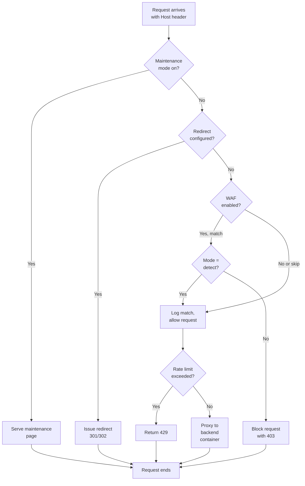

<div className="flex flex-wrap items-center gap-2 not-prose"><span className="inline-flex h-9 w-9 items-center justify-center rounded-lg bg-white p-1.5 ring-1 ring-black/10"></span><span className="inline-flex h-9 w-9 items-center justify-center rounded-lg bg-white p-1.5 ring-1 ring-black/10"></span><span className="inline-flex h-9 w-9 items-center justify-center rounded-lg bg-white p-1.5 ring-1 ring-black/10"></span></div>

Levelrail has nothing to install for ingress. The control plane embeds [Caddy](https://caddyserver.com/) as a Go library (`internal/ingress`) and drives it through its admin API, not a hand-written Caddyfile. Config comes from the app specs the reconciler already knows about, so there is no `caddy` binary, no separate proxy container, and no way for ingress config to drift from desired state. The reasoning is in [ADR 005](https://github.com/glincker/levelrail/blob/main/adr/005-caddy-embedded-ingress.md) and the [comparison](/comparison).

New to this? The [Go live checklist](/go-live) walks one app and domain through firewall, DNS, certificate and a final HTTPS check with live status.

## What this covers

| You want to | Go to |
| --- | --- |
| Put an app on a domain | [Walkthrough: your first domain](#walkthrough-your-first-domain) |
| Get HTTPS with no DNS at all | [Zero DNS setup](#zero-dns-setup-sslipio-hostnames-and-one-click-https) |
| Have Levelrail create DNS records | [Add a domain and go live](#add-a-domain-and-go-live) |
| Fix a certificate that will not issue | [TLS](#tls-whats-actually-shipped-today) and [Domain doctor](#domain-doctor) |
| Block, throttle, redirect or gate traffic | [WAF](#opt-in-waf-and-rate-limiting), [Auth gate](#auth-gate-forward-auth), [Redirects](#domain-redirects) |
| Tune timeouts, client IPs, failover | [Edge limits](#edge-limits-client-ips-and-failover) |
| Open ports or change listen addresses | [Firewall](#firewall-ports-80-and-443) |

## Walkthrough: your first domain

This assumes the control plane is running and an app is deployed (see [Getting started](/getting-started)).

<Steps>
<Step title="Point DNS at your server">

Create an A record (AAAA for IPv6) for the domain pointing at the server's public IP, then check it from a machine outside your network:

```bash
dig +short my-app.example.com
levelrail-cli domains check my-app my-app.example.com
```

`domains check` reports whether the domain currently resolves to this control plane's advertised address.

</Step>
<Step title="Add the domain to your app">

<Tabs>
<Tab title="Dashboard">

Open the app's **Domains** tab and add the domain inline. No redeploy is needed.

</Tab>
<Tab title="CLI">

```bash
levelrail-cli apps domains add my-app my-app.example.com
levelrail-cli apps domains remove my-app my-app.example.com
levelrail-cli domains list
```

</Tab>
<Tab title="app.yaml">

```yaml
version: 1
services:
  web:
    build:
      type: dockerfile
    domains:
      - my-app.example.com
    port: 3000
```

Redeploy after editing. Each domain can be claimed by only one service across your whole spec (see [App spec reference](/app-spec-reference)).

</Tab>
</Tabs>

</Step>
<Step title="Open ports 80 and 443">

Open them in your cloud firewall, `ufw` or `iptables`, or re-run the installer with `LEVELRAIL_CONFIGURE_UFW=1 ./install.sh`. See [Firewall](#firewall-ports-80-and-443).

</Step>
<Step title="Get a trusted certificate">

By default the domain is served over HTTPS with a self-signed certificate, so browsers warn. For a trusted one, enable real ACME (see [TLS](#tls-whats-actually-shipped-today)) and follow the [ACME verification runbook](/acme-verification-runbook).

</Step>
<Step title="Test it">

```bash
curl -v https://my-app.example.com
levelrail-cli domains doctor my-app my-app.example.com
```

</Step>
</Steps>

<Note>
**Infrastructure > Domains** lists every domain across every app with its certificate status, plus read-only badges for WAF, redirect, maintenance mode and basic auth. Edit those settings on the owning app's Domains tab.
</Note>


## How domain routing actually works

When you deploy, the control plane builds a Caddy route that matches incoming requests by `Host` header and reverse-proxies them to the service's container. Static sites (`build.type: static`) skip the container and are served by Caddy from disk. Every request to a configured domain goes through this chain:



### Setting up DNS

Create an **A record** (or AAAA for IPv6) pointing at your server's public IP address. DNS resolution happens before any request reaches your server, so this is no different from any other platform. Once it resolves and the app is deployed, Caddy starts routing and issuing certificates (depending on your [TLS configuration](#tls-whats-actually-shipped-today)). No manual reload is needed.

DNS changes usually appear within minutes but can take a few hours depending on the record's TTL.

### Managing DNS records from the dashboard

If you have connected Cloudflare DNS or Route53 DNS (see [Wildcard domains](#wildcard-domains-dns-01-providers)), a domain's Domains tab also gets a **DNS records** panel: the A/AAAA/CNAME/TXT/MX/SRV/CAA records in that domain's zone, listed, added, edited and deleted without leaving the dashboard, each with a live resolved/pending/mismatch check against its configured value. It reuses the same provider credentials as wildcard ACME, so no separate API token is needed. NS and SOA records are read-only (provider-managed) and never appear.

<Note>
The zone shown is a best-effort guess, the domain's last two labels (`app.example.com` becomes `example.com`). That is wrong for multi-label public suffixes like `.co.uk`; the panel always echoes the exact zone it queried.
</Note>

The CLI covers add, list and remove. Editing a record in place is dashboard-only (it is a delete-then-add under the hood).

```bash
levelrail-cli domains dns list <app> <domain>
levelrail-cli domains dns add <app> <domain> --type A --name www --value 203.0.113.10
levelrail-cli domains dns remove <app> <domain> --type A --name www --value 203.0.113.10
```

### Guided setup: domain, DNS, port, certificate

The **Guided setup** button on an app's Domains tab walks one domain through four checks before anything is saved:

1. **Domain.** Pick the environment it belongs to, and optionally route the `www` or apex twin with a redirect to the one you typed.
2. **DNS record.** The exact A, AAAA or CNAME record to add, re-checked live.
3. **Container port.** Whether the running container really listens on the app's port. This reads the container's socket table, so it needs exec access enabled for the app; without it the step says it could not verify.
4. **Certificate.** Which challenge applies. HTTP-01 needs the internet to reach port 80 on this server. If this server sits on a private (LAN, NAT, NAS) address, or the domain is a wildcard, only DNS-01 can work, and the step says which provider is connected (Cloudflare, Route53 or none) and where to connect one.

When a certificate request fails, the dashboard shows the certificate authority's own error next to the one step that usually fixes it: open ports 80 and 443, fix the DNS record, wait out a rate limit, or correct a CAA record. The same reason appears on the Domains list and in `domains check`.

```bash
levelrail-cli domains check <app> <domain>   # DNS, challenge, DNS-01 provider, last CA error
levelrail-cli domains connectivity           # do ports 80 and 443 answer here, is the address private
```

`domains connectivity` dials this server's advertised address from the control plane. It cannot prove a port is open to the whole internet, but a private address is decisive: HTTP-01 cannot work there.

### One app, one domain set per environment

An app can carry a separate set of domains for each environment, so you do not duplicate the app for dev, UAT and production. The app routes the set of the environment it is tagged with. An environment without its own set falls back to the app's default domains, so existing apps keep working unchanged.

```bash
levelrail-cli apps domains add --env dev <app> dev.example.com
levelrail-cli apps domains add --env uat <app> uat.example.com
levelrail-cli apps domains list --env all <app>
```

`--env` takes an environment id, name or kind. In the dashboard, the Domains tab shows one tab per environment, with the active one marked. Moving the app to another environment switches the routed set on the next reconcile. A hostname still belongs to exactly one app across all sets.

Cloning an environment can copy every app's domain sets under rewritten hostnames, since a hostname cannot be shared:

```bash
levelrail-cli apps environments clone <id> --new-name uat \
  --copy-domains --domain-find example.com --domain-replace uat.example.com
```

Use `--domain-prefix uat.` instead to prepend a label to every copied hostname.

### The dashboard's own domain

**Infrastructure > Domains** sets the control plane's own `primary_domain`, the one the dashboard itself is reachable at, separate from any app's `domains:`. Give it a dedicated subdomain such as `console.example.com` or `panel.example.com` rather than reusing one an app already serves.

Setting the primary domain to a domain an app already owns is rejected with a `409` naming the conflicting app.

## Zero DNS setup: sslip.io hostnames and one-click HTTPS

[sslip.io](https://sslip.io) is a public DNS service that resolves any dash-encoded IP straight to that IP, so `134-209-118-96.sslip.io` is `134.209.118.96` with no record to create and nothing to wait for. A fresh install uses it to get working HTTPS URLs with no DNS setup at all.

### One-click HTTPS for the dashboard

The Domains page opens with an **Enable HTTPS** card (the first-run screen shows the same card first). The contact email is prefilled from your admin account and can be edited, so one click is enough. The control plane:

1. sets the dashboard's primary domain to `<dashed-ip>.sslip.io`,
2. turns on real ACME issuance and asks Let's Encrypt for a certificate over the HTTP-01 challenge,
3. shows `pending`, then `issued` with the issuer and expiry, and
4. once you are looking at the dashboard on that https address, saves it as the dashboard URL (sign-in over plain HTTP is then refused).

<Tabs>
<Tab title="CLI">

```bash
levelrail-cli settings ingress https enable --wait 2m
levelrail-cli settings ingress https status
```

Add `--staging` to use the Let's Encrypt staging CA while debugging.

</Tab>
<Tab title="API">

```text
GET  /api/v1/settings/ingress/https
POST /api/v1/settings/ingress/https
```

</Tab>
</Tabs>

The contact email is checked before anything is saved: it must be a plain address on a real domain, and `example.com`, `.test`, `.invalid`, `.localhost` and similar reserved names are rejected because Let's Encrypt refuses them. The same applies to the primary domain when real ACME is on.

Ports 80 and 443 must be reachable from the internet. If issuance fails for any reason, the site keeps answering over HTTPS with a certificate signed by the platform's own CA instead of dropping the handshake, and the card shows the certificate authority's error with a hint:

| Hint | Meaning |
|---|---|
| `unreachable` | Let's Encrypt could not connect to port 80. Open 80 and 443 in the host firewall (`ufw allow 80,443/tcp`) and in your cloud provider's security group. |
| `rate_limited` | Let's Encrypt is throttling the hostname. Wait, and use staging while debugging. |
| `dns` | The hostname did not resolve to this server. Check the detected public address. |
| `caa` | A CAA record forbids Let's Encrypt from issuing for the hostname. |

The public CA is retried each time the fallback certificate renews, every `APP_INGRESS_FALLBACK_CERT_LIFETIME` (default `6h`), and immediately when you run the enable command again with a corrected email.

<Accordion title="Staging, rate limits and switching CA">

Tick "Test with Let's Encrypt staging first" (or pass `--staging`) to use the staging CA: certificates are not browser trusted, but there are no meaningful limits. Production enable attempts are capped at 5 per hour per control plane (`APP_ACME_MAX_ATTEMPTS_PER_HOUR`) so a misconfiguration cannot burn Let's Encrypt's failed-validation limit; staging is never capped.

| Variable | Effect |
|---|---|
| `APP_ACME_STAGING=true` | Makes staging the default CA. |
| `APP_ACME_DIRECTORY_URL` | Points at any other RFC 8555 CA. |
| `APP_ACME_MAX_ATTEMPTS_PER_HOUR` | Production enable cap (default 5). |
| `APP_ACME_PENDING_TIMEOUT` | A request that never settles is reported as failed after this long (default 2 minutes). |

Switching CA (staging to production, or from the internal issuer to ACME) drops the certificates stored for the previous issuer so they are re-issued. Without this, Caddy keeps serving the old still-valid certificate and never asks the new CA.

</Accordion>

### The server's public address

At first start the control plane works out its own public IP, in this order:

1. `APP_PUBLIC_HOST`, if set (an IP, or a hostname if you only need it for DNS checks). This always wins.
2. Otherwise it asks public what-is-my-IP services (`api.ipify.org`, `icanhazip.com`, `ifconfig.me`) and takes the first public answer. Private, loopback and link-local answers are ignored.

The Domains page shows the address and how it was found (`from APP_PUBLIC_HOST`, `detected`, `detection disabled`, `not found`), and `levelrail-cli settings ingress get` prints it as `public_host`.

| Variable | Default | Effect |
|---|---|---|
| `APP_PUBLIC_HOST` | unset | Override the public address. |
| `APP_PUBLIC_IP_DETECT` | on | Set to `off` to never call the outside services (air-gapped or privacy sensitive installs). |
| `APP_PUBLIC_IP_PROBE_URLS` | the three above | Comma separated list of URLs that return the caller's IP as plain text. |
| `APP_PUBLIC_IP_PROBE_TIMEOUT` | `4s` | Overall budget for detection at startup. |

<Warning>
If the server is behind NAT or a [load balancer](/load-balancing), detection finds the wrong address. Set `APP_PUBLIC_HOST` to the address that actually reaches ports 80 and 443 on this box.
</Warning>

### Automatic hostnames for apps

Every app deployed without `domains:` gets:

```text
https://<app-name>.<dashed-ip>.sslip.io
```

It is routed by the same ingress and gets the same TLS treatment as any other domain: a Let's Encrypt certificate once ACME is enabled (the Enable HTTPS card turns it on for every host), Caddy's internal issuer before that.

- It appears on the app's **Network** tab, in `levelrail-cli apps network <name>`, in `levelrail-cli domains list` (source `automatic`) and in `GET /api/v1/domains` (`"automatic": true`).
- It disappears the moment you add a real domain. A configured domain always wins.
- It is generated each pass and never stored on the app, so per-domain features (basic auth, WAF, BYO certificate, maintenance mode) do not apply to it. Add a real domain for those.
- Toggle it per server (not per app) with the **Automatic app hostnames** setting on the Domains page, or `levelrail-cli settings ingress set --fallback-domains=false`.
- It needs a public IPv4 address (detected or `APP_PUBLIC_HOST`). With a private address, a hostname, or detection turned off there is nothing to build, and the Network tab says so.

The automatic hostname is a beta test address, and the dashboard labels it that way. It works only while your resolver answers for sslip.io: some routers and DNS filters block it or drop private-looking answers (DNS rebind protection), so check with `dig <name>` before assuming the app is down. sslip.io maps a name to an IP and never to a port, so when ingress cannot own 80 and 443 and listens on fallback ports such as 8081 and 8443, the URL must carry the port (`https://<name>:8443`). The dashboard, CLI and API print it that way. Use your own domain for production.

Choose the wildcard-DNS provider under Settings, Domains (default for every app) or on an app's Domains tab (override): sslip.io, nip.io, traefik.me (IPv4 only), or **Custom base domain**, your own wildcard such as `apps.example.com` pointing at this server, which names apps `<app>.apps.example.com`. Changing it re-derives the hostname and updates the route with no downtime, and the old hostname stops working. **Test resolution** resolves a sample hostname and reports ok, wrong IP or not resolving, with a one-click switch to another provider or your own domain. From the CLI: `levelrail-cli domains provider get|set|test [--app <app>]`. Free providers get the internal issuer or plain HTTP only, never a shared private key.

A request that matches no app, or an app with no healthy replica, gets a small "No app is serving this address" page (plain text for non-browser clients) with the original 404 or 503 status.

### HTTP redirects to HTTPS

When the control plane can bind the HTTP ingress port (port 80 as root, the installer's default), every routed host answers plain HTTP with a `308` redirect to the same URL over HTTPS, and Let's Encrypt's HTTP-01 challenge is served on the same listener. A non-root development run that cannot bind port 80 skips the redirect and logs why. `APP_INGRESS_HTTP_REDIRECT=true|false` forces the choice instead of auto detecting.

## Add a domain and go live

With a DNS provider connected, adding a domain does the rest: Levelrail creates the DNS record, waits for it to propagate, checks the certificate and confirms the site answers, then gives you one link.

<Steps>
<Step title="Connect a DNS provider once">

Connect Cloudflare or Route53 (see [Wildcard domains: DNS-01 providers](#wildcard-domains-dns-01-providers)). The same credential is used for records.

</Step>
<Step title="Add the domain">

From the dashboard (**Domains**, **Add domains**), with the CLI, or with `PATCH /api/v1/apps/{name}/domains`:

```bash
levelrail-cli apps domains add my-app app.example.com --wait
levelrail-cli apps domains add my-app app.example.com --dns preview   # show the record, change nothing
levelrail-cli domains go-live my-app app.example.com --wait --timeout 5m
```

`--wait` prints each step as it happens and exits non-zero when the domain is not live within `--timeout`.

</Step>
</Steps>

### What gets created

- An `A` record to this server's public IPv4 address (an `AAAA` record on an IPv6-only host), or a `CNAME` to the target set with `settings ingress set --dns-cname-target`. A CNAME at a zone apex is only created at Cloudflare, which flattens it.
- An identical record already in place is left as it is. A **different** `A`, `AAAA` or `CNAME` at the same name is reported as a conflict and not overwritten, unless you pass `--replace` (`replace: true`). Other record types such as `TXT` and `MX` are never touched.
- The TTL is the provider's automatic one unless you set `--dns-ttl`. Cloudflare's proxy is off unless you set `--dns-proxied`; when on, set the zone's SSL/TLS mode to Full (strict).
- Removing a domain keeps its record unless you pass `--remove-dns`. Only records Levelrail created are ever removed, and only when their value still matches.

### Token scopes

| Provider | Needed |
| --- | --- |
| Cloudflare | An API token with `Zone:DNS:Edit` and `Zone:Zone:Read` on the zones you use. Read is how the zone for a domain is found. |
| Route53 | `route53:ListHostedZones`, `route53:GetHostedZone`, `route53:ListResourceRecordSets` and `route53:ChangeResourceRecordSets`. Add `route53:GetChange` to wait for a change to propagate. |

Creating or changing a record needs the root ability. Every record write is recorded in the audit log as `dns_record.create`, `dns_record.update` or `dns_record.delete`.

### Apps base domain

Set a base domain such as `apps.example.com` and every new app created without a domain gets `<app>.apps.example.com`, with its record created, instead of the sslip.io address.

```bash
levelrail-cli settings ingress set --apps-base-domain apps.example.com
levelrail-cli domains backfill-base-domain            # dry run for existing apps
levelrail-cli domains backfill-base-domain --confirm
```

The base domain must sit inside a zone your provider manages; the dashboard shows whether the zone was found as you type. Existing apps keep their address until you run the backfill.

### The automation policy

`GET/PUT /api/v1/settings/domain-automation` (or **Domains**, **Platform settings**, **Domain automation**, or `levelrail-cli settings domain-automation get|set`) controls what runs on a new domain:

| Key | Default | Effect |
| --- | --- | --- |
| `auto_dns` | on when a provider is connected | Create the DNS record. |
| `auto_proxy_route` | on when the proxy integration is enabled | Wait for the managed proxy route. |
| `force_https` | on | Force HTTPS once a certificate is ready, where this server supports it. |
| `www_policy` | `off` | `redirect_to_apex` or `redirect_to_www` also attaches the partner host, its record and a 301 redirect. |
| `attach_www_counterpart` | off | Attach `www.example.com` with `example.com` and the reverse, without a redirect. |
| `wildcard_for_base_domain` | off | One `*.<base>` record covers every app under the base domain. |
| `verify_after` | on | Probe propagation, certificate and HTTP and report each step. |

A request can override any key with an `automation` object. `POST /api/v1/apps/{name}/domains/go-live/plan` is the dry run: it returns the planned steps and changes nothing. Each run is kept in the automation history with a one-step **Undo** that removes only what that run created (`levelrail-cli domains go-live runs`, `domains go-live undo <id>`). Steps the server cannot do are reported as `skipped` and the rest still completes.

## TLS: what's actually shipped today

### Default: self-signed certificates

Out of the box, every routed domain gets a certificate from Caddy's internal, self-signed issuer. It works immediately with no DNS propagation, no outbound connectivity to a certificate authority and no configuration.

The tradeoff: browsers and HTTP clients show a trust warning until you accept the certificate or switch to a real issuer. Use self-signed for internal tools, staging environments, or first local trials, not for public-facing apps.

### Real public ACME (Let's Encrypt or RFC 8555 CA)

Real ACME issuance is built in. Enable it with the **Issue real ACME certificates** toggle on the Domains page, or:

```bash
levelrail-cli settings ingress set --acme-enabled --acme-email you@yourdomain.com
```

The API is `GET/PUT /api/v1/settings/ingress`. An account email is required, and a directory URL is optional.

<Tip>
Real Let's Encrypt issuance, HTTP to HTTPS redirect and trusted-chain handshakes were run on a public VPS (`<dashed-ip>.sslip.io`, ports 80 and 443 open). The recorded run, including what failed before it worked, is in the [ACME verification runbook](/acme-verification-runbook#recorded-run-2026-10-05).
</Tip>

### Get a real certificate in one step

A domain that still serves the internal certificate shows a browser warning. **Get a real certificate** (on the domain row, the domain's Overview, and the result step after adding a domain) is the one guided action that ends it:

1. **Preflight.** The control plane checks, without calling Let's Encrypt: the name is one a public CA signs, TLS is not terminated by a proxy in front, DNS points at this server, port 80 answers on this server's address, no CAA record blocks Let's Encrypt, a contact email is set, and no Let's Encrypt limit is close. The email defaults to the one already saved, else your admin account's; you can change it. Rate limits (failed validations per hour, duplicate certificates per week) come with a **next safe time**.
2. **Staging first, optionally.** Tick the staging option to rehearse against Let's Encrypt's test CA, which has no meaningful limits. Its certificates are untrusted by browsers, and the badge says **Staging** so it is never mistaken for the real thing. Run the action again without staging for the trusted one.
3. **Request and progress.** The action turns public certificates on, clears the domain's internal or wrong-CA certificate and waits with a visible state: challenge pending, issued, or failed with a plain-language reason and the CA's own message. A finished request shows the issuer, expiry, and the date renewal starts (a third of the lifetime before expiry).

Staging is for rehearsal on a domain that has no real certificate yet (still on the internal certificate or on an earlier staging one). The preflight blocks it, and the server refuses it independently, when any working Let's Encrypt certificate exists on the server (switching the CA drops every stored ACME certificate) or the domain has a working uploaded or proxy certificate. An expired or stalled certificate may be replaced. Going from staging to production is always allowed.

Public certificates are a server setting, so the action applies to every domain on this server, not only the one you clicked. A failed port 80 self-check can be acknowledged when you know the port is open (some routers cannot reach themselves); the other checks cannot.

From a terminal:

```bash
levelrail-cli domains cert shop.example.com --staging --wait
levelrail-cli domains cert shop.example.com --wait
levelrail-cli domains cert shop.example.com --preflight
```

The API is `GET /api/v1/domains/{domain}/cert/preflight`, `POST /api/v1/domains/{domain}/cert` (root ability, audited) and `GET /api/v1/domains/{domain}/cert/status`.

### Where to see certificate status

| Where | What it shows |
| --- | --- |
| Domains page, a domain's Overview, the app's domain editor | A badge per domain: **Internal certificate**, **Staging**, **Let's Encrypt** (with days left), **Uploaded certificate**, **Proxy certificate** or **No certificate**, plus the last renewal attempt, its result and the next retry |
| `levelrail-cli domains certificates` and `GET /api/v1/certificates` | The same facts per certificate: `kind`, `days_left`, `last_renewal`, `next_retry_at` |
| Doctor, check "Certificate expiry" | Fails when an auto-renewed certificate expired, its renewal stalled or failed, or it has fewer than `APP_CERT_FAIL_DAYS` days left (default 14). The typed fix **Renew now** clears the stored certificate and asks for a new one |
| Attention center | An item for a failing renewal or a certificate inside the failure window, with the CA's last error |

A renewal watchdog retries stuck or failing renewals on its own with exponential backoff (first retry after `APP_CERT_WATCHDOG_BACKOFF`, default 30 minutes, doubling to at most 12 hours, checked every `APP_CERT_WATCHDOG_INTERVAL`, default 10 minutes). It reuses the normal renewal path (it never runs a second ACME client), leaves a still-valid certificate in place and only asks the ingress to try again, clears a certificate that has already expired, and pauses while a Let's Encrypt rate limit is in the way. The rate-limit ledger lives in memory, so a restart forgets it and the CA's own answer remains the final word. See [Environment variables](/environment-variables#certificates-and-request-thresholds) for the knobs.

### HSTS (HTTP Strict Transport Security)

Turn on **Enable HSTS** on the Domains page (or `levelrail-cli settings ingress set --hsts-enabled`) to send `Strict-Transport-Security` on every https response, including the dashboard's HTML page, no restart required. It is never sent over plain HTTP. HSTS defaults to off on purpose.

`APP_ENABLE_HSTS=true` still works. The two are additive: HSTS is sent if either the dashboard toggle or the environment variable is on, so upgrading never turns HSTS off for a deployment that already had it on.

<Warning>
HSTS tells browsers to refuse plain HTTP and refuse certificate warnings on this host for one year (`max-age=31536000`). Enabling it before ACME is working (while still on self-signed certificates) can lock you out of your own dashboard. Only enable it once real, browser-trusted certificates are issuing.
</Warning>

### Bring your own certificate

For domains ACME can't reach (internal-only hosts, externally issued wildcards, or certificates provisioned before DNS cuts over), upload a certificate and key. Caddy loads it directly and skips automatic issuance for that host.

```bash
levelrail-cli domains tls-cert set <app> <domain> --cert-file fullchain.pem --key-file privkey.pem
levelrail-cli domains tls-cert get <app> <domain>
```

The API is `PUT /api/v1/apps/{name}/domains/{domain}/tls-cert`, and the dashboard has a per-domain TLS control.

An upload is all or nothing: if saving the key or the record fails, the previous certificate is restored and the error names the failing step. The certificate shows as Pending until an ingress pass loads it, then In use. Uploading needs the control plane master key (`APP_MASTER_KEY` or `APP_MASTER_KEY_FILE`).

### Domains that are dropped or downgraded

The ingress pass never degrades a domain silently. Each pass records a per-domain issue, shown on the domain list (and by `levelrail-cli domains list`): an uploaded certificate that cannot be read (automatic issuance is used instead), a basic auth password that cannot be read (the domain is not routed rather than served open), a wildcard with no DNS-01 provider, or a standalone target that is unavailable. A dropped domain also turns the ingress Ready condition False with the domain names; fixing the cause clears it on the next pass. Each issue on the domain list has a Fix button: **Use automatic certificate** (root only, clears the uploaded certificate) or **Upload again** for a certificate, **Set password** for basic auth, **Connect DNS provider** for a wildcard, **Open app** or **Check target** for an unavailable target.

## Wildcard domains: DNS-01 providers

Wildcard domains like `*.example.com` need ACME's DNS-01 challenge (HTTP-01 cannot validate wildcards). DNS-01 works by creating a short-lived TXT record at your DNS provider, so you must grant API access.

Two providers are supported, configured platform-wide on the **Domains** page or with the CLI. Only one is active per reconcile pass, and Cloudflare wins if both are enabled.

<Tabs>
<Tab title="Cloudflare">

Use an API token scoped to `Zone:DNS:Edit` and `Zone:Zone:Read` for your zone, never the global API key.

```bash
levelrail-cli domains cloudflare-dns set --cf-api-token <token>
levelrail-cli domains cloudflare-dns get
levelrail-cli domains cloudflare-dns clear
```

The API is `GET/PUT/DELETE /api/v1/settings/cloudflare-dns`.

</Tab>
<Tab title="Route53">

Use an AWS IAM access key pair with `route53:ChangeResourceRecordSets`, `route53:ListResourceRecordSets` and `route53:GetChange`. The region and hosted zone ID are optional.

```bash
levelrail-cli domains route53-dns set --aws-access-key-id <id> --aws-secret-access-key <secret>
levelrail-cli domains route53-dns get
levelrail-cli domains route53-dns clear
```

The API is `GET/PUT/DELETE /api/v1/settings/route53-dns`.

</Tab>
</Tabs>

Credentials are envelope-encrypted at rest and never returned by GET: responses report only whether a credential is present.

## Domains without an app

A domain does not have to belong to an app. A [standalone domain](/standalone-domains) proxies to a port on this server, an address on your network, an external URL, another app's port or a container, and gets every per-domain feature on this page. In the dashboard, **Add domain** offers **Proxy to a port or URL** next to **Route to an app**; from the CLI:

```bash
levelrail-cli domains standalone add <domain> --target 127.0.0.1:3000 --confirm
```

The same page explains the **Server address** card, which shows the public IPv4 and IPv6 your DNS records must point at, with a manual override.

## Firewall: ports 80 and 443

Public traffic and ACME's HTTP-01 challenge need your server reachable from the internet on **ports 80 and 443**. Port 80 is also how Let's Encrypt validates domain ownership. If it is blocked, issuance fails even if everything else is configured correctly.

Common blockers, all of which look fine from the server itself: a cloud provider firewall or security group, a home router with no port forwarding, and `ufw` in default-deny state.

### Automatic firewall setup

`install.sh` has an opt-in flag:

```bash
LEVELRAIL_CONFIGURE_UFW=1 ./install.sh
```

It allows SSH, opens `80/tcp`, `443/tcp` and `443/udp` (HTTP/3), and enables `ufw` if it is not already active. If `ufw` was already active, it only adds the rules. Without the flag, open these ports yourself via your cloud firewall, `ufw` or `iptables`.

### Running on non-default ports

If port 443 (or 80) is already taken on the host, most often by a second control-plane instance, set the ingress listen addresses instead of fighting over the defaults:

```bash
APP_INGRESS_HTTPS_ADDR=:8443 \
APP_INGRESS_HTTP_ADDR=:8080 \
./levelrail
```

- `APP_INGRESS_HTTPS_ADDR` (default `:443`): the embedded Caddy ingress's HTTPS listener.
- `APP_INGRESS_HTTP_ADDR` (default `:80`): the plain HTTP listener. It redirects to HTTPS (see [HTTP redirects to HTTPS](#http-redirects-to-https)) and serves the HTTP-01 challenge.

`GET /api/v1/system/doctor`'s port checks follow whatever you set here, so a second instance on `:8443`/`:8080` reports those ports as owned and available, not `:443`/`:80`.

## Opt-in WAF and rate limiting

Both are Caddy modules registered at build time, not separate containers. They are off by default and configured per domain.

- WAF: OWASP Coraza with the stock OWASP Core Rule Set (`github.com/corazawaf/coraza-caddy/v2`)
- Rate limiting: Caddy's `rate_limit` module (`github.com/mholt/caddy-ratelimit`)

### WAF modes: detect or block

| Mode | Behavior | Default | Use case |
| --- | --- | --- | --- |
| `detect` | Logs OWASP CRS matches but never rejects | Yes, new domains | Monitor for false positives first |
| `block` | Actually rejects requests matching CRS rules | No | Deploy after validating detect logs |

<Warning>
The OWASP CRS can produce false positives against normal app traffic. Enable WAF in `detect` mode first, watch logs for a while, then switch to `block` once you are confident it is not flagging legitimate traffic. There is no auto-promote from detect to block; you flip it yourself.
</Warning>

### Rate limiting parameters

Rate limiting is independent of WAF and configured per client IP with two numbers:

| Parameter | What it does | Example |
| --- | --- | --- |
| `requests/sec` | Sustained cap, averaged over 10 seconds | 20 |
| `burst` | 1-second window allowance above sustained rate | 50 |

Clients exceeding either limit get a 429 response. Set burst equal to or below requests/sec for a strict, non-bursting cap.

### Configuration

<Tabs>
<Tab title="Dashboard">

Each domain's row in an app's **Domains** tab has an **Add WAF / rate limit** control.

</Tab>
<Tab title="CLI">

```bash
levelrail-cli domains waf get|set|clear <app> <domain>
levelrail-cli domains waf set my-app my-app.example.com --waf --mode detect --rps 20 --burst 50
```

</Tab>
<Tab title="API">

```text
GET/PUT/DELETE /api/v1/apps/{name}/domains/{domain}/waf
```

</Tab>
</Tabs>

<Accordion title="Not included in v1">

- No UI for custom CRS exclusion or override rules.
- No per-path or per-route rate-limit scoping (whole-domain only).
- No separate WAF/rate-limit event log (use Caddy's access log).

</Accordion>

## Maintenance mode

While a domain is in maintenance, the ingress answers `503` with a small page instead of proxying to the app. The container keeps running.

| Setting | Meaning |
| --- | --- |
| `title`, `message` | Page text, plain text only (HTML is shown as written), up to 120 and 2000 characters. Empty uses the default page. The page follows the visitor's light or dark preference. |
| `retry_after_seconds` | Sent as `Retry-After`, 1 to 86400. Default 300. |
| `until` | RFC 3339 end time. Creates a linked [scheduled maintenance](/scheduled-maintenance) window (app scope, no deploy freeze), so the dashboard banner and the public status page show it. When the window ends, or is cancelled, maintenance ends on its own within a minute and an audit entry `domain_maintenance.ended` is written. |
| `bypass` | Up to 32 IP addresses or CIDRs whose clients still reach the app, for example your office, so you can check the site while it is down. Matched on the client address after trusted proxy headers. `0.0.0.0/0` is refused. |
| `max_duration_seconds` | Safety net for maintenance with no `until`: it switches itself off after this long. Omitted takes `APP_MAINTENANCE_MAX_DURATION` (default none), `0` means no limit, at most 30 days. Ignored when `until` is set, since the window already ends it. |
| `bypass_health_check` | Default on. When the app has an HTTP readiness path, requests to exactly that path still reach the app, so uptime probes are not answered with `503`. A readiness path of `/` is never bypassed, because that is the homepage itself. |

Bypassed requests go through the domain's normal route, so basic auth, the auth gate and the WAF still apply to them. When the app has no running container, every request gets the page.

The page is self-contained (inline CSS, no files from your app) and carries `Cache-Control: no-store`. Requests for assets (`/_next/*`, `/static/*`, `/assets/*`, and files such as `.css`, `.js`, images and fonts) get an empty `503` with `Cache-Control: no-store` and a `text/plain` type instead of the page, so browsers and CDNs never store HTML under an asset URL. The brief "Updating" hold page shown during a deploy follows the same rule. After maintenance ends the next request reaches the app; nothing in the `503` is cacheable. A service worker that cached assets keeps serving them until it updates, which a normal reload does.

```bash
levelrail-cli domains maintenance set web app.example.com \
  --title "Upgrading the database" --message "Back in about 30 minutes." \
  --for 45m --retry-after 10m --bypass 203.0.113.7,10.0.0.0/8
levelrail-cli domains maintenance get web app.example.com
levelrail-cli domains maintenance clear web app.example.com   # also cancels the linked window
```

To put every domain of an app into maintenance at once, add `--app` and drop the domain: `levelrail-cli domains maintenance set --app web --for 2h`. It applies to all domains or none and reports the domain and stage that failed, with nothing changed. `GET`, `PUT` and `DELETE /api/v1/apps/{name}/maintenance` do the same over the API, and the app's pages show one app-level banner instead of one per domain. A deploy while an app is in maintenance completes and leaves maintenance on; the deploy sheet and the Deploy button say so.

The API is `PUT /api/v1/apps/{name}/domains/{domain}/maintenance` with an optional JSON body of the fields above; an empty body keeps the default page. Running `set` again replaces the settings. On the dashboard, open the app's **Domains** tab and choose **Page and schedule** next to the maintenance toggle.

### What visitors get, and what it does not do

- Every URL of the domain answers `503` with the page and a `Retry-After` header. Scripts, styles, images and API calls are not served either, so nothing in the page can load from the app.
- The container is not stopped or restarted, and a deploy during maintenance does not end it: the setting is stored per domain and only you, `until` or the max duration clear it.
- Turning maintenance on creates a linked alert silence for the app's down, DNS, certificate and request error or latency alerts (threshold rules on request counts, 4xx and 5xx counts, upstream errors, latency and traffic volume only). It is listed under Alerts > Silences as "Created by maintenance", cannot be ended on its own, and is removed when maintenance ends, including an automatic end or an end that happened while the control plane was down. CPU, memory, disk, restart and crash alerts still fire, as does any threshold rule on a metric not classed as a request metric, because the app keeps running. A probe on the readiness path still reaches the app unless you turned that off.
- The audit log records who turned it on (`domain_maintenance.started`) and off (`domain_maintenance.ended`). Both rows carry a `detail` with `started_at`, `duration_seconds`, `actor` and, for the end, `end_reason`: `manual`, `until`, `max_duration` or `domain_removed` (the domain left its app). Automatic ends are written by the system actor.
- The public status page lists every maintenance. With an `until` it shows the dated window; without one it shows an entry marked **ongoing**, which is resolved (listed as completed) when maintenance ends.

### Not leaving it on

- Turning it on from the dashboard asks for confirmation: it lists the points above, the end time or max duration that applies, and a live preview of the page, rendered by the server with the same template visitors get.
- While any domain is in maintenance a banner on every page shows how long it has been on and when it ends, with a one click **End maintenance**. It cannot be dismissed.
- A domain that has been on longer than `APP_MAINTENANCE_ATTENTION_AFTER` (default `4h`) appears in the [attention center](/attention-center) as a warning. `0` or an unparseable value falls back to the default.
- `levelrail-cli domains maintenance status` lists every domain in maintenance across all apps, how long each has been on, whether its alerts are silenced and how the status page shows it. `levelrail-cli domains maintenance preview` prints the page and headers without enabling anything.

Worked example: take `app.example.com` down for a database upgrade, keep your office able to check it, and never leave it on past four hours.

```bash
levelrail-cli domains maintenance preview --title "Upgrading the database" --message "Back in about 30 minutes."
levelrail-cli domains maintenance set web app.example.com \
  --title "Upgrading the database" --message "Back in about 30 minutes." \
  --max-duration 4h --retry-after 10m --bypass 203.0.113.7
levelrail-cli domains maintenance status
# app.example.com  app=web  on for 12m  auto off 2026-11-01T06:00:00Z
levelrail-cli domains maintenance clear web app.example.com
```

The same data is available over the API: `GET /api/v1/maintenance/domains` (read) returns every active entry with `started_at`, `auto_off_at` and `elapsed_seconds`, and `POST /api/v1/maintenance/preview` (read, changes nothing) returns the page `html`, `status` and `retry_after` for a given `title`, `message` and `retry_after_seconds`.

Behind another reverse proxy, maintenance applies only when that proxy is proven to forward to the ingress; otherwise the dashboard shows it as **Saved, not enforced**. See [traffic controls behind a proxy](/behind-an-existing-proxy#traffic-controls-behind-a-proxy).

## Domain redirects

For force HTTPS, www and apex presets, aliases and other per-domain controls (headers, path forwarders, country rules, caching), see [Domain traffic controls](/domain-traffic-controls).

A redirect sends a domain to a different URL instead of proxying to a container, for example `www.example.com` to `example.com`, or `old-domain.com` to `https://newapp.example.com/promo` during a migration. It uses Caddy's `static_response` handler with a `Location` header, so there is no new container or infrastructure.

### Configuration

<Tabs>
<Tab title="Dashboard">

Each domain's row in an app's **Domains** tab has an **Add redirect** control.

</Tab>
<Tab title="CLI">

```bash
levelrail-cli domains redirect get|set|clear <app> <domain>
levelrail-cli domains redirect set my-app www.example.com --target https://example.com
```

Add `--temporary` for a `302`, or `--status 307`/`--status 308`. The default is a permanent `301`. `--preset www-to-apex` or `--preset apex-to-www` sets up the www and apex pair instead of a fixed target. A redirect that would loop back to its own domain is refused.

</Tab>
<Tab title="API">

```text
GET/PUT/DELETE /api/v1/apps/{name}/domains/{domain}/redirect
```

</Tab>
</Tabs>

### Redirect status codes

| Code | Type | Use case |
| --- | --- | --- |
| `301` | Permanent (default) | Renames, www-to-apex normalization, or expected permanent moves |
| `302` | Temporary | Redirects you plan to undo (browsers and search engines don't cache these) |
| `307` | Temporary, keeps the method | Like 302, but a POST stays a POST |
| `308` | Permanent, keeps the method | Like 301, but a POST stays a POST |

### Requirements

- The domain must already be one of the app's domains. Add it first with `levelrail-cli apps domains add <app> www.example.com`.
- Target must be an absolute URL, such as `https://example.com`. Bare hostnames, relative paths, and non-HTTP(S) schemes are rejected.
- A target that is only an origin keeps the request path and query, so `www.example.com/pricing?plan=pro` goes to `https://example.com/pricing?plan=pro`. A target with its own path, query, or fragment always redirects to exactly that URL.

<Note>
If a domain has both a redirect and maintenance mode configured, maintenance mode wins and the domain serves the maintenance response. Clear maintenance mode to let a configured redirect take effect.
</Note>

## Custom error pages

Replace Caddy's bare default error text, or whatever the backend returned, with your own HTML for a domain. Four status codes are supported: `404`, `500`, `502` and `503`. The original status code is kept and only the body changes. It covers both a status the backend actually returns and a proxy failure such as an unreachable container, which Caddy turns into its own 502 or 504.

- A domain can have several mappings at once, for example a custom `404` and a separate `503` "temporarily down" page.
- The HTML is served byte for byte: no templating, no variables, and no per-app default separate from the per-domain mapping.

<Tabs>
<Tab title="Dashboard">

Each domain's row in an app's **Domains** tab has an **Add error page** control. Pick a status code and paste in HTML. There is no live preview.

</Tab>
<Tab title="CLI">

```bash
levelrail-cli domains error-pages get|set|clear <app> <domain>
levelrail-cli domains error-pages set my-app my-app.example.com --code 404 --body-file 404.html
```

</Tab>
<Tab title="API">

```text
GET/PUT/DELETE /api/v1/apps/{name}/domains/{domain}/error-pages
```

`PUT` upserts one status code mapping per call. `DELETE` takes an optional `?status_code=` to remove one mapping, or removes all of the domain's mappings when omitted.

</Tab>
</Tabs>

## Hide a domain from search engines

Consoles, staging sites and internal tools should not show up in search results. Per domain, turn on **Hide from search engines** (domain editor), run `levelrail-cli domains search-visibility <app> <domain> --hide`, or `PUT /api/v1/apps/{name}/domains/{domain}/search-visibility` with `{"hidden": true}`. The ingress then:

- sends `X-Robots-Tag: noindex, nofollow, noarchive, nosnippet` on every response, overriding the app's own value;
- answers `/robots.txt` itself with a disallow-all file, even if the app serves its own.

<Note>
This is a request that well-behaved crawlers honour. It is not access control: use basic auth or an [auth gate](#auth-gate-forward-auth) to keep people out. It takes effect on the next ingress reconcile pass, and a crawler that already indexed the page drops it on its next visit. Domains are open to search engines by default.
</Note>

## Auth gate (forward auth)

An auth gate puts your own auth service (Authelia, oauth2-proxy, a small app of your own) in front of a domain. Before a request reaches your app, the ingress sends a `GET` to the auth service with the original request's `Cookie` and `Authorization` headers plus `X-Forwarded-Method`, `X-Forwarded-Uri`, `X-Forwarded-Host`, `X-Forwarded-Proto` and `X-Forwarded-For`. The request body is never sent.

- **2xx**: the request goes on to your app, carrying only the response headers you listed in **copy headers**.
- **Anything else**: the auth service's status, headers (including `Location` and `Set-Cookie`) and body go straight back to the visitor. A `302` to your login page just works.
- **Auth service down or too slow**: the visitor gets a `502` (unreachable) or `504` (timed out). The request never reaches your app.

The gate is off by default and runs after rate limiting, the WAF and basic auth, and before caching and the proxy to your app.

<Warning>
On every request to a gated domain, the ingress first deletes any copy of each copy header that the visitor sent. Your app only ever sees values that came from the auth service.
</Warning>

### Worked example

Your auth service answers `GET /check`. For a signed-in visitor it returns `200` with `X-User`, `X-Email` and `X-Name`; otherwise it returns `302` to its login page.

```bash
levelrail-cli domains auth-gate set my-app app.example.com \
  --url http://auth:9091 --check-path /check \
  --copy-header X-User,X-Email,X-Name
```

A visitor who sends `X-User: admin` themselves gets that header removed before the check. If the visitor is signed in, the app receives the auth service's `X-User`, `X-Email` and `X-Name`.

### Settings

| Setting | Default | Notes |
| --- | --- | --- |
| Auth URL | required | `http` or `https`, a host, no username or password, no query. Internal addresses are allowed. A base path is kept: `https://auth.example.com/api` plus `/check` calls `/api/check`. |
| Check path | `/` | Absolute path, may carry its own query. |
| Copy headers | none | Up to 16 header names. `Cookie`, `Authorization`, `Host` and the `X-Forwarded-*` headers cannot be copied. |
| Timeout | `APP_AUTH_GATE_TIMEOUT` (default `5s`) | Per domain override in seconds. The env var takes a Go duration (`3s`) or whole seconds. |

<Tabs>
<Tab title="Dashboard">

Each domain's row in an app's **Domains** tab has an **Add an auth gate** control next to basic auth.

</Tab>
<Tab title="CLI">

```bash
levelrail-cli domains auth-gate get|set|clear <app> <domain>
```

</Tab>
<Tab title="API">

```text
GET/PUT/DELETE /api/v1/apps/{name}/domains/{domain}/auth-gate
```

Writes need the root ability, like basic auth.

</Tab>
</Tabs>

### Built-in sign-in (SSO for apps)

Instead of running your own auth service, set the provider to **Levelrail sign-in** (`builtin`). Visitors sign in with their account on this installation, through the same sign-in page as the dashboard (passwords, passkeys, two-factor), and only the users, [teams and roles](/teams-and-roles) you allow get through. Your app receives `X-User` and `X-Email` (the email) and `X-Name` (the display name). Visitor-sent copies of those headers are always removed first.

It needs the platform primary domain (**Settings > Ingress**), because visitors are sent to the dashboard to sign in. Signing in there with an OAuth provider (Google, GitHub) ends on the dashboard; open the app link again and it goes straight through.

```bash
levelrail-cli domains auth-gate set my-app app.example.com \
  --provider builtin --allow alice@example.com --allow-team ops --allow-role support
levelrail-cli domains auth-gate log my-app app.example.com --since 24h
levelrail-cli domains auth-gate revoke my-app app.example.com
```

<Warning>
Nobody gets in by default. A built-in gate with no allow rule denies everyone, including admins.
</Warning>

A few behaviours to know:

- Denied users see a plain 403 page that names the account they are signed in with, never a redirect loop. Fetch and XHR requests (`Accept: application/json` or `X-Requested-With`) get a `401` JSON body with a `login_url` instead of a redirect.
- A guest, meaning a user whose role only sees granted environments, also needs a grant for the app's environment. Standalone domains have no environment, so they are closed to such users.
- Plain http apps cannot use the built-in provider unless `APP_GATE_ALLOW_HTTP=true`; the session cookie is then not `Secure`.

| Variable | Default | Effect |
|---|---|---|
| `APP_GATE_TOKEN_TTL` | `1m` | Sign-in tokens are single use, only work on the host they were issued for and only in the browser that started the sign-in. Only hashes are stored. |
| `APP_GATE_SESSION_TTL` | `12h` | Gate sessions end early when the user signs out of the dashboard (or is signed out everywhere), is removed, loses access, or when you press **Sign out all visitors**. Access is re-checked on every request. |
| `APP_GATE_EVENT_RETENTION` | `30d` | Access log rows older than this are pruned hourly. |

<Accordion title="Sign-in flow, step by step">

```text
browser                 app.example.com (ingress)         dashboard (cp.example.com)
   | GET /orders              |                                  |
   |------------------------->| check: no gate session           |
   |<-- 302 cp/gate/login?rd=https://app.example.com/orders&state=S
   |    Set-Cookie: __Host-gate_state=S (app host only)          |
   | GET /gate/login?rd=...&state=S --------------------------->|
   |                          |   not signed in: 302 /login, then back here
   |                          |   rd host must have a built-in gate
   |                          |   user must match an allow rule
   |<-- 302 https://app.example.com/orders?_gate_token=T --------|
   | GET /orders?_gate_token=T|                                  |
   |------------------------->| check: T unused, unexpired, for this host,
   |                          | state cookie matches, dashboard session live
   |<-- 302 /orders  Set-Cookie: __Host-gate_session (host only, 12h)
   | GET /orders (cookie)     |                                  |
   |------------------------->| check: session valid, user still allowed
   |                          | -> app with X-User, X-Email, X-Name
```

</Accordion>

#### Access log

Every decision is recorded with time, domain, user, decision, reason and client IP: `allowed`, `denied`, `login_redirect`, `token_issued`, `token_exchange` and `session_revoked`. Identical events in the same minute are stored as one row with a count, so busy apps do not grow the database per request. Read it on the domain's auth gate card (**Show access log**), with `levelrail-cli domains auth-gate log`, or at `GET /api/v1/apps/{name}/domains/{domain}/auth-gate/events?since=24h` (needs `read:sensitive`).

## Edge limits, client IPs and failover

Every proxied domain gets the same edge policy, on by default. All of it is tuned by environment variables on the control plane (set them in the systemd unit or compose file); `APP_INGRESS_HARDENING=false` restores the bare Caddy config. `levelrail-cli doctor` shows the active policy in its `ingress_edge` check.

| Variable | Default | What it does |
| --- | --- | --- |
| `APP_INGRESS_READ_HEADER_TIMEOUT` | `10s` | Time a client gets to send its request headers. This is the slowloris limit. |
| `APP_INGRESS_READ_TIMEOUT` / `APP_INGRESS_WRITE_TIMEOUT` | `0` (off) | Whole-request deadlines. Left off so uploads, downloads and SSE streams keep working. |
| `APP_INGRESS_IDLE_TIMEOUT` | `2m` | Idle keep-alive connections are closed after this. |
| `APP_INGRESS_MAX_HEADER_BYTES` | `131072` | Largest request header block. |
| `APP_INGRESS_MAX_BODY_BYTES` | `1073741824` | Largest request body (1 GiB), answered with `413`. `0` removes the cap. |
| `APP_INGRESS_PROTOCOLS` | `h1,h2,h3` | HTTP/1.1, HTTP/2 and HTTP/3. HTTP/3 needs `443/udp` open. |
| `APP_INGRESS_RETRY_WINDOW` | `2s` | How long a request is retried when its upstream refuses connections, before the friendly 503. |
| `APP_INGRESS_DIAL_TIMEOUT` | `2s` | Time allowed to connect to a container. |
| `APP_INGRESS_PASSIVE_FAIL_DURATION` | `5s` | A replica that fails a connection is skipped for this long (pools of two or more replicas only). |
| `APP_INGRESS_UNAVAILABLE_RETRY_AFTER` | `5` | Seconds in the `Retry-After` header of the friendly 503. |
| `APP_INGRESS_GRACE_PERIOD` | `0` (`3s` with socket activation) | How long in-flight requests get to finish when the process stops. |
| `APP_INGRESS_HOLD_WINDOW` | `10m` | How long a previously routed domain keeps its route and certificate while its app has no ready container (see [When a backend is down](#when-a-backend-is-down)). |

Request limits and the trusted proxy list can also be changed without a restart: Domains, Platform settings, "Request limits and trusted proxies" in the dashboard, `levelrail-cli settings edge get|set|fix`, or `GET`/`PUT /api/v1/settings/ingress/edge` (changing needs root). A saved value applies on the next reconcile and an environment variable above, when set, wins and shows as locked. Header size, the header read timeout and the idle timeout belong to the shared HTTP server, so they are instance wide. The request body cap can also be set per app: the Request size cap card on the app's Domains tab, `levelrail-cli ingress-limits show|set|clear APP`, or `GET`/`PUT /api/v1/apps/{name}/ingress-limits`. An app cap replaces the instance cap for that app's domains.

Per-app monthly spend caps (warn at 50, 80 and 100 percent by default, with throttle or pause only when you opt in per app) are described in [Spend caps](/spend-caps); the cap card sits on the app's Deploys tab.

There is no per-IP connection limit: Caddy has none built in. Put a firewall rule or the [WAF rate limit](#opt-in-waf-and-rate-limiting) in front if you need one.

### Real client IPs behind a CDN or proxy

By default the app sees the address that connected to Levelrail, and any `X-Forwarded-For` the client sent is discarded (so it cannot be spoofed). If Levelrail itself sits behind Cloudflare, a load balancer or another proxy, tell it which peers to trust:

```bash
APP_INGRESS_TRUSTED_PROXIES=203.0.113.0/24,private_ranges
APP_INGRESS_CLIENT_IP_HEADERS=CF-Connecting-IP   # optional, defaults to X-Forwarded-For
```

`private_ranges` expands to the RFC 1918 and loopback ranges. For a trusted peer, the client address is read from the header (right to left for `X-Forwarded-For`, so a forged left-most entry is ignored), appended to `X-Forwarded-For`, and sent to the app as `X-Real-IP`. Every app receives `X-Real-IP`, trusted proxy or not.

<Warning>
Keep the trusted list to the proxies you actually run: anything listed can claim any client address.
</Warning>

### Running behind a TLS proxy

If the proxy is Traefik (Coolify's included), `levelrail-cli proxy setup` turns this mode on and writes one route per domain into Traefik's watched directory, kept in step with every domain you add or remove. See [Run behind an existing proxy](/behind-an-existing-proxy#one-step-setup-traefik-including-coolify). The domain check then says the proxy handles certificates instead of asking for ports 80 and 443 on this server.

If Traefik, nginx or Caddy owns 80 and 443 and forwards to this ingress, set the **Public HTTPS port** (`public_https_port`, usually `443`) so generated links omit the ingress listen port, and turn on `tls_terminated_upstream` when the proxy also holds the certificates so this instance never runs ACME. Details and a Traefik example: [Run behind an existing proxy](/behind-an-existing-proxy#several-instances-behind-one-proxy). An ACME failure notice for non-standard ingress ports does not apply in this mode, because the proxy handles HTTPS.

### When a backend is down

A request that cannot reach its container is retried for `APP_INGRESS_RETRY_WINDOW`. With two or more replicas a refused connection moves to another replica at once and the failed one is skipped for `APP_INGRESS_PASSIVE_FAIL_DURATION`, so a killed replica costs no requests. A single-replica app, or a pool with no live replica, answers a styled `503` with `Retry-After` and a page that reloads itself, not Caddy's bare `502`. A [custom error page](#custom-error-pages) for the domain replaces it.

A domain whose app was routed in the last `APP_INGRESS_HOLD_WINDOW` (default `10m`) but has no ready container right now (a `recreate` deploy, a crash, a restart) keeps its route and its certificate and answers the same `503` instead of a TLS error or a dead connection. A domain that has never been routed since the control plane started is not held, so adding a domain before the first deploy does not start certificate issuance early.

### Surviving a control plane restart

The embedded Caddy lives in the control plane process, so a restart would close ports 80 and 443 for its length. New installs close that gap by default: systemd owns the listening sockets.

```bash
./install.sh                                          # new install, socket activation on
LEVELRAIL_SOCKET_ACTIVATION=0 ./install.sh            # new install, opt out
LEVELRAIL_SOCKET_ACTIVATION=1 ./install.sh upgrade    # switch an existing install (one short stop)
LEVELRAIL_SOCKET_ACTIVATION=0 ./install.sh upgrade    # switch back
```

An `upgrade` with the variable unset keeps whichever mode the install is already in. Docker Compose deployments are unchanged: they do not use systemd and bind the ports themselves.

The installer writes `levelrail-http.socket` and `levelrail-https.socket`. The control plane detects the inherited sockets (`LISTEN_FDS`, named `http` and `https`) on its own; no extra setting is needed. While the process is down the kernel queues new connections, and the new process serves them when it is up, so visitors see a slower response instead of a refused connection. Measured numbers are on the [resilience](/resilience#ingress-availability-windows-measured) page, and the decision is in [ADR 025](https://github.com/glincker/levelrail/blob/main/adr/025-ingress-restart-gap-socket-activation.md).

The control plane also saves its last applied route table, sealed with a key derived from the master key, and serves it as soon as it starts, before its first reconcile pass. `levelrail-cli doctor` reports `ingress_survives_control_plane` with the next step when this is not true on your install. Details and limits: [resilience](/resilience#what-happens-to-traffic-when-the-control-plane-restarts).

<Accordion title="Socket activation trade-offs">

- HTTP/3 and ACME HTTP-01 are not available in this mode (TLS-ALPN-01 on 443 and DNS-01 still issue certificates).
- The sockets stay open while the service is stopped on purpose.

</Accordion>

## Raw TCP streams: forwarding a non-HTTP port

Domains, WAF, redirects and error pages are all for HTTP(S). Some services are not HTTP: a Postgres instance, an SSH server, a game server. A **stream** forwards a host port to one of an app's container ports byte for byte, with no Host-header routing and no protocol awareness.

```bash
levelrail-cli apps streams create my-postgres --host-port 15432 --container-port 5432
levelrail-cli apps streams list my-postgres
levelrail-cli apps streams delete my-postgres <id>
```

The dashboard's app **Streams** tab lists, adds and removes forwards, and the API is `GET`/`POST`/`DELETE /api/v1/apps/{name}/streams`.

Streams use the same embedded Caddy through its [`layer4`](https://github.com/mholt/caddy-l4) app, not a second proxy.

<Warning>
Creating or deleting a stream restarts the app automatically, because Docker cannot add a published port to a running container.
</Warning>

Scope: TCP only, one stream per forward, no access lists, and no TLS termination on the stream (if the backend speaks TLS, that is between the client and the backend). Multi-app and load-balanced streams are not supported.

## Traffic: routing status for every domain at a glance

**Infrastructure > Traffic** in the dashboard (`GET /api/v1/network/proxy`, `read` ability) is a flat, one-row-per-domain table: which app a domain routes to, which node that app actually runs on, whether this control plane's own embedded ingress can reach it, its port, and TLS status and issuer.

It exists to catch one failure that is otherwise invisible. The embedded Caddy ingress reaches an app on another node only over the WireGuard mesh. If that path is down, the app's container can be perfectly healthy while its domain silently never routes. When the path is healthy the domain shows **Reachable**. See [Multi-node: Routing to apps on remote nodes](/multi-node#routing-to-apps-on-remote-nodes) for how the mesh bind works.

A domain in the broken state shows an **Unreachable** badge with the reason (with a banner at the top of the page when any exist; `levelrail-cli nodes traffic` prints the same reason). Each unreachable row carries a **Move** button straight to the move-with-volumes flow described in [Moving an app with its volumes](/multi-node#moving-an-app-with-its-volumes), or run the fix directly:

```bash
levelrail-cli apps set-node <app-name> <this control plane's own node id>
# or, to let auto-placement choose again:
levelrail-cli apps clear-node <app-name>
```

## Reachable links, health summary and the domain doctor

### Domain doctor

When a domain does not work, start here. `POST /api/v1/apps/{name}/domains/{domain}/doctor` (`read` ability) runs ordered checks and returns one fix per problem:

```bash
levelrail-cli domains doctor shop shop.example.com          # prioritised fix list
levelrail-cli domains doctor shop shop.example.com --json
```

Need the fix applied or the exact record? See [Diagnose a domain](/domain-diagnosis).

Each check has a `state` (`pass`, `warn`, `fail`, `skipped`, `unavailable`), a `tier` (1 blocks traffic, 2 blocks the certificate, 3 breaks soon, 4 hygiene) and, when it is not passing, a `fix` with a summary and at most one action (`request` with the API call, `link`, or `copy` with the exact record).

<Accordion title="Every check the doctor runs">

| Check | What it looks at |
| --- | --- |
| `dns.resolves` | what this server and public resolvers answer, and whether they disagree (propagating) |
| `dns.points_here` | whether the answers include this server's public address |
| `dns.aaaa_mismatch` | AAAA records that send IPv6 visitors somewhere else |
| `dns.cname_apex` | a CNAME at the zone apex |
| `caa.blocks_issuer` | CAA records that do not allow `letsencrypt.org` |
| `app.running` | the app is running and ready |
| `domain.held_back` | an import staged the domain without routing it |
| `proxy.ports` | another container (Traefik, nginx, Caddy) publishing port 80 or 443 |
| `net.port80` | port 80 answers (Let's Encrypt validates over it) |
| `tls.certificate` | the certificate served on 443 for this name: issuer, expiry, name mismatch, and a proxy's default certificate such as `TRAEFIK DEFAULT CERT` or Caddy's local authority |
| `http.status` | what `GET /` returns over HTTPS |
| `redirect.chain` | redirect loops, HTTP not redirecting to HTTPS, www and apex hops |
| `hsts.risk` | an untrusted certificate behind HSTS (a header from the site, or a preloaded TLD such as `.dev`), which browsers refuse with `net::ERR_CERT_AUTHORITY_INVALID` and no way to click through |
| `cert.renewal` | the stored certificate, stalled renewal, or the CA's last error with its next action |

Example response:

```json
{
  "domain": "shop.example.com",
  "app": "shop",
  "checked_at": "2026-10-10T12:00:00Z",
  "status": "problems",
  "probed": true,
  "checks": [
    {"id": "tls.certificate", "title": "A default certificate from Traefik is served", "state": "fail", "tier": 2,
     "detail": "subject \"CN=TRAEFIK DEFAULT CERT\" ...",
     "fix": {"summary": "Give that proxy a route and certificate for this domain ...",
             "action": {"kind": "request", "label": "Show proxy setup", "api": "GET /api/v1/system/reverse-proxy?domain=shop.example.com"}}}
  ]
}
```

</Accordion>

The doctor only connects to the domain when it resolves to this server's own public address (`APP_PUBLIC_HOST` or the detected public IPs, never the request's Host header), and it always dials that address, never an address taken from DNS. When the domain points elsewhere it runs the DNS checks only, sets `probed` to false and explains why in `probe_note`. The whole run is bounded by `APP_DOMAIN_DOCTOR_TIMEOUT` (default `20s`) and each probe by `APP_DOMAIN_DOCTOR_PROBE_TIMEOUT` (default `4s`).

<Note>
Probes run from this server, so a NAT that does not hairpin can make a port check warn even when visitors connect fine.
</Note>

### `reachable_url`: the link that actually works

`GET /api/v1/domains` returns `reachable_url` on every row, and `GET /api/v1/apps/{name}/environment-domains` returns a `reachability` map keyed by domain. The URL is `https://<domain>`, with the public HTTPS port only when one is configured (or 443 when TLS is terminated by a proxy in front). It is present only when the app is running and the domain is routable. Otherwise the field is omitted and `reachable_reason` says why:

| Reason | Meaning |
| --- | --- |
| `held_back` | an app import staged the domain without routing it yet |
| `stopped` | the app is stopped or has never run |
| `not_routed` | no standard public link exists: the ingress listens on a non standard port and no public HTTPS port is set, or the domain is not in the app's active environment |
| `not_resolving` | the last DNS check found no record, or a record pointing elsewhere (not counted when your own proxy fronts this server) |

The dashboard builds its **Open site** button from this field only, so it never shows a `:8443` or sslip.io link that does not answer. `levelrail-cli domains list` prints it in the `URL` column.

### Health summary

`GET /api/v1/traffic/summary` (`read` ability) feeds the sidebar badge and the health strip. `levelrail-cli domains summary` prints the same counts. It never does network I/O: it reads stored state and the last DNS check result for each domain, and is cached for `APP_TRAFFIC_SUMMARY_CACHE_TTL` (default `5s`).

- Domains are counted as `live`, `propagating`, `waiting`, `needs_attention`, `not_set_up`, `paused` or `unknown` (a domain never checked since the control plane started is `unknown`).
- Certificates are counted when expiring within `APP_TRAFFIC_CERT_EXPIRY_DAYS` days (default 30), expired, or failing to renew.
- Zone delegation and proxy route errors are listed in `unavailable` until those features report them.

<Accordion title="Example response">

```json
{
  "generated_at": "2026-10-10T12:00:00Z",
  "domains": {"total": 6, "live": 3, "waiting": 1, "propagating": 1, "needs_attention": 1, "not_set_up": 0, "paused": 0, "unknown": 0},
  "certificates": {"window_days": 30, "expiring": 1, "expired": 0, "renewal_failing": 1},
  "domains_not_resolving": 1,
  "attention": 1,
  "unavailable": ["zones_not_delegated", "routes_with_errors"]
}
```

</Accordion>

### Activity

`GET /api/v1/domains/{domain}/activity` (`read` ability, limited to domains whose app you can see) returns the domain's recent changes from the audit log plus certificate issuance, renewals and the CA's last failure, newest first, as `{events: [{id, at, kind, title, detail, failed, action, actor: {type, name}, object: {type, id, href}}], next_cursor}`. Pass `next_cursor` back as `?before=` for the next page; `?limit=` and `?actions=` work as on the audit log. `levelrail-cli domains activity <domain>` prints it.

## Troubleshooting

### If this fails

| Error or symptom | Where you see it | Fix |
| --- | --- | --- |
| `store: domain "shop.example.com" is already in use by service "api"` (409) | `apps domains add`, the Domains tab | A hostname belongs to one app. Remove it from the other app first, or use another hostname. |
| `this server's public address is unknown; set APP_PUBLIC_HOST` | Domain doctor, go-live | Set `APP_PUBLIC_HOST` to the address that reaches ports 80 and 443, then restart. |
| `sign-in over plain HTTP is disabled on this instance; sign in at https://...` | Sign-in page | Open the `https://` dashboard URL in the message. |
| Hint `unreachable` | Enable HTTPS card | Let's Encrypt could not reach port 80. Open ports 80 and 443 in the host firewall and the cloud security group. |
| Hint `rate_limited` | Enable HTTPS card | Let's Encrypt is throttling the name. Wait, and test with staging. |
| Hint `dns` | Enable HTTPS card | The name does not resolve to this server. Check the public address the card shows. |
| Hint `caa` | Enable HTTPS card | A CAA record blocks Let's Encrypt for this name. Change the CAA record. |
| `external_reachability_80` warning | `levelrail-cli doctor` | The check dials the server's own public address from the server. A router without hairpin support can fail it. Test from outside the network. |
| `all predefined address pools have been fully subnetted` | Deploy fails | Docker is out of network subnets. See [App network pool](/troubleshooting#app-network-pool). |

### Browser shows a security warning about the certificate

Browsers warn when the certificate is self-signed or expired, or when the domain name in the certificate does not match the one you visited.

Likely cause: ACME TLS is not enabled, or the certificate is still being issued after you added the domain.

How to confirm: visit the domain in a browser and check the certificate details (usually by clicking the lock icon), or run `levelrail-cli domains doctor <app> <domain>` to see the certificate status.

Fix: open the **Enable HTTPS** card on the Domains page (or run `levelrail-cli settings ingress https enable --wait 2m`), then follow the [ACME verification runbook](/acme-verification-runbook) to issue a real Let's Encrypt certificate. Certificates take a few seconds to issue.

### The domain is added but requests get connection refused

The domain resolves to the server, but incoming traffic does not reach the control plane.

Likely cause: ports 80 and/or 443 are blocked by a firewall, or something else on the server is already using those ports.

How to confirm: run `levelrail-cli domains doctor <app> <domain>` to check port reachability, or try `curl -v http://<domain>` from outside the network to see the actual error. Also check `sudo ss -tlnp | grep -E ':80 |:443 '` to see what owns the ports.

Fix: open ports 80 and 443 in your cloud firewall, or in the host firewall with `sudo ufw allow 80,443/tcp`. If another process already owns them, either stop it or run `install.sh upgrade --coexist` to move ingress to different ports and keep it behind your existing proxy.

### Requests time out or return 502 gateway errors

Traffic reaches the control plane but the app container is not responding.

Likely cause: the app is not running, the container is not healthy, or it is not listening on the port declared in the app spec.

How to confirm: open the app's dashboard page (Apps > <app>) and check the Status section. If it shows Running, run `levelrail-cli apps status <app>` to see the container status and any readiness or liveness probe failures. Also check the app's logs (Apps > <app> > Logs).

Fix: if the app is not running, deploy it again. If it is running but unhealthy, check the logs for startup errors, then fix the app code or configuration and redeploy. Verify that the app actually listens on the port specified in `app.yaml` (default 3000).

### A domain shows status "waiting" and does not answer

DNS is not resolving the domain to this server yet.

Likely cause: the DNS A record has not been created or propagated, or it points to the wrong IP address.

How to confirm: run `levelrail-cli domains check <app> <domain>` to see what the domain resolves to, or `dig <domain>` to inspect the DNS records directly.

Fix: create or update the A record at your registrar or DNS provider to point at the control plane's public IP address. The Domains page shows it, and `levelrail-cli settings ingress get --json | jq .public_host` prints it. DNS changes can take up to a few hours to propagate globally. Once it resolves, the domain status changes automatically.

### Wildcard domain rules do not work

A wildcard domain added to the app is not routing subdomains correctly.

Likely cause: the wildcard domain needs DNS-01 ACME, which requires DNS provider credentials. The system cannot issue a wildcard cert with HTTP-01.

How to confirm: check the DNS provider section of the Domains page, or run `levelrail-cli domains cloudflare-dns get` or `levelrail-cli domains route53-dns get`. Also see the domain's status on the Domains page to check if the certificate is issued.

Fix: connect a DNS provider (Cloudflare or Route53) on the Domains page and enable DNS-01 for wildcard domains. Then open the domain on the Domains page and check the certificate status.

Still stuck? Run `levelrail-cli domains doctor <app> <domain>` and attach its full JSON output to an issue on [GitHub](https://github.com/glincker/levelrail/issues), or check the [ACME verification runbook](/acme-verification-runbook).

## Next steps

<CardGroup cols={2}>
<Card title="Domain traffic controls" href="/domain-traffic-controls">

Headers, path forwarders, country rules, caching and redirects per domain.

</Card>
<Card title="ACME verification runbook" href="/acme-verification-runbook">

Issue and verify a real Let's Encrypt certificate.

</Card>
<Card title="Load balancing" href="/load-balancing">

Balance traffic across an app's replicas.

</Card>
<Card title="App spec reference" href="/app-spec-reference">

Configure domains in `app.yaml`.

</Card>
<Card title="Multi-node" href="/multi-node">

How ingress reaches apps on worker nodes.

</Card>
<Card title="Standalone domains" href="/standalone-domains">

Proxy a domain to a port or URL with no app behind it.

</Card>
</CardGroup>
