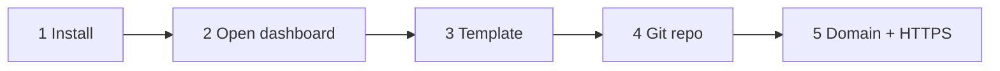

## How do I install Levelrail and deploy my first app?

Run one command as root on a Linux server, open the dashboard link it prints, choose a password, and deploy an app from a template or a Git repository. In about 10 minutes you have a running app with a health check, logs, metrics and rollback. You can add your own domain with an automatic Let's Encrypt certificate at the end.



## Before you start

- A Linux server, `amd64` or `arm64`, with systemd and root access. 1 vCPU and 1 GB of RAM boots the platform. 2 vCPU and 2 GB is more comfortable once you build images on it.
- Ports 80 and 443 free on the server and reachable from the internet. Let's Encrypt uses port 80. If another proxy holds them, the installer moves Levelrail to ports 8088 and 8443 (coexist mode) and one-click HTTPS does not work. See [Server already runs a proxy](/installing#server-already-runs-a-proxy).
- Port 8080 stays closed to the internet. The dashboard answers there over plain HTTP, so use an SSH tunnel or open it to your own IP only. See [Dashboard port 8080](/installing#dashboard-port-8080).
- Optional: a domain you can point at the server. Without one you can use a free `sslip.io` test address.

The full requirements are in [Installing](/installing#requirements). No server yet? [Try it on your laptop](/local-development) first.

## 1. Install

```bash
curl -fsSLO https://github.com/glincker/levelrail/releases/latest/download/install.sh
curl -fsSLO https://github.com/glincker/levelrail/releases/latest/download/checksums.txt
grep ' install.sh$' checksums.txt | sha256sum -c -  # macOS: shasum -a 256 -c -
sudo sh install.sh
```

Expected: preflight rows, then `Levelrail vX.Y.Z installed and running.` and a dashboard link. The installer checks the host, installs Docker if it is missing, downloads the newest release and verifies its checksum, starts the `levelrail` systemd service, and waits until it is healthy.

Back up `/var/lib/levelrail-data/master.key` now. Every stored secret is encrypted with it, and nothing can recover it if it is lost.

<Tip>
To pin a release, set `LEVELRAIL_VERSION=vX.Y.Z` before the command. You can also run Levelrail as a container. See [Installing](/installing).
</Tip>

## 2. Open the dashboard

The installer prints two ways in. The SSH tunnel works even when only ports 80 and 443 are open:

```bash
ssh -L 8080:127.0.0.1:8080 <user>@<server-ip>
```

Then open the `http://127.0.0.1:8080/login#setup=<token>` link from the installer output. The direct `http://<server-ip>:8080/...` link works only if port 8080 is open to you. If 8080 was taken, the installer picked the next free port and printed it, so use the printed port in the tunnel command.

Expected: a page asking you to choose a password. After that you are the admin and land on the dashboard. The token travels in the `#` fragment, so it never reaches server logs or a referrer header.

<Accordion title="If the setup link does not work">

Print a new setup token on the server. The installer does not print the token when its output is not a terminal (for example in cloud-init), so this is also the way to get it then:

```bash
sudo APP_DATA_DIR=/var/lib/levelrail-data levelrail setup-token
```

Enter the token on the sign-in page. To create the first admin from a terminal instead, set `APP_SETUP_TOKEN` to it, set `APP_ADMIN_PASSWORD` (or answer the prompt), then run `levelrail-cli setup admin --api-url http://127.0.0.1:8080`. It is refused once an admin exists.

The dashboard port is in the systemd unit: `systemctl cat levelrail | grep APP_HTTP_ADDR`.

</Accordion>

## 3. Deploy a one-click template

In the dashboard, open **Get started** and choose **Browse templates** under "From a template", or open **Apps**, **New app**, **Browse templates**. Pick a card, review the pre-filled Compose body, and deploy. There are hundreds of entries, listed in the [template catalog](/template-catalog).

From a terminal on the server:

```bash
levelrail-cli templates deploy uptime-kuma --name my-status-page
levelrail-cli apps status my-status-page
```

Expected: the app shows as healthy and has an automatic address. With no domain set, an app gets `https://<app>.<dashed-ip>.sslip.io` once HTTPS is on (step 5). `levelrail-cli open my-status-page` prints its addresses. Templates with settings use `levelrail-cli templates install <id>`. See [Templates and registry](/templates-and-registry).

Want the quickest proof first? **Deploy sample app** on the same Get started page runs a small image with a health check in one click.

## 4. Deploy from Git

In the dashboard, choose **New app** and paste a repository URL. Levelrail shows a deployment plan before it creates anything: build method, port, environment variables, volumes and warnings. Confirm it, and the build log streams live.

From a terminal (on the server, or anywhere you have run `levelrail-cli login`, see [Use the CLI from your laptop](#use-the-cli-from-your-laptop)):

```bash
levelrail-cli import https://github.com/your-org/your-app
levelrail-cli import https://github.com/your-org/your-app --deploy
```

Expected: the first command prints the plan and stops. The second creates the app and deploys it. A public repository is read over HTTPS. To read a private repository or deploy on every push, connect GitHub, GitLab, Bitbucket or Gitea first, see [Git integrations](/git-integrations). The importer also accepts `docker run` commands, compose files and Dockerfiles, see [Importing apps](/importing-apps).

Other routes:

<Tabs>
<Tab title="Built image">

```bash
levelrail-cli apps create --name web --image ghcr.io/your-org/web:1.0 --port 8080
```

`--port` is the port the container listens on. To build from source instead, pass `--repo <url>`, or run `apps create` inside a git checkout that has an `origin` remote.

</Tab>
<Tab title="Config file">

`levelrail-cli init` detects your stack and writes an `app.yaml`. It also writes `AGENTS.md` and `.mcp.json`, which you can delete if you do not use an AI agent. A minimal spec looks like this:

```yaml
version: 1
services:
  web:
    build:
      type: dockerfile
    port: 8080
    domains:
      - app.example.com
    health:
      readiness: { path: /healthz, interval: 5s, timeout: 2s }
```

Check it locally with no server call, then create the app:

```bash
levelrail-cli apps validate --file app.yaml
levelrail-cli apps create --file app.yaml --repo https://github.com/your-org/your-app --image-repo ghcr.io/your-org/your-app
```

Every field is in the [app spec reference](/app-spec-reference). `levelrail-cli apps create --interactive` asks for the same values step by step.

</Tab>
<Tab title="From your computer">

No git remote yet? Run `levelrail-cli deploy` in the project folder to upload and deploy it directly, see [Deploy from your computer](/deploy-from-cli). To go from a project folder to a running app in one command, see [One command quickstart](/quickstart-one-command).

</Tab>
</Tabs>

### Check that it is running

```bash
levelrail-cli apps status web
levelrail-cli apps logs web --follow
levelrail-cli open web
```

`apps status` lists the reconciler's conditions, each with a reason, so a failed deploy says why. `open` prints the custom domain first, then the automatic URL. In the dashboard the same app shows live metrics with deploy markers, the deploy history, and a log viewer with search.


If the app does not come up, `apps status` names the failing condition:

- **Health check failed.** The app did not answer on the readiness path. Check that the path returns a 2xx status and that the app listens on the port you set.
- **Container crashed.** Read `levelrail-cli apps logs web` for the last lines before the exit.
- **Missing environment variable.** Add it with `levelrail-cli env set web NAME=value --apply`.

For a full diagnosis run `levelrail-cli apps diagnose web`. See [Deploy failures](/deploy-failures) for each failure code.

### Roll back

Use the deploy history in the dashboard, or run:

```bash
levelrail-cli apps deploys list web
levelrail-cli apps deploys rollback-to web <deploy-id>
```

To go back to the previous successful deploy in one step, run `levelrail-cli rollback web`. Earlier images stay pinned, so cleanup cannot remove a rollback target.

## 5. Add a domain with HTTPS

First, turn on HTTPS for the dashboard with no DNS: press **Enable HTTPS** on the dashboard banner or the Domains page, or run:

```bash
levelrail-cli settings ingress https enable --wait 2m
```

Expected: the dashboard gets a `<dashed-ip>.sslip.io` address with a Let's Encrypt certificate. This is a test address that works only while your DNS resolver answers for sslip.io, so use your own domain for production. Enabling is capped at 5 attempts per hour. After HTTPS is on, signing in over plain HTTP stops working, so use the https address from then on.

Then create an `A` record for your domain pointing at the server's public IP, and attach it to the app:

```bash
levelrail-cli apps domains add web app.example.com --wait
```

Expected: the command prints the go-live steps and exits when the domain is live, or non-zero if it is not live within the timeout. Open the app's **Go live** page for one checklist that covers the firewall, DNS and the certificate. See [Go live checklist](/go-live) and [Domains and ingress](/domains-and-ingress).

## Troubleshooting the first run

| You see | What to do |
| --- | --- |
| `<N> preflight check(s) failed. Fix them, or re-run with --force to continue anyway.` | Read the rows marked `FAIL` above that message and fix them. `--force` continues anyway. |
| Port row: `already in use by ... Automatic TLS needs 80/443. Re-run with --coexist to run behind it, or set LEVELRAIL_HTTP_PORT/LEVELRAIL_HTTPS_PORT to pick other ports (accepting that automatic ACME certs won't work)` | Stop the other service, or use coexist mode. See [Server already runs a proxy](/installing#server-already-runs-a-proxy). |
| `port 8080 ... taken, using <port> instead` | Not an error. Use the printed port in the dashboard link and the SSH tunnel. |
| `systemd is required as the init system (OpenRC and Alpine are not supported)` | Use a systemd distribution such as Ubuntu or Debian. |
| `--runtime existing found no working Docker or Podman. Start one, or use --runtime docker to install Docker` | Start Docker with `sudo systemctl start docker`, check `sudo docker ps`, then run the installer again. |
| `<X> GB free on <dir>, need <Y> GB` | Free disk space or use a larger server. |
| `ufw is active and does not allow port(s) ...` | Run the command the row prints, for example `sudo ufw allow 80/tcp && sudo ufw allow 443/tcp`. |
| `port(s) ... did not answer on <ip>. Apps and TLS certificates need 80 and 443 open.` | Open 80 and 443 in the cloud firewall, see [Cloud firewall rules](/cloud-firewall-rules). |
| `<domain> does not resolve: create an A record pointing at this server's public IPv4 address` | Create the record, then check it with `dig +short <domain>` from your own machine. |
| `control plane did not become healthy within 60s` | Run `systemctl status levelrail` and `journalctl -u levelrail -n 100 --no-pager`. A port already in use is the usual cause. |
| `could not list releases from GitHub. Set LEVELRAIL_VERSION=vX.Y.Z to pin one.` | The server cannot reach GitHub. Check outbound HTTPS, or pin a release. |
| `checksum mismatch for ...` | Run the installer again. Do not set `LEVELRAIL_SKIP_CHECKSUM=1` to get past it. |
| `plan import: ... connection refused` or `start device login: ... connection refused` | The CLI points at an address where the control plane is not listening. Run `systemctl start levelrail`, or pass `--api-url http://127.0.0.1:<dashboard port>` (or set `APP_API_URL`). |
| HTTPS fails on the first try | Fix the cause, then run `levelrail-cli settings ingress https status` to re-check, or click **Re-check** in the dashboard. |

More: [Troubleshooting](/troubleshooting), [Installing: Troubleshooting](/installing#troubleshooting) and the [FAQ](/faq).

## Use the CLI from your laptop

`levelrail-cli` runs on your own machine. It talks to the control plane over HTTPS, so you need no SSH key and no open port.

```bash
curl -fsSLO https://github.com/glincker/levelrail/releases/latest/download/install-cli.sh
curl -fsSLO https://github.com/glincker/levelrail/releases/latest/download/checksums.txt
grep ' install-cli.sh$' checksums.txt | sha256sum -c -  # macOS: shasum -a 256 -c -
sh install-cli.sh
export APP_API_URL=https://console.example.com
levelrail-cli login --api-url https://console.example.com --code ABCD-EF23
```

The CLI has no server address until you give one: always pass `--api-url` (or set `APP_API_URL`) on the first login. To manage a second server, add `--profile NAME` to the login and to every later command for that server; without it the login uses the `default` profile, which is pinned to the first server it saw (a different server is refused until you pass `--reauth`).

Right after setup, the dashboard home shows a **Connect your CLI** card. Press **Show my command** and paste the one line it prints into your terminal. The code is single use, expires in minutes and is only ever shown to a signed-in dashboard session, so it signs the CLI in with no password and no approval step:

```text
$ levelrail-cli login --api-url https://console.example.com --code ABCD-EF23
logged in as "you@example.com"
token tk_9fQ2x saved to ~/.config/levelrail-cli/credentials under profile "default", expires 2027-01-18
```

If you sign in with your password instead (`levelrail-cli login --api-url https://console.example.com`), a new device needs approval from a browser where you are signed in. The CLI tells you exactly where:

```text
This sign-in comes from a new device, so it needs your approval.

  1. Open https://console.example.com/approve-sign-in?request=la_Kx3pQ
     in the browser where you are signed in to the dashboard.
  2. Type this number when asked: 42

Or run "levelrail-cli auth approve la_Kx3pQ --match 42" with a token that holds signin:approve, or with your root device login.
Faster: open the dashboard, copy the command from the "Connect your CLI" card and run it (levelrail-cli login --api-url <url> --code XXXX-XXXX).
Waiting up to 3m0s. Press Ctrl+C to cancel.
```

On a desktop terminal the CLI opens that page for you (`--open`, or `--open=false` to turn it off); over SSH and in scripts it does not. In a script it stops at once with the same instructions on one line, unless you pass `--wait`. Change the wait with `--approval-timeout` or `APP_LOGIN_APPROVAL_TIMEOUT`. `login --device` still works when you prefer to start from the CLI and approve in the dashboard. For CI, create an API token under **Settings, API tokens** and set it as `APP_API_TOKEN`.

No git remote yet? Run `levelrail-cli deploy` in the project folder to upload and deploy it directly, see [Deploy from your computer](/deploy-from-cli).

## Finish setting up for real use

After you sign in, the dashboard home shows live stats, recent activity, and a **Needs attention** list built from the same server checks as `levelrail-cli doctor`.


The **Get started** checklist starts with four steps: set the dashboard address and turn on HTTPS, secure the admin account, connect a git source (or skip it and deploy an image), and deploy your first app. Each step turns to done on its own when the matching item exists. The other steps are under **More recommended steps**. None of them blocks your first deploy.

| Step | Done when | Optional |
| --- | --- | --- |
| Secure the admin account | Two-factor authentication or a passkey is set up | no |
| Set the public dashboard address | The dashboard URL is an `https://` address | no |
| Connect a Git provider | GitHub, GitLab, Bitbucket, or Gitea is connected | yes |
| Deploy your first app | At least one app exists | no |
| Put the app on your domain | A domain is attached to an app | no |
| Connect a DNS provider or proxy | Cloudflare or Route 53 is connected, or you run behind a proxy | yes |
| Get a valid TLS certificate | Every domain has a healthy certificate (not needed behind a proxy that ends TLS) | no |
| Add a backup target | A backup target exists | no |
| Take the first backup | A control plane backup exists | no |
| Verify a restore | A backup has passed verification | no |
| Add a notification channel and alert rule | A channel exists and an alert rule is set | no |
| Invite a teammate | A second user or a pending invite exists | yes |
| Choose an upgrade policy | Automatic upgrades are enabled | yes |

You can **Skip** a step, **Mark done** for something the checklist cannot detect, and **Undo** either. Steps that do not apply to you, such as TLS behind your own proxy, show as "Not needed" and do not count toward your readiness score.

The same checklist works from a terminal:

```bash
levelrail-cli setup status
levelrail-cli setup next
levelrail-cli setup skip teammate
```

Set up backups before anything else. Your control plane database and `master.key` are the two things you cannot recreate. The shortest path is [First backup in 5 minutes](/backups-and-storage#first-backup-in-5-minutes).

## What next

- [Features](/features): what Levelrail does and what is stable.
- [Observability](/observability) and the [alert inbox](/alert-inbox): get told when something breaks.
- [Backups and storage](/backups-and-storage#first-backup-in-5-minutes): your control plane database and `master.key` are the two things you cannot recreate, so back them up before anything else.
- [Multi-node quickstart](/multi-node-quickstart): add a second server.
- [Managing databases](/managing-databases): run Postgres, Redis or another database next to your app.
- [FAQ](/faq) and [Feature status](/feature-status).

Every command, output format (`--output`, `--query`) and shell completion option is in the [CLI reference](/cli-reference). To build from source or run a development instance, see [Installing](/installing#option-3-build-from-source).
