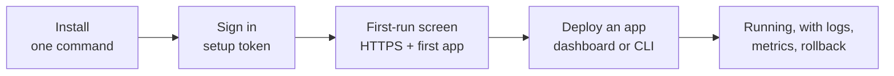

This page takes you from an empty Linux server to one app that is running, has a health check, and shows logs and metrics. It takes about ten minutes.



## Before you start

- A Linux server, `amd64` or `arm64`, with systemd and root access. 1 vCPU and 1 GB of RAM boots the platform. 2 vCPU and 2 GB is more comfortable once you build images on it.
- Ports 80 and 443 reachable from the internet. Let's Encrypt uses port 80 to issue certificates.
- Optional: a domain you can point at the server. You can skip this and use a free `sslip.io` address.

The full requirements, with what the installer checks, is in [Installing](/installing#requirements). No server yet? [Try it on your laptop](/local-development) first.

## Install

```bash
curl -fsSL https://levelrail.com/install.sh | sudo sh
```

The installer checks the host, installs Docker if it is missing, downloads the newest release and verifies its checksum, starts the `levelrail` systemd service, and waits until it is healthy. The last lines of output look like this (abridged):

```text
Levelrail vX.Y.Z installed and running.

Open the dashboard:
  http://203.0.113.10:8080/login?setup=<token>

IMPORTANT: back up /var/lib/levelrail-data/master.key somewhere safe.
```

Use the address from your own output. If port 8080 was taken, the installer picked the next free port and printed it.

Back up `master.key` now. Every stored secret is encrypted with it, and nothing can recover it if it is lost.

<Tip>
To pin a release, set `LEVELRAIL_VERSION=v0.2.0-beta.14` before the command. You can also run Levelrail as a container. See [Installing](/installing).
</Tip>

<Accordion title="If the install fails">

| Message | What to do |
| --- | --- |
| `control plane did not become healthy within 60s` | Run `systemctl status levelrail` and `journalctl -u levelrail -n 100 --no-pager`. A port that is already in use is the usual cause. |
| `N preflight check(s) failed. Fix them, or re-run with --force` | Read the rows marked `fail` above that message and fix them. `--force` continues anyway. |
| `could not list releases from GitHub` | The server cannot reach GitHub. Check outbound HTTPS, or set `LEVELRAIL_VERSION=vX.Y.Z`. |
| `checksum mismatch for ...` | Run the installer again. Do not set `LEVELRAIL_SKIP_CHECKSUM=1` to get past it. |

</Accordion>

## Sign in and deploy your first app

Open the printed setup link, choose a password, and you are the admin. The setup token travels in the link's `#` fragment, so it never reaches the server logs or a referrer header. The first sign-in opens one screen, not an empty app list:

1. **Your app's address** is shown before you deploy: with no domain set, an app gets `https://<app>.<dashed-ip>.sslip.io`.
2. **Enable HTTPS** is one button that needs no DNS. Your admin email is prefilled as the certificate contact, and the dashboard gets a free `<dashed-ip>.sslip.io` address with a real certificate. After HTTPS is on, signing in over plain HTTP stops working, so use the https address from then on. A banner on the dashboard keeps offering it until it is on.
3. **Deploy** a sample app, a template, or your own repository. The screen waits until the app is healthy and ends on its live link. A failure shows the automatic diagnosis and a link to the logs.

Everything else (email, git provider, backups, teammates, alerts) is on the **Get started** checklist in the sidebar, which reads your real server state and ticks steps off by itself. `levelrail-cli setup status` shows the same list.

<Accordion title="If the setup link does not work">

Print a new setup token on the server:

```bash
sudo APP_DATA_DIR=/var/lib/levelrail-data levelrail setup-token
```

The dashboard port is in the systemd unit: `systemctl cat levelrail | grep APP_HTTP_ADDR`.

If HTTPS fails on the first-run screen (for example, the `sslip.io` name does not reach this server yet), fix the cause and click **Re-check**. You can also run `levelrail-cli settings ingress https status` from a terminal.

</Accordion>

## Deploy your first app

Pick the route that matches what you have.

<Tabs>
<Tab title="Git repository">

In the dashboard, choose **New app** and paste a repository URL. Levelrail shows a deployment plan before it creates anything: build method, port, environment variables, volumes, and warnings. Confirm it, and the build log streams live.

From the server (or any machine where you ran `levelrail-cli login --device`), the same flow is:

```bash
levelrail-cli import https://github.com/your-org/your-app
```

Without a flag, this prints the plan and stops. Add `--deploy` to create the app and deploy it:

```bash
levelrail-cli import https://github.com/your-org/your-app --deploy
```

This reads a public repository over HTTPS. To deploy on every push, or to read a private repository, connect GitHub, GitLab, Bitbucket, or Gitea first. Pushes reach Levelrail through the provider's webhook. The importer accepts repositories, `docker run` commands, compose files, and Dockerfiles. See [Importing apps](/importing-apps).

<Accordion title="If the import fails">

| Message | What to do |
| --- | --- |
| `plan import: request POST http://localhost:8080/api/v1/imports/plan: ... connection refused` | The control plane is not running on that address. Run `systemctl start levelrail`. If the dashboard uses another port, set `APP_API_URL` first. |
| `start device login: ... connection refused` | `levelrail-cli login --device` points at the wrong address. Set `APP_API_URL=http://127.0.0.1:<dashboard port>` and run it again. |

</Accordion>

</Tab>
<Tab title="Built image">

If your image is already in a registry, register it directly:

```bash
levelrail-cli apps create --name web --image ghcr.io/your-org/web:1.0 --port 8080
```

`--port` is the port the container listens on. To build from source instead, pass `--repo <url>`, or run `apps create` inside a git checkout that has an `origin` remote.

</Tab>
<Tab title="Config file">

`levelrail-cli init` detects your stack and writes an `app.yaml` for it. It also writes `AGENTS.md` and `.mcp.json`, which you can delete if you do not use an AI agent. A minimal spec looks like this:

```yaml
version: 1
services:
  web:
    build:
      type: dockerfile
    port: 8080
    domains:
      - app.example.com
    health:
      readiness: { path: /healthz, interval: 5s, timeout: 2s }
```

Check the file locally, with no server call:

```bash
levelrail-cli apps validate --file app.yaml
```

```text
app.yaml: valid app.yaml, 1 service(s)
```

Then create the app from it:

```bash
levelrail-cli apps create --file app.yaml --repo https://github.com/your-org/your-app --image-repo ghcr.io/your-org/your-app
```

Every field, including resources, environment, replicas, and deploy strategy, is in the [app spec reference](/app-spec-reference).

</Tab>
</Tabs>

<Accordion title="Prefer a guided prompt?">
`levelrail-cli apps create --interactive` asks for the name, source, port, domain, health path, and limits. It then writes `app.yaml` or creates the app. `levelrail-cli databases create --interactive` does the same for a [managed database](/managing-databases).
</Accordion>

### Check that it is running

```bash
levelrail-cli apps status web
levelrail-cli apps logs web --follow
```

`apps status` lists the reconciler's conditions. Each condition has a reason, so a failed deploy says why instead of retrying silently. In the dashboard, the same app shows live metrics with deploy markers on the charts, the deploy history, and a log viewer with search.


Open the app in a browser:

```bash
levelrail-cli open web
```

It prints the custom domain first, then the automatic URL.

<Accordion title="If the app does not come up">

`apps status` names the failing condition. Common cases:

- **Health check failed.** The app did not answer on the readiness path. Check that the path exists and returns a 2xx status, and that the app listens on the port you set.
- **Container crashed.** Read `levelrail-cli apps logs web` for the last lines before the exit.
- **Missing environment variable.** Add it with `levelrail-cli env set web NAME=value --apply`.

For a full diagnosis, run `levelrail-cli apps diagnose web`. See [Deploy failures](/deploy-failures) for each failure code.

</Accordion>

To put it on your own domain with HTTPS, open the app's **Go live** page: one checklist covers the firewall, DNS and the certificate. See [Go live checklist](/go-live).

### Roll back

Use the deploy history in the dashboard, or run:

```bash
levelrail-cli apps deploys list web
levelrail-cli apps deploys rollback-to web <deploy-id>
```

To go back to the previous successful deploy in one step, run `levelrail-cli rollback web`. Earlier images stay pinned, so cleanup cannot remove a rollback target.

## Use the CLI from your laptop

`levelrail-cli` runs on your own machine. It talks to the control plane over HTTPS, so you need no SSH key and no open port.

```bash
curl -fsSL https://levelrail.com/install-cli.sh | sh
export APP_API_URL=https://console.example.com
levelrail-cli login --api-url https://console.example.com --code ABCD-EF23
```

Right after setup, the dashboard home shows a **Connect your CLI** card. Press **Show my command** and paste the one line it prints into your terminal. The code is single use, expires in minutes and is only ever shown to a signed-in dashboard session, so it signs the CLI in with no password and no approval step:

```text
$ levelrail-cli login --api-url https://console.example.com --code ABCD-EF23
logged in as "you@example.com"
token tk_9fQ2x saved to ~/.config/levelrail-cli/credentials under profile "default", expires 2027-01-18
```

If you sign in with your password instead (`levelrail-cli login --api-url https://console.example.com`), a new device needs approval from a browser where you are signed in. The CLI tells you exactly where:

```text
This sign-in comes from a new device, so it needs your approval.

  1. Open https://console.example.com/approve-sign-in?request=la_Kx3pQ
     in the browser where you are signed in to the dashboard.
  2. Type this number when asked: 42

Or run "levelrail-cli auth approve la_Kx3pQ --match 42" with a token that holds signin:approve.
Faster: open the dashboard, copy the command from the "Connect your CLI" card and run it (levelrail-cli login --api-url <url> --code XXXX-XXXX).
Waiting up to 3m0s. Press Ctrl+C to cancel.
```

On a desktop terminal the CLI opens that page for you (`--open`, or `--open=false` to turn it off); over SSH and in scripts it does not. In a script it stops at once with the same instructions on one line, unless you pass `--wait`. Change the wait with `--approval-timeout` or `APP_LOGIN_APPROVAL_TIMEOUT`. `login --device` still works when you prefer to start from the CLI and approve in the dashboard. For CI, create an API token under **Settings, API tokens** and set it as `APP_API_TOKEN`.

No git remote yet? Run `levelrail-cli deploy` in the project folder to upload and deploy it directly, see [Deploy from your computer](/deploy-from-cli).

## Finish setting up

After you sign in, the dashboard home shows live stats, recent activity, and a **Needs attention** list built from the same server checks as `levelrail-cli doctor`.


The **Get started** checklist starts with four steps: set the dashboard address and turn on HTTPS, secure the admin account, connect a git source (or skip it and deploy an image), and deploy your first app. Each step turns to done on its own when the matching item exists. The other steps are under **More recommended steps**. None of them blocks your first deploy.

| Step | Done when | Optional |
| --- | --- | --- |
| Secure the admin account | Two-factor authentication or a passkey is set up | no |
| Set the public dashboard address | The dashboard URL is an `https://` address | no |
| Connect a Git provider | GitHub, GitLab, Bitbucket, or Gitea is connected | yes |
| Deploy your first app | At least one app exists | no |
| Put the app on your domain | A domain is attached to an app | no |
| Connect a DNS provider or proxy | Cloudflare or Route 53 is connected, or you run behind a proxy | yes |
| Get a valid TLS certificate | Every domain has a healthy certificate (not needed behind a proxy that ends TLS) | no |
| Add a backup target | A backup target exists | no |
| Take the first backup | A control plane backup exists | no |
| Verify a restore | A backup has passed verification | no |
| Add a notification channel and alert rule | A channel exists and an alert rule is set | no |
| Invite a teammate | A second user or a pending invite exists | yes |
| Choose an upgrade policy | Automatic upgrades are enabled | yes |

You can **Skip** a step, **Mark done** for something the checklist cannot detect, and **Undo** either. Steps that do not apply to you, such as TLS behind your own proxy, show as "Not needed" and do not count toward your readiness score.

The same checklist works from a terminal:

```bash
levelrail-cli setup status
levelrail-cli setup next
levelrail-cli setup skip teammate
```

Set up backups before anything else. Your control plane database and `master.key` are the two things you cannot recreate.

## Where to go next

<CardGroup cols={2}>
<Card title="One command quickstart" href="/quickstart-one-command">

Deploy a project from your laptop with `levelrail-cli up`.

</Card>
<Card title="Managing databases" href="/managing-databases">

Run Postgres, Redis, or another database next to your app.

</Card>
<Card title="Templates" href="/templates-and-registry">

Deploy a pre-made service such as Plausible or Uptime Kuma.

</Card>
<Card title="Domains and ingress" href="/domains-and-ingress">

Add custom domains and understand certificates.

</Card>
<Card title="Git integrations" href="/git-integrations">

Deploy on every push, with previews per pull request.

</Card>
<Card title="Multi-node quickstart" href="/multi-node-quickstart">

Add a second server.

</Card>
<Card title="Observability" href="/observability">

Get alerted when something breaks.

</Card>
</CardGroup>

Not sure what is stable? See [Feature status](/feature-status). Hit a problem? See [Troubleshooting](/troubleshooting).

Every command, output format (`--output`, `--query`), and shell completion option is in the [CLI reference](/cli-reference). To build from source or run a development instance, see [Installing](/installing#option-3-build-from-source).
