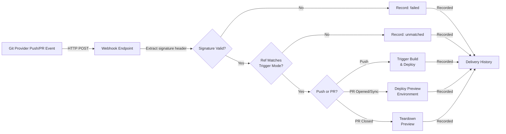

<div className="flex flex-wrap items-center gap-2 not-prose"><span className="inline-flex h-9 w-9 items-center justify-center rounded-lg bg-white p-1.5 ring-1 ring-black/10"></span><span className="inline-flex h-9 w-9 items-center justify-center rounded-lg bg-white p-1.5 ring-1 ring-black/10"></span><span className="inline-flex h-9 w-9 items-center justify-center rounded-lg bg-white p-1.5 ring-1 ring-black/10"></span><span className="inline-flex h-9 w-9 items-center justify-center rounded-lg bg-white p-1.5 ring-1 ring-black/10"></span></div>

Connect a git provider once for the whole control plane, then point any number of apps at repositories it can see. A push, a tag, or a pull request on the repository then deploys the app, builds a preview, or both.

No provider at all? A [git push remote on your own server](/git-push-deploy) (beta) deploys a pushed branch with no webhook.

This page covers connecting a provider, using a repository as an app's source, deploy triggers and path filters, deploying a commit by hand, monorepo build settings, webhook handling and replay, and per-pull-request previews.

<Tip>
Fastest path: connect the provider in the dashboard ([Connect a provider](#connect-a-provider)), then run `levelrail-cli github-app use-as-source <owner> <repo> --app-name my-app`. Pushes to the default branch deploy from then on.
</Tip>

## Provider connections and git sources

Two records are involved, and keeping them separate is deliberate.

- A **provider connection** (a GitHub App installation, or a GitLab, Bitbucket or Gitea account authorized through an OAuth application) is a control-plane-wide credential that can see many repositories across many organizations or workspaces. You can connect several of each kind: see [Connecting more than one account](#connecting-more-than-one-account).
- An app's **git source** (`GET/PUT/DELETE /api/v1/apps/{name}/git-source`) is a per-app record: one repository URL, one branch, one build configuration, one webhook secret, and one [deploy trigger mode](#deploy-triggers-push-or-release). Each app has its own webhook secret and its own enable and disable state.

So you connect GitHub once, wire ten apps to ten different repositories, and never paste a personal token into an app by hand.

### Provider differences

| Provider | Auth method | Token lifetime | Self-hosted |
| --- | --- | --- | --- |
| **GitHub** | GitHub App, created by a manifest flow or entered by hand | Short-lived, minted per API call | GitHub Enterprise Server, via `instance_url` |
| **GitLab** | OAuth Application you register | Long-lived | Yes, via `instance_url` |
| **Bitbucket** | OAuth consumer you register | Long-lived | Bitbucket Cloud only |
| **Gitea** | OAuth2 Application you register | Long-lived, refreshed | Almost always, via `instance_url` |

All four support webhooks, [preview environments](/previews), and PR comments and commit statuses. GitHub's manifest flow creates the App on GitHub's side for you. GitLab, Bitbucket, and Gitea need you to create the application in their own settings first and paste its credentials in.

`GET /api/v1/git-providers` (and `levelrail-cli git-providers`) answers "what can I do with each provider?" in one call: whether it is connected, can list branches, can register a webhook, and can authenticate a clone. The dashboard's repository picker uses it.

## Connect a provider

Connecting is done in the dashboard on purpose. Each flow ends in a real browser redirect to github.com, your GitLab instance, or bitbucket.org, which a script or the CLI cannot drive. The CLI can register, rename, list and disconnect accounts, and print the authorize path to open in a browser.

<Note>
All four need a master key configured on the control plane, the same one that encrypts every secret. Routes that need it return `501` without one. GitHub's manifest flow also needs a primary domain set in ingress settings first, because GitHub needs a reachable callback URL. Without one you get a `409` that says so.
</Note>

<Tabs>
<Tab title="GitHub">

Open the GitHub App settings page (`/settings/github-app`).

<Steps>
<Step title="Choose the owner">
The dashboard previews the App's name, permissions, and webhook URL and lets you choose who owns the App.

| Owner | Where GitHub creates the App | Query parameter |
| --- | --- | --- |
| **My personal account** (default) | `github.com/settings/apps/new` | none |
| **An organization** | `github.com/organizations/<login>/settings/apps/new` | `owner=<login>` |

"Allow other accounts and organizations to install it" makes the App public (`public=true`). Leave it off for a private App, which GitHub only lets the owning account or organization install.
</Step>
<Step title="Create the App on GitHub">
The dashboard redirects your browser to github.com, and the credentials come back automatically. `levelrail-cli github-app register-url --owner <org> [--public]` prints the registration link for the same choice. Open it in a browser signed in to the dashboard.
</Step>
<Step title="Install it">
Levelrail sends you to `/apps/<slug>/installations/new`, GitHub's account chooser. Pick the account or organization and the repositories to grant. You need to be an owner of the organization, or its owners must approve the install request. Use "Add organization" in the connected accounts list to install the same App on another account later.
</Step>
</Steps>

<Warning>
A private App owned by your personal account never offers an organization on the install page. To deploy from an organization, either own the App from that organization or make the App public. Levelrail asks GitHub whether the App is public; when it is private, the dashboard and `github-app installations add` say so and link to the App's Advanced settings, where "Make public" allows installs on any account.
</Warning>

GitHub Enterprise Server works the same way: set `instance_url` and the form posts to `<instance_url>/organizations/<login>/settings/apps/new`. `owner` must be a GitHub organization login (letters, digits and hyphens, up to 39 characters); anything else is a `400`.

If the control plane has no publicly reachable primary domain yet, create the App at `github.com/settings/apps` yourself and connect it with `PUT /api/v1/github-app/manual`, giving the app ID, client ID, client secret, webhook secret, and the private key PEM.

</Tab>
<Tab title="GitLab">

Open the GitLab App settings page (`/settings/gitlab-app`).

Register an OAuth Application in GitLab with redirect URI `<your control plane>/api/v1/gitlab-app/callback` and scope `api`, then paste its `instance_url`, `client_id`, and `client_secret`. Authorize through the redirect to your instance's `/oauth/authorize`.

</Tab>
<Tab title="Bitbucket">

Open the Bitbucket App settings page (`/settings/bitbucket-app`).

Register an OAuth consumer in Bitbucket Cloud, then paste its key and secret and authorize through the redirect.

</Tab>
<Tab title="Gitea">

Open the Gitea App settings page (`/settings/gitea-app`).

Register an OAuth2 application in Gitea, then paste its `instance_url`, `client_id`, and `client_secret`. Authorize through the redirect to your instance's `/login/oauth/authorize`.

</Tab>
</Tabs>

To disconnect GitHub, call `DELETE /api/v1/github-app`. To disconnect one GitLab, Bitbucket or Gitea account, call `DELETE /api/v1/git-connections/{id}` (or press Disconnect on its row). Either removes the connection and its secrets from the control plane, revokes the OAuth token at GitLab, and answers `{disconnected, token_revoked, note, affected_sources}`. It does not uninstall the GitHub App or delete the application on the provider's side; the note says where to do that. Other connected accounts are not touched.

### Connect with a token instead

GitLab, Bitbucket Cloud, Gitea and Forgejo can also connect with an access token, with no OAuth application and no public domain, so it works on a plain `http://` install. In the dashboard choose Add account, then Connect with a token, or press it on a provider's settings page. The panel shows where to create the token and which scopes to tick:

| Host | Scopes | Paste |
| --- | --- | --- |
| GitLab | `api` | the `glpat-` token |
| Bitbucket Cloud | `read:user:bitbucket`, `read:repository:bitbucket`, `write:repository:bitbucket`, `read:pullrequest:bitbucket`, `write:pullrequest:bitbucket`, `read:webhook:bitbucket`, `write:webhook:bitbucket` | `email:token` |
| Gitea, Forgejo | `read:user`, `write:repository` | the generated token |

Check Token asks the host for the account, the scopes (GitLab reports them) and how many repositories the token reaches before anything is saved. Connecting stores the token encrypted and the account shows up like any other, with health. From the CLI: `git-providers test --type gitlab --instance-url URL --pat TOKEN`, then `git-providers add` with the same flags. A self-hosted server on a private network needs `APP_GIT_ALLOW_PRIVATE_NETWORKS=true` on the control plane. Tokens do not refresh: when one expires or is revoked the account shows Needs reconnect, and you add a new token.

## Connecting more than one account

The quickest way to see and manage every account is the **Git connections** page (**Settings, Git connections**, `/settings/git-connections`). It lists each GitHub, GitLab, Bitbucket, Bitbucket Server, Gitea and Forgejo (including Codeberg) account in one place with its health, repository count and the apps using it. Its **Add account** menu starts the connect flow for any host and, where the host needs one, asks for a primary domain first. In the repository picker, when more than one account is connected, account chips filter the list and the last choice is remembered per user.

GitHub supports many installations. GitLab, Bitbucket and Gitea support many accounts too: a personal and a work Bitbucket workspace, several GitLab groups or accounts, gitlab.com next to a self-managed GitLab, or two Gitea servers. Each one is a **connection** with its own label, host, signed-in account, scopes and health.

To add another account:

1. Open the provider's settings page (`/settings/gitlab-app`, `/settings/bitbucket-app` or `/settings/gitea-app`) and press **Add another account**.
2. To sign in with a different account on an instance you already use, choose **Reuse the application of ...**. Nothing else to enter. To use another instance or another OAuth application, choose **Register a new OAuth application** and paste its `instance_url` (GitLab, Gitea), client ID and secret. Optionally give it a label.
3. Press **Save and authorize**. You are sent to the provider to approve; you come back to the settings page with the new account listed.

From the CLI, `levelrail-cli git-providers add gitlab --instance-url https://git.example.com --client-id ID --client-secret SECRET` registers the application and prints the authorize path to open in a browser. `--reuse <connection id>` copies another connection's application.

Forgejo (including Codeberg) connects exactly like Gitea, under its own provider. Bitbucket Server and Data Center connect with a personal access token instead of an OAuth application: `levelrail-cli git-providers add bitbucket_server --instance-url https://bitbucket.example.com --pat TOKEN` verifies the token and connects at once. Repositories there are addressed as `PROJECT/slug`, and the webhook it registers delivers `repo:refs_changed` pushes (pull request previews are not supported on Bitbucket Server yet).

How it behaves:

- Connecting again with a **different** account adds a connection and never replaces another. Connecting again with the **same** account (same host, same remote account, same OAuth application) updates that connection's tokens instead of adding a duplicate. The same login through a different OAuth application is a separate connection, which is what a Bitbucket workspace consumer needs.
- The label defaults to `account @ host` once the account is known. Rename it any time.
- The first connection of a provider is its **default**. Set another with **Set default** or `levelrail-cli git-providers default <id>`. The default is used when a request does not name a connection.
- **Reconnect** on a row sends that connection through authorization again, for example after its grant was revoked.
- **Disconnect** removes only that connection. Git sources that used it stay, show **needs reconnect**, and are never deleted. They attach to the next connection you add on the same host.
- Connections belong to the control plane and are created, renamed and removed by an admin (the `root` ability). Anyone with the `read:sensitive` ability can list them (no credentials are ever returned) and browse the repositories an account can see, as with the GitHub App.
- Existing GitLab, Bitbucket and Gitea connections from before this change became the first connection of their provider on upgrade, with their tokens and git sources intact. The account name fills in the first time the connection is used.

```bash
levelrail-cli git-providers connections --provider gitlab
levelrail-cli git-providers rename <id> "Work GitLab"
levelrail-cli git-providers disconnect --id <id>
levelrail-cli git-providers repos gitlab --connection <id>
```

Pick the account when you choose a repository: the picker shows every connected account, filters by account, and shows the owner and account on each row, so `acme/api` from your work account and `acme/api` from your personal one are never confused. The git source records the account it came from, and its webhook is registered with that account's token.

## Listing repositories

The repository picker, `GET /api/v1/git/repos` and `levelrail-cli git-providers repos <provider>` all read one cached list per connection. Nothing is cut off at a fixed page count: the control plane pages through the provider until it runs out, up to `APP_GIT_REPO_LIST_MAX` repositories per connection (default `10000`). If an account has more than that, the response says `truncated: true` and the picker says so; paste a repository URL for one beyond the cap.

Search, owner, archived and fork filters and paging are applied on the server, so a large account never reaches the browser in one response.

| Parameter | Meaning |
| --- | --- |
| `provider` | `github`, `gitlab`, `bitbucket` or `gitea`. Omit it to merge every connected account of every provider. |
| `connection` | One connection id, for example `gc_...` (GitHub installations use `github:<installation id>`). Each response lists its `connections` and each row carries `connection_id`, `connection_label` and `account`. |
| `search` | Words that must all appear in the `owner/name` path. |
| `owner` | One owner or organization. |
| `archived`, `forks` | `include` (default), `exclude` or `only`. |
| `limit`, `offset` | Page size (default 100, at most 500) and start. `next_offset` in the response is the following page. |
| `refresh=1` | Re-list from the provider now. Throttled to once per `APP_GIT_REPO_REFRESH_MIN` per connection. |

A list is served from the cache for `APP_GIT_REPO_CACHE_TTL` (default `5m`). After that it is still served for up to `APP_GIT_REPO_CACHE_STALE_MAX` (default `24h`) while one background refresh runs, and concurrent requests share a single provider call. GitHub pages are revalidated with ETags, so an unchanged page costs no rate limit budget. Disconnecting a provider, changing its connection or removing a GitHub installation drops its cached list. The dashboard picker has a Refresh button; the CLI has `--refresh`.

When a provider answers 429 or a secondary rate limit, the control plane waits for a short `Retry-After` (at most `APP_GIT_RATE_LIMIT_MAX_WAIT`, default `5s`, up to `APP_GIT_RATE_LIMIT_RETRIES` times, default `2`). A longer wait is not slept on: a saved list is served with a `rate_limit.next_check_at` notice, or, with nothing saved yet, the call returns `429` with a `Retry-After` header and the next check time. `APP_GIT_RATE_LIMIT_BACKOFF` (default `60s`) is the assumed wait when the provider sends no `Retry-After`.

```bash
levelrail-cli git-providers repos github --search api --archived exclude
levelrail-cli git-providers repos gitlab --owner platform --all
levelrail-cli git-providers repos gitea --refresh
levelrail-cli git-providers repos gitlab --connection <id>
```

## Reconnecting a provider

Each connection has a health state, shown on its settings page, in `GET /api/v1/git-providers` (`connection.status`), in `levelrail-cli git-providers` and in the System Doctor check `git_connections`.

| Status | Meaning | What to do |
| --- | --- | --- |
| `ok` | The provider accepted the last call. | Nothing. |
| `needs_reauthorize` | The grant was revoked or expired, or the provider answered 401 or 403 to the stored credential. | Press Reconnect on that account's row on the provider's settings page. |
| `revoked` | The GitHub App installation (or the authorization) no longer exists on the provider. | Press Reconnect, which opens the App page to install it again. |
| `rate_limited` | The provider is rate limiting this control plane. | Nothing: saved lists are used and the provider is asked again after `next_check_at`. |

API calls that hit a `needs_reauthorize` or `revoked` connection answer `409` with `{"code": "needs_reauthorize"}` (or `revoked`) instead of an internal error. A rate limit answers `429` with `Retry-After`. The status clears itself on the next call the provider accepts.

GitLab, Bitbucket and Gitea refresh their OAuth tokens one caller at a time per connection. A caller that waited reuses the token another caller just refreshed, and a refresh token is never spent twice, so concurrent requests cannot break a provider that rotates refresh tokens.

Disconnecting a provider reports what happened on the provider's side: GitLab's token is revoked at GitLab; GitHub (installation tokens are minted per call and never stored), Bitbucket and Gitea have nothing the control plane can revoke, and the response says where to remove the grant by hand.

GitLab asks for the broad `api` OAuth scope, because it is the one scope that covers listing projects and registering webhooks. It grants read and write on everything the connecting account can see. Connect with a dedicated, least-privileged GitLab account or a bot user if that is too wide.

## Use a repository as an app's source

Once a provider is connected, the CLI can list repositories and branches and connect a repository to an app. `use-as-source` also registers the webhook in the same call.

<Tabs>
<Tab title="GitHub">

```bash
levelrail-cli github-app repos
levelrail-cli github-app branches <owner> <repo>
levelrail-cli github-app use-as-source <owner> <repo> --app-name my-app --branch main
```

</Tab>
<Tab title="GitLab, Bitbucket, Gitea">

These three share one set of commands, because each can hold several accounts. `--id` names the connection (see `git-providers connections`). `--repo` is a project ID for GitLab and `owner/name` for Bitbucket and Gitea.

```bash
levelrail-cli git-providers repos gitlab --connection <id>
levelrail-cli git-providers branches --id <id> --repo <project-id>
levelrail-cli git-providers use-as-source --id <id> --repo <owner/name> --app-name my-app
```

</Tab>
</Tabs>

`use-as-source` takes the same optional settings as `PUT /api/v1/apps/{name}/git-source`:

| Flag | Meaning |
| --- | --- |
| `--branch` | Defaults to the repository's default branch. |
| `--build-type` | `dockerfile`, `railpack`, or `static` (default `dockerfile`). |
| `--build-path` | Path to the build file inside the repository. |
| `--trigger-mode` | `push` (default) or `release`, see [Deploy triggers](#deploy-triggers-push-or-release). |

```bash
$ levelrail-cli github-app use-as-source acme storefront --app-name storefront --branch main
app_name:            storefront
repo_url:            https://github.com/acme/storefront.git
branch:              main
build_type:          dockerfile
webhook_url:         https://levelrail.example.com/api/v1/webhooks/github/storefront
webhook_registered:  true
```

If webhook registration fails, GitHub still connects the repository and reports `webhook_registered: false` with a `webhook_error` (typically an installation that predates the `repository_hooks:write` permission). GitLab, Bitbucket, and Gitea fail the whole request with a `502` instead.

For an app that already exists, `levelrail-cli apps git-source get|set|delete <name>` manages the git source directly.

### Validate access

The git source card has a **Validate access** button (CLI: `levelrail-cli apps git-source validate <name>`). It reads the app's branch with the credential a deploy would use (a stored deploy token, else the connected GitHub App) and reports a typed fix: no credential for a private repo, a rejected or expired token, a token that cannot see the repository, a missing branch, or an unreachable host. Each provider settings page has the same button for the connection itself (`levelrail-cli git-providers validate <provider>`). Installation tokens minted from the GitHub App are registered with the secret masker, so they never appear in logs or stored output.

## Deploy triggers: push or release

Every git source has a `trigger_mode`. It is independent of preview environments and is not part of `app.yaml`.

| Mode | Behavior |
| --- | --- |
| `push` (default) | Deploys on every push to the configured branch. |
| `release` | Deploys only on a tag push, or (GitHub only) a `release` webhook event with action `published`. Branch pushes, including to the configured branch, never deploy. |

Switching modes takes effect on the next webhook and never touches what is currently deployed. Set it from the **Deploy trigger** select on the app's git source card, or from the CLI:

```bash
levelrail-cli apps git-source set storefront --repo-url https://github.com/acme/storefront.git --trigger-mode release
levelrail-cli github-app use-as-source acme storefront --app-name storefront --trigger-mode release
```

How each provider handles `release` mode:

| Provider | Tag push | `release` published event |
| --- | --- | --- |
| **GitHub** | Yes. A push to `refs/tags/<name>` deploys the tag's commit. | Yes. The release is checked out by its tag ref, and the image is tagged with the release's tag name (`/` replaced with `-`). |
| **GitLab** | Yes. The Tag Push Hook shares the branch push payload shape. | Not supported. GitLab's separate Releases event is not subscribed to. |
| **Bitbucket** | Not supported. See the [known limits](#known-limits). | Not supported. |
| **Gitea** | Yes. Gitea's push payload is GitHub-shaped. | Not supported. Gitea's own `release` event is not subscribed to. |

### Path filters

A git source can deploy only when a push changes files you ship:

```bash
levelrail-cli apps git-source settings my-app --paths "src/**,Dockerfile" --paths-ignore "**/*.md"
```

`--paths` and `--paths-ignore` take comma-separated doublestar globs (`**` spans directories, dotfiles match, commas inside `{a,b}` do not split) and replace the whole list. An empty value clears it. Tag pushes are never path filtered. A push whose changed files all fall outside the filter is answered with `ignored: skipped: no changed path matched paths` (or `... matched paths_ignore`) and shows in the delivery history.

The file list comes from the push payload. When the payload has none (Bitbucket, or a push of more than 20 commits) the control plane reads it from the provider, and if that fails the push deploys anyway. The dashboard has the same fields on the app's Source tab under **Deploy filters and status reporting**.

### Reporting back to the provider

With `report_status` on (the default), the control plane reports to the provider:

- Pipeline runs get a commit status per run, linking to the run page. See [Pipelines](/pipelines#reporting-status-to-the-git-provider).
- GitHub deploys get a Deployments API entry for each push deploy (environment `production`) and each pull request preview (environment `preview`), moving through `in_progress` to `success` or `failure`. A newer successful deploy marks earlier ones in the same environment `inactive`, a partially failed multi-service deploy is `failure`, a superseded deploy is `inactive`, and closing a pull request marks its preview deployment `inactive`. A deployment the provider refuses to create is kept as an `error` row with the reason.

GitHub Apps registered recently request `statuses: write` and `deployments: write`. An App registered earlier needs those permissions added and accepted in GitHub, otherwise posts fail with a warning and nothing else changes. A failed post never fails a deploy or run.

Turn reporting off for one app with `levelrail-cli apps git-source settings my-app --report-status=false`, or for the whole server with `APP_GIT_STATUS_ENABLED=false`. GitHub `merge_group` events route to pipelines with a `merge_group` trigger; subscribe the repository webhook to the "Merge groups" event.

## Deploying by hand

A push deploys on its own, but you can also deploy any commit yourself. The **Deploy** button on an app opens a sheet that adapts to what the app deploys from.

<Tabs>
<Tab title="Dashboard">

**Git source connected.** The sheet leads with "Deploy latest commit on `<branch>`": the head commit's SHA, message, author and age, with a one-click **Deploy latest commit** button.

- Below it are the ten most recent commits, each with its own **Deploy** and a badge for live, failed or building.
- A branch switcher and the build it will run (build pack, Dockerfile path, build directory) follow.
- A status line says whether what is live is up to date or how many commits behind the head it is.
- **Redeploy last successful** and **Roll back to previous** appear once the app has history.
- After you click Deploy the sheet closes and opens the live build log.

**Image only.** An image form pre-filled with the current image and your recent tags as one-click chips. The "fresh registry lookup" option lives under **Advanced**.

**Nothing connected.** A guided choice between connecting a repository and deploying an image.

</Tab>
<Tab title="CLI">

```bash
# Newest commits of the connected branch, with deploy status and suggestions
levelrail-cli apps git-source commits web
levelrail-cli apps git-source commits web --branch staging --json

# Build and deploy a commit, or the newest commit of the connected branch
levelrail-cli apps deploy web --commit 3f9c2ab
levelrail-cli deploy web --latest
```

</Tab>
<Tab title="API">

`GET /api/v1/apps/{name}/git-source/commits?branch=<name>` needs the `deploy` ability. It reads the commit list through the same provider API client and token as build detection (a stored deploy token first, else the GitHub App installation) and returns at most the ten newest commits.

| Behavior | Detail |
| --- | --- |
| Cache | `APP_GIT_COMMITS_CACHE_TTL`, default `30s`, `0` disables. `?refresh=1` skips it. |
| `404` | Repository or branch not found. |
| `422` | Access refused. |
| `429` | Rate limited. |
| `502` | Provider unreachable. |
| `degraded: true` | A host without a commit-list API (for example a Bitbucket or plain git remote) returns only the head commit. |

</Tab>
</Tabs>

Deploying a different branch than the connected one builds that branch once. Push webhooks keep following the connected branch.

### Suggestions

The sheet also lists suggestions computed on the control plane, each with a reason and one click to act. You can dismiss any of them; dismissals are remembered in your browser only.

| Suggestion | Shown when |
| --- | --- |
| Commit failed to build | The head commit's latest build failed. Opens its build log. |
| Webhook rejected | The latest webhook delivery had an invalid signature. |
| Check the build settings | Detection says the repository looks like a monorepo with no app at the root, or the last build failed on build configuration. |
| Turn on deploy on push | No webhook delivery has ever reached the app. |
| Deploys on releases only | The deploy trigger mode is `release`. |
| Preview every pull request | Webhook events are arriving and previews are off. One click enables them. |
| Add a health check | The app has no readiness or liveness probe. |
| Get told when deploys finish | The app has no deploy notification target. |

Not sure what a repository will be detected as? [Import a repository](/import-a-repo) explains the detection and how to preview it with `apps analyze`.

## Monorepos and build settings

A git source builds from two settings, and both are relative to the repository root:

- **Base directory** is the Docker build context. Empty means the repository root.
- **Dockerfile path** is the Dockerfile to build, for example `apps/web/Dockerfile`. It is relative to the repository root, not to the base directory, and it must sit inside the base directory when one is set. Empty uses `Dockerfile` in the build context.

Auto-detect (Railpack) only looks at the base directory, so a monorepo with no app at its root needs one of the two settings above. The Source tab states the resolved result in plain words ("Builds apps/glinr/deploy/Dockerfile with the repository root as the build context"), and the CLI prints the same sentence.

### Finding the right settings

Detection lists Dockerfiles and build roots from the provider's file-tree API without cloning the repository (GitHub, GitLab and Gitea; other hosts use a shallow in-memory clone). It ignores `node_modules`, `vendor`, `dist` and similar folders, and reads `turbo.json`, `pnpm-workspace.yaml`, `nx.json`, `go.work`, Cargo and npm workspaces and compose files to explain what it found.

```bash
$ levelrail-cli apps git-source detect glinr
branch:         main
monorepo:       true
tooling:        turbo, npm-workspaces
attention:      this looks like a monorepo and there is no app at the repository root, pick a Dockerfile below
suggestions:
 * 1. type=dockerfile dockerfile=apps/glinr/deploy/Dockerfile context=.
      Dockerfile at apps/glinr/deploy/Dockerfile; it runs turbo prune, so keep the build context at the repository root.
```

In the dashboard, the Source tab shows the same list under "Detected in this repo", with a one-click "Use this" on each suggestion. When an app uses auto-detect on a repository with no app at its root, the tab shows a "This looks like a monorepo. Pick a Dockerfile." notice, and a failed build links to it.

Apply the recommended suggestion straight from the CLI with `levelrail-cli apps git-source detect <name> --apply`. Invalid values (absolute paths, `..`, or a Dockerfile outside the base directory) are rejected with a `400`.

See [Monorepos](/monorepos) for workspace packages, per-service watch paths and affected-only deploys.

### The turbo prune pattern

A Dockerfile that runs `turbo prune` needs the whole repository as its context, because the prune step reads the root `turbo.json` and lockfile and then copies only the packages the app needs. Keep the base directory empty and point the Dockerfile path at the app's file:

```bash
levelrail-cli apps git-source set glinr \
  --build-type dockerfile \
  --dockerfile apps/glinr/deploy/Dockerfile
```

```dockerfile
FROM node:20-alpine AS pruner
WORKDIR /repo
COPY . .
RUN npx turbo prune glinr --docker
```

A self-contained app with its own Dockerfile and no workspace dependencies builds from its own folder instead:

```bash
levelrail-cli apps git-source set api \
  --build-type dockerfile \
  --base-directory apps/api \
  --dockerfile apps/api/Dockerfile
```

## How webhooks are processed

Push and pull request webhooks from all four providers follow one path.



Every webhook creates a delivery history entry, whether it succeeds, fails, or does not match, so you can see and replay failed deliveries.

A push is acknowledged with `202 deploy queued: <id>` as soon as the attempt is recorded; the clone and build run in the background, and the delivery's note is updated to the outcome when the deploy ends. A delivery repeating a provider delivery id (`X-GitHub-Delivery` and equivalents) that already succeeded is answered with the original status and the note `duplicate delivery`. A push whose commit is already deployed or in flight is ignored, as is a push for a repository other than the one the app tracks. A commit the repository does not have returns `422 commit not found`.

All four providers post to `POST /api/v1/webhooks/github/{name}`. The path says `github` for backward compatibility with webhooks configured before the other providers existed. The provider is detected from headers (`X-GitHub-Event`, `X-Gitlab-Event`, `X-Event-Key`, `X-Gitea-Event-Type`), not the URL.

The route takes no session or token, because providers cannot send one. The per-app webhook secret, generated when the git source was connected, is checked against the request instead.

| Provider | Signature check |
| --- | --- |
| GitHub | HMAC-SHA256 in `X-Hub-Signature-256`, format `sha256=<hex>` |
| Bitbucket | HMAC-SHA256 in `X-Hub-Signature`, format `sha256=<hex>` |
| GitLab | The secret sent verbatim in `X-Gitlab-Token`, compared in constant time |
| Gitea | HMAC-SHA256 in `X-Hub-Signature-256`, the GitHub-compatible header Gitea also sends |

Each request is limited per client IP and app name before any lookup or write happens, so a client that never produces a valid signature is rejected cheaply. The budget is `APP_WEBHOOK_RATE_LIMIT_RPM` requests per minute (default `60`), refilled continuously so a burst of back-to-back pushes does not trip it. A request over budget gets `429` with `Retry-After`. Set it to `0` to disable the limit.

A push whose ref does not match the git source's trigger mode is accepted (`200`) and ignored. Pull request events are routed separately: `opened` and `synchronize` deploy or redeploy a preview (when previews are enabled), and `closed` tears it down whether or not the pull request merged.

## Webhook deliveries

Every inbound request is recorded, signature valid or not, matched or not. Bad signatures, unconnected sources, and [deploy failures](/deploy-failures) all show up. The app's **Source** tab (`/apps/{name}/source`) has a "Recent webhook deliveries" panel.

```bash
levelrail-cli apps webhook-deliveries list storefront
ID                    PROVIDER  EVENT        SIGNATURE  MATCHED  STATUS  RECEIVED
whd_9f2a...           github    push         true       true     200     2026-09-10T14:02:11Z
whd_8e11...           github    push         false      true     401     2026-09-10T13:58:03Z

levelrail-cli apps webhook-deliveries replay storefront whd_8e11...
```

<Warning>
Replay runs the same processing against the stored payload and headers once you have fixed the problem, so it can trigger a real build and deploy. It does not re-verify the original signature (you are already authenticated with the `deploy` ability) and does not write a second delivery row, since the replay is in the audit log.
</Warning>

Rows are kept for 30 days by default (`APP_WEBHOOK_DELIVERY_RETENTION_DAYS`) and swept every hour (`APP_WEBHOOK_DELIVERY_SWEEP_INTERVAL`). Deliveries that fail signature verification are capped separately: only the newest 20 per app are kept (`APP_WEBHOOK_FAILED_DELIVERY_KEEP`) and each stores at most 2048 body bytes (`APP_WEBHOOK_FAILED_BODY_BYTES`). This is debugging data, not a compliance trail.

### Print the webhook settings

```bash
levelrail-cli apps git-source webhook storefront
```

This prints the absolute webhook URL, the content type (`application/json`) and the events to subscribe to (`push`, `pull_request`). The URL is built from the primary domain, or from the address you called when none is set. The secret is only shown with `--rotate`, which mints a new one.

### Rotate the webhook secret

Rotating mints a fresh secret without touching the repository URL, branch, build config, services, or deploy token. The old secret stops verifying the moment the call returns, so update the repository's webhook settings with the new value before the next delivery.

```bash
levelrail-cli apps git-source rotate-secret storefront
```

The git source card has a matching **Rotate secret** button that shows the new value once. The API route is `POST /api/v1/apps/{name}/git-source/rotate-webhook-secret`.

## Preview environments

Previews are opt-in per app and off by default. Once enabled, opening a pull request against the repository's target branch deploys an independent copy of the app named `<app-name>-pr-<number>`. New commits redeploy it in place, and closing or merging the pull request tears it down.

A single app with a persisted multi-service `services:` map fans a preview out the same way `POST /api/v1/apps/{name}/deploy-spec` does for a real deploy.

<Tabs>
<Tab title="CLI">

```bash
levelrail-cli apps previews enable storefront
levelrail-cli apps previews disable storefront
levelrail-cli apps previews list storefront
levelrail-cli apps previews extend storefront 42 --hours 48
```

`apps previews list` shows one row per preview with its pull request number, preview app, branch, status, domain, last update, expiry, whether it is stale, and any ephemeral or isolated databases. `extend` adds hours to one preview's expiry (default 24).

</Tab>
<Tab title="Dashboard">

Use the **Enabled** toggle on the app's Source tab, next to the git source card.

</Tab>
</Tabs>

### Domains

When a control-plane primary domain is configured, the preview gets `pr-<number>.<app-name>.<primary-domain>`. A domain collision does not fail the preview: it deploys without a domain, and `status_reason` says why. For a multi-service preview only one fanned-out service, the one that carried a domain in production, claims the subdomain. The rest are internal only.

### Pull request comments and commit statuses

A second toggle, independent of previews themselves, works on all four providers:

```bash
levelrail-cli apps previews pr-status enable storefront
levelrail-cli apps previews pr-status disable storefront
```

When on, each preview deploy posts a `levelrail/preview` commit status on the pull request's head commit: `pending` while building, `success` once live (with the preview URL), `failure` if the deploy failed. Messages are truncated to 140 characters on GitHub and 255 on GitLab.

Each pull request also carries a single comment, found by a hidden marker and edited in place, showing the state (building, ready with the URL, failed with a short reason, removed with the reason), the commit, and the last update time. If someone deletes it, the next update posts a fresh one. This uses the same connected provider credentials as repository and branch calls. If the repository is not hosted on the connected instance, or no provider is connected, it is a silent no-op that never fails the preview.

### Preview environment variables

A preview inherits its parent app's env vars wholesale (`Env`, `SecretEnv`, and `VaultEnv` copy unchanged). Every preview container also gets `PREVIEW_URL` (when a domain was assigned), `PREVIEW_PR_NUMBER`, and `PREVIEW_BRANCH`. Pipeline runs triggered by a pull request get the same three variables for the live preview built from their branch.

To give previews a different value for one key, declare an override on the parent app:

```bash
levelrail-cli apps preview-env set storefront DATABASE_URL --value postgres://preview-only/db
levelrail-cli apps preview-env clear storefront DATABASE_URL
```

In the dashboard this is the **Preview env overrides** card on the app's Environment tab. Overrides apply the next time a preview is created or updated, never touch the parent app's running deploy, and survive parent redeploys. They apply to single-service previews only.

Branch-scoped overrides apply only when the preview's head branch matches a pattern, either an exact name or a glob such as `release/*` (`*` matches any run of characters except `/`, so `release/*` matches `release/1.0` but not `release/1.0/hotfix`). Resolution order is branch-scoped override, then the unscoped preview override, then the app's own env.

```bash
levelrail-cli apps branch-env set storefront DATABASE_URL --branch "release/*" --value postgres://release-only/db
levelrail-cli apps branch-env set storefront API_KEY --branch main --value sk-live-real --secret
levelrail-cli apps branch-env list storefront
levelrail-cli apps branch-env clear storefront <id>
```

`--secret` encrypts the value like `apps secrets set` does, and it is never returned once saved. Setting the same pattern and key again replaces the override. When two overrides for a key both match, the exact match wins. `clear` takes the override's `id` from `list` or `set`, because a branch pattern can contain `/`. In the dashboard this is the **Branch env overrides** card on the Environment tab. Like the unscoped form, it applies to single-service previews only.

### Databases in previews

A preview that declares `ephemeralInPreviews` databases in `app.yaml` gets its own disposable instance, removed with the preview. A database that declares `isolatedInPreviews` instead gets its own credential on the existing database (a Postgres role or a Redis ACL user) with no new container. See the [app.yaml reference](/app-spec-reference#database-an-entry-under-databases).

### Limits, forks, and approval

The control plane caps live previews per app (`APP_PREVIEW_ENV_MAX_PER_APP`, default 10) and across the platform (`APP_PREVIEW_ENV_MAX_TOTAL`, default 50). `0` turns a cap off. When a new pull request would exceed a cap, the app's policy decides:

- `evict_oldest` (default): the oldest live preview is removed to make room, and its pull request comment says why.
- `reject`: the new pull request is not deployed. Its row shows `limit_reached` with the reason, and the next push retries once a slot frees up.

A push to a preview that is already live never counts as a new preview, and pull requests waiting for approval hold no slot.

A pull request whose head repository differs from the target repository gets no preview unless you opt in per app (`allow_fork_previews`, default off). A payload that names no repository is treated as a fork. The preview shows `awaiting_approval` and the pull request comment explains how to approve. Approving deploys that commit once, and a later push from the fork waits for approval again. A fork preview also never receives the app's environment variables or secrets unless the separate `allow_fork_secrets` policy is on (`--fork-secrets` on `apps previews settings`).

<Warning>
Approving is a security decision: the fork's code runs on your server, and with fork secrets on it runs with the app's environment variables and secrets. The dashboard asks you to confirm, and the CLI requires `--yes`.
</Warning>

Set the per-app policy on the Source tab under **Preview limits and safety**, or from the CLI:

```bash
levelrail-cli apps previews limits                      # platform usage and caps
levelrail-cli apps previews limits storefront           # one app's policy and usage
levelrail-cli apps previews limits storefront --on-limit reject --allow-forks --ttl-hours 48
levelrail-cli apps previews list                        # previews across every app you can read
levelrail-cli apps previews approve storefront 42 --yes
```

`--ttl-hours` overrides the platform TTL for one app, and `0` restores the default. `apps previews settings <name>` sets the same policy plus `--fork-secrets`, `--max-previews`, `--memory`, `--cpu`, `--idle-sleep-minutes`, `--database`, `--seed-database` and `--gate`.

### Cleanup

A preview is removed when its pull request closes or merges, when it expires, when it is evicted, or manually.

```bash
levelrail-cli apps previews teardown storefront 42
levelrail-cli apps previews sweep
```

`teardown` uses the same path as the automatic pull-request-closed webhook, so use it for stuck builds or after a partial teardown. The dashboard has a **Tear down** button on each preview row.

<Accordion title="Automatic repair and the TTL sweep">

At startup the control plane repairs what a crash can leave behind: previews stuck in `deploying` longer than `APP_PREVIEW_STUCK_AFTER` (default 30 minutes) are marked failed, and preview services that no preview owns are removed with their containers.

The TTL sweep covers a pull-request-closed delivery that never arrived. A background loop tears down any preview whose last update is older than `APP_PREVIEW_TTL` (default 7 days, or the app's own `--ttl-hours`). `sweep`, or the **Sweep stale previews** button that appears once a preview is stale, runs it immediately. `GET /api/v1/apps/{name}/previews` returns a `stale` field showing what the next sweep would remove.

</Accordion>

## API reference

| Method | Path | Ability |
| --- | --- | --- |
| `GET` | `/api/v1/git-providers` | `read:sensitive` |
| `GET` | `/api/v1/git/repos` | `read:sensitive` |
| `GET`, `DELETE` | `/api/v1/github-app` | `root` |
| `PUT` | `/api/v1/github-app/manual` | `root` |
| `GET` | `/api/v1/github-app/register/preview`, `/register/start`, `/callback`, `/installed` | `root` |
| `GET` | `/api/v1/github-app/repos`, `/repos/{owner}/{repo}/branches` | `read:sensitive` |
| `POST` | `/api/v1/github-app/repos/{owner}/{repo}/use-as-source` | `write:sensitive` |
| `GET` | `/api/v1/git-connections`, `/api/v1/git-connections/{id}` | `read:sensitive` |
| `POST` | `/api/v1/git-connections` | `root` |
| `PATCH`, `DELETE` | `/api/v1/git-connections/{id}` | `root` |
| `POST` | `/api/v1/git-connections/{id}/default` | `root` |
| `GET` | `/api/v1/gitlab-app/connect`, `/callback` (also `bitbucket-app`, `gitea-app`) | `root` |
| `GET` | `/api/v1/git-connections/{id}/branches?repo=` | `read:sensitive` |
| `POST` | `/api/v1/git-connections/{id}/use-as-source` | `write:sensitive` |
| `PUT` | `/api/v1/apps/{name}/git-source/build` | `write:sensitive` |
| `POST` | `/api/v1/apps/{name}/git-source/detect` | `deploy` |
| `POST` | `/api/v1/webhooks/github/{name}` | none (signature verified) |
| `POST` | `/api/v1/apps/{name}/git-source/webhook/register` | `write:sensitive` |
| `GET` | `/api/v1/apps/{name}/webhook-deliveries` | `read` |
| `POST` | `/api/v1/apps/{name}/webhook-deliveries/{id}/replay` | `deploy` |
| `PUT` | `/api/v1/apps/{name}/preview-settings` | `write:sensitive` |
| `GET` | `/api/v1/apps/{name}/previews`, `/api/v1/previews` | `read` |
| `POST` | `/api/v1/apps/{name}/previews/{number}/teardown` | `deploy` |
| `POST` | `/api/v1/apps/{name}/previews/{number}/extend` | `deploy` |
| `POST` | `/api/v1/previews/sweep` | `deploy` |
| `GET`, `PUT` | `/api/v1/apps/{name}/preview-policy` | `read`, `write:sensitive` |
| `POST` | `/api/v1/apps/{name}/previews/{number}/approve` | `write:sensitive` |
| `PUT`, `DELETE` | `/api/v1/apps/{name}/preview-env/{key}` | `write` |
| `GET` | `/api/v1/apps/{name}/branch-env` | `read` |
| `POST` | `/api/v1/apps/{name}/branch-env` | `write:sensitive` |
| `DELETE` | `/api/v1/apps/{name}/branch-env/{id}` | `write` |

The `root` tier covers routes that read or write credential material itself, the same tier as `PUT /api/v1/settings/ingress`. The `read:sensitive` and `write:sensitive` tier covers repository, branch, and project listing and `use-as-source`: they disclose private repository names but never the connection's credentials.

## Known limits

<AccordionGroup>
<Accordion title="Bitbucket tag pushes do not trigger release mode">

Bitbucket's `repo:push` payload marks each change as a branch or a tag, but the webhook parser discards that and always treats the change as a branch. A Bitbucket tag push is therefore never recognized, so `release` mode never deploys from Bitbucket. This fails closed: a tag push simply does not deploy.

</Accordion>
<Accordion title="GitLab and Gitea release events are not wired up">

Both have their own release webhook events that Levelrail does not subscribe to. A tag push on either still triggers `release` mode correctly.

</Accordion>
<Accordion title="Private GitLab, Bitbucket, and Gitea repositories need a deploy token">

`use-as-source` connects the repository and registers the webhook, but does not carry the OAuth token forward as the git source's deploy token. A private repository only builds once you paste a personal access token into the app's git source card. GitHub does not have this gap, because its installation token is minted fresh on every call. Likewise `can_auth_clone` in `GET /api/v1/git-providers` is true only for GitHub.

</Accordion>
<Accordion title="GitHub Enterprise Server is not tested against a live instance">

A GitHub Enterprise Server connection uses the instance's own host for the App, for listing and for authenticated clones: a repository URL on the connected instance's host gets the installation token, exactly like `github.com`. This is covered by unit tests only; it has not been run against a live Enterprise Server.

</Accordion>
<Accordion title="Disconnecting only revokes the token on GitLab">

Disconnecting deletes the local connection and its secrets and, for GitLab, revokes the OAuth token. It never uninstalls the GitHub App or deletes the OAuth application on any provider, and Bitbucket and Gitea offer no API to revoke a token. The disconnect response and the toast say which of these applied.

</Accordion>
</AccordionGroup>

## When webhooks do not arrive

A push can reach a git source without a webhook ever being called: the webhook address was `localhost`, registration failed, or the git host was down. [Git reliability](/git-reliability) describes what the control plane does about it: it flags an unreachable webhook address, shows registration failures with a Register again button, polls the branch head for missed pushes and ignores a late delivery for a commit older than the one already deployed.

## Troubleshooting

### Webhook is not triggering deploys

**Likely cause:** The provider connection is not set up, the webhook is not registered on the repository, or the webhook is pointing to the wrong URL.

**How to confirm:** In the dashboard, go to Settings > Git integrations. Check that the provider is connected. Then open the app's git source settings and verify the webhook secret is present and the status shows "registered".

**Fix:** Reconnect the provider if needed. Make sure the app's git source has a valid webhook secret. If the webhook URL changed (for example, domain migration), re-register it by disabling and re-enabling the git source.

### Build does not start after a push

**Likely cause:** The webhook is not configured, the app is not listening for webhooks, or the branch does not match the configured trigger branch.

**How to confirm:** Check the app's git source in the dashboard (App > Source). Verify the branch matches the pushed branch. Check webhook history in the dashboard if available.

**Fix:** Verify the trigger branch matches where you are pushing. If the webhook is registered but not triggering, check the provider's webhook delivery logs (on GitHub, GitLab, etc.). The control plane logs may also show webhook errors: `journalctl -u levelrail | grep webhook`.

### Repository credentials are wrong

**Likely cause:** The provider credential was revoked, expired, or was never authorized to access the repository.

**How to confirm:** Try to list repositories in the dashboard or CLI. If it fails with a 401 or 403, the credential is invalid.

**Fix:** Disconnect and reconnect the provider, authorizing the new credential with access to the required repositories. For GitHub, you may need to approve the app on an organization, or check if app permissions changed.

### Still stuck

For help with git integrations, check the webhook history in the dashboard (if available) or provider's webhook delivery logs. Run `levelrail-cli github-app repos` (or the equivalent for other providers) to verify the connection is working.

<CardGroup cols={2}>
<Card title="Deploying and managing apps" href="/deploying-apps">

The app lifecycle: deploy, rollback, resources, health checks.

</Card>
<Card title="Domains and ingress" href="/domains-and-ingress">

Domains for production apps and preview environments.

</Card>
<Card title="Pipelines" href="/pipelines">

Run tests and gated deploys on push, tag, or pull request.

</Card>
<Card title="app.yaml reference" href="/app-spec-reference">

The deployment spec behind multi-service deploys.

</Card>
</CardGroup>
