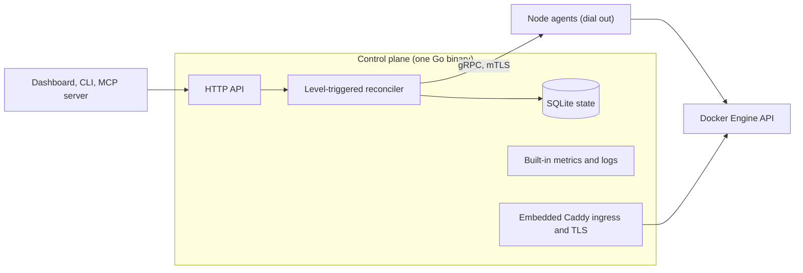

<!-- translated-from: README.md blob:9c194248e518399035b29933ea71854d30fc19ec lang:de -->
<div align="center">

<h1>Levelrail</h1>

> This translation was generated with AI and may contain mistakes. Corrections are welcome: see [docs/i18n/README.md](README.md).

<p><strong>Selbst gehostetes PaaS: deployen per git push auf eigene Server, mit Logs, Metriken, HTTPS und Rollback.</strong><br>
Ein Go-Binary, Docker-Runtime, kein Kubernetes. Apache 2.0.</p>
<p>
  <a href="../../LICENSE"></a>
  <a href="https://github.com/glincker/levelrail/releases"></a>
  <a href="https://github.com/glincker/levelrail/actions/workflows/ci.yml"></a>
  <a href="../../go.mod"></a>
<br>
  <a href="../../docs/mcp.md"></a>
  <a href="https://docs.levelrail.com"></a>
  <a href="https://discord.gg/Ar5pcaZB99"></a>
  <a href="https://codespaces.new/glincker/levelrail"></a>
</p>
<p>
  <a href="https://levelrail.com">Website</a> &middot;
  <a href="https://docs.levelrail.com">Doku</a> &middot;
  <a href="#schnellstart-eine-selbst-gehostete-vercel-alternative-installieren">Installation</a> &middot;
  <a href="#produktionsreif-mit-belegen">Produktionsreif</a> &middot;
  <a href="#levelrail-im-vergleich-zu-coolify-dokploy-caprover-und-dokku-coolify-alternative">Vergleich</a> &middot;
  <a href="#faq">FAQ</a> &middot;
  <a href="../../docs/roadmap.md">Roadmap</a> &middot;
  <a href="../../CHANGELOG.md">Changelog</a> &middot;
  <a href="https://github.com/glincker/levelrail/discussions">Discussions</a>
</p>
<!-- i18n-nav:start -->
<p><a href="../../README.md">English</a> &middot; <a href="README.zh-Hans.md">简体中文</a> &middot; <a href="README.es.md">Español</a> &middot; <a href="README.pt-BR.md">Português (BR)</a> &middot; Deutsch &middot; <a href="README.fr.md">Français</a> &middot; <a href="README.ja.md">日本語</a></p>
<!-- i18n-nav:end -->
<picture><source media="(prefers-color-scheme: dark)" srcset="../../docs/assets/brand/social/github-social-1280x640.jpg"></picture>
</div>

Levelrail ist ein Open-Source-PaaS (Apache 2.0) zum **Selbsthosten** für Entwickler und kleine Teams, die einen Workflow im Stil von Vercel, Heroku oder Railway auf eigenen Servern wollen. Es läuft auf jedem Linux-Server, vom kleinen VPS bis zum Rack (der einzige gemessene Host ist ein Rechner mit 2 vCPU und 8 GB), und macht aus gewöhnlichen Servern eine private Cloud mit Git-Deploys (Forge-Webhooks), HTTPS, Datenbanken mit verifizierten Backups, Metriken, Logs und Alarmen, ohne Kubernetes und ohne den Monitoring-Stack, den man sonst nachrüsten müsste.

**Status:** pre-1.0 (v0.x). Einzelserver-Betrieb ist laut [Feature-Status](../../docs/feature-status.md) produktionsreif; Multi-Node ist Beta.

## Welche Installation passt zu mir?

| Ich... | Ausführen | Doku |
| --- | --- | --- |
| habe einen Linux-Server (VPS oder Bare Metal) und möchte Apps deployen | `curl -fsSL https://levelrail.com/install.sh \| sudo sh` | [Installation](../../docs/installing.md) |
| möchte es zuerst lokal ausprobieren | Dev-Container in [Codespaces](https://codespaces.new/glincker/levelrail) öffnen | [Installation](../../docs/installing.md#option-3-build-from-source) |
| brauche nur die CLI auf meinem Laptop | `brew install glincker/tap/levelrail-cli` oder `npm install -g levelrail-cli` | [Nur die CLI installieren](../../docs/installing.md#installing-just-the-cli) |
| nutze Docker und möchte einen Container | `docker pull ghcr.io/glincker/levelrail` | [Docker](../../docs/installing.md#option-2-docker) |
| nutze einen Coding-Agent | `npx skills add https://github.com/glincker/levelrail --skill levelrail` | [MCP-Server](../../docs/mcp.md) |

Der Server lässt sich nur unter Linux installieren. macOS und Windows sind reine CLI-Ziele.

## Inhaltsverzeichnis

[Schnellstart](#schnellstart-eine-selbst-gehostete-vercel-alternative-installieren) &middot; [So funktioniert es](#so-funktioniert-es) &middot; [Installation überprüfen](#installation-überprüfen) &middot; [Warum Levelrail](#warum-man-levelrail-wählt) &middot; [Produktionsreif](#produktionsreif-mit-belegen) &middot; [Coolify-Alternative](#levelrail-im-vergleich-zu-coolify-dokploy-caprover-und-dokku-coolify-alternative) &middot; [Funktionen](#funktionsumfang) &middot; [Anleitungen](#anleitungen) &middot; [FAQ](#faq) &middot; [Für KI-Agenten](#für-ki-agenten-und-crawler)

## Schnellstart (eine selbst gehostete Vercel-Alternative installieren)

Voraussetzung ist ein Linux-Server (`amd64` oder `arm64`) mit systemd und Root-Zugriff. Der Installer richtet Docker ein, falls es fehlt.

### 1. Server installieren

```bash
curl -fsSL https://levelrail.com/install.sh | sudo sh
```

> **Hinweis:** HTTPS ist selbstsigniert, bis Let's Encrypt aktiviert wird. Beim ersten Login wird ein kostenloses Zertifikat für `<dashed-ip>.sslip.io` mit einem Klick angeboten, alternativ lässt sich eine eigene Domain hinzufügen.

Die letzten Ausgabezeilen enthalten die Dashboard-Adresse und einen einmaligen Setup-Link:

```text
Levelrail vX.Y.Z installed and running.

Open the dashboard:
  http://203.0.113.10:8080/login#setup=<token>
```

### 2. Admin-Konto anlegen

Den Setup-Link öffnen und ein Passwort wählen. Das Token steht im `#`-Fragment und erreicht daher weder den Server noch dessen Logs; verloren? `sudo APP_DATA_DIR=/var/lib/levelrail-data levelrail setup-token` gibt es erneut aus. Beim ersten Login erscheint ein Bildschirm, der mit einem Klick ein kostenloses Zertifikat für `<dashed-ip>.sslip.io` aktiviert (kein DNS nötig) und die erste App deployt.

### 3. App deployen

Auf dem Server hat der Installer `levelrail-cli` bereits in `/usr/local/bin` abgelegt. Einmal anmelden, dann ein Repository importieren (`levelrail-cli apps create --interactive` fragt alles Schritt für Schritt ab):

```bash
levelrail-cli login --api-url http://<server-ip>:8080 --code ABCD-EF23
levelrail-cli import https://github.com/your-org/your-app --deploy
```

Container, eine feste Version oder ein Build aus dem Quellcode gewünscht? Siehe [Installation](../../docs/installing.md). Es soll so leicht sein wie Dokku, oder alles aktiviert? `install.sh --profile minimal|standard|suite`, siehe [Server-Profile](../../docs/profiles.md). Wechsel von einer anderen Plattform? Siehe [Zu Levelrail migrieren](../../docs/migrate-to-levelrail.md): Coolify, Dokploy, CapRover, Dokku und Compose-Dateien bekommen jeweils zuerst einen Probelauf, und der alte Server liefert weiter aus.

Nach dem Setup zeigt die Dashboard-Startseite eine Karte **Connect your CLI**. **Show my command** drücken, die Zeile ins Terminal einfügen, und die CLI meldet sich mit einem einmaligen Code an, der nach wenigen Minuten abläuft (kein Passwort, kein Freigabeschritt):

```text
logged in as "you@example.com"
token tk_9fQ2x saved to ~/.config/levelrail-cli/credentials under profile "default", expires 2027-01-18
```

Die Anmeldung per Passwort von einem neuen Gerät erfordert eine Freigabe: Die CLI gibt die Dashboard-Seite für die Freigabe und die einzugebende Nummer aus. `login --device` funktioniert ebenfalls weiterhin.

Ohne `--deploy` gibt `import` nur den Deployment-Plan aus. Die Adresse der App zeigt `levelrail-cli open your-app`. Zuerst wird die eigene Domain ausgegeben, dann die automatische URL.

### Oder vom Coding-Agent erledigen lassen

Den Skill einmal installieren, dann den Agent in normalen Worten beauftragen. Er deployt, wartet, bis der Rollout tatsächlich konvergiert, liest bei einem Fehler die Ursache aus und führt ein sicheres Rollback durch:

```bash
npx skills add https://github.com/glincker/levelrail --skill levelrail
```

> Deploy this repo to my Levelrail and tell me when it is live.

Der Skill ist auch auf [skills.sh](https://www.skills.sh/glincker/levelrail/levelrail) gelistet. Details: [Agents](../../docs/agents.md).

### Wenn etwas fehlschlägt

| Schritt | Angezeigter Fehler | Lösung |
| --- | --- | --- |
| Installation | `control plane did not become healthy within 60s` | `systemctl status levelrail` und `journalctl -u levelrail -n 100 --no-pager`. Eine häufige Ursache ist ein bereits belegter Port. |
| Installation | `could not list releases from GitHub. Set LEVELRAIL_VERSION=vX.Y.Z to pin one.` | Der Server erreicht GitHub nicht. Ausgehendes HTTPS prüfen oder ein Release festlegen. |
| Installation | `checksum mismatch for ...` | Nicht fortfahren. Den Installer erneut ausführen. `LEVELRAIL_SKIP_CHECKSUM=1` nicht setzen, um darüber hinwegzukommen. |
| Login | `start device login: ... connection refused` | Die CLI zeigt auf die falsche Adresse. `export APP_API_URL=http://127.0.0.1:<dashboard port>` ausführen und es erneut versuchen. |
| Import | `plan import: ... connection refused` | Die Control Plane läuft nicht. Mit `systemctl start levelrail` starten. |

Weitere Lösungen: [Fehlerbehebung](../../docs/troubleshooting.md). Alle Installationsoptionen (Docker-Image, feste Version, Build aus dem Quellcode): [Installation](../../docs/installing.md). Aus einem lokalen Projekt mit `levelrail-cli up` deployen: [Schnellstart mit einem Befehl](../../docs/quickstart-one-command.md). Server-Profile (`install.sh --profile minimal|standard|suite`): [Server-Profile](../../docs/profiles.md). Migration von einer anderen Plattform? `levelrail-cli import platform coolify|dokploy|caprover --dry-run` zeigt zuerst, was angelegt würde, und der alte Server liefert weiter aus. Vollständige Anleitung: [Zu Levelrail migrieren](../../docs/migrate-to-levelrail.md). Ein Open-Source-Projekt veröffentlichen? Einen Ein-Klick-Button in dessen README einbauen: [Deploy-to-Levelrail-Button](../../docs/deploy-button.md).

<table>
  <tr>
    <td width="50%" valign="top" align="center">
      <br>
      <sub><b>Installieren, dann deployen</b></sub>
    </td>
    <td width="50%" valign="top" align="center">
      <br>
      <sub><b>Deployment mit Gate, Rollback in einem Schritt</b></sub>
    </td>
  </tr>
</table>

### Nur die CLI installieren

Für den Laptop oder einen CI-Runner, um einen Server zu steuern, auf dem Levelrail bereits läuft:

```bash
brew install glincker/tap/levelrail-cli
npm install -g levelrail-cli
curl -fsSL https://levelrail.com/install-cli.sh | sh
irm https://levelrail.com/install-cli.ps1 | iex
```

Die ersten beiden funktionieren auf jeder unterstützten Plattform, der dritte ist für macOS und Linux, der letzte für Windows PowerShell.

## So funktioniert es



Die Control Plane hält den Soll-Zustand in eingebettetem SQLite, und ein Reconciler gleicht Docker daran an. Er kann sicher wiederholen, weil er jedes Mal vom beobachteten Zustand ausgeht. Auf jedem Knoten läuft ein Agent, der per mTLS zur Control Plane hin verbindet und direkt mit der Docker Engine API spricht, sodass Knoten keinen eingehenden Port brauchen. Metriken und Logs werden pro Knoten gespeichert und gemeinsam abgefragt. Caddy ist für Ingress und Zertifikate eingebettet. Details: [Architektur](../../docs/architecture.md).

## Installation überprüfen

Releases veröffentlichen eine Sigstore-Signatur für `checksums.txt` sowie eine Build-Provenance-Attestierung. `v0.1.0` durch den Release-Tag ersetzen.

```bash
V=v0.1.0
BASE=https://github.com/glincker/levelrail/releases/download/$V
curl -fsSLO $BASE/checksums.txt -O $BASE/checksums.txt.sigstore.json -O $BASE/levelrail-linux-amd64
cosign verify-blob --bundle checksums.txt.sigstore.json \
  --certificate-identity-regexp 'https://github.com/glincker/levelrail/\.github/workflows/release\.yml@.*' \
  --certificate-oidc-issuer https://token.actions.githubusercontent.com checksums.txt
sha256sum --check --ignore-missing checksums.txt
gh attestation verify levelrail-linux-amd64 --repo glincker/levelrail
```

Der Installer prüft die Prüfsummen selbst. Container-Images liegen auf GHCR (`ghcr.io/glincker/levelrail`, Multi-Arch). Mehr: [Installation](../../docs/installing.md).

## Warum man Levelrail wählt

- **Leichtgewichtig.** Etwa 200 MB RAM und rund 1,5 % einer CPU im Leerlauf, gemessen auf einem Linux-Testrechner mit 2 vCPU und 8 GB, ohne Apps unter Last und mit dem Standard-Funktionsumfang (ein Lauf, 2026-10-19). [Zahlen und Methode](../../docs/benchmarks.md).
- **Agents statt SSH.** Auf jedem Knoten läuft ein kleiner Agent, der per mTLS nach außen verbindet und direkt mit der Engine API von Docker spricht. Keine eingehenden Ports, kein Aufruf der `docker`-CLI per Shell, keine Polling-Schleifen.
- **Observability inklusive.** Metriken pro Knoten mit 15 Sekunden Auflösung, durchsuchbare Logs, Deploy-Markierungen, Traces, SLO-Burn, Alarm-Eingang und eine Gesundheitsseite für den Leerlauf-Footprint. Kein Grafana-Stack zu installieren.
- **Deployments, die schützen.** Rollouts mit Readiness-Gate, fixierte Images für das Rollback, Canary-Releases mit automatischem Rollback bei Fehlern, Deploy-Diffs, Freigaben und Freezes.
- **Standardmäßig sicher.** Hash-verketteter Audit-Log, der sich verifizieren lässt, SSRF-geschützte ausgehende Aufrufe, Secrets mit Envelope-Verschlüsselung und Schlüsselrotation, Tokens mit begrenztem Geltungsbereich, Passkeys und TOTP-2FA, OAuth- und OIDC-Anmeldung, IAM-Richtlinien, signierte Releases. SAML-Single-Sign-On und SCIM-Provisioning sind als [Beta-Funktion](../../docs/sso-saml.md) verfügbar und standardmäßig deaktiviert.
- **Für KI-Agenten gebaut.** Ein MCP-Server mit über 240 Tools in bedarfsgesteuerten Toolsets (kleine Standardliste, etwa 2,4k Tokens; siehe [Tool-Oberfläche](../../docs/mcp-tool-surface.md)), ein Berechtigungsmodell mit eingeschränkten Tokens und ein Agent-Skill.

## Produktionsreif, mit Belegen

Einzelserver-Deployments sind heute produktionsreif. Multi-Node und einige neuere Funktionen sind als Beta gekennzeichnet, und jede Kennzeichnung verlinkt auf ihre Belege.

| Aussage | Beleg |
| --- | --- |
| Jede Funktion ist als stabil oder Beta gekennzeichnet | [Feature-Status](../../docs/feature-status.md): die Tests, Live-E2E-Läufe und Dokumentation hinter jeder Kennzeichnung |
| Übersteht Ausfälle | [Resilienz](../../docs/resilience.md): volle Festplatte, Verbindungsverlust zum Agent, beschädigte Datenbank mit geführter Wiederherstellung, Safe-Mode-Start, Schutz vor Reconcile-Stürmen |
| Sichere Upgrades und Rollback | Getestete Upgrade-Matrix, Ablehnung von Downgrades, [Rollback](../../docs/rollback.md) per Ein-Klick und sauberes Herunterfahren |
| Gemessen, nicht versprochen | [Benchmarks](../../docs/benchmarks.md): Leerlauf-Footprint, Ingress-Durchsatz, Grenzen, mit der Methode neben jeder Zahl |
| Verifizierte Backups | Jedes Backup wird erneut heruntergeladen und per Prüfsumme geprüft, mit geplanten Restore-Übungen |
| Manipulationssichere Sicherheit | Verifizierbare Audit-Kette, [Sicherheitsrichtlinie](../../.github/SECURITY.md), signierte Releases und SBOM-Scans |

## Levelrail im Vergleich zu Coolify, Dokploy, CapRover und Dokku (Coolify-Alternative)

Die meisten selbst gehosteten Plattformen dieser Kategorie verwalten Server, indem sie sich per SSH einloggen und die `docker`-CLI per Shell aufrufen und den Text auswerten, was meist Polling-Schleifen erzwingt. Levelrail setzt stattdessen auf einen rückwärts verbindenden Agent und einen Level-Triggered-Reconciler.

| | Levelrail | Coolify | Dokploy | CapRover | Dokku |
| --- | --- | --- | --- | --- | --- |
| Knotensteuerung | Rückwärts verbindender Agent | SSH + CLI | SSH + Engine API | Swarm API | Lokales Bash |
| Orchestrierung | Level-Triggered-Reconciler | Compose | Swarm | Swarm | Bash-Scheduler |
| Eingebaute Metriken und Logs | Ja | Optionales Add-on | Separates Binary | Nein | Nein |
| Rollback | Fixierte Images, mit Readiness-Gate | Health-Check standardmäßig aus | Swarm-Rollback | Manuell | Standard-Scheduler: keins |
| Backup-Verifizierung | Automatisch, alle 8 Engines | Prüfung auf nicht leer | Keine | Keine | Keine Backups |
| SSO und Provisioning | OAuth (20 Anbieter) und generisches OIDC; SAML und SCIM (Beta, standardmäßig aus) | Siehe deren Doku | Siehe deren Doku | Siehe deren Doku | Siehe deren Doku |
| Audit-Log | Hash-verkettet, verifizierbar, CSV-Export, Weiterleitung an Syslog, Webhook oder Bucket | Siehe deren Doku | Siehe deren Doku | Siehe deren Doku | Siehe deren Doku |
| IAM | Allow- und Deny-Richtlinien pro App oder Datenbank, Tokens mit begrenztem Geltungsbereich | Siehe deren Doku | Siehe deren Doku | Siehe deren Doku | Siehe deren Doku |

Das ist eine Positionierung, kein Ranking, und jedes Projekt hier ist einen Einsatz wert. Wo Levelrail zurückliegt: Es ist das jüngste Projekt hier, mit weniger Nutzern und weniger Produktionserfahrung, und sein SAML-Single-Sign-On und SCIM-Provisioning sind Beta ([Details](../../docs/sso-saml.md)). Der Template-Katalog (etwa 360 Einträge) liegt in derselben Größenordnung wie der von Coolify, aber nur eine Stichprobe wird Ende-zu-Ende deployt ([ADR 015](../../adr/015-service-template-catalog-reversal.md)). Der vollständige Vergleich mit Quellen steht unter [Vergleich](../../docs/comparison.md).

## Funktionsumfang

- **Deployments:** Push an den Git-Host (Webhooks von GitHub, GitLab, Bitbucket, Gitea), Deployments starten über einen Forge-Webhook (ein natives `git push`-Remote ist Beta und standardmäßig aus), Preview-Umgebungen pro Pull Request (stabil auf GitHub, Beta auf GitLab und Bitbucket), Framework-Presets (Next.js, Go, React, Spring Boot und mehr), Deployments per Dockerfile, Compose oder Image, Canary- und Blue-Green-Rollouts. Die Umschaltung mit Readiness-Gate ist auf einem einzelnen Knoten live getestet, ohne fehlgeschlagene Anfragen; Multi-Node ist Beta. [Apps deployen](../../docs/deploying-apps.md)
- **Domains und TLS:** Eingebetteter Caddy-Ingress. Das Standardzertifikat ist intern (selbstsigniert). Öffentliches Let's Encrypt ist ein Schalter und wurde in einem Live-Lauf verifiziert; Erneuerung und DNS-01-Wildcards sind nicht verifiziert. Eigene Zertifikate lassen sich hochladen. Missbrauchsschutz pro App. [Domains](../../docs/domains-and-ingress.md)
- **Datenbanken:** Postgres, MySQL, MariaDB, MongoDB, Redis, KeyDB, Dragonfly und ClickHouse mit geplanten Backups, Postgres-Point-in-Time-Recovery, Wiederherstellung und Passwortrotation. [Datenbanken](../../docs/managing-databases.md)
- **Eine Suche für alles:** Cmd+K über Apps, Datenbanken, Knoten, Templates und Aktionen, gefiltert nach den eigenen Berechtigungen. [Suche](../../docs/search.md)
- **Server:** Knoten mit einem einmaligen Token hinzufügen, WireGuard-Mesh, Zonen und Verteilung über Fehlerdomänen, Platzierungs-Was-wäre-wenn. [Multi-Node](../../docs/multi-node.md)
- **Templates:** etwa 360 Ein-Klick-Dienste, mit einem Smoke-Test, der die Top 50 hochfährt (heute bestehen 48, [Status](../../docs/templates-status.md)). [Katalog](../../docs/template-catalog.md)
- **Identität und Zugriff:** Passwort, Passkeys, TOTP, OAuth mit 20 Anbietern plus generisches OIDC, IAM-Richtlinien, Teams, ein hash-verketteter Audit-Log mit CSV-Export. SAML-Single-Sign-On und SCIM-Provisioning sind Beta und standardmäßig aus. [Identität und Zugriff](../../docs/identity-and-access.md), [SAML und SCIM](../../docs/sso-saml.md)
- **Plugins:** Ein signierter Plugin-Marktplatz mit Ein-Klick-Installation, Dashboard-Panels und Alarmkanälen des Herstellers. [Plugins](../../docs/plugins.md)
- **Automatisierung:** Eine HTTP-API hinter dem Dashboard, einer CLI und einem MCP-Server. KI sitzt nie im Reconciliation-Pfad. [CLI](../../docs/cli-reference.md), [KI-Steuerung](../../docs/ai-control.md)
- **Pipelines, Previews, Kostenbudgets, Ruhezustand bei Leerlauf, Statusseiten** und mehr. Siehe [Produkttour](https://docs.levelrail.com/product-tour).

<table>
  <tr>
    <td width="33%" valign="top"><a href="../../docs/product-tour.mdx"><picture><source media="(prefers-color-scheme: dark)" srcset="../../docs/assets/screenshots/dashboard-home.png"></picture></a><br><sub><b>Die Control Plane auf einen Blick</b></sub></td>
    <td width="33%" valign="top"><a href="../../docs/frameworks.md"><picture><source media="(prefers-color-scheme: dark)" srcset="../../docs/assets/screenshots/framework-preset-picker.png"></picture></a><br><sub><b>Ein Framework-Preset wählen, und die Build-Einstellungen füllen sich</b></sub></td>
    <td width="33%" valign="top"><a href="../../docs/template-catalog.md"><picture><source media="(prefers-color-scheme: dark)" srcset="../../docs/assets/screenshots/templates-catalog.png"></picture></a><br><sub><b>Einen bekannten Dienst aus dem Template-Katalog installieren</b></sub></td>
  </tr>
  <tr>
    <td width="33%" valign="top"><a href="../../docs/deploying-apps.md"><picture><source media="(prefers-color-scheme: dark)" srcset="../../docs/assets/screenshots/deploy-live-log.png"></picture></a><br><sub><b>Live-Deployments</b></sub></td>
    <td width="33%" valign="top"><a href="../../docs/load-balancing.md"><picture><source media="(prefers-color-scheme: dark)" srcset="../../docs/assets/screenshots/load-balancer.png"></picture></a><br><sub><b>Last über Replikate verteilen, mit Health-Checks</b></sub></td>
    <td width="33%" valign="top"><a href="../../docs/deploying-apps.md"><picture><source media="(prefers-color-scheme: dark)" srcset="../../docs/assets/screenshots/apps-list.png"></picture></a><br><sub><b>Jede App, ihr Zustand und ihr letztes Deployment</b></sub></td>
  </tr>
</table>

Weitere Ansichten (Metriken, Logs, Backups, Domains, Sicherheit, Plugins) stehen in der [Produkttour](https://docs.levelrail.com/product-tour).

Alle Screenshots stammen von einer real laufenden Control Plane.

## Anleitungen

Schritt-für-Schritt-Anleitungen, jeweils an einer echten Installation getestet:

| Anleitung | Was man lernt |
| --- | --- |
| [Eine Next.js-App mit Postgres deployen](https://github.com/glincker/levelrail/discussions/1239) | Vom Repo zu HTTPS in etwa zehn Minuten |
| [Eine Django-App mit Postgres deployen](https://github.com/glincker/levelrail/discussions/1243) | Dazu die vier Fehler, in die jeder läuft |
| [Push-to-Deploy mit GitHub](https://github.com/glincker/levelrail/discussions/1244) | Webhooks, Previews und das Zustellungs-Log |
| [Wie Deployments sicher bleiben](https://github.com/glincker/levelrail/discussions/1246) | Health-Gates, Blue-Green-Umschaltung, Rollback |
| [Logs, Traces und Fehler ohne Stack](https://github.com/glincker/levelrail/discussions/1240) | Observability und Grafana |
| [Auf null skalieren auf einem kleinen VPS](https://github.com/glincker/levelrail/discussions/1242) | Viele Projekte auf einer Maschine betreiben |
| [Levelrail im Vergleich zu Coolify, Dokploy, CapRover, Dokku und Kamal](https://github.com/glincker/levelrail/discussions/1235) | Wo welches Tool passt |

## Deploy-Button zum Projekt hinzufügen

Eine Open-Source-App betreuen? Anderen ermöglichen, sie mit wenigen Klicks auf dem eigenen Server zu betreiben.

[](../../docs/deploy-button.md)

Snippets zum Kopieren und die vier Badge-Stile: [Deploy-Button](../../docs/deploy-button.md) und das [Brand-Kit](../../docs/brand.md).

## Wie es weitergeht

Geplant, nicht versprochen. Termine sind Ziele, und Punkte können sich verschieben oder entfallen. Die vollständige Liste steht in der [Roadmap](../../docs/roadmap.md).

- Echte Host-Läufe für das Multi-Node-Mesh und eine Zahl für den Leerlauf-Footprint.
- Öffentliche ACME-Prüfungen: Erneuerung kurz vor Ablauf und DNS-01-Wildcards.
- Mehr Upgrade- und Downgrade-Tests über Releases hinweg.
- Release-Snapshots und Umgebungs-Bindings.
- Ein erstes stabiles Release, erst wenn die Belege zur Härtung vorliegen. Ein Termin ist nicht festgelegt.

## FAQ

**Ist Levelrail produktionsreif?** Einzelserver-Deployments sind produktionsreif; Multi-Node und einige neuere Funktionen sind Beta. Jede Kennzeichnung steht im [Feature-Status](../../docs/feature-status.md). Das Projekt ist pre-1.0.

**Braucht es Kubernetes?** Nein. Es ist ein Go-Binary mit Docker-Runtime, und eine Kubernetes-Kompatibilitätsschicht ist bewusst kein Ziel ([Vergleich](../../docs/comparison.md)).

**Was kostet es?** Nichts. Es steht unter Apache 2.0, eine Edition, kein Lizenzschlüssel und keine kostenpflichtige Stufe. Bezahlt werden nur die eigenen Server ([Preise](../../docs/pricing.md)).

**Wie unterscheidet es sich von Coolify oder Dokploy?** Knoten werden von einem rückwärts verbindenden Agent und einem Level-Triggered-Reconciler verwaltet statt per SSH und `docker`-CLI, und Metriken und Logs sind eingebaut. Siehe die [Vergleichstabelle](#levelrail-im-vergleich-zu-coolify-dokploy-caprover-und-dokku-coolify-alternative), einschließlich der Punkte, in denen Levelrail zurückliegt.

**Kann ich von Coolify migrieren?** Ja. `levelrail-cli import platform coolify --dry-run` zeigt zuerst, was angelegt würde, und der alte Server liefert weiter aus. Dokploy, CapRover, Dokku und Compose-Dateien funktionieren ebenfalls: [Zu Levelrail migrieren](../../docs/migrate-to-levelrail.md).

**Unterstützt es KI-Agenten und MCP?** Ja. `levelrail-mcp` stellt dieselbe API und dasselbe Berechtigungsmodell bereit, und ein Agent-Skill ist enthalten. KI liegt nie im Reconciliation-Pfad: [MCP](../../docs/mcp.md), [KI-Steuerung](../../docs/ai-control.md).

**Wie führe ich Upgrades durch?** Settings > Updates oder `levelrail-cli upgrade --plan` verwenden. Das Upgrade verifiziert das Release, sichert einen Snapshot der Daten und macht selbstständig ein Rollback, wenn das neue Release nicht gesund ist: [Sicher upgraden](../../docs/upgrade-safely.md).

**Wo liegen meine Daten?** Auf den eigenen Servern. Die Control Plane hält SQLite, den Master-Key und das Setup-Token standardmäßig in `/var/lib/levelrail-data`; Metriken und Logs bleiben auf jedem Knoten ([Installation](../../docs/installing.md), [Architektur](../../docs/architecture.md)).

## Für KI-Agenten und Crawler

- **Agent-Skill:** [`skills/levelrail/SKILL.md`](../../skills/levelrail/SKILL.md) bringt einem Coding-Agent bei, sicher zu deployen, zu warten, zu diagnostizieren und zurückzurollen.
- **MCP-Server:** `levelrail-mcp` stellt dieselbe API und dasselbe Berechtigungsmodell bereit. Im Modus `read-only` beginnen. Siehe [MCP](../../docs/mcp.md) und [KI-Steuerung](../../docs/ai-control.md).
- **Repo-Leitfaden:** [`AGENTS.md`](../../AGENTS.md) für die Arbeit in dieser Codebasis und [`llms.txt`](../../llms.txt) als Index. Dokumentation für LLMs: [llms.txt](https://docs.levelrail.com/llms.txt) und [llms-full.txt](https://docs.levelrail.com/llms-full.txt).

## Community und Support

- [GitHub Discussions](https://github.com/glincker/levelrail/discussions) für Fragen, Ideen und Vorstellungen eigener Projekte, und [Issues](https://github.com/glincker/levelrail/issues) für Bugs.
- [GLINR Discord](https://discord.gg/Ar5pcaZB99): Live-Chat mit den Maintainern, im Forenkanal `#levelrail`.
- [support@levelrail.com](mailto:support@levelrail.com) für direkte Hilfe, und die [Sicherheitsrichtlinie](../../.github/SECURITY.md), um eine Schwachstelle vertraulich zu melden.
- [Mitwirken](../../.github/CONTRIBUTING.md): Entwicklungszyklus, Tests und Commit-Konventionen. Der Build aus dem Quellcode braucht Go 1.26 oder neuer und Docker: siehe [Installation](../../docs/installing.md#option-3-build-from-source).

## Das Repo mit einem Stern unterstützen

Wenn Levelrail ein Wochenende spart, hilft ein [Stern auf GitHub](https://github.com/glincker/levelrail) anderen Selbsthostern, es zu finden. Bug-Reports und ehrliches Feedback helfen noch mehr.

[](https://star-history.com/#glincker/levelrail&Date)

<a href="https://github.com/glincker/levelrail/graphs/contributors"></a>

## Lizenz

Apache 2.0, siehe [LICENSE](../../LICENSE).

## Entwickelt von

Levelrail wird von Gagan Deep Singh entwickelt, Gründer von [GLINR STUDIOS](https://glinr.com) und [theSVG](https://thesvg.org). Schwesterprojekte: [theSVG](https://thesvg.org) (Bibliothek für Markensymbole), [theauth](https://github.com/glincker/theauth) (Open-Source-Authentifizierung für KI-Agenten und Menschen) und [AskVerdict AI](https://askverdict.ai). Einfach Hallo sagen unter [thegdsks.com](https://thegdsks.com).

<div align="center">

<a href="https://glinr.com">
  <picture>
    <source media="(prefers-color-scheme: dark)" srcset="../../docs/assets/brand/glincker-light.svg">
    
  </picture>
</a>

<sub>Powered by <a href="https://glinr.com"><b>GLINR STUDIOS</b></a> &middot; Icon von <a href="https://thesvg.org/icon/glincker">theSVG</a></sub>

</div>
