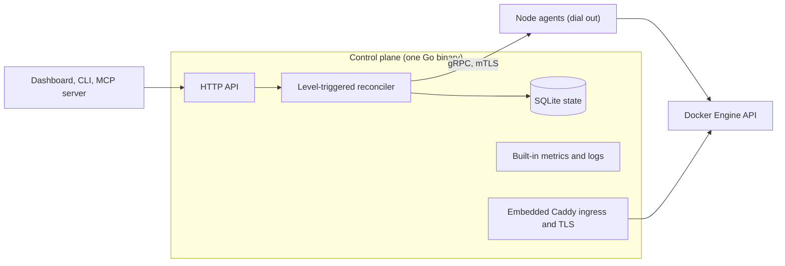

<!-- translated-from: README.md blob:9c194248e518399035b29933ea71854d30fc19ec lang:es -->
<div align="center">

<h1>Levelrail</h1>

> This translation was generated with AI and may contain mistakes. Corrections are welcome: see [docs/i18n/README.md](README.md).
>
> Esta traducción fue generada con IA y puede contener errores. Las correcciones son bienvenidas: consulta [docs/i18n/README.md](README.md).

<p><strong>PaaS autoalojado: despliega con git push en tus propios servidores, con logs, métricas, HTTPS y rollback.</strong><br>
Un solo binario de Go, runtime de Docker, sin Kubernetes. Apache 2.0.</p>
<p>
  <a href="../../LICENSE"></a>
  <a href="https://github.com/glincker/levelrail/releases"></a>
  <a href="https://github.com/glincker/levelrail/actions/workflows/ci.yml"></a>
  <a href="../../go.mod"></a>
<br>
  <a href="../../docs/mcp.md"></a>
  <a href="https://docs.levelrail.com"></a>
  <a href="https://discord.gg/Ar5pcaZB99"></a>
  <a href="https://codespaces.new/glincker/levelrail"></a>
</p>
<p>
  <a href="https://levelrail.com">Sitio web</a> &middot;
  <a href="https://docs.levelrail.com">Docs</a> &middot;
  <a href="#inicio-rápido-instala-una-alternativa-autoalojada-a-vercel">Instalar</a> &middot;
  <a href="#listo-para-producción-con-pruebas">Listo para producción</a> &middot;
  <a href="#levelrail-vs-coolify-dokploy-caprover-y-dokku-alternativa-a-coolify">Comparar</a> &middot;
  <a href="#preguntas-frecuentes-faq">FAQ</a> &middot;
  <a href="../../docs/roadmap.md">Hoja de ruta</a> &middot;
  <a href="../../CHANGELOG.md">Registro de cambios</a> &middot;
  <a href="https://github.com/glincker/levelrail/discussions">Discusiones</a>
</p>
<!-- i18n-nav:start -->
<p><a href="../../README.md">English</a> &middot; <a href="README.zh-Hans.md">简体中文</a> &middot; Español &middot; <a href="README.pt-BR.md">Português (BR)</a> &middot; <a href="README.de.md">Deutsch</a> &middot; <a href="README.fr.md">Français</a> &middot; <a href="README.ja.md">日本語</a></p>
<!-- i18n-nav:end -->
<picture><source media="(prefers-color-scheme: dark)" srcset="../../docs/assets/brand/social/github-social-1280x640.jpg"></picture>
</div>

Levelrail es un **PaaS autoalojado** de código abierto (Apache 2.0) para desarrolladores y equipos pequeños que quieren un flujo de trabajo al estilo Vercel, Heroku o Railway en servidores propios. Funciona en cualquier servidor Linux, desde un VPS pequeño hasta un rack (el único host medido es una máquina de 2 vCPU y 8 GB), y convierte servidores comunes en una nube privada con despliegues por Git (webhooks del forge), HTTPS, bases de datos con backups verificados, métricas, logs y alertas, sin Kubernetes y sin el stack de monitoreo que de otro modo tendrías que añadir.

**Estado:** pre-1.0 (v0.x). Un solo servidor está listo para producción según el [estado de las funciones](../../docs/feature-status.md); multinodo es beta.

## ¿Qué instalación es para mí?

| Soy... | Ejecuta | Doc |
| --- | --- | --- |
| Tengo un servidor Linux (VPS o bare metal) y quiero desplegar apps | `curl -fsSL https://levelrail.com/install.sh \| sudo sh` | [Instalación](../../docs/installing.md) |
| Quiero probarlo primero en local | Abre el dev container en [Codespaces](https://codespaces.new/glincker/levelrail) | [Instalación](../../docs/installing.md#option-3-build-from-source) |
| Solo necesito la CLI en mi laptop | `brew install glincker/tap/levelrail-cli` o `npm install -g levelrail-cli` | [Instalar solo la CLI](../../docs/installing.md#installing-just-the-cli) |
| Uso Docker y quiero un contenedor | `docker pull ghcr.io/glincker/levelrail` | [Docker](../../docs/installing.md#option-2-docker) |
| Uso un agente de código | `npx skills add https://github.com/glincker/levelrail --skill levelrail` | [Servidor MCP](../../docs/mcp.md) |

El servidor solo se instala en Linux. macOS y Windows son destinos solo para la CLI.

## Tabla de contenidos

[Inicio rápido](#inicio-rápido-instala-una-alternativa-autoalojada-a-vercel) &middot; [Cómo funciona](#cómo-funciona) &middot; [Verifica lo que instalas](#verifica-lo-que-instalas) &middot; [Por qué Levelrail](#por-qué-elegir-levelrail) &middot; [Listo para producción](#listo-para-producción-con-pruebas) &middot; [Alternativa a Coolify](#levelrail-vs-coolify-dokploy-caprover-y-dokku-alternativa-a-coolify) &middot; [Funciones](#qué-obtienes) &middot; [Guías](#guías) &middot; [FAQ](#preguntas-frecuentes-faq) &middot; [Para agentes de IA](#para-agentes-de-ia-y-crawlers)

## Inicio rápido (instala una alternativa autoalojada a Vercel)

Necesitas un servidor Linux (`amd64` o `arm64`) con systemd y acceso root. El instalador añade Docker si no lo encuentra.

### 1. Instala el servidor

```bash
curl -fsSL https://levelrail.com/install.sh | sudo sh
```

> **Nota:** HTTPS usa un certificado autofirmado hasta que actives Let's Encrypt. El primer inicio de sesión ofrece un certificado gratuito con un clic para `<dashed-ip>.sslip.io`, o puedes añadir tu propio dominio.

Las últimas líneas de la salida incluyen la dirección del panel y un enlace de configuración de un solo uso:

```text
Levelrail vX.Y.Z installed and running.

Open the dashboard:
  http://203.0.113.10:8080/login#setup=<token>
```

### 2. Crea la cuenta de administrador

Abre el enlace de configuración y elige una contraseña. El token va en el fragmento `#`, así que nunca llega al servidor ni a sus logs; ¿lo perdiste? `sudo APP_DATA_DIR=/var/lib/levelrail-data levelrail setup-token` lo imprime de nuevo. El primer inicio de sesión abre una pantalla que activa un certificado gratuito para `<dashed-ip>.sslip.io` con un clic (sin necesidad de DNS) y despliega tu primera app.

### 3. Despliega una app

En el servidor, el instalador ya dejó `levelrail-cli` en `/usr/local/bin`. Inicia sesión una vez y luego importa un repositorio (`levelrail-cli apps create --interactive` te pregunta todo paso a paso):

```bash
levelrail-cli login --api-url http://<server-ip>:8080 --code ABCD-EF23
levelrail-cli import https://github.com/your-org/your-app --deploy
```

¿Prefieres contenedores, una versión fija o compilar desde el código fuente? Consulta [Instalación](../../docs/installing.md). ¿Lo quieres tan ligero como Dokku, o con todo activado? `install.sh --profile minimal|standard|suite`, consulta [Perfiles de servidor](../../docs/profiles.md). ¿Vienes de otra plataforma? Consulta [Migrar a Levelrail](../../docs/migrate-to-levelrail.md): Coolify, Dokploy, CapRover, Dokku y los archivos compose pasan primero por una simulación (dry run), y el servidor anterior sigue atendiendo.

Después de la configuración, la página de inicio del panel muestra una tarjeta **Connect your CLI**. Pulsa **Show my command**, pega la línea en tu terminal y la CLI inicia sesión con un código de un solo uso que caduca en minutos (sin contraseña, sin paso de aprobación):

```text
logged in as "you@example.com"
token tk_9fQ2x saved to ~/.config/levelrail-cli/credentials under profile "default", expires 2027-01-18
```

Iniciar sesión con tu contraseña desde un dispositivo nuevo requiere aprobación: la CLI imprime la página del panel donde aprobarlo y el número que debes escribir. `login --device` también sigue funcionando.

Sin `--deploy`, `import` solo imprime el plan de despliegue. Para ver la dirección de la app, ejecuta `levelrail-cli open your-app`. Primero imprime el dominio personalizado y después la URL automática.

### O deja que tu agente de código lo haga

Instala la skill una vez y luego pídele a tu agente lo que quieras con palabras normales. Despliega, espera a que el rollout realmente converja, lee el fallo si lo hay y hace rollback de forma segura:

```bash
npx skills add https://github.com/glincker/levelrail --skill levelrail
```

> Deploy this repo to my Levelrail and tell me when it is live.

La skill también aparece en [skills.sh](https://www.skills.sh/glincker/levelrail/levelrail). Detalles: [Agentes](../../docs/agents.md).

### Si algo falla

| Paso | Error que ves | Solución |
| --- | --- | --- |
| Instalación | `control plane did not become healthy within 60s` | `systemctl status levelrail` y `journalctl -u levelrail -n 100 --no-pager`. Una causa común es un puerto que ya está en uso. |
| Instalación | `could not list releases from GitHub. Set LEVELRAIL_VERSION=vX.Y.Z to pin one.` | El servidor no puede llegar a GitHub. Revisa el HTTPS saliente o fija una versión. |
| Instalación | `checksum mismatch for ...` | No continúes. Ejecuta el instalador de nuevo. No definas `LEVELRAIL_SKIP_CHECKSUM=1` para saltarte el error. |
| Inicio de sesión | `start device login: ... connection refused` | La CLI apunta a una dirección equivocada. Ejecuta `export APP_API_URL=http://127.0.0.1:<dashboard port>` e inténtalo de nuevo. |
| Importación | `plan import: ... connection refused` | El plano de control no está en ejecución. Inícialo con `systemctl start levelrail`. |

Más soluciones: [Solución de problemas](../../docs/troubleshooting.md). Todas las opciones de instalación (imagen de Docker, versión fija, compilación desde el código fuente): [Instalación](../../docs/installing.md). Despliega desde un proyecto local con `levelrail-cli up`: [Inicio rápido con un comando](../../docs/quickstart-one-command.md). Perfiles de servidor (`install.sh --profile minimal|standard|suite`): [Perfiles de servidor](../../docs/profiles.md). ¿Migras desde otra plataforma? `levelrail-cli import platform coolify|dokploy|caprover --dry-run` muestra primero qué se crearía, y el servidor anterior sigue atendiendo. Guía completa: [Migrar a Levelrail](../../docs/migrate-to-levelrail.md). ¿Publicas un proyecto de código abierto? Añade un botón de un clic a su README: [Botón Deploy to Levelrail](../../docs/deploy-button.md).

<table>
  <tr>
    <td width="50%" valign="top" align="center">
      <br>
      <sub><b>Instalar y luego desplegar</b></sub>
    </td>
    <td width="50%" valign="top" align="center">
      <br>
      <sub><b>Despliegue con compuerta, rollback en un paso</b></sub>
    </td>
  </tr>
</table>

### Instalar solo la CLI

Para tu laptop o un runner de CI, para controlar un servidor que ya ejecuta Levelrail:

```bash
brew install glincker/tap/levelrail-cli
npm install -g levelrail-cli
curl -fsSL https://levelrail.com/install-cli.sh | sh
irm https://levelrail.com/install-cli.ps1 | iex
```

Los dos primeros funcionan en cualquier plataforma compatible, el tercero es para macOS y Linux, y el último para Windows PowerShell.

## Cómo funciona



El plano de control guarda el estado deseado en SQLite embebido y un reconciliador hace que Docker coincida con él, reintentando de forma segura porque cada vez parte del estado observado. Cada nodo ejecuta un agente que se conecta hacia afuera al plano de control mediante mTLS y habla directamente con la API de Docker Engine, así que los nodos no necesitan ningún puerto de entrada. Las métricas y los logs se almacenan por nodo y se consultan en conjunto. Caddy está embebido para el ingress y los certificados. Detalles: [Arquitectura](../../docs/architecture.md).

## Verifica lo que instalas

Las versiones publican una firma de Sigstore para `checksums.txt` y una attestation de procedencia del build. Reemplaza `v0.1.0` por la etiqueta de la versión.

```bash
V=v0.1.0
BASE=https://github.com/glincker/levelrail/releases/download/$V
curl -fsSLO $BASE/checksums.txt -O $BASE/checksums.txt.sigstore.json -O $BASE/levelrail-linux-amd64
cosign verify-blob --bundle checksums.txt.sigstore.json \
  --certificate-identity-regexp 'https://github.com/glincker/levelrail/\.github/workflows/release\.yml@.*' \
  --certificate-oidc-issuer https://token.actions.githubusercontent.com checksums.txt
sha256sum --check --ignore-missing checksums.txt
gh attestation verify levelrail-linux-amd64 --repo glincker/levelrail
```

El instalador verifica los checksums por sí mismo. Las imágenes de contenedor están en GHCR (`ghcr.io/glincker/levelrail`, multiarquitectura). Más información: [Instalación](../../docs/installing.md).

## Por qué elegir Levelrail

- **Ligero.** Unos 200 MB de RAM y aproximadamente 1,5 % de una CPU en reposo, medido en una máquina de pruebas Linux de 2 vCPU y 8 GB, sin apps bajo carga y con el conjunto de funciones por defecto (una ejecución, 2026-10-19). [Cifras y método](../../docs/benchmarks.md).
- **Agentes, no SSH.** Cada nodo ejecuta un agente pequeño que se conecta hacia afuera mediante mTLS y habla directamente con la API de Docker Engine. Sin puertos de entrada, sin invocar la CLI `docker` desde un shell, sin bucles de polling.
- **Observabilidad incluida.** Métricas por nodo con resolución de 15 segundos, logs con búsqueda, marcadores de despliegue, trazas, consumo del presupuesto de errores (SLO burn), bandeja de alertas y una página de estado del consumo en reposo. Sin instalar un stack de Grafana.
- **Despliegues que te protegen.** Rollouts con compuerta de readiness, imágenes fijadas para el rollback, lanzamientos canary que hacen rollback ante errores, diffs de despliegue, aprobaciones y congelamientos.
- **Seguro por defecto.** Log de auditoría encadenado por hash que puedes verificar, llamadas salientes protegidas contra SSRF, secretos cifrados con cifrado de sobre y rotación de claves, tokens con alcance limitado, passkeys y 2FA con TOTP, inicio de sesión con OAuth y OIDC, políticas IAM, versiones firmadas. El inicio de sesión único con SAML y el aprovisionamiento con SCIM están disponibles como [función beta](../../docs/sso-saml.md), desactivados por defecto.
- **Pensado para agentes de IA.** Un servidor MCP con más de 240 herramientas en conjuntos que se cargan bajo demanda (lista por defecto pequeña, unos 2,4k tokens; consulta la [superficie de herramientas](../../docs/mcp-tool-surface.md)), un modelo de permisos con tokens de alcance limitado y una skill para agentes.

## Listo para producción, con pruebas

Los despliegues en un solo servidor están listos para producción hoy. Multinodo y un puñado de funciones más recientes están etiquetados como beta, y cada etiqueta enlaza a su evidencia.

| Afirmación | Evidencia |
| --- | --- |
| Cada función está etiquetada como estable o beta | [Estado de las funciones](../../docs/feature-status.md): las pruebas, las ejecuciones e2e en vivo y la documentación detrás de cada etiqueta |
| Sobrevive a los fallos | [Resiliencia](../../docs/resilience.md): disco lleno, pérdida del enlace con el agente, daño en la base de datos con restauración guiada, arranque en modo seguro, protección contra tormentas de reconciliación |
| Actualizaciones seguras y rollback | Matriz de actualización probada, rechazo de downgrade, [rollback](../../docs/rollback.md) con un clic y apagado limpio |
| Medido, no prometido | [Benchmarks](../../docs/benchmarks.md): consumo en reposo, throughput del ingress, límites, con el método junto a cada cifra |
| Backups verificados | Cada backup se vuelve a descargar y se comprueba con checksum, con simulacros de restauración programados |
| Seguridad con evidencia de manipulación | Cadena de auditoría verificable, [política de seguridad](../../.github/SECURITY.md), versiones firmadas y escaneo de SBOM |

## Levelrail vs Coolify, Dokploy, CapRover y Dokku (alternativa a Coolify)

La mayoría de las plataformas autoalojadas de esta categoría gestionan los servidores entrando por SSH e invocando la CLI `docker` desde un shell, y luego analizan texto, lo que tiende a obligar a usar bucles de polling. Levelrail usa en su lugar un agente de conexión inversa y un reconciliador activado por nivel (level-triggered).

| | Levelrail | Coolify | Dokploy | CapRover | Dokku |
| --- | --- | --- | --- | --- | --- |
| Control de nodos | Agente de conexión inversa | SSH + CLI | SSH + Engine API | Swarm API | Bash local |
| Orquestación | Reconciliador level-triggered | Compose | Swarm | Swarm | Scheduler en Bash |
| Métricas y logs integrados | Sí | Complemento opcional | Binario aparte | No | No |
| Rollback | Imágenes fijadas, con compuerta de readiness | Health check desactivado por defecto | Rollback de Swarm | Manual | Scheduler por defecto: ninguno |
| Verificación de backups | Automática, los 8 motores | Comprobación de no vacío | Ninguna | Ninguna | Sin backups |
| SSO y aprovisionamiento | OAuth (20 proveedores) y OIDC genérico; SAML y SCIM (beta, desactivados por defecto) | Consulta su documentación | Consulta su documentación | Consulta su documentación | Consulta su documentación |
| Log de auditoría | Encadenado por hash, verificable, exportación a CSV, reenvío a syslog, webhook o bucket | Consulta su documentación | Consulta su documentación | Consulta su documentación | Consulta su documentación |
| IAM | Políticas Allow y Deny por app o base de datos, tokens con alcance limitado | Consulta su documentación | Consulta su documentación | Consulta su documentación | Consulta su documentación |

Esto es posicionamiento, no un ranking, y todos los proyectos aquí valen la pena. Donde Levelrail va por detrás: es el proyecto más joven de los mencionados, con menos usuarios y menos recorrido en producción, y su inicio de sesión único con SAML y su aprovisionamiento con SCIM están en beta ([detalles](../../docs/sso-saml.md)). Su catálogo de plantillas (unas 360 entradas) está en el mismo rango que el de Coolify, pero solo una muestra se despliega de extremo a extremo ([ADR 015](../../adr/015-service-template-catalog-reversal.md)). La comparación completa y con fuentes está en [Comparación](../../docs/comparison.md).

## Qué obtienes

- **Despliegues:** Haz push a tu host de git (webhooks de GitHub, GitLab, Bitbucket, Gitea), los despliegues se inician desde un webhook del forge (un remoto nativo de `git push` es beta y está desactivado por defecto), entornos de vista previa por pull request (estable en GitHub, beta en GitLab y Bitbucket), presets de frameworks (Next.js, Go, React, Spring Boot y más), despliegues con Dockerfile, Compose o imagen, rollouts canary y blue-green. El corte con compuerta de readiness está probado en vivo con cero solicitudes fallidas en un solo nodo; multinodo es beta. [Desplegar apps](../../docs/deploying-apps.md)
- **Dominios y TLS:** Ingress con Caddy embebido. El certificado por defecto es interno (autofirmado). Let's Encrypt público se activa con un solo interruptor y se verificó en una ejecución en vivo; la renovación y los wildcards con DNS-01 no están verificados. Se pueden subir certificados personalizados. Protección contra abuso por app. [Dominios](../../docs/domains-and-ingress.md)
- **Bases de datos:** Postgres, MySQL, MariaDB, MongoDB, Redis, KeyDB, Dragonfly y ClickHouse con backups programados, recuperación a un punto en el tiempo para Postgres, restauración y rotación de contraseñas. [Bases de datos](../../docs/managing-databases.md)
- **Una sola búsqueda para todo:** Cmd+K en apps, bases de datos, nodos, plantillas y acciones, filtrado según lo que tengas permitido hacer. [Búsqueda](../../docs/search.md)
- **Servidores:** Añade nodos con un token de un solo uso, malla WireGuard, zonas y distribución por dominios de falla, simulación (what-if) de ubicación. [Multinodo](../../docs/multi-node.md)
- **Plantillas:** unos 360 servicios con un clic, con una prueba de humo que levanta los 50 principales (hoy pasan 48, [estado](../../docs/templates-status.md)). [Catálogo](../../docs/template-catalog.md)
- **Identidad y acceso:** Contraseña, passkeys, TOTP, OAuth con 20 proveedores más OIDC genérico, políticas IAM, equipos, un log de auditoría encadenado por hash con exportación a CSV. El inicio de sesión único con SAML y el aprovisionamiento con SCIM están en beta y desactivados por defecto. [Identidad y acceso](../../docs/identity-and-access.md), [SAML y SCIM](../../docs/sso-saml.md)
- **Plugins:** Un marketplace de plugins firmados con instalación en un clic, paneles en el dashboard y canales de alerta propios. [Plugins](../../docs/plugins.md)
- **Automatización:** Una sola API HTTP detrás del dashboard, una CLI y un servidor MCP. La IA nunca forma parte de la ruta de reconciliación. [CLI](../../docs/cli-reference.md), [Control con IA](../../docs/ai-control.md)
- **Pipelines, vistas previas, presupuestos de costos, suspensión por inactividad, páginas de estado** y más. Consulta el [Recorrido del producto](https://docs.levelrail.com/product-tour).

<table>
  <tr>
    <td width="33%" valign="top"><a href="../../docs/product-tour.mdx"><picture><source media="(prefers-color-scheme: dark)" srcset="../../docs/assets/screenshots/dashboard-home.png"></picture></a><br><sub><b>El plano de control de un vistazo</b></sub></td>
    <td width="33%" valign="top"><a href="../../docs/frameworks.md"><picture><source media="(prefers-color-scheme: dark)" srcset="../../docs/assets/screenshots/framework-preset-picker.png"></picture></a><br><sub><b>Elige un preset de framework y los ajustes de build se completan solos</b></sub></td>
    <td width="33%" valign="top"><a href="../../docs/template-catalog.md"><picture><source media="(prefers-color-scheme: dark)" srcset="../../docs/assets/screenshots/templates-catalog.png"></picture></a><br><sub><b>Instala un servicio conocido desde el catálogo de plantillas</b></sub></td>
  </tr>
  <tr>
    <td width="33%" valign="top"><a href="../../docs/deploying-apps.md"><picture><source media="(prefers-color-scheme: dark)" srcset="../../docs/assets/screenshots/deploy-live-log.png"></picture></a><br><sub><b>Despliegues en vivo</b></sub></td>
    <td width="33%" valign="top"><a href="../../docs/load-balancing.md"><picture><source media="(prefers-color-scheme: dark)" srcset="../../docs/assets/screenshots/load-balancer.png"></picture></a><br><sub><b>Balancea la carga entre réplicas con health checks</b></sub></td>
    <td width="33%" valign="top"><a href="../../docs/deploying-apps.md"><picture><source media="(prefers-color-scheme: dark)" srcset="../../docs/assets/screenshots/apps-list.png"></picture></a><br><sub><b>Cada app, su salud y su último despliegue</b></sub></td>
  </tr>
</table>

Más pantallas (métricas, logs, backups, dominios, seguridad, plugins) están en el [Recorrido del producto](https://docs.levelrail.com/product-tour).

Todas las capturas de pantalla provienen de un plano de control real en ejecución.

## Guías

Tutoriales paso a paso, cada uno probado en una instalación real:

| Guía | Qué aprendes |
| --- | --- |
| [Despliega una app de Next.js con Postgres](https://github.com/glincker/levelrail/discussions/1239) | Del repositorio a HTTPS en unos diez minutos |
| [Despliega una app de Django con Postgres](https://github.com/glincker/levelrail/discussions/1243) | Más los cuatro errores con los que todos se topan |
| [Push to deploy con GitHub](https://github.com/glincker/levelrail/discussions/1244) | Webhooks, vistas previas y el log de entregas |
| [Cómo se mantienen seguros los despliegues](https://github.com/glincker/levelrail/discussions/1246) | Compuertas de salud, corte blue-green, rollback |
| [Logs, trazas y errores sin un stack aparte](https://github.com/glincker/levelrail/discussions/1240) | Observabilidad y Grafana |
| [Escala a cero en un VPS pequeño](https://github.com/glincker/levelrail/discussions/1242) | Ejecuta muchos proyectos en una sola máquina |
| [Levelrail vs Coolify, Dokploy, CapRover, Dokku y Kamal](https://github.com/glincker/levelrail/discussions/1235) | Dónde encaja cada uno |

## Añade un botón Deploy a tu proyecto

¿Mantienes una app de código abierto? Deja que la gente la ejecute en su propio servidor con unos pocos clics.

[](../../docs/deploy-button.md)

Fragmentos para copiar y pegar y los cuatro estilos de badge: [Botón Deploy](../../docs/deploy-button.md) y el [Kit de marca](../../docs/brand.md).

## Qué sigue

Planeado, no prometido. Las fechas son metas y los elementos pueden moverse o descartarse. Lista completa en la [hoja de ruta](../../docs/roadmap.md).

- Ejecuciones en hosts reales para la malla multinodo y una cifra de consumo en reposo.
- Verificaciones públicas de ACME: renovación cerca del vencimiento y wildcards con DNS-01.
- Más pruebas de actualización y downgrade entre versiones.
- Snapshots de versiones y vínculos de entorno.
- Una primera versión estable, solo cuando esté la evidencia de hardening. No hay fecha definida.

## Preguntas frecuentes (FAQ)

**¿Levelrail está listo para producción?** Los despliegues en un solo servidor están listos para producción; multinodo y algunas funciones más recientes son beta. Cada etiqueta está en [Estado de las funciones](../../docs/feature-status.md). El proyecto es pre-1.0.

**¿Necesita Kubernetes?** No. Es un solo binario de Go con un runtime de Docker, y una capa de compatibilidad con Kubernetes es un no-objetivo deliberado ([Comparación](../../docs/comparison.md)).

**¿Cuánto cuesta?** Nada. Es Apache 2.0, una sola edición, sin clave de licencia y sin plan de pago. Tú pagas por tus propios servidores ([Precios](../../docs/pricing.md)).

**¿En qué se diferencia de Coolify o Dokploy?** Los nodos se gestionan con un agente de conexión inversa y un reconciliador level-triggered en lugar de SSH y la CLI `docker`, y las métricas y los logs vienen integrados. Consulta la [tabla comparativa](#levelrail-vs-coolify-dokploy-caprover-y-dokku-alternativa-a-coolify), que incluye dónde Levelrail va por detrás.

**¿Puedo migrar desde Coolify?** Sí. `levelrail-cli import platform coolify --dry-run` muestra primero qué se crearía, y el servidor anterior sigue atendiendo. Dokploy, CapRover, Dokku y los archivos compose también funcionan: [Migrar a Levelrail](../../docs/migrate-to-levelrail.md).

**¿Es compatible con agentes de IA y MCP?** Sí. `levelrail-mcp` expone la misma API y el mismo modelo de permisos, y se incluye una skill para agentes. La IA nunca forma parte de la ruta de reconciliación: [MCP](../../docs/mcp.md), [Control con IA](../../docs/ai-control.md).

**¿Cómo actualizo?** Usa Settings > Updates o `levelrail-cli upgrade --plan`. La actualización verifica la versión, hace un snapshot de tus datos y hace rollback por sí sola si la nueva versión no está sana: [Actualiza con seguridad](../../docs/upgrade-safely.md).

**¿Dónde se almacenan mis datos?** En tus servidores. Por defecto, el plano de control guarda SQLite, la clave maestra y el token de configuración en `/var/lib/levelrail-data`; las métricas y los logs se quedan en cada nodo ([Instalación](../../docs/installing.md), [Arquitectura](../../docs/architecture.md)).

## Para agentes de IA y crawlers

- **Skill para agentes:** [`skills/levelrail/SKILL.md`](../../skills/levelrail/SKILL.md) enseña a un agente de código a desplegar, esperar, diagnosticar y hacer rollback de forma segura.
- **Servidor MCP:** `levelrail-mcp` expone la misma API y el mismo modelo de permisos. Empieza en modo `read-only`. Consulta [MCP](../../docs/mcp.md) y [Control con IA](../../docs/ai-control.md).
- **Guía del repositorio:** [`AGENTS.md`](../../AGENTS.md) para trabajar en este código, y [`llms.txt`](../../llms.txt) como índice. Documentación para LLM: [llms.txt](https://docs.levelrail.com/llms.txt) y [llms-full.txt](https://docs.levelrail.com/llms-full.txt).

## Comunidad y soporte

- [GitHub Discussions](https://github.com/glincker/levelrail/discussions) para preguntas, ideas y para mostrar tus proyectos, e [Issues](https://github.com/glincker/levelrail/issues) para errores.
- [GLINR Discord](https://discord.gg/Ar5pcaZB99): chat en vivo con los mantenedores, en el canal de foro `#levelrail`.
- [support@levelrail.com](mailto:support@levelrail.com) para ayuda directa, y la [Política de seguridad](../../.github/SECURITY.md) para reportar una vulnerabilidad de forma privada.
- [Contribuir](../../.github/CONTRIBUTING.md): ciclo de desarrollo, pruebas y convenciones de commits. Compilar desde el código fuente requiere Go 1.26 o superior y Docker: consulta [Instalación](../../docs/installing.md#option-3-build-from-source).

## Dale una estrella al repositorio

Si Levelrail te ahorra un fin de semana, una [estrella en GitHub](https://github.com/glincker/levelrail) ayuda a que otras personas que alojan sus propios servicios lo encuentren. Los reportes de errores y los comentarios honestos ayudan aún más.

[](https://star-history.com/#glincker/levelrail&Date)

<a href="https://github.com/glincker/levelrail/graphs/contributors"></a>

## Licencia

Apache 2.0, consulta [LICENSE](../../LICENSE).

## Creado por

Levelrail es creado por Gagan Deep Singh, fundador de [GLINR STUDIOS](https://glinr.com) y [theSVG](https://thesvg.org). Proyectos hermanos: [theSVG](https://thesvg.org) (biblioteca de íconos de marcas), [theauth](https://github.com/glincker/theauth) (autenticación de código abierto para agentes de IA y personas) y [AskVerdict AI](https://askverdict.ai). Saluda en [thegdsks.com](https://thegdsks.com).

<div align="center">

<a href="https://glinr.com">
  <picture>
    <source media="(prefers-color-scheme: dark)" srcset="../../docs/assets/brand/glincker-light.svg">
    
  </picture>
</a>

<sub>Con tecnología de <a href="https://glinr.com"><b>GLINR STUDIOS</b></a> &middot; ícono de <a href="https://thesvg.org/icon/glincker">theSVG</a></sub>

</div>
