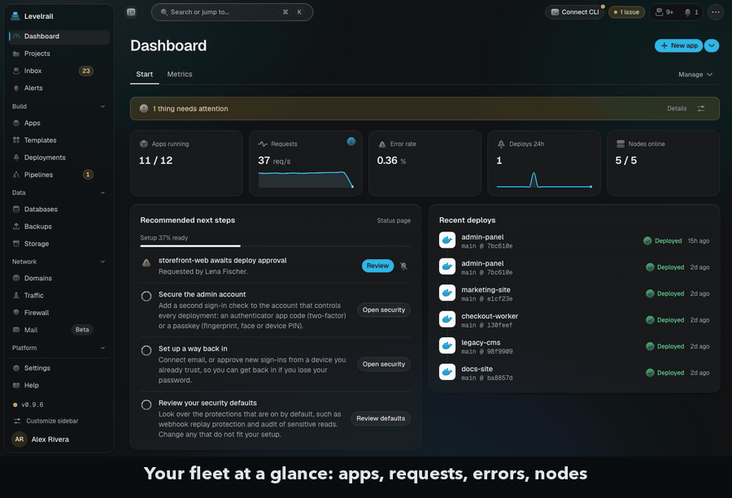

<!-- translated-from: README.md blob:b3c2e12bc506fb9fd5a89df18863898321998952 lang:es -->
<div align="center">

<h1>Levelrail</h1>

> This translation was generated with AI and may contain mistakes. Corrections are welcome: see [docs/i18n/README.md](README.md).
>
> Esta traducción fue generada con IA y puede contener errores. Las correcciones son bienvenidas: consulta [docs/i18n/README.md](README.md).

<p><strong>Git push a producción en tus propios servidores.</strong><br>
Una plataforma de despliegue autoalojada en un solo binario de Go. El plano de control consume en reposo unos 200 MB de RAM (<a href="../../docs/performance.md">medido</a>), con más de 570 apps de un clic, rollbacks, vistas previas, HTTPS y bases de datos integrados.</p>
<p><code>curl -fsSL https://levelrail.com/install.sh | sudo sh</code> &middot; <a href="https://demo.levelrail.com"><b>Prueba la demo en vivo</b></a></p>
<p>
  <a href="https://github.com/glincker/levelrail/stargazers"></a>
  <a href="../../LICENSE"></a>
  <a href="https://github.com/glincker/levelrail/releases"></a>
  <a href="https://github.com/glincker/levelrail/actions/workflows/ci.yml"></a>
  <a href="https://demo.levelrail.com"></a>
</p>
<p>
  <a href="https://levelrail.com?utm_source=github&amp;utm_medium=readme&amp;utm_campaign=nav">Sitio web</a> &middot;
  <a href="https://docs.levelrail.com?utm_source=github&amp;utm_medium=readme&amp;utm_campaign=nav">Docs</a> &middot;
  <a href="#inicio-rápido">Inicio rápido</a> &middot;
  <a href="#vs-coolify-dokploy-caprover-y-dokku">Comparar</a> &middot;
  <a href="../../docs/faq.md">FAQ</a> &middot;
  <a href="../../docs/roadmap.md">Hoja de ruta</a> &middot;
  <a href="https://github.com/glincker/levelrail/discussions">Discusiones</a>
</p>
<!-- i18n-nav:start -->
<p><a href="../../README.md">English</a> &middot; <a href="README.zh-Hans.md">简体中文</a> &middot; Español &middot; <a href="README.pt-BR.md">Português (BR)</a> &middot; <a href="README.de.md">Deutsch</a> &middot; <a href="README.fr.md">Français</a> &middot; <a href="README.ja.md">日本語</a></p>
<!-- i18n-nav:end -->

</div>

Levelrail convierte servidores Linux en una nube privada y funciona con los clústeres de Kubernetes y las cuentas de nube que ya tienes. Un solo servidor está listo para producción, multinodo es beta. Cada función lleva una etiqueta estable, beta o experimental en [Estado de las funciones](../../docs/feature-status.md).

## Inicio rápido

Necesitas un servidor Linux (amd64 o arm64) con systemd y root. El instalador añade Docker. Abre los puertos 80 y 443.

```bash
curl -fsSL https://levelrail.com/install.sh | sudo sh
```

1. Abre el enlace de configuración que imprime el instalador y elige una contraseña. Eso crea la cuenta de administrador.
2. En el panel, copia la línea de inicio de sesión de la tarjeta **Connect your CLI** y ejecútala (se ve así: `levelrail-cli login --api-url http://127.0.0.1:8080 --code ABCD-EF23`).
3. Despliega tu primera app:

```bash
levelrail-cli import https://github.com/your-org/your-app --deploy
```

Si algo falla, ejecuta `levelrail-cli doctor` y consulta [Instalación](../../docs/installing.md#troubleshooting). Siguiente: [Primeros 15 minutos](../../docs/first-15-minutes.md). Solo la CLI: `brew install glincker/tap/levelrail-cli` o `npx levelrail-cli --help`.

¿Quieres verlo primero? [Prueba la demo en vivo](https://demo.levelrail.com), una demo alojada de solo lectura del panel con datos ficticios ([cómo funciona](../../docs/run-a-read-only-demo.md)).

## Dónde puedes usarlo

| Superficie | Inicio | Docs |
| --- | --- | --- |
| Panel web | Abre el enlace de configuración que imprime el instalador | [Primeros 15 minutos](../../docs/first-15-minutes.md) |
| CLI |  `brew install glincker/tap/levelrail-cli`, `npx levelrail-cli --help` o `npm install --global levelrail-cli` | [Instalación](../../docs/installing.md) |
| API HTTP | Token Bearer, `/api/v1` | [Referencia de la API](../../docs/api-reference.md) |
| Terraform y OpenTofu |   `source = "glincker/levelrail"` | [Proveedor de Terraform](../../docs/terraform-provider.md) |
| MCP y agentes de código |  259 herramientas | [MCP](../../docs/mcp.md) |
| API móvil (beta, desactivada por defecto) | Actívala en Settings, Beta features | [API móvil](../../docs/mobile-api.md) |
| Runtime de escritorio en Mac (experimental) | Máquina virtual Linux privada en tu Mac | [Runtime de escritorio](../../docs/desktop-runtime.md) |

## Qué obtienes

La madurez sigue el [Estado de las funciones](../../docs/feature-status.md).

| Área | En una línea | Funciona con |
| --- | --- | --- |
| [Despliegues](../../docs/deploying-apps.md) | Git push desde GitHub, GitLab, Bitbucket, Gitea o Forgejo, rollouts con compuerta de readiness, rollback en un paso, vistas previas y canarios |      |
| [Plantillas](../../docs/template-catalog.md) | 570+ plantillas en el catálogo, 346 con una ejecución registrada en un motor real |    |
| [Edge y HTTPS](../../docs/domains-and-ingress.md) | Certificados automáticos, incluidos wildcards, firewall, listas de bots, encabezados y redirecciones por dominio |   |
| [Nodos y nubes](../../docs/node-provisioning.md) | Une cualquier host Linux con un token, aprovisiona nodos en 6 nubes (beta), clústeres de Kubernetes existentes como destinos (experimental) |    |
| [Bases de datos y copias de seguridad](../../docs/managing-databases.md) | 13 motores, copias de seguridad a destinos compatibles con S3, R2 o disco local, [simulacros de restauración](../../docs/prove-your-backups-work.md) |        |
| [Observabilidad](../../docs/observability.md) | Métricas integradas, búsqueda de registros, alertas a 18 tipos de canal, ingesta OTLP, página de estado. Grafana lee los registros mediante una [API compatible con Loki](../../docs/loki-api.md) |     |
| [Seguridad y acceso](../../docs/identity-and-access.md) | Inicio de sesión con OAuth y OIDC, passkeys, TOTP, políticas IAM, registro de auditoría encadenado por hash |   |
| [Automatización](../../docs/cli-reference.md) | CLI, API HTTP, [proveedor de Terraform y OpenTofu](../../docs/terraform-provider.md), 259 [herramientas MCP](../../docs/mcp.md) para agentes de código |    |

<details>
<summary>Todas las funciones de despliegue</summary>

- Despliegues por Git push o webhook desde GitHub, GitLab, Bitbucket, Gitea y Forgejo. Consulta [Integraciones de Git](../../docs/git-integrations.md) y [Despliegue con Git push](../../docs/git-push-deploy.md).
- Compilaciones con Dockerfile, Compose y Railpack (Railpack es beta) con una cola de compilación. Consulta [Build Center](../../docs/build-center.md).
- Rollouts con compuerta de readiness y rollback en un paso. Consulta [Despliegues sin downtime](../../docs/zero-downtime-deploys.md) y [Rollback](../../docs/rollback.md).
- Canarios y pruebas divididas. Consulta [Despliegues canary](../../docs/canary-deploys.md) y [Pruebas divididas](../../docs/split-testing.md).
- Entornos de vista previa por pull request: estable en GitHub, beta en GitLab y Bitbucket. Consulta [Vistas previas de despliegue](../../docs/deploy-previews.md).
- Aprobaciones y congelamientos de despliegue. Consulta [Seguridad de los despliegues](../../docs/deploy-safety.md).
- Funciones en Node, Python o Go (beta). Consulta [Funciones](../../docs/functions.md).
</details>
<details>
<summary>Todos los detalles de las plantillas</summary>

- 574 entradas de catálogo (565 activas, 9 obsoletas) en 22 categorías.
- 346 entradas tienen una ejecución registrada en un motor real.
- 228 entradas están marcadas como vista previa: instalables, sin ejecución registrada todavía.
</details>
<details>
<summary>Todas las funciones de edge</summary>

- Ingress embebido con TLS automático mediante HTTP-01 y wildcards con DNS-01.
- Encabezados, reenvíos, reglas geográficas, caché y redirecciones por dominio. Consulta [Controles de tráfico por dominio](../../docs/domain-traffic-controls.md).
- Reglas de firewall, listas de IP, desafío del navegador, listas de bots y modo ataque. Consulta [Firewall](../../docs/firewall.md).
- Límites de tasa y listas de denegación por app (beta). Consulta [Defensa contra abuso](../../docs/abuse-defense.md).
- Balanceo round-robin entre réplicas. Consulta [Balanceo de carga](../../docs/load-balancing.md).
- Redes privadas y una malla WireGuard (beta). Consulta [Multinodo](../../docs/multi-node.md).
</details>
<details>
<summary>Todas las funciones de nodos y nubes</summary>

- Aprovisiona nodos en Hetzner, DigitalOcean, AWS, Azure, GCP u Oracle Cloud (beta).
- Une cualquier host Linux con un token de un solo uso mediante mTLS. Consulta [Añade un nodo en cualquier lugar](../../docs/add-node-anywhere.md).
- DNS en Cloudflare y Route53, registros de imágenes en ECR, Artifact Registry y ACR. Consulta [Integraciones de nube](../../docs/cloud-integrations.md) para el estado de cada nube.
- Funciona con los clústeres y las cuentas de nube que ya tienes (experimental): conecta clústeres de Kubernetes existentes y despliega en ellos, desactivado por defecto. Consulta [Clústeres de Kubernetes](../../docs/kubernetes-clusters.md).
</details>
<details>
<summary>Todas las funciones de datos y copias de seguridad</summary>

- 13 motores de base de datos en el código. 9 verificados en vivo. 4 (Meilisearch, Qdrant, Typesense, Memcached) están construidos pero aún no verificados en vivo.
- Copias de seguridad a destinos compatibles con S3, R2 o locales. Consulta [Copias de seguridad y almacenamiento](../../docs/backups-and-storage.md).
- Simulacros de restauración que demuestran que una copia de seguridad funciona. Consulta [Demuestra que tus copias de seguridad funcionan](../../docs/prove-your-backups-work.md).
- Recuperación a un punto en el tiempo para Postgres.
</details>
<details>
<summary>Todas las funciones de observabilidad</summary>

- Métricas integradas, búsqueda de registros y archivo de registros. Consulta [Explorador de registros](../../docs/log-explorer.md) y [Archivo de registros](../../docs/log-archive.md).
- Ingesta OTLP. Consulta [Ingesta OTLP](../../docs/otlp-ingest.md).
- Página de estado pública. Consulta [Página de estado](../../docs/status-page.md).
- Trazas de despliegue y exportación de tráfico. Consulta [Traza de despliegue](../../docs/deploy-trace.md) y [Exportación de tráfico](../../docs/traffic-export.md).
- Alertas a 18 tipos de canal de notificación. Consulta [Alertas](../../docs/alerts.md).
- Monitores de uptime HTTP, TCP, heartbeat y TLS (experimental). Consulta [Monitores](../../docs/monitors.md).
</details>
<details>
<summary>Todas las funciones de seguridad y acceso</summary>

- Contraseñas, passkeys y TOTP.
- Inicio de sesión con OAuth con 20 proveedores más OIDC genérico. Consulta [OIDC](../../docs/sso-oidc.md).
- SAML y SCIM (beta, desactivados por defecto). Consulta [SAML y SCIM](../../docs/sso-saml.md).
- Políticas IAM y equipos. Consulta [Equipos y roles](../../docs/teams-and-roles.md).
- Registro de auditoría encadenado por hash. Consulta [Registro de auditoría](../../docs/audit-log.md).
- Secretos cifrados. Consulta [Entorno y secretos](../../docs/environment-and-secrets.md).
- Versiones firmadas. Consulta [Verifica una versión](../../docs/verify-a-release.md).
</details>
<details>
<summary>Todas las funciones de automatización</summary>

- `levelrail-cli` y una API HTTP. Consulta [Referencia de la API](../../docs/api-reference.md).
- Proveedor de Terraform y OpenTofu. Consulta [Proveedor de Terraform](../../docs/terraform-provider.md), el [registro de Terraform](https://registry.terraform.io/providers/glincker/levelrail/latest) y el [registro de OpenTofu](https://search.opentofu.org/provider/glincker/levelrail/latest).
- Plataforma como código en YAML (experimental). Consulta [Plataforma como código](../../docs/platform-as-code.md).
- Pipelines de CI. Consulta [Pipelines](../../docs/pipelines.md).
- 11 integraciones por app: Sentry, PostHog, GlitchTip, OneUptime, Plausible, Datadog, Axiom, Better Stack, LogSnag, Bugsnag y New Relic. Consulta [Alertas](../../docs/alerts.md).
- Plugins firmados para canales de notificación. Consulta [Plugins](../../docs/plugins.md).
- 259 herramientas MCP para agentes de código. Consulta [MCP](../../docs/mcp.md) y [Superficie de herramientas](../../docs/mcp-tool-surface.md).
- Una plantilla de servidor de correo con buzones y registros DNS (experimental). Consulta [Plantilla de correo](../../docs/mail-template.md).
</details>

Todas las funciones, con etiquetas de madurez: [docs/features.md](../../docs/features.md).

## Pensado para agentes de código

259 [herramientas MCP](../../docs/mcp.md), con alcance limitado a las capacidades del token, con confirmación para las escrituras y auditadas. Añade la skill con `npx skills add https://github.com/glincker/levelrail --skill levelrail` y luego pide a tu agente que despliegue tu repositorio. Para instalar con un agente, pega esto en Claude Code, Cursor o cualquier agente que pueda ejecutar comandos de shell en tu servidor:

```text
Install Levelrail on this server: run `curl -fsSL https://levelrail.com/install.sh | sudo sh`.
Open the setup link it prints and tell me, because I choose the password myself.
Then run `levelrail-cli doctor` and `levelrail-cli status` and report anything that fails.
Do not write any token or password to a file or into this chat.
```

## Listo para producción, con pruebas

| Afirmación | Evidencia |
| --- | --- |
| Cada función con etiqueta estable o beta | [Estado de las funciones](../../docs/feature-status.md) |
| Sobrevive a los fallos | [Resiliencia](../../docs/resilience.md) |
| Medido, no prometido | [Benchmarks](../../docs/benchmarks.md) |
| Probado con contenedores reales | [CI](../../.github/workflows/ci.yml) y [`test/e2e`](../../test/e2e) |
| Versiones firmadas | [Verifícalas](../../docs/installing.md#verifying-release-binaries) |
| Honesto sobre las carencias | [Límites conocidos](../../docs/known-limits.md) |

## vs Coolify, Dokploy, CapRover y Dokku

| | Levelrail | Coolify | Dokploy | CapRover | Dokku |
| --- | --- | --- | --- | --- | --- |
| **Acceso de agentes (MCP)** | Lectura y escritura, con alcance por capacidades, con confirmación, auditado | Servidor oficial, solo lectura | Existe un repositorio de servidor MCP | No documentado | No documentado |
| **Cambiarte a Levelrail** | Importadores con simulación (dry run) para los cuatro, el servidor anterior sigue atendiendo | n/d | n/d | n/d | n/d |
| Control de nodos | Agente de conexión inversa | SSH + CLI | SSH + Engine API | Swarm API | Bash local |
| Métricas y registros integrados | Sí | Complemento opcional | Binario aparte | No | No |
| Rollback | Imágenes fijadas, con compuerta de readiness | Imágenes retenidas | Rollback de Swarm | Manual | Scheduler por defecto: ninguno |
| Verificación de copias de seguridad | Automática | Comprobación de no vacío | Ninguna | Ninguna | Sin copias de seguridad |
| Registro de auditoría | Encadenado por hash, verificable | No documentado | No documentado | No documentado | No documentado |

Las celdas indican solo lo que dicen los documentos públicos de cada proyecto (última revisión 2026-11-07), y "No documentado" significa que no encontramos nada, no que falte. Esto es posicionamiento, no un ranking. Levelrail es el proyecto más joven de los mencionados, con menos usuarios y menos recorrido en producción. Detalles con fuentes: [Comparación](../../docs/comparison.md).

## Comunidad

[Discussions](https://github.com/glincker/levelrail/discussions) &middot; [Issues](https://github.com/glincker/levelrail/issues) &middot; [Discord](https://discord.gg/Ar5pcaZB99) &middot; [support@levelrail.com](mailto:support@levelrail.com) &middot; [Política de seguridad](../../.github/SECURITY.md)

Si Levelrail te ahorra un fin de semana, una [estrella](https://github.com/glincker/levelrail) ayuda a que otras personas que alojan sus propios servicios lo encuentren.

## Licencia

Apache 2.0, consulta [LICENSE](../../LICENSE). Creado por Gagan Singh, también conocido como GDS K S, de [GLINR Studios](https://glinr.com) y [theSVG](https://thesvg.org).

<div align="center">


</div>
