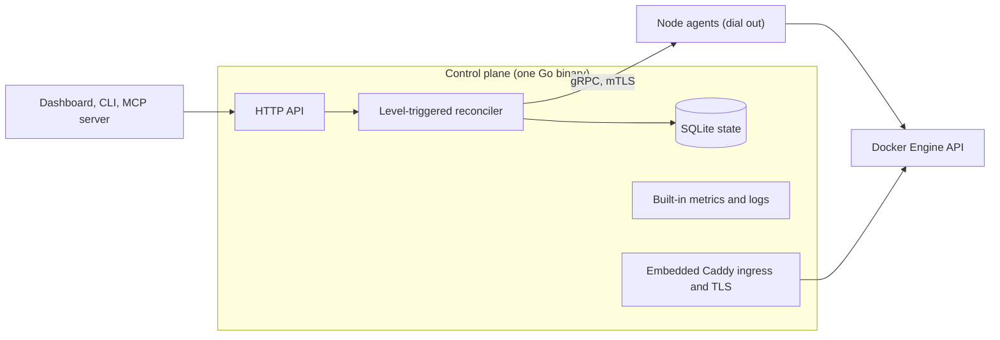

<!-- translated-from: README.md blob:9c194248e518399035b29933ea71854d30fc19ec lang:fr -->
<div align="center">

<h1>Levelrail</h1>

> This translation was generated with AI and may contain mistakes. Corrections are welcome: see [docs/i18n/README.md](README.md).

<p><strong>PaaS auto-hébergé : déployez avec git push sur vos propres serveurs, avec logs, métriques, HTTPS et rollback.</strong><br>
Un seul binaire Go, runtime Docker, pas de Kubernetes. Apache 2.0.</p>
<p>
  <a href="../../LICENSE"></a>
  <a href="https://github.com/glincker/levelrail/releases"></a>
  <a href="https://github.com/glincker/levelrail/actions/workflows/ci.yml"></a>
  <a href="../../go.mod"></a>
<br>
  <a href="../../docs/mcp.md"></a>
  <a href="https://docs.levelrail.com"></a>
  <a href="https://discord.gg/Ar5pcaZB99"></a>
  <a href="https://codespaces.new/glincker/levelrail"></a>
</p>
<p>
  <a href="https://levelrail.com">Site web</a> &middot;
  <a href="https://docs.levelrail.com">Docs</a> &middot;
  <a href="#démarrage-rapide-installer-une-alternative-auto-hébergée-à-vercel">Installation</a> &middot;
  <a href="#prêt-pour-la-production-avec-preuves">Prêt pour la production</a> &middot;
  <a href="#levelrail-face-à-coolify-dokploy-caprover-et-dokku-alternative-à-coolify">Comparaison</a> &middot;
  <a href="#faq">FAQ</a> &middot;
  <a href="../../docs/roadmap.md">Roadmap</a> &middot;
  <a href="../../CHANGELOG.md">Changelog</a> &middot;
  <a href="https://github.com/glincker/levelrail/discussions">Discussions</a>
</p>
<!-- i18n-nav:start -->
<p><a href="../../README.md">English</a> &middot; <a href="README.zh-Hans.md">简体中文</a> &middot; <a href="README.es.md">Español</a> &middot; <a href="README.pt-BR.md">Português (BR)</a> &middot; <a href="README.de.md">Deutsch</a> &middot; Français &middot; <a href="README.ja.md">日本語</a></p>
<!-- i18n-nav:end -->
<picture><source media="(prefers-color-scheme: dark)" srcset="../../docs/assets/brand/social/github-social-1280x640.jpg"></picture>
</div>

Levelrail est un **PaaS auto-hébergé** open source (Apache 2.0) pour les développeurs et les petites équipes qui veulent un workflow à la Vercel, Heroku ou Railway sur des serveurs qui leur appartiennent. Il fonctionne sur n'importe quel serveur Linux, du petit VPS au rack (le seul hôte mesuré est une machine de 2 vCPU et 8 Go), et transforme de simples serveurs en cloud privé avec des déploiements Git (webhooks de forge), HTTPS, des bases de données avec sauvegardes vérifiées, des métriques, des logs et des alertes, sans Kubernetes et sans la pile de supervision qu'il faudrait sinon ajouter.

**Statut :** pre-1.0 (v0.x). Le mode mono-serveur est prêt pour la production selon [Feature status](../../docs/feature-status.md) ; le multi-nœud est en beta.

## Quelle installation me convient ?

| Je... | Exécuter | Doc |
| --- | --- | --- |
| suis sur un serveur Linux (VPS ou bare metal) et veux déployer des apps | `curl -fsSL https://levelrail.com/install.sh \| sudo sh` | [Installation](../../docs/installing.md) |
| veux d'abord l'essayer en local | Ouvrir le dev container dans [Codespaces](https://codespaces.new/glincker/levelrail) | [Installation](../../docs/installing.md#option-3-build-from-source) |
| n'ai besoin que de la CLI sur mon portable | `brew install glincker/tap/levelrail-cli` ou `npm install -g levelrail-cli` | [Installer uniquement la CLI](../../docs/installing.md#installing-just-the-cli) |
| utilise Docker et veux un conteneur | `docker pull ghcr.io/glincker/levelrail` | [Docker](../../docs/installing.md#option-2-docker) |
| utilise un agent de codage | `npx skills add https://github.com/glincker/levelrail --skill levelrail` | [Serveur MCP](../../docs/mcp.md) |

Le serveur ne s'installe que sous Linux. macOS et Windows sont des cibles CLI uniquement.

## Table des matières

[Démarrage rapide](#démarrage-rapide-installer-une-alternative-auto-hébergée-à-vercel) &middot; [Fonctionnement](#fonctionnement) &middot; [Vérifier ce que vous installez](#vérifier-ce-que-vous-installez) &middot; [Pourquoi Levelrail](#pourquoi-choisir-levelrail) &middot; [Prêt pour la production](#prêt-pour-la-production-avec-preuves) &middot; [Alternative à Coolify](#levelrail-face-à-coolify-dokploy-caprover-et-dokku-alternative-à-coolify) &middot; [Fonctionnalités](#ce-que-vous-obtenez) &middot; [Guides](#guides) &middot; [FAQ](#faq) &middot; [Pour les agents IA](#pour-les-agents-ia-et-les-crawlers)

## Démarrage rapide (installer une alternative auto-hébergée à Vercel)

Il vous faut un serveur Linux (`amd64` ou `arm64`) avec systemd et les droits root. L'installateur ajoute Docker s'il manque.

### 1. Installer le serveur

```bash
curl -fsSL https://levelrail.com/install.sh | sudo sh
```

> **Remarque :** HTTPS est auto-signé tant que vous n'activez pas Let's Encrypt. La première connexion propose un certificat gratuit en un clic pour `<dashed-ip>.sslip.io`, ou bien ajoutez votre propre domaine.

Les dernières lignes de la sortie contiennent l'adresse du dashboard et un lien de configuration à usage unique :

```text
Levelrail vX.Y.Z installed and running.

Open the dashboard:
  http://203.0.113.10:8080/login#setup=<token>
```

### 2. Créer le compte administrateur

Ouvrez le lien de configuration et choisissez un mot de passe. Le jeton se trouve dans le fragment `#`, donc il n'atteint jamais le serveur ni ses logs ; vous l'avez perdu ? `sudo APP_DATA_DIR=/var/lib/levelrail-data levelrail setup-token` l'affiche de nouveau. La première connexion ouvre un écran qui active un certificat gratuit pour `<dashed-ip>.sslip.io` en un clic (sans DNS) et déploie votre première app.

### 3. Déployer une app

Sur le serveur, l'installateur a déjà placé `levelrail-cli` dans `/usr/local/bin`. Connectez-vous une fois, puis importez un dépôt (`levelrail-cli apps create --interactive` demande tout pas à pas) :

```bash
levelrail-cli login --api-url http://<server-ip>:8080 --code ABCD-EF23
levelrail-cli import https://github.com/your-org/your-app --deploy
```

Vous préférez des conteneurs, une version figée ou un build depuis les sources ? Voir [Installation](../../docs/installing.md). Vous le voulez aussi léger que Dokku, ou avec tout activé ? `install.sh --profile minimal|standard|suite`, voir [Profils de serveur](../../docs/profiles.md). Vous venez d'une autre plateforme ? Voir [Migrer vers Levelrail](../../docs/migrate-to-levelrail.md) : Coolify, Dokploy, CapRover, Dokku et les fichiers compose commencent chacun par un essai à blanc, et l'ancien serveur continue de servir.

Une fois la configuration terminée, l'accueil du dashboard affiche une carte **Connect your CLI**. Appuyez sur **Show my command**, collez la ligne dans votre terminal, et la CLI se connecte avec un code à usage unique qui expire en quelques minutes (sans mot de passe, sans étape d'approbation) :

```text
logged in as "you@example.com"
token tk_9fQ2x saved to ~/.config/levelrail-cli/credentials under profile "default", expires 2027-01-18
```

Se connecter avec votre mot de passe depuis un nouvel appareil exige une approbation : la CLI affiche la page du dashboard où approuver et le numéro à saisir. `login --device` fonctionne toujours aussi.

Sans `--deploy`, `import` n'affiche que le plan de déploiement. Pour voir l'adresse de l'app, exécutez `levelrail-cli open your-app`. Elle affiche d'abord le domaine personnalisé, puis l'URL automatique.

### Ou laissez votre agent de codage s'en charger

Installez le skill une fois, puis demandez à votre agent en langage courant. Il déploie, attend que le rollout converge réellement, lit l'échec s'il y en a un, et effectue un rollback en toute sécurité :

```bash
npx skills add https://github.com/glincker/levelrail --skill levelrail
```

> Deploy this repo to my Levelrail and tell me when it is live.

Le skill est aussi listé sur [skills.sh](https://www.skills.sh/glincker/levelrail/levelrail). Détails : [Agents](../../docs/agents.md).

### En cas d'échec

| Étape | Erreur affichée | Correctif |
| --- | --- | --- |
| Installation | `control plane did not become healthy within 60s` | `systemctl status levelrail` et `journalctl -u levelrail -n 100 --no-pager`. Un port déjà utilisé est une cause fréquente. |
| Installation | `could not list releases from GitHub. Set LEVELRAIL_VERSION=vX.Y.Z to pin one.` | Le serveur ne peut pas joindre GitHub. Vérifiez le HTTPS sortant, ou figez une version. |
| Installation | `checksum mismatch for ...` | Ne continuez pas. Relancez l'installateur. Ne définissez pas `LEVELRAIL_SKIP_CHECKSUM=1` pour passer outre. |
| Connexion | `start device login: ... connection refused` | La CLI pointe vers la mauvaise adresse. Exécutez `export APP_API_URL=http://127.0.0.1:<dashboard port>` et réessayez. |
| Import | `plan import: ... connection refused` | Le control plane ne tourne pas. Démarrez-le avec `systemctl start levelrail`. |

Autres correctifs : [Dépannage](../../docs/troubleshooting.md). Toutes les options d'installation (image Docker, version figée, build depuis les sources) : [Installation](../../docs/installing.md). Déployer depuis un projet local avec `levelrail-cli up` : [Démarrage rapide en une commande](../../docs/quickstart-one-command.md). Profils de serveur (`install.sh --profile minimal|standard|suite`) : [Profils de serveur](../../docs/profiles.md). Vous migrez depuis une autre plateforme ? `levelrail-cli import platform coolify|dokploy|caprover --dry-run` montre d'abord ce qui serait créé, et l'ancien serveur continue de servir. Guide complet : [Migrer vers Levelrail](../../docs/migrate-to-levelrail.md). Vous publiez un projet open source ? Ajoutez un bouton en un clic à son README : [Bouton Deploy to Levelrail](../../docs/deploy-button.md).

<table>
  <tr>
    <td width="50%" valign="top" align="center">
      <br>
      <sub><b>Installer, puis déployer</b></sub>
    </td>
    <td width="50%" valign="top" align="center">
      <br>
      <sub><b>Déploiement contrôlé, rollback en une étape</b></sub>
    </td>
  </tr>
</table>

### Installer uniquement la CLI

Pour votre portable ou un runner de CI, afin de piloter un serveur qui exécute déjà Levelrail :

```bash
brew install glincker/tap/levelrail-cli
npm install -g levelrail-cli
curl -fsSL https://levelrail.com/install-cli.sh | sh
irm https://levelrail.com/install-cli.ps1 | iex
```

Les deux premières fonctionnent sur toute plateforme prise en charge, la troisième est pour macOS et Linux, la dernière pour Windows PowerShell.

## Fonctionnement



Le control plane conserve l'état désiré dans un SQLite embarqué, et un réconciliateur aligne Docker dessus, avec des reprises sûres car il part à chaque fois de l'état observé. Chaque nœud exécute un agent qui se connecte vers le control plane en mTLS et parle directement à l'API Docker Engine, donc les nœuds n'ont besoin d'aucun port entrant. Les métriques et les logs sont stockés par nœud et interrogés ensemble. Caddy est embarqué pour l'ingress et les certificats. Détails : [Architecture](../../docs/architecture.md).

## Vérifier ce que vous installez

Les releases publient une signature Sigstore pour `checksums.txt` et une attestation de provenance du build. Remplacez `v0.1.0` par le tag de la release.

```bash
V=v0.1.0
BASE=https://github.com/glincker/levelrail/releases/download/$V
curl -fsSLO $BASE/checksums.txt -O $BASE/checksums.txt.sigstore.json -O $BASE/levelrail-linux-amd64
cosign verify-blob --bundle checksums.txt.sigstore.json \
  --certificate-identity-regexp 'https://github.com/glincker/levelrail/\.github/workflows/release\.yml@.*' \
  --certificate-oidc-issuer https://token.actions.githubusercontent.com checksums.txt
sha256sum --check --ignore-missing checksums.txt
gh attestation verify levelrail-linux-amd64 --repo glincker/levelrail
```

L'installateur vérifie lui-même les sommes de contrôle. Les images de conteneur sont sur GHCR (`ghcr.io/glincker/levelrail`, multi-arch). Plus d'informations : [Installation](../../docs/installing.md).

## Pourquoi choisir Levelrail

- **Léger.** Environ 200 Mo de RAM et environ 1,5 % d'un CPU au repos, mesurés sur une machine de test Linux de 2 vCPU et 8 Go, sans app sous charge et avec l'ensemble de fonctionnalités par défaut (une mesure, 2026-10-19). [Chiffres et méthode](../../docs/benchmarks.md).
- **Des agents, pas du SSH.** Chaque nœud exécute un petit agent qui se connecte vers l'extérieur en mTLS et parle directement à l'API Engine de Docker. Pas de ports entrants, pas d'appel shell à la CLI `docker`, pas de boucles de polling.
- **Observabilité incluse.** Métriques par nœud à 15 secondes de résolution, logs interrogeables, marqueurs de déploiement, traces, consommation du budget d'erreur SLO, boîte de réception d'alertes et une page de santé de l'empreinte au repos. Aucune pile Grafana à installer.
- **Des déploiements qui vous protègent.** Rollouts conditionnés à la disponibilité, images figées pour le rollback, releases canary avec rollback automatique en cas d'erreurs, diffs de déploiement, approbations et gels.
- **Sécurisé par défaut.** Journal d'audit à chaînage de hachages que vous pouvez vérifier, appels sortants protégés contre le SSRF, secrets chiffrés par enveloppe avec rotation des clés, jetons à portée limitée, passkeys et 2FA TOTP, connexion OAuth et OIDC, politiques IAM, releases signées. L'authentification unique SAML et le provisionnement SCIM sont disponibles en [fonctionnalité beta](../../docs/sso-saml.md), désactivés par défaut.
- **Conçu pour les agents IA.** Un serveur MCP avec plus de 240 outils dans des toolsets à la demande (courte liste par défaut, environ 2,4k tokens ; voir [surface d'outils](../../docs/mcp-tool-surface.md)), un modèle de permissions à jetons à portée limitée et un skill pour agents.

## Prêt pour la production, avec preuves

Les déploiements mono-serveur sont prêts pour la production dès aujourd'hui. Le multi-nœud et quelques fonctionnalités plus récentes sont étiquetés beta, et chaque étiquette renvoie vers ses preuves.

| Affirmation | Preuve |
| --- | --- |
| Chaque fonctionnalité est étiquetée stable ou beta | [Feature status](../../docs/feature-status.md) : les tests, les exécutions e2e en réel et la documentation derrière chaque étiquette |
| Résiste aux pannes | [Résilience](../../docs/resilience.md) : disque plein, perte du lien avec l'agent, base de données endommagée avec restauration guidée, démarrage en mode sans échec, protection contre les tempêtes de réconciliation |
| Mises à jour sûres et rollback | Matrice de mises à jour testée, refus des rétrogradations, [rollback](../../docs/rollback.md) en un clic et arrêt propre |
| Mesuré, pas promis | [Benchmarks](../../docs/benchmarks.md) : empreinte au repos, débit de l'ingress, limites, avec la méthode à côté de chaque chiffre |
| Sauvegardes vérifiées | Chaque sauvegarde est retéléchargée et vérifiée par somme de contrôle, avec des exercices de restauration planifiés |
| Sécurité à preuve d'altération | Chaîne d'audit vérifiable, [politique de sécurité](../../.github/SECURITY.md), releases signées et analyse SBOM |

## Levelrail face à Coolify, Dokploy, CapRover et Dokku (alternative à Coolify)

La plupart des plateformes auto-hébergées de cette catégorie gèrent les serveurs en s'y connectant en SSH et en appelant la CLI `docker` via le shell, puis en analysant le texte, ce qui tend à imposer des boucles de polling. Levelrail utilise à la place un agent à connexion inversée et un réconciliateur déclenché par niveau (level-triggered).

| | Levelrail | Coolify | Dokploy | CapRover | Dokku |
| --- | --- | --- | --- | --- | --- |
| Contrôle des nœuds | Agent à connexion inversée | SSH + CLI | SSH + Engine API | Swarm API | Bash local |
| Orchestration | Réconciliateur level-triggered | Compose | Swarm | Swarm | Ordonnanceur Bash |
| Métriques et logs intégrés | Oui | Module optionnel | Binaire séparé | Non | Non |
| Rollback | Images figées, conditionné à la disponibilité | Health check désactivé par défaut | Rollback Swarm | Manuel | Ordonnanceur par défaut : aucun |
| Vérification des sauvegardes | Automatique, les 8 moteurs | Contrôle de non-vacuité | Aucune | Aucune | Pas de sauvegardes |
| SSO et provisionnement | OAuth (20 fournisseurs) et OIDC générique ; SAML et SCIM (beta, désactivés par défaut) | Voir leur doc | Voir leur doc | Voir leur doc | Voir leur doc |
| Journal d'audit | Chaîné par hachage, vérifiable, export CSV, transfert vers syslog, webhook ou bucket | Voir leur doc | Voir leur doc | Voir leur doc | Voir leur doc |
| IAM | Politiques Allow et Deny par app ou base de données, jetons à portée limitée | Voir leur doc | Voir leur doc | Voir leur doc | Voir leur doc |

Il s'agit d'un positionnement, pas d'un classement, et chaque projet ici mérite d'être utilisé. Là où Levelrail est en retrait : c'est le plus jeune des projets cités, avec moins d'utilisateurs et moins de vécu en production, et son authentification unique SAML et son provisionnement SCIM sont en beta ([détails](../../docs/sso-saml.md)). Son catalogue de templates (environ 360 entrées) est du même ordre que celui de Coolify, mais seul un échantillon est déployé de bout en bout ([ADR 015](../../adr/015-service-template-catalog-reversal.md)). La comparaison complète et sourcée se trouve dans [Comparison](../../docs/comparison.md).

## Ce que vous obtenez

- **Déploiements :** Push vers votre hébergeur git (webhooks GitHub, GitLab, Bitbucket, Gitea), les déploiements démarrent depuis un webhook de forge (un remote `git push` natif est en beta et désactivé par défaut), environnements de prévisualisation par pull request (stable sur GitHub, beta sur GitLab et Bitbucket), presets de frameworks (Next.js, Go, React, Spring Boot et d'autres), déploiements par Dockerfile, Compose ou image, rollouts canary et blue-green. La bascule conditionnée à la disponibilité est testée en réel sans aucune requête en échec sur un seul nœud ; le multi-nœud est en beta. [Déployer des apps](../../docs/deploying-apps.md)
- **Domaines et TLS :** Ingress Caddy embarqué. Le certificat par défaut est interne (auto-signé). Let's Encrypt public s'active d'un simple interrupteur et a été vérifié lors d'une exécution en réel ; le renouvellement et les wildcards DNS-01 ne sont pas vérifiés. Des certificats personnalisés peuvent être téléversés. Protection contre les abus par app. [Domaines](../../docs/domains-and-ingress.md)
- **Bases de données :** Postgres, MySQL, MariaDB, MongoDB, Redis, KeyDB, Dragonfly et ClickHouse avec sauvegardes planifiées, récupération à un instant donné pour Postgres, restauration et rotation des mots de passe. [Bases de données](../../docs/managing-databases.md)
- **Une seule recherche pour tout :** Cmd+K sur les apps, bases de données, nœuds, templates et actions, filtrée selon ce que vous avez le droit de faire. [Recherche](../../docs/search.md)
- **Serveurs :** Ajout de nœuds avec un jeton à usage unique, maillage WireGuard, zones et répartition par domaine de défaillance, simulation de placement. [Multi-nœud](../../docs/multi-node.md)
- **Templates :** environ 360 services en un clic, avec un smoke test qui lance les 50 premiers (48 réussissent aujourd'hui, [statut](../../docs/templates-status.md)). [Catalogue](../../docs/template-catalog.md)
- **Identité et accès :** Mot de passe, passkeys, TOTP, OAuth avec 20 fournisseurs plus OIDC générique, politiques IAM, équipes, un journal d'audit à chaînage de hachages avec export CSV. L'authentification unique SAML et le provisionnement SCIM sont en beta et désactivés par défaut. [Identité et accès](../../docs/identity-and-access.md), [SAML et SCIM](../../docs/sso-saml.md)
- **Plugins :** Une place de marché de plugins signés avec installation en un clic, panneaux de dashboard et canaux d'alerte officiels. [Plugins](../../docs/plugins.md)
- **Automatisation :** Une seule API HTTP derrière le dashboard, une CLI et un serveur MCP. L'IA n'est jamais dans le chemin de réconciliation. [CLI](../../docs/cli-reference.md), [Pilotage par IA](../../docs/ai-control.md)
- **Pipelines, prévisualisations, budgets de coûts, mise en veille à l'inactivité, pages de statut** et plus encore. Voir la [visite du produit](https://docs.levelrail.com/product-tour).

<table>
  <tr>
    <td width="33%" valign="top"><a href="../../docs/product-tour.mdx"><picture><source media="(prefers-color-scheme: dark)" srcset="../../docs/assets/screenshots/dashboard-home.png"></picture></a><br><sub><b>Le control plane en un coup d'œil</b></sub></td>
    <td width="33%" valign="top"><a href="../../docs/frameworks.md"><picture><source media="(prefers-color-scheme: dark)" srcset="../../docs/assets/screenshots/framework-preset-picker.png"></picture></a><br><sub><b>Choisissez un preset de framework et les réglages de build se remplissent</b></sub></td>
    <td width="33%" valign="top"><a href="../../docs/template-catalog.md"><picture><source media="(prefers-color-scheme: dark)" srcset="../../docs/assets/screenshots/templates-catalog.png"></picture></a><br><sub><b>Installez un service connu depuis le catalogue de templates</b></sub></td>
  </tr>
  <tr>
    <td width="33%" valign="top"><a href="../../docs/deploying-apps.md"><picture><source media="(prefers-color-scheme: dark)" srcset="../../docs/assets/screenshots/deploy-live-log.png"></picture></a><br><sub><b>Déploiements en direct</b></sub></td>
    <td width="33%" valign="top"><a href="../../docs/load-balancing.md"><picture><source media="(prefers-color-scheme: dark)" srcset="../../docs/assets/screenshots/load-balancer.png"></picture></a><br><sub><b>Répartissez la charge entre des réplicas avec des health checks</b></sub></td>
    <td width="33%" valign="top"><a href="../../docs/deploying-apps.md"><picture><source media="(prefers-color-scheme: dark)" srcset="../../docs/assets/screenshots/apps-list.png"></picture></a><br><sub><b>Chaque app, sa santé et son dernier déploiement</b></sub></td>
  </tr>
</table>

D'autres écrans (métriques, logs, sauvegardes, domaines, sécurité, plugins) se trouvent dans la [visite du produit](https://docs.levelrail.com/product-tour).

Toutes les captures d'écran proviennent d'un control plane réellement en fonctionnement.

## Guides

Des tutoriels pas à pas, chacun testé sur une vraie installation :

| Guide | Ce que vous apprenez |
| --- | --- |
| [Déployer une app Next.js avec Postgres](https://github.com/glincker/levelrail/discussions/1239) | Du dépôt au HTTPS en une dizaine de minutes |
| [Déployer une app Django avec Postgres](https://github.com/glincker/levelrail/discussions/1243) | Plus les quatre erreurs que tout le monde rencontre |
| [Push to deploy avec GitHub](https://github.com/glincker/levelrail/discussions/1244) | Webhooks, prévisualisations et journal de livraison |
| [Comment les déploiements restent sûrs](https://github.com/glincker/levelrail/discussions/1246) | Health gates, bascule blue-green, rollback |
| [Logs, traces et erreurs sans pile dédiée](https://github.com/glincker/levelrail/discussions/1240) | Observabilité et Grafana |
| [Passer à zéro instance sur un petit VPS](https://github.com/glincker/levelrail/discussions/1242) | Faire tourner de nombreux projets sur une seule machine |
| [Levelrail face à Coolify, Dokploy, CapRover, Dokku et Kamal](https://github.com/glincker/levelrail/discussions/1235) | La place de chacun |

## Ajouter un bouton Deploy à votre projet

Vous maintenez une app open source ? Permettez aux gens de la faire tourner sur leur propre serveur en quelques clics.

[](../../docs/deploy-button.md)

Extraits à copier-coller et les quatre styles de badge : [Bouton Deploy](../../docs/deploy-button.md) et le [kit de marque](../../docs/brand.md).

## La suite

Prévu, pas promis. Les dates sont des objectifs et les éléments peuvent bouger ou disparaître. Liste complète dans la [roadmap](../../docs/roadmap.md).

- Des exécutions sur de vrais hôtes pour le maillage multi-nœud et un chiffre d'empreinte au repos.
- Des vérifications ACME publiques : renouvellement proche de l'expiration et wildcards DNS-01.
- Davantage de tests de mise à jour et de rétrogradation entre les releases.
- Snapshots de release et liaisons d'environnement.
- Une première release stable, seulement quand les preuves de durcissement seront réunies. Aucune date n'est fixée.

## FAQ

**Levelrail est-il prêt pour la production ?** Les déploiements mono-serveur sont prêts pour la production ; le multi-nœud et certaines fonctionnalités plus récentes sont en beta. Chaque étiquette figure dans [Feature status](../../docs/feature-status.md). Le projet est pre-1.0.

**Faut-il Kubernetes ?** Non. C'est un seul binaire Go avec un runtime Docker, et une couche de compatibilité Kubernetes est un non-objectif délibéré ([Comparison](../../docs/comparison.md)).

**Combien ça coûte ?** Rien. C'est sous Apache 2.0, une seule édition, sans clé de licence ni offre payante. Vous ne payez que vos propres serveurs ([Pricing](../../docs/pricing.md)).

**En quoi est-ce différent de Coolify ou Dokploy ?** Les nœuds sont gérés par un agent à connexion inversée et un réconciliateur level-triggered au lieu de SSH et de la CLI `docker`, et les métriques et les logs sont intégrés. Voir le [tableau comparatif](#levelrail-face-à-coolify-dokploy-caprover-et-dokku-alternative-à-coolify), y compris là où Levelrail est en retrait.

**Puis-je migrer depuis Coolify ?** Oui. `levelrail-cli import platform coolify --dry-run` montre d'abord ce qui serait créé, et l'ancien serveur continue de servir. Dokploy, CapRover, Dokku et les fichiers compose fonctionnent aussi : [Migrer vers Levelrail](../../docs/migrate-to-levelrail.md).

**Prend-il en charge les agents IA et MCP ?** Oui. `levelrail-mcp` expose la même API et le même modèle de permissions, et un skill pour agents est inclus. L'IA n'est jamais dans le chemin de réconciliation : [MCP](../../docs/mcp.md), [Pilotage par IA](../../docs/ai-control.md).

**Comment mettre à jour ?** Utilisez Settings > Updates ou `levelrail-cli upgrade --plan`. La mise à jour vérifie la release, fait un snapshot de vos données et revient en arrière d'elle-même si la nouvelle release n'est pas saine : [Mettre à jour en toute sécurité](../../docs/upgrade-safely.md).

**Où sont stockées mes données ?** Sur vos serveurs. Le control plane conserve SQLite, la clé maître et le jeton de configuration dans `/var/lib/levelrail-data` par défaut ; les métriques et les logs restent sur chaque nœud ([Installation](../../docs/installing.md), [Architecture](../../docs/architecture.md)).

## Pour les agents IA et les crawlers

- **Skill pour agents :** [`skills/levelrail/SKILL.md`](../../skills/levelrail/SKILL.md) apprend à un agent de codage à déployer, attendre, diagnostiquer et effectuer un rollback en toute sécurité.
- **Serveur MCP :** `levelrail-mcp` expose la même API et le même modèle de permissions. Commencez en mode `read-only`. Voir [MCP](../../docs/mcp.md) et [Pilotage par IA](../../docs/ai-control.md).
- **Guide du dépôt :** [`AGENTS.md`](../../AGENTS.md) pour travailler dans cette base de code, et [`llms.txt`](../../llms.txt) comme index. Docs pour les LLM : [llms.txt](https://docs.levelrail.com/llms.txt) et [llms-full.txt](https://docs.levelrail.com/llms-full.txt).

## Communauté et support

- [GitHub Discussions](https://github.com/glincker/levelrail/discussions) pour les questions, les idées et la présentation de vos projets, et [Issues](https://github.com/glincker/levelrail/issues) pour les bugs.
- [GLINR Discord](https://discord.gg/Ar5pcaZB99) : discussion en direct avec les mainteneurs, dans le canal forum `#levelrail`.
- [support@levelrail.com](mailto:support@levelrail.com) pour une aide directe, et la [politique de sécurité](../../.github/SECURITY.md) pour signaler une vulnérabilité en privé.
- [Contribuer](../../.github/CONTRIBUTING.md) : boucle de développement, tests et conventions de commit. Le build depuis les sources nécessite Go 1.26 ou plus récent et Docker : voir [Installation](../../docs/installing.md#option-3-build-from-source).

## Mettre une étoile au dépôt

Si Levelrail vous fait gagner un week-end, une [étoile sur GitHub](https://github.com/glincker/levelrail) aide d'autres auto-hébergeurs à le trouver. Les rapports de bugs et les retours honnêtes aident encore plus.

[](https://star-history.com/#glincker/levelrail&Date)

<a href="https://github.com/glincker/levelrail/graphs/contributors"></a>

## Licence

Apache 2.0, voir [LICENSE](../../LICENSE).

## Développé par

Levelrail est développé par Gagan Deep Singh, fondateur de [GLINR STUDIOS](https://glinr.com) et de [theSVG](https://thesvg.org). Projets frères : [theSVG](https://thesvg.org) (bibliothèque d'icônes de marques), [theauth](https://github.com/glincker/theauth) (authentification open source pour les agents IA et les humains) et [AskVerdict AI](https://askverdict.ai). Venez dire bonjour sur [thegdsks.com](https://thegdsks.com).

<div align="center">

<a href="https://glinr.com">
  <picture>
    <source media="(prefers-color-scheme: dark)" srcset="../../docs/assets/brand/glincker-light.svg">
    
  </picture>
</a>

<sub>Powered by <a href="https://glinr.com"><b>GLINR STUDIOS</b></a> &middot; icône de <a href="https://thesvg.org/icon/glincker">theSVG</a></sub>

</div>
