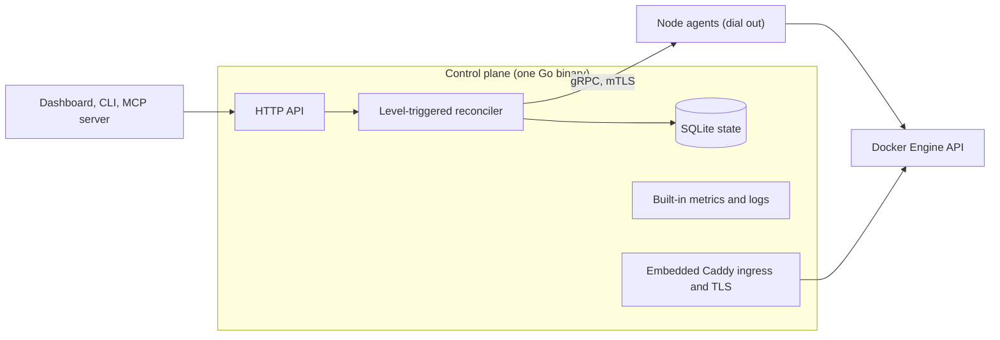

<!-- translated-from: README.md blob:9c194248e518399035b29933ea71854d30fc19ec lang:ja -->
<div align="center">

<h1>Levelrail</h1>
<p><strong>セルフホストの PaaS：git push で自分のサーバーにデプロイでき、ログ、メトリクス、HTTPS、ロールバックを備えています。</strong><br>
Go 製の単一バイナリ、Docker ランタイム、Kubernetes は不要。Apache 2.0。</p>
<p>
  <a href="../../LICENSE"></a>
  <a href="https://github.com/glincker/levelrail/releases"></a>
  <a href="https://github.com/glincker/levelrail/actions/workflows/ci.yml"></a>
  <a href="../../go.mod"></a>
<br>
  <a href="../../docs/mcp.md"></a>
  <a href="https://docs.levelrail.com"></a>
  <a href="https://discord.gg/Ar5pcaZB99"></a>
  <a href="https://codespaces.new/glincker/levelrail"></a>
</p>
<p>
  <a href="https://levelrail.com">Web サイト</a> &middot;
  <a href="https://docs.levelrail.com">ドキュメント</a> &middot;
  <a href="#クイックスタート-セルフホスト版-vercel-代替をインストール">インストール</a> &middot;
  <a href="#本番運用可能と根拠">本番運用可能</a> &middot;
  <a href="#levelrail-vs-coolify-dokploy-caprover-dokku-coolify-代替">比較</a> &middot;
  <a href="#faq">FAQ</a> &middot;
  <a href="../../docs/roadmap.md">ロードマップ</a> &middot;
  <a href="../../CHANGELOG.md">変更履歴</a> &middot;
  <a href="https://github.com/glincker/levelrail/discussions">ディスカッション</a>
</p>
<!-- i18n-nav:start -->
<p><a href="../../README.md">English</a> &middot; <a href="README.zh-Hans.md">简体中文</a> &middot; <a href="README.es.md">Español</a> &middot; <a href="README.pt-BR.md">Português (BR)</a> &middot; <a href="README.de.md">Deutsch</a> &middot; <a href="README.fr.md">Français</a> &middot; 日本語</p>
<!-- i18n-nav:end -->
<picture><source media="(prefers-color-scheme: dark)" srcset="../../docs/assets/brand/social/github-social-1280x640.jpg"></picture>
</div>

> この翻訳は AI によって生成されており、誤りが含まれている可能性があります。修正を歓迎します：[docs/i18n/README.md](README.md) を参照してください。

Levelrail は、自分が所有するサーバー上で Vercel、Heroku、Railway のようなワークフローを使いたい開発者や小規模チーム向けの、オープンソース（Apache 2.0）の**セルフホスト PaaS** です。小さな VPS からラックまで、あらゆる Linux サーバーで動作し（計測したホストは 2 vCPU、8 GB のマシン 1 台です）、通常のサーバーを、Git デプロイ（forge の Webhook 経由）、HTTPS、検証済みバックアップ付きのデータベース、メトリクス、ログ、アラートを備えたプライベートクラウドに変えます。Kubernetes は不要で、別途監視スタックを追加する必要もありません。

**ステータス：** 1.0 より前（v0.x）。[機能ステータス](../../docs/feature-status.md)のとおり、単一サーバーは本番運用可能で、マルチノードはベータです。

## どのインストール方法が自分に合う？

| 状況 | 実行するもの | ドキュメント |
| --- | --- | --- |
| Linux サーバー（VPS またはベアメタル）があり、アプリをデプロイしたい | `curl -fsSL https://levelrail.com/install.sh \| sudo sh` | [インストール](../../docs/installing.md) |
| まずローカルで試したい | [Codespaces](https://codespaces.new/glincker/levelrail) で開発コンテナを開く | [インストール](../../docs/installing.md#option-3-build-from-source) |
| ノート PC に CLI だけ必要 | `brew install glincker/tap/levelrail-cli` または `npm install -g levelrail-cli` | [CLI だけをインストールする](../../docs/installing.md#installing-just-the-cli) |
| Docker を使っていて、コンテナが欲しい | `docker pull ghcr.io/glincker/levelrail` | [Docker](../../docs/installing.md#option-2-docker) |
| コーディングエージェントを使っている | `npx skills add https://github.com/glincker/levelrail --skill levelrail` | [MCP サーバー](../../docs/mcp.md) |

サーバーは Linux にのみインストールできます。macOS と Windows は CLI 専用です。

## 目次

[クイックスタート](#クイックスタート-セルフホスト版-vercel-代替をインストール) &middot; [仕組み](#仕組み) &middot; [インストールするものを検証する](#インストールするものを検証する) &middot; [Levelrail が選ばれる理由](#levelrail-が選ばれる理由) &middot; [本番運用可能](#本番運用可能と根拠) &middot; [Coolify の代替](#levelrail-vs-coolify-dokploy-caprover-dokku-coolify-代替) &middot; [機能](#主な機能) &middot; [ガイド](#ガイド) &middot; [FAQ](#faq) &middot; [AI エージェント向け](#ai-エージェントとクローラー向け)

## クイックスタート (セルフホスト版 Vercel 代替をインストール)

systemd と root 権限を持つ Linux サーバー（`amd64` または `arm64`）が必要です。Docker がない場合は、インストーラーが追加します。

### 1. サーバーをインストールする

```bash
curl -fsSL https://levelrail.com/install.sh | sudo sh
```

> **注意：** Let's Encrypt を有効にするまで、HTTPS は自己署名です。最初のサインインでは、`<dashed-ip>.sslip.io` 用の無料証明書をワンクリックで取得できます。独自のドメインを追加することもできます。

出力の最後の数行に、ダッシュボードのアドレスと 1 回限りのセットアップリンクが表示されます。

```text
Levelrail vX.Y.Z installed and running.

Open the dashboard:
  http://203.0.113.10:8080/login#setup=<token>
```

### 2. 管理者アカウントを作成する

セットアップリンクを開き、パスワードを設定します。トークンは `#` フラグメントに含まれるため、サーバーにもそのログにも送られません。紛失した場合は、`sudo APP_DATA_DIR=/var/lib/levelrail-data levelrail setup-token` で再表示できます。最初のサインインでは 1 つの画面が開き、ワンクリックで `<dashed-ip>.sslip.io` 用の無料証明書を有効にでき（DNS は不要）、最初のアプリをデプロイできます。

### 3. アプリをデプロイする

サーバー上では、インストーラーがすでに `levelrail-cli` を `/usr/local/bin` に配置しています。一度サインインしてから、リポジトリをインポートします（`levelrail-cli apps create --interactive` は、すべてを順番に尋ねます）。

```bash
levelrail-cli login --api-url http://<server-ip>:8080 --code ABCD-EF23
levelrail-cli import https://github.com/your-org/your-app --deploy
```

コンテナ、バージョン固定、ソースからのビルドを使いたい場合は、[インストール](../../docs/installing.md)を参照してください。Dokku のように軽くしたい、またはすべてを有効にしたい場合は、`install.sh --profile minimal|standard|suite` を使います。[サーバープロファイル](../../docs/profiles.md)を参照してください。ほかのプラットフォームから移行する場合は、[Levelrail への移行](../../docs/migrate-to-levelrail.md)を参照してください。Coolify、Dokploy、CapRover、Dokku、compose ファイルは、いずれも最初にドライランを行い、古いサーバーは稼働し続けます。

セットアップ後、ダッシュボードのホームに **CLI を接続する** カードが表示されます。**コマンドを表示** を押し、その行をターミナルに貼り付けると、CLI は数分で期限切れになる 1 回限りのコードでサインインします（パスワードも承認の手順も不要です）。

```text
logged in as "you@example.com"
token tk_9fQ2x saved to ~/.config/levelrail-cli/credentials under profile "default", expires 2027-01-18
```

新しいデバイスからパスワードでサインインする場合は承認が必要です。CLI は、承認を行うダッシュボードのページと、入力する番号を表示します。`login --device` も引き続き使えます。

`--deploy` を付けない場合、`import` はデプロイ計画を表示するだけです。アプリのアドレスを確認するには、`levelrail-cli open your-app` を実行します。カスタムドメインが先に、自動 URL がその次に表示されます。

### またはコーディングエージェントに任せる

スキルを一度インストールしたら、エージェントに普通の言葉で頼みます。エージェントはデプロイを行い、ロールアウトが実際に収束するまで待ち、失敗した場合はその内容を読み取り、安全にロールバックします。

```bash
npx skills add https://github.com/glincker/levelrail --skill levelrail
```

> このリポジトリを私の Levelrail にデプロイして、公開されたら教えてください。

このスキルは [skills.sh](https://www.skills.sh/glincker/levelrail/levelrail) にも掲載されています。詳細：[エージェント](../../docs/agents.md)。

### うまくいかない場合

| ステップ | 表示されるエラー | 対処 |
| --- | --- | --- |
| インストール | `control plane did not become healthy within 60s` | `systemctl status levelrail` と `journalctl -u levelrail -n 100 --no-pager` を実行してください。ポートがすでに使用中であることがよくある原因です。 |
| インストール | `could not list releases from GitHub. Set LEVELRAIL_VERSION=vX.Y.Z to pin one.` | サーバーから GitHub に到達できません。アウトバウンドの HTTPS を確認するか、リリースを固定してください。 |
| インストール | `checksum mismatch for ...` | 続行しないでください。インストーラーをもう一度実行してください。回避するために `LEVELRAIL_SKIP_CHECKSUM=1` を設定しないでください。 |
| ログイン | `start device login: ... connection refused` | CLI が間違ったアドレスを指しています。`export APP_API_URL=http://127.0.0.1:<dashboard port>` を実行して、もう一度試してください。 |
| インポート | `plan import: ... connection refused` | コントロールプレーンが動いていません。`systemctl start levelrail` で起動してください。 |

その他の対処：[トラブルシューティング](../../docs/troubleshooting.md)。インストールの全オプション（Docker イメージ、バージョン固定、ソースからのビルド）：[インストール](../../docs/installing.md)。ローカルのプロジェクトから `levelrail-cli up` でデプロイ：[1 コマンドのクイックスタート](../../docs/quickstart-one-command.md)。サーバープロファイル（`install.sh --profile minimal|standard|suite`）：[サーバープロファイル](../../docs/profiles.md)。ほかのプラットフォームから移行する場合は、`levelrail-cli import platform coolify|dokploy|caprover --dry-run` で、作成される内容を先に確認できます。古いサーバーは稼働し続けます。完全なガイド：[Levelrail への移行](../../docs/migrate-to-levelrail.md)。オープンソースプロジェクトを公開していますか。README にワンクリックのボタンを追加できます：[Deploy to Levelrail ボタン](../../docs/deploy-button.md)。

<table>
  <tr>
    <td width="50%" valign="top" align="center">
      <br>
      <sub><b>インストールしてデプロイ</b></sub>
    </td>
    <td width="50%" valign="top" align="center">
      <br>
      <sub><b>ゲート付きデプロイと、ワンステップのロールバック</b></sub>
    </td>
  </tr>
</table>

### CLI だけをインストールする

ノート PC や CI ランナーから、すでに Levelrail が動いているサーバーを操作する場合に使います。

```bash
brew install glincker/tap/levelrail-cli
npm install -g levelrail-cli
curl -fsSL https://levelrail.com/install-cli.sh | sh
irm https://levelrail.com/install-cli.ps1 | iex
```

最初の 2 つは対応しているすべてのプラットフォームで使えます。3 つ目は macOS と Linux 用、最後は Windows PowerShell 用です。

## 仕組み



コントロールプレーンは、組み込みの SQLite に望ましい状態を保持し、リコンサイラーが Docker をその状態に一致させます。毎回、観測した状態から処理を行うため、安全に再試行できます。各ノードではエージェントが動作し、mTLS でコントロールプレーンへ外向きに接続して、Docker Engine API と直接通信するため、ノードにインバウンドポートは不要です。メトリクスとログはノードごとに保存され、まとめて問い合わせられます。Caddy はイングレスと証明書のために組み込まれています。詳細：[アーキテクチャ](../../docs/architecture.md)。

## インストールするものを検証する

リリースでは、`checksums.txt` の Sigstore 署名とビルド来歴の証明（attestation）を公開しています。`v0.1.0` はリリースタグに置き換えてください。

```bash
V=v0.1.0
BASE=https://github.com/glincker/levelrail/releases/download/$V
curl -fsSLO $BASE/checksums.txt -O $BASE/checksums.txt.sigstore.json -O $BASE/levelrail-linux-amd64
cosign verify-blob --bundle checksums.txt.sigstore.json \
  --certificate-identity-regexp 'https://github.com/glincker/levelrail/\.github/workflows/release\.yml@.*' \
  --certificate-oidc-issuer https://token.actions.githubusercontent.com checksums.txt
sha256sum --check --ignore-missing checksums.txt
gh attestation verify levelrail-linux-amd64 --repo glincker/levelrail
```

インストーラーは、チェックサムを自分で確認します。コンテナイメージは GHCR にあります（`ghcr.io/glincker/levelrail`、マルチアーキテクチャ）。詳細：[インストール](../../docs/installing.md)。

## Levelrail が選ばれる理由

- **軽量。** アイドル時で RAM は約 200 MB、CPU は 1 コアの約 1.5% です。計測は、アプリに負荷をかけていない 2 vCPU、8 GB の Linux テストマシンで、デフォルトの機能セットのまま行いました（1 回の実行、2026-10-19）。[数値と方法](../../docs/benchmarks.md)。
- **SSH ではなくエージェント。** 各ノードでは小さなエージェントが動き、mTLS で外向きに接続して、Docker の Engine API と直接通信します。インバウンドポートも、`docker` CLI の呼び出しも、ポーリングループもありません。
- **オブザーバビリティを標準搭載。** 15 秒解像度のノード別メトリクス、検索可能なログ、デプロイマーカー、トレース、SLO バーン、アラートインボックス、アイドル時のフットプリントのヘルスページ。Grafana スタックをインストールする必要はありません。
- **守ってくれるデプロイ。** 準備完了ゲート付きのロールアウト、ロールバック用に固定されたイメージ、エラー時にロールバックするカナリアリリース、デプロイの差分、承認、フリーズ。
- **デフォルトで安全。** 検証可能なハッシュチェーン式の監査ログ、SSRF ガード付きの外向き呼び出し、鍵ローテーション付きのエンベロープ暗号化シークレット、スコープ付きトークン、パスキーと TOTP の 2 要素認証、OAuth と OIDC によるサインイン、IAM ポリシー、署名付きリリース。SAML シングルサインオンと SCIM プロビジョニングは[ベータ機能](../../docs/sso-saml.md)として利用でき、デフォルトでは無効です。
- **AI エージェント向けに構築。** オンデマンドのツールセットに分かれた 240 を超えるツールを持つ MCP サーバー（デフォルトの一覧は小さく、約 2.4k トークン。[ツールの範囲](../../docs/mcp-tool-surface.md)を参照）、スコープ付きトークンの権限モデル、エージェントスキル。

## 本番運用可能と根拠

単一サーバーのデプロイは、現時点で本番運用可能です。マルチノードと、いくつかの新しい機能にはベータのラベルが付いており、どのラベルも根拠にリンクしています。

| 主張 | 根拠 |
| --- | --- |
| すべての機能に stable または beta のラベルがある | [機能ステータス](../../docs/feature-status.md)：各ラベルの裏付けとなるテスト、実環境での e2e 実行、ドキュメント |
| 障害に耐える | [レジリエンス](../../docs/resilience.md)：ディスクフル、エージェントのリンク断、ガイド付きリストアによるデータベース破損への対応、セーフモード起動、リコンサイル嵐からの保護 |
| 安全なアップグレードとロールバック | テスト済みのアップグレードマトリクス、ダウングレードの拒否、ワンクリックの[ロールバック](../../docs/rollback.md)、クリーンなシャットダウン |
| 約束ではなく計測 | [ベンチマーク](../../docs/benchmarks.md)：アイドル時のフットプリント、イングレスのスループット、上限。どの数値にも方法を併記しています |
| 検証済みのバックアップ | すべてのバックアップは再ダウンロードしてチェックサムを確認し、定期的にリストアの訓練を行います |
| 改ざんを検知できるセキュリティ | 検証可能な監査チェーン、[セキュリティポリシー](../../.github/SECURITY.md)、署名付きリリース、SBOM スキャン |

## Levelrail vs Coolify, Dokploy, CapRover, Dokku (Coolify 代替)

このカテゴリのセルフホストプラットフォームの多くは、SSH でログインして `docker` CLI を呼び出し、テキストを解析することでサーバーを管理しており、その結果ポーリングループが必要になりがちです。Levelrail は代わりに、逆方向に接続するエージェントと、レベルトリガー式のリコンサイラーを使います。

| | Levelrail | Coolify | Dokploy | CapRover | Dokku |
| --- | --- | --- | --- | --- | --- |
| ノードの制御 | 逆方向に接続するエージェント | SSH + CLI | SSH + Engine API | Swarm API | ローカルの bash |
| オーケストレーション | レベルトリガー式リコンサイラー | Compose | Swarm | Swarm | Bash スケジューラー |
| メトリクスとログの内蔵 | あり | オプトインのアドオン | 別バイナリ | なし | なし |
| ロールバック | 固定イメージ、準備完了ゲート付き | ヘルスチェックはデフォルトで無効 | Swarm のロールバック | 手動 | デフォルトのスケジューラー：なし |
| バックアップの検証 | 自動、全 8 エンジン | 空でないことの確認 | なし | なし | バックアップなし |
| SSO とプロビジョニング | OAuth（20 プロバイダー）と汎用 OIDC。SAML と SCIM（ベータ、デフォルトで無効） | 各ドキュメントを参照 | 各ドキュメントを参照 | 各ドキュメントを参照 | 各ドキュメントを参照 |
| 監査ログ | ハッシュチェーン式、検証可能、CSV エクスポート、syslog、Webhook、バケットへの転送 | 各ドキュメントを参照 | 各ドキュメントを参照 | 各ドキュメントを参照 | 各ドキュメントを参照 |
| IAM | アプリまたはデータベースごとの Allow と Deny のポリシー、スコープ付きトークン | 各ドキュメントを参照 | 各ドキュメントを参照 | 各ドキュメントを参照 | 各ドキュメントを参照 |

これはポジショニングであってランキングではなく、ここに挙げたどのプロジェクトも使う価値があります。Levelrail が劣っている点：ここで最も新しいプロジェクトであり、ユーザーは少なく、本番での実績も少ないこと、そして SAML シングルサインオンと SCIM プロビジョニングがベータであることです（[詳細](../../docs/sso-saml.md)）。テンプレートカタログ（約 360 件）は Coolify と同程度の規模ですが、エンドツーエンドでデプロイされているのは一部のサンプルだけです（[ADR 015](../../adr/015-service-template-catalog-reversal.md)）。出典付きの完全な比較は[比較](../../docs/comparison.md)にあります。

## 主な機能

- **デプロイ：** git ホスト（GitHub、GitLab、Bitbucket、Gitea の Webhook）へ push すると、forge の Webhook からデプロイが始まります（ネイティブの `git push` リモートはベータで、デフォルトでは無効）。プルリクエストごとのプレビュー環境（GitHub では stable、GitLab と Bitbucket ではベータ）、フレームワークのプリセット（Next.js、Go、React、Spring Boot など）、Dockerfile、Compose、イメージによるデプロイ、カナリアとブルーグリーンのロールアウトに対応します。準備完了ゲート付きの切り替えは、単一ノードで失敗リクエストゼロの実環境テストを行っています。マルチノードはベータです。[アプリのデプロイ](../../docs/deploying-apps.md)
- **ドメインと TLS：** 組み込みの Caddy イングレス。デフォルトの証明書は内部（自己署名）です。公開の Let's Encrypt はスイッチ 1 つで有効になり、1 回の実環境での実行で検証されました。更新と DNS-01 のワイルドカードは未検証です。独自の証明書をアップロードできます。アプリごとの不正利用対策。[ドメイン](../../docs/domains-and-ingress.md)
- **データベース：** Postgres、MySQL、MariaDB、MongoDB、Redis、KeyDB、Dragonfly、ClickHouse。定期バックアップ、Postgres のポイントインタイムリカバリ、リストア、パスワードのローテーションに対応します。[データベース](../../docs/managing-databases.md)
- **すべてを 1 つの検索で：** アプリ、データベース、ノード、テンプレート、アクションを Cmd+K で横断検索し、実行できる操作で絞り込みます。[検索](../../docs/search.md)
- **サーバー：** 1 回限りのトークンでノードを追加。WireGuard メッシュ、ゾーン、障害ドメインへの分散、配置のシミュレーション。[マルチノード](../../docs/multi-node.md)
- **テンプレート：** 約 360 のワンクリックサービス。上位 50 を起動するスモークテストがあります（現在 48 が合格、[ステータス](../../docs/templates-status.md)）。[カタログ](../../docs/template-catalog.md)
- **ID とアクセス：** パスワード、パスキー、TOTP、20 プロバイダーの OAuth と汎用 OIDC、IAM ポリシー、チーム、CSV エクスポート付きのハッシュチェーン式監査ログ。SAML シングルサインオンと SCIM プロビジョニングはベータで、デフォルトでは無効です。[ID とアクセス](../../docs/identity-and-access.md)、[SAML と SCIM](../../docs/sso-saml.md)
- **プラグイン：** 署名付きのプラグインマーケットプレイス。ワンクリックでのインストール、ダッシュボードのパネル、公式のアラートチャンネルを備えます。[プラグイン](../../docs/plugins.md)
- **自動化：** ダッシュボード、CLI、MCP サーバーの背後に 1 つの HTTP API があります。AI がリコンサイルの経路に入ることはありません。[CLI](../../docs/cli-reference.md)、[AI 制御](../../docs/ai-control.md)
- **パイプライン、プレビュー、コスト予算、アイドル時のスリープ、ステータスページ**など。[プロダクトツアー](https://docs.levelrail.com/product-tour)を参照してください。

<table>
  <tr>
    <td width="33%" valign="top"><a href="../../docs/product-tour.mdx"><picture><source media="(prefers-color-scheme: dark)" srcset="../../docs/assets/screenshots/dashboard-home.png"></picture></a><br><sub><b>コントロールプレーンを一目で</b></sub></td>
    <td width="33%" valign="top"><a href="../../docs/frameworks.md"><picture><source media="(prefers-color-scheme: dark)" srcset="../../docs/assets/screenshots/framework-preset-picker.png"></picture></a><br><sub><b>フレームワークのプリセットを選ぶと、ビルド設定が入力されます</b></sub></td>
    <td width="33%" valign="top"><a href="../../docs/template-catalog.md"><picture><source media="(prefers-color-scheme: dark)" srcset="../../docs/assets/screenshots/templates-catalog.png"></picture></a><br><sub><b>テンプレートカタログから既知のサービスをインストール</b></sub></td>
  </tr>
  <tr>
    <td width="33%" valign="top"><a href="../../docs/deploying-apps.md"><picture><source media="(prefers-color-scheme: dark)" srcset="../../docs/assets/screenshots/deploy-live-log.png"></picture></a><br><sub><b>ライブデプロイ</b></sub></td>
    <td width="33%" valign="top"><a href="../../docs/load-balancing.md"><picture><source media="(prefers-color-scheme: dark)" srcset="../../docs/assets/screenshots/load-balancer.png"></picture></a><br><sub><b>ヘルスチェック付きでレプリカ間を負荷分散</b></sub></td>
    <td width="33%" valign="top"><a href="../../docs/deploying-apps.md"><picture><source media="(prefers-color-scheme: dark)" srcset="../../docs/assets/screenshots/apps-list.png"></picture></a><br><sub><b>すべてのアプリ、その状態、最後のデプロイ</b></sub></td>
  </tr>
</table>

そのほかの画面（メトリクス、ログ、バックアップ、ドメイン、セキュリティ、プラグイン）は[プロダクトツアー](https://docs.levelrail.com/product-tour)にあります。

すべてのスクリーンショットは、実際に動いているコントロールプレーンから取得したものです。

## ガイド

ステップごとの解説です。いずれも実際のインストール環境で検証しています。

| ガイド | 学べること |
| --- | --- |
| [Postgres 付きの Next.js アプリをデプロイする](https://github.com/glincker/levelrail/discussions/1239) | リポジトリから HTTPS まで約 10 分 |
| [Postgres 付きの Django アプリをデプロイする](https://github.com/glincker/levelrail/discussions/1243) | 誰もが遭遇する 4 つのエラーも解説 |
| [GitHub で push してデプロイする](https://github.com/glincker/levelrail/discussions/1244) | Webhook、プレビュー、配信ログ |
| [デプロイを安全に保つ仕組み](https://github.com/glincker/levelrail/discussions/1246) | ヘルスゲート、ブルーグリーン切り替え、ロールバック |
| [スタックなしで見るログ、トレース、エラー](https://github.com/glincker/levelrail/discussions/1240) | オブザーバビリティと Grafana |
| [小さな VPS でゼロへスケールする](https://github.com/glincker/levelrail/discussions/1242) | 1 台のマシンで多数のプロジェクトを動かす |
| [Levelrail vs Coolify, Dokploy, CapRover, Dokku, Kamal](https://github.com/glincker/levelrail/discussions/1235) | それぞれが向いている場面 |

## プロジェクトに Deploy ボタンを追加する

オープンソースのアプリを開発していますか。数回のクリックで、自分のサーバーで動かせるようにしましょう。

[](../../docs/deploy-button.md)

コピー&ペースト用のスニペットと 4 種類のバッジスタイル：[Deploy ボタン](../../docs/deploy-button.md)と[ブランドキット](../../docs/brand.md)。

## 今後の予定

予定であり、約束ではありません。日付は目標で、項目は変更または取りやめになることがあります。全体の一覧は[ロードマップ](../../docs/roadmap.md)にあります。

- マルチノードメッシュの実ホストでの実行と、アイドル時のフットプリントの数値。
- 公開 ACME の検証：期限が近いときの更新と DNS-01 のワイルドカード。
- リリース間でのアップグレードとダウングレードのテストの拡充。
- リリーススナップショットと環境バインディング。
- 最初の安定版リリース。堅牢化の根拠がそろった場合に限ります。日付は決まっていません。

## FAQ

**Levelrail は本番運用可能ですか。** 単一サーバーのデプロイは本番運用可能です。マルチノードと一部の新しい機能はベータです。すべてのラベルは[機能ステータス](../../docs/feature-status.md)にあります。このプロジェクトは 1.0 より前です。

**Kubernetes は必要ですか。** いいえ。Docker ランタイムを使う単一の Go バイナリで、Kubernetes 互換レイヤーは意図的に目標から外しています（[比較](../../docs/comparison.md)）。

**費用はかかりますか。** かかりません。Apache 2.0 で、エディションは 1 つ、ライセンスキーも有料プランもありません。費用がかかるのは、ご自身のサーバーの分だけです（[料金](../../docs/pricing.md)）。

**Coolify や Dokploy とどう違いますか。** ノードは SSH や `docker` CLI ではなく、逆方向に接続するエージェントとレベルトリガー式のリコンサイラーで管理され、メトリクスとログは組み込みです。Levelrail が劣っている点も含め、[比較表](#levelrail-vs-coolify-dokploy-caprover-dokku-coolify-代替)を参照してください。

**Coolify から移行できますか。** はい。`levelrail-cli import platform coolify --dry-run` で、作成される内容を先に確認でき、古いサーバーは稼働し続けます。Dokploy、CapRover、Dokku、compose ファイルにも対応しています：[Levelrail への移行](../../docs/migrate-to-levelrail.md)。

**AI エージェントと MCP に対応していますか。** はい。`levelrail-mcp` は同じ API と権限モデルを公開しており、エージェントスキルも付属しています。AI がリコンサイルの経路に入ることはありません：[MCP](../../docs/mcp.md)、[AI 制御](../../docs/ai-control.md)。

**アップグレードはどうしますか。** Settings > Updates か `levelrail-cli upgrade --plan` を使います。アップグレードではリリースを検証し、データのスナップショットを取り、新しいリリースが正常でない場合は自動でロールバックします：[安全にアップグレードする](../../docs/upgrade-safely.md)。

**データはどこに保存されますか。** お使いのサーバー上です。コントロールプレーンは、デフォルトで SQLite、マスターキー、セットアップトークンを `/var/lib/levelrail-data` に保存します。メトリクスとログは各ノードに残ります（[インストール](../../docs/installing.md)、[アーキテクチャ](../../docs/architecture.md)）。

## AI エージェントとクローラー向け

- **エージェントスキル：** [`skills/levelrail/SKILL.md`](../../skills/levelrail/SKILL.md) は、コーディングエージェントに、安全にデプロイし、待機し、診断し、ロールバックする方法を教えます。
- **MCP サーバー：** `levelrail-mcp` は同じ API と権限モデルを公開します。`read-only` モードから始めてください。[MCP](../../docs/mcp.md) と [AI 制御](../../docs/ai-control.md)を参照してください。
- **リポジトリガイド：** このコードベースで作業するための [`AGENTS.md`](../../AGENTS.md) と、索引である [`llms.txt`](../../llms.txt)。LLM 向けのドキュメント：[llms.txt](https://docs.levelrail.com/llms.txt) と [llms-full.txt](https://docs.levelrail.com/llms-full.txt)。

## コミュニティとサポート

- 質問、アイデア、作ったものの紹介は [GitHub Discussions](https://github.com/glincker/levelrail/discussions)、バグは [Issues](https://github.com/glincker/levelrail/issues) へ。
- [GLINR Discord](https://discord.gg/Ar5pcaZB99)：メンテナーとのライブチャット。`#levelrail` フォーラムチャンネルで行っています。
- 直接のサポートは [support@levelrail.com](mailto:support@levelrail.com)、脆弱性を非公開で報告するには[セキュリティポリシー](../../.github/SECURITY.md)をご覧ください。
- [コントリビューション](../../.github/CONTRIBUTING.md)：開発ループ、テスト、コミット規約。ソースからのビルドには Go 1.26 以降と Docker が必要です。[インストール](../../docs/installing.md#option-3-build-from-source)を参照してください。

## リポジトリにスターを付ける

Levelrail があなたの週末を節約できたなら、[GitHub でスター](https://github.com/glincker/levelrail)を付けていただけると、ほかのセルフホストユーザーが見つけやすくなります。バグ報告や率直なフィードバックは、さらに助けになります。

[](https://star-history.com/#glincker/levelrail&Date)

<a href="https://github.com/glincker/levelrail/graphs/contributors"></a>

## ライセンス

Apache 2.0。[LICENSE](../../LICENSE) を参照してください。

## 作者

Levelrail は、[GLINR STUDIOS](https://glinr.com) と [theSVG](https://thesvg.org) の創業者である Gagan Deep Singh が作っています。姉妹プロジェクト：[theSVG](https://thesvg.org)（ブランドアイコンライブラリ）、[theauth](https://github.com/glincker/theauth)（AI エージェントと人間のためのオープンソースの認証）、[AskVerdict AI](https://askverdict.ai)。ご挨拶は [thegdsks.com](https://thegdsks.com) でどうぞ。

<div align="center">

<a href="https://glinr.com">
  <picture>
    <source media="(prefers-color-scheme: dark)" srcset="../../docs/assets/brand/glincker-light.svg">
    
  </picture>
</a>

<sub>提供：<a href="https://glinr.com"><b>GLINR STUDIOS</b></a> &middot; アイコンは <a href="https://thesvg.org/icon/glincker">theSVG</a> より</sub>

</div>
