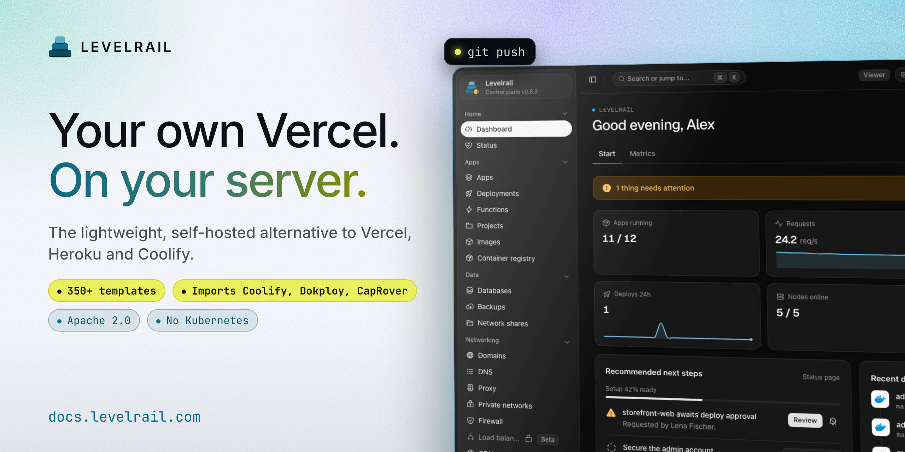
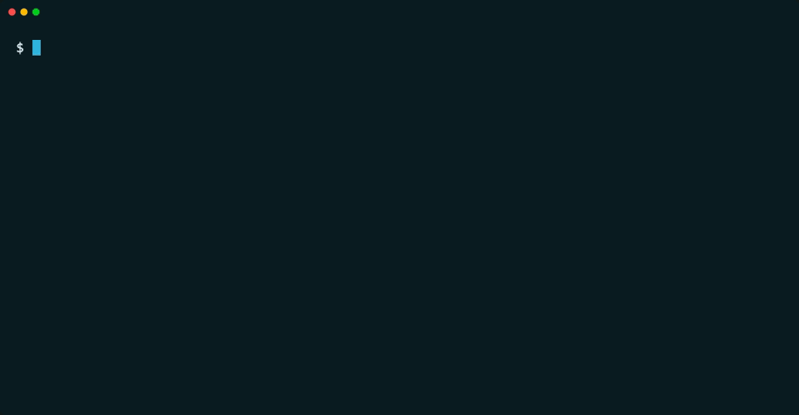
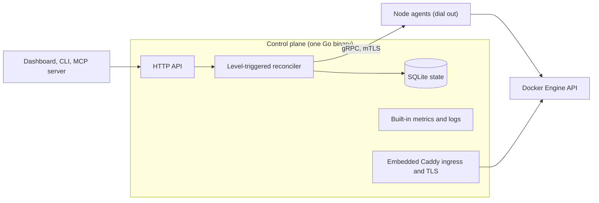
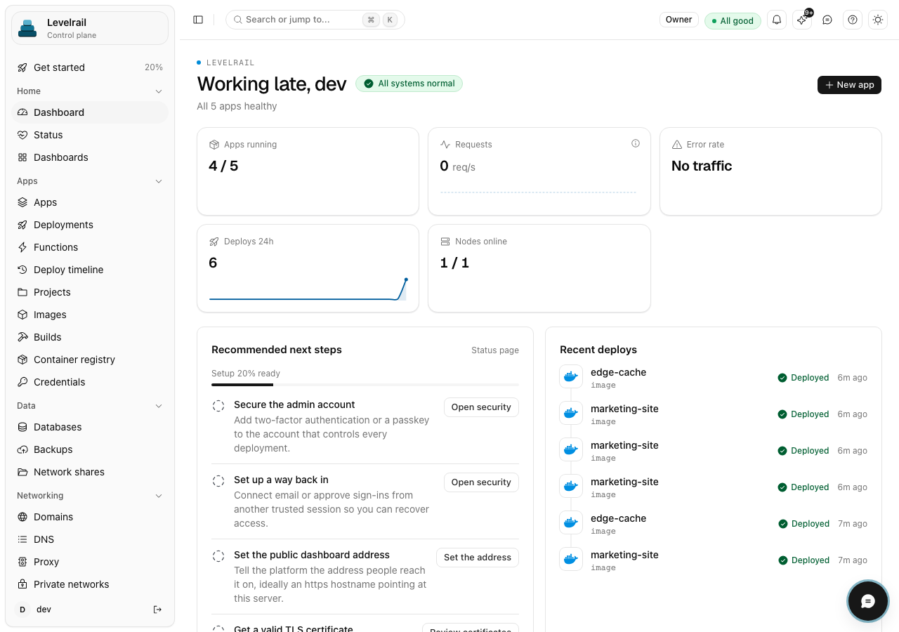
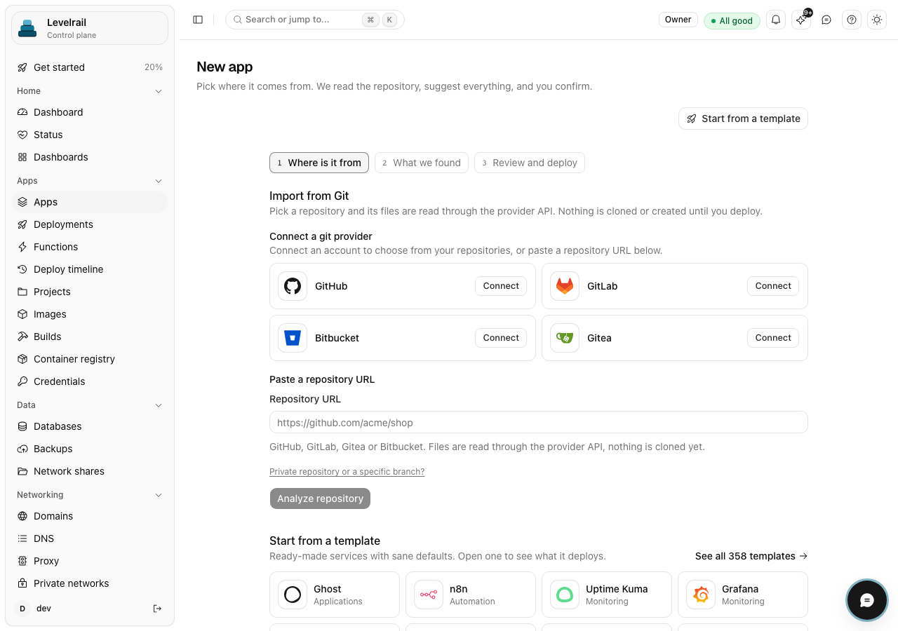
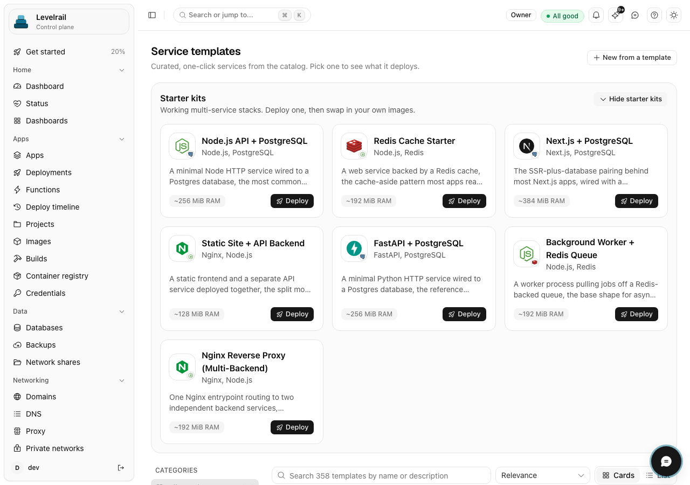
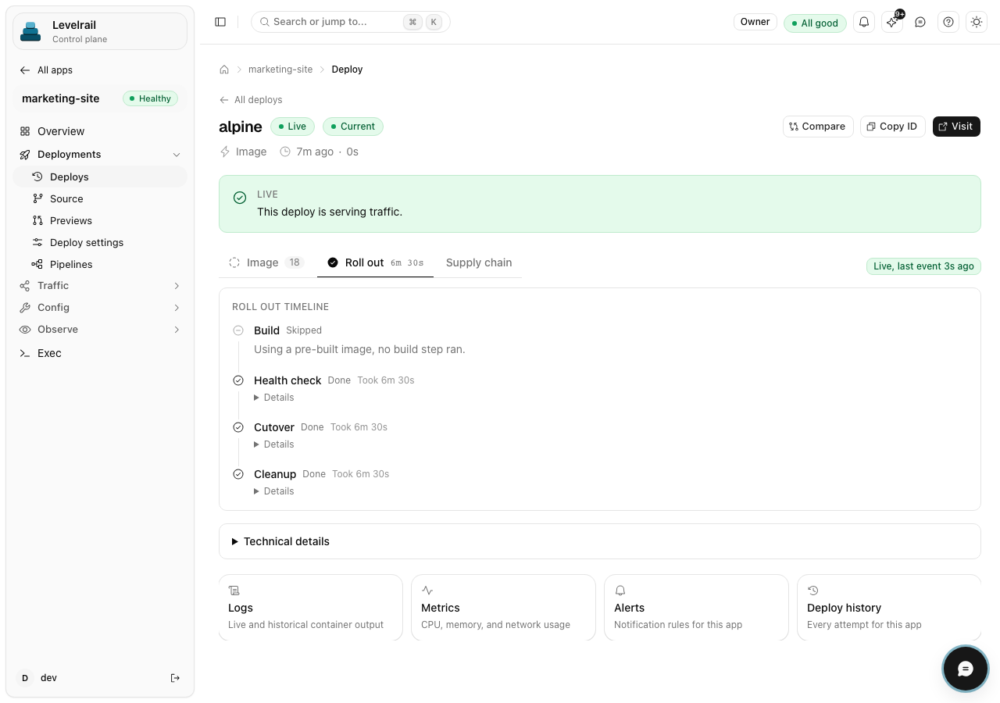
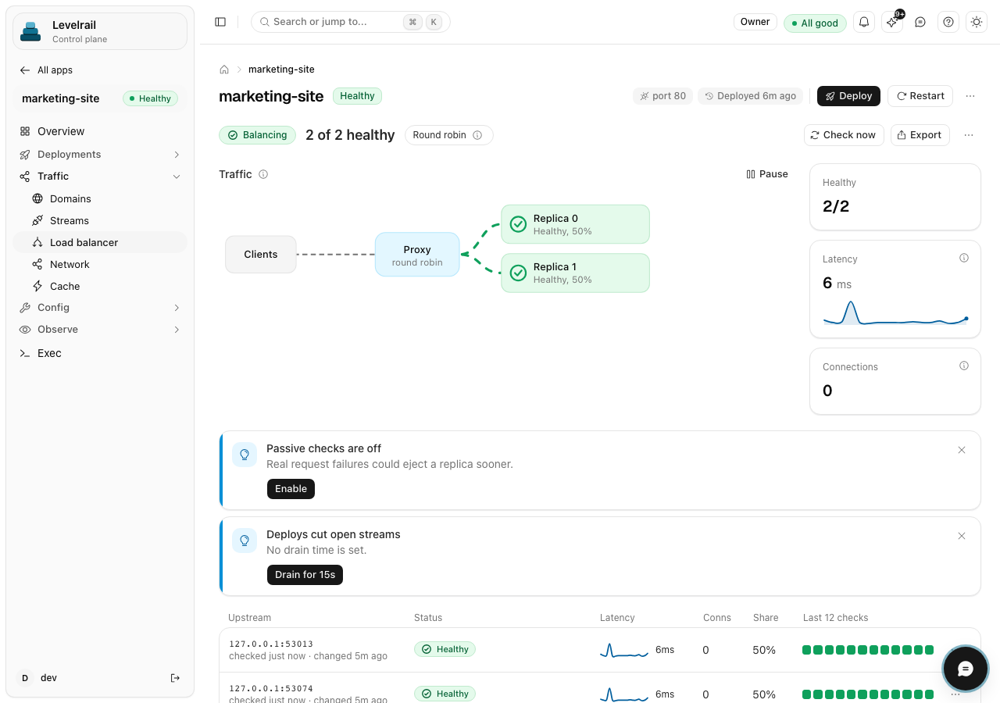
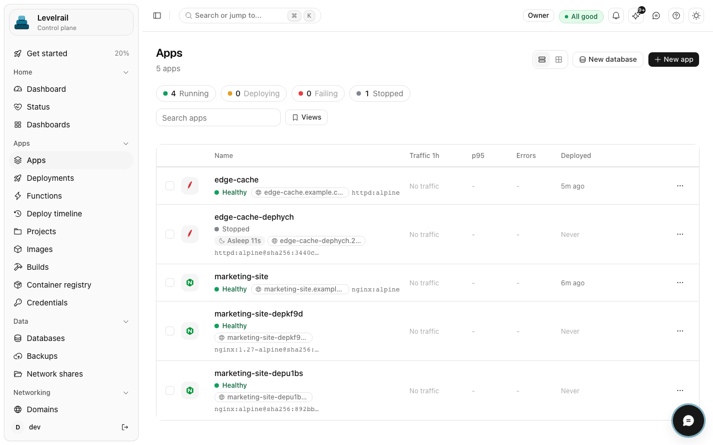
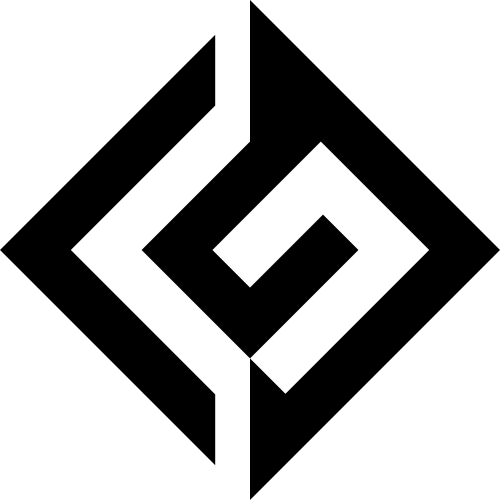

<!-- translated-from: README.md blob:9c194248e518399035b29933ea71854d30fc19ec lang:pt-BR -->
<div align="center">

<h1>Levelrail</h1>

> This translation was generated with AI and may contain mistakes. Corrections are welcome: see [docs/i18n/README.md](README.md).
>
> Esta tradução foi gerada com IA e pode conter erros. Correções são bem-vindas: veja [docs/i18n/README.md](README.md).

<p><strong>PaaS auto-hospedado: faça deploy com git push nos seus próprios servidores, com logs, métricas, HTTPS e rollback.</strong><br>
Um único binário Go, runtime Docker, sem Kubernetes. Apache 2.0.</p>
<p>
  <a href="../../LICENSE"></a>
  <a href="https://github.com/glincker/levelrail/releases"></a>
  <a href="https://github.com/glincker/levelrail/actions/workflows/ci.yml"></a>
  <a href="../../go.mod"></a>
<br>
  <a href="../../docs/mcp.md"></a>
  <a href="https://docs.levelrail.com"></a>
  <a href="https://discord.gg/Ar5pcaZB99"></a>
  <a href="https://codespaces.new/glincker/levelrail"></a>
</p>
<p>
  <a href="https://levelrail.com">Site</a> &middot;
  <a href="https://docs.levelrail.com">Docs</a> &middot;
  <a href="#início-rápido-instale-uma-alternativa-auto-hospedada-à-vercel">Instalar</a> &middot;
  <a href="#pronto-para-produção-com-comprovações">Pronto para produção</a> &middot;
  <a href="#levelrail-vs-coolify-dokploy-caprover-e-dokku-alternativa-ao-coolify">Comparar</a> &middot;
  <a href="#perguntas-frequentes-faq">FAQ</a> &middot;
  <a href="../../docs/roadmap.md">Roadmap</a> &middot;
  <a href="../../CHANGELOG.md">Changelog</a> &middot;
  <a href="https://github.com/glincker/levelrail/discussions">Discussões</a>
</p>
<!-- i18n-nav:start -->
<p><a href="../../README.md">English</a> &middot; <a href="README.zh-Hans.md">简体中文</a> &middot; <a href="README.es.md">Español</a> &middot; Português (BR) &middot; <a href="README.de.md">Deutsch</a> &middot; <a href="README.fr.md">Français</a> &middot; <a href="README.ja.md">日本語</a></p>
<!-- i18n-nav:end -->
<picture><source media="(prefers-color-scheme: dark)" srcset="../../docs/assets/brand/social/github-social-1280x640.jpg"></picture>
</div>

O Levelrail é um **PaaS auto-hospedado** de código aberto (Apache 2.0) para desenvolvedores e equipes pequenas que querem um fluxo de trabalho no estilo Vercel, Heroku ou Railway em servidores próprios. Ele roda em qualquer servidor Linux, de um VPS pequeno a um rack (o único host medido é uma máquina com 2 vCPUs e 8 GB), e transforma servidores comuns em uma nuvem privada com deploys por Git (webhooks do forge), HTTPS, bancos de dados com backups verificados, métricas, logs e alertas, sem Kubernetes e sem a stack de monitoramento que você teria de acrescentar de outra forma.

**Status:** pré-1.0 (v0.x). Um único servidor está pronto para produção conforme o [status dos recursos](../../docs/feature-status.md); multi-nó é beta.

## Qual instalação é para mim?

| Eu sou... | Execute | Doc |
| --- | --- | --- |
| Tenho um servidor Linux (VPS ou bare metal) e quero fazer deploy de apps | `curl -fsSL https://levelrail.com/install.sh \| sudo sh` | [Instalação](../../docs/installing.md) |
| Quero testar localmente primeiro | Abra o dev container no [Codespaces](https://codespaces.new/glincker/levelrail) | [Instalação](../../docs/installing.md#option-3-build-from-source) |
| Só preciso da CLI no meu notebook | `brew install glincker/tap/levelrail-cli` ou `npm install -g levelrail-cli` | [Instalando só a CLI](../../docs/installing.md#installing-just-the-cli) |
| Uso Docker e quero um contêiner | `docker pull ghcr.io/glincker/levelrail` | [Docker](../../docs/installing.md#option-2-docker) |
| Uso um agente de código | `npx skills add https://github.com/glincker/levelrail --skill levelrail` | [Servidor MCP](../../docs/mcp.md) |

O servidor só é instalado em Linux. macOS e Windows são alvos apenas para a CLI.

## Índice

[Início rápido](#início-rápido-instale-uma-alternativa-auto-hospedada-à-vercel) &middot; [Como funciona](#como-funciona) &middot; [Verifique o que você instala](#verifique-o-que-você-instala) &middot; [Por que o Levelrail](#por-que-escolher-o-levelrail) &middot; [Pronto para produção](#pronto-para-produção-com-comprovações) &middot; [Alternativa ao Coolify](#levelrail-vs-coolify-dokploy-caprover-e-dokku-alternativa-ao-coolify) &middot; [Recursos](#o-que-você-recebe) &middot; [Guias](#guias) &middot; [FAQ](#perguntas-frequentes-faq) &middot; [Para agentes de IA](#para-agentes-de-ia-e-crawlers)

## Início rápido (instale uma alternativa auto-hospedada à Vercel)

Você precisa de um servidor Linux (`amd64` ou `arm64`) com systemd e acesso root. O instalador adiciona o Docker se ele não estiver presente.

### 1. Instale o servidor

```bash
curl -fsSL https://levelrail.com/install.sh | sudo sh
```

> **Nota:** o HTTPS usa um certificado autoassinado até você ativar o Let's Encrypt. O primeiro login oferece um certificado gratuito com um clique para `<dashed-ip>.sslip.io`, ou você pode adicionar seu próprio domínio.

As últimas linhas da saída incluem o endereço do painel e um link de configuração de uso único:

```text
Levelrail vX.Y.Z installed and running.

Open the dashboard:
  http://203.0.113.10:8080/login#setup=<token>
```

### 2. Crie a conta de administrador

Abra o link de configuração e escolha uma senha. O token fica no fragmento `#`, então nunca chega ao servidor nem aos logs dele; perdeu? `sudo APP_DATA_DIR=/var/lib/levelrail-data levelrail setup-token` imprime de novo. O primeiro login abre uma tela que ativa um certificado gratuito para `<dashed-ip>.sslip.io` com um clique (sem precisar de DNS) e faz o deploy do seu primeiro app.

### 3. Faça o deploy de um app

No servidor, o instalador já colocou o `levelrail-cli` em `/usr/local/bin`. Faça login uma vez e depois importe um repositório (`levelrail-cli apps create --interactive` pergunta tudo passo a passo):

```bash
levelrail-cli login --api-url http://<server-ip>:8080 --code ABCD-EF23
levelrail-cli import https://github.com/your-org/your-app --deploy
```

Prefere contêineres, uma versão fixa ou um build a partir do código-fonte? Veja [Instalação](../../docs/installing.md). Quer algo tão leve quanto o Dokku, ou com tudo ligado? `install.sh --profile minimal|standard|suite`, veja [Perfis de servidor](../../docs/profiles.md). Vindo de outra plataforma? Veja [Migrar para o Levelrail](../../docs/migrate-to-levelrail.md): Coolify, Dokploy, CapRover, Dokku e arquivos compose passam primeiro por uma simulação (dry run), e o servidor antigo continua atendendo.

Depois da configuração, a home do painel mostra um cartão **Connect your CLI**. Pressione **Show my command**, cole a linha no seu terminal e a CLI faz login com um código de uso único que expira em minutos (sem senha, sem etapa de aprovação):

```text
logged in as "you@example.com"
token tk_9fQ2x saved to ~/.config/levelrail-cli/credentials under profile "default", expires 2027-01-18
```

Fazer login com sua senha em um dispositivo novo exige aprovação: a CLI imprime a página do painel para aprovar e o número a digitar. `login --device` também continua funcionando.

Sem `--deploy`, o `import` só imprime o plano de deploy. Para ver o endereço do app, execute `levelrail-cli open your-app`. Ele imprime primeiro o domínio personalizado e depois a URL automática.

### Ou deixe seu agente de código fazer isso

Instale a skill uma vez e depois peça ao seu agente em palavras simples. Ele faz o deploy, espera o rollout realmente convergir, lê a falha se houver uma e faz rollback com segurança:

```bash
npx skills add https://github.com/glincker/levelrail --skill levelrail
```

> Deploy this repo to my Levelrail and tell me when it is live.

A skill também está listada em [skills.sh](https://www.skills.sh/glincker/levelrail/levelrail). Detalhes: [Agentes](../../docs/agents.md).

### Se algo falhar

| Etapa | Erro que você vê | Correção |
| --- | --- | --- |
| Instalação | `control plane did not become healthy within 60s` | `systemctl status levelrail` e `journalctl -u levelrail -n 100 --no-pager`. Uma porta já em uso é uma causa comum. |
| Instalação | `could not list releases from GitHub. Set LEVELRAIL_VERSION=vX.Y.Z to pin one.` | O servidor não consegue acessar o GitHub. Verifique o HTTPS de saída ou fixe uma versão. |
| Instalação | `checksum mismatch for ...` | Não continue. Execute o instalador de novo. Não defina `LEVELRAIL_SKIP_CHECKSUM=1` para contornar o erro. |
| Login | `start device login: ... connection refused` | A CLI aponta para o endereço errado. Execute `export APP_API_URL=http://127.0.0.1:<dashboard port>` e tente de novo. |
| Importação | `plan import: ... connection refused` | O plano de controle não está em execução. Inicie-o com `systemctl start levelrail`. |

Mais correções: [Solução de problemas](../../docs/troubleshooting.md). Todas as opções de instalação (imagem Docker, versão fixa, build a partir do código-fonte): [Instalação](../../docs/installing.md). Faça deploy de um projeto local com `levelrail-cli up`: [Início rápido com um comando](../../docs/quickstart-one-command.md). Perfis de servidor (`install.sh --profile minimal|standard|suite`): [Perfis de servidor](../../docs/profiles.md). Migrando de outra plataforma? `levelrail-cli import platform coolify|dokploy|caprover --dry-run` mostra primeiro o que seria criado, e o servidor antigo continua atendendo. Guia completo: [Migrar para o Levelrail](../../docs/migrate-to-levelrail.md). Publica um projeto de código aberto? Adicione um botão de um clique ao README dele: [Botão Deploy to Levelrail](../../docs/deploy-button.md).

<table>
  <tr>
    <td width="50%" valign="top" align="center">
      <br>
      <sub><b>Instalar e depois fazer o deploy</b></sub>
    </td>
    <td width="50%" valign="top" align="center">
      <br>
      <sub><b>Deploy com barreira, rollback em um passo</b></sub>
    </td>
  </tr>
</table>

### Instalar só a CLI

Para o seu notebook ou um runner de CI, para controlar um servidor que já roda o Levelrail:

```bash
brew install glincker/tap/levelrail-cli
npm install -g levelrail-cli
curl -fsSL https://levelrail.com/install-cli.sh | sh
irm https://levelrail.com/install-cli.ps1 | iex
```

Os dois primeiros funcionam em qualquer plataforma compatível, o terceiro é para macOS e Linux, e o último para o PowerShell do Windows.

## Como funciona



O plano de controle guarda o estado desejado em um SQLite embutido e um reconciliador faz o Docker corresponder a ele, tentando de novo com segurança porque parte do estado observado a cada vez. Cada nó roda um agente que se conecta de dentro para fora ao plano de controle via mTLS e fala diretamente com a API do Docker Engine, então os nós não precisam de nenhuma porta de entrada. As métricas e os logs ficam armazenados por nó e são consultados em conjunto. O Caddy é embutido para o ingress e os certificados. Detalhes: [Arquitetura](../../docs/architecture.md).

## Verifique o que você instala

As versões publicam uma assinatura Sigstore para o `checksums.txt` e uma attestation de proveniência do build. Substitua `v0.1.0` pela tag da versão.

```bash
V=v0.1.0
BASE=https://github.com/glincker/levelrail/releases/download/$V
curl -fsSLO $BASE/checksums.txt -O $BASE/checksums.txt.sigstore.json -O $BASE/levelrail-linux-amd64
cosign verify-blob --bundle checksums.txt.sigstore.json \
  --certificate-identity-regexp 'https://github.com/glincker/levelrail/\.github/workflows/release\.yml@.*' \
  --certificate-oidc-issuer https://token.actions.githubusercontent.com checksums.txt
sha256sum --check --ignore-missing checksums.txt
gh attestation verify levelrail-linux-amd64 --repo glincker/levelrail
```

O instalador verifica os checksums por conta própria. As imagens de contêiner estão no GHCR (`ghcr.io/glincker/levelrail`, multiarquitetura). Mais informações: [Instalação](../../docs/installing.md).

## Por que escolher o Levelrail

- **Leve.** Cerca de 200 MB de RAM e aproximadamente 1,5% de uma CPU em repouso, medido em uma máquina de teste Linux com 2 vCPUs e 8 GB, sem apps sob carga e com o conjunto de recursos padrão (uma execução, 2026-10-19). [Números e método](../../docs/benchmarks.md).
- **Agentes, não SSH.** Cada nó roda um agente pequeno que se conecta de dentro para fora via mTLS e fala diretamente com a API do Docker Engine. Sem portas de entrada, sem chamar a CLI `docker` por shell, sem loops de polling.
- **Observabilidade incluída.** Métricas por nó com resolução de 15 segundos, logs pesquisáveis, marcadores de deploy, traces, consumo do orçamento de erros (SLO burn), caixa de entrada de alertas e uma página de saúde do consumo em repouso. Sem instalar uma stack do Grafana.
- **Deploys que protegem você.** Rollouts com barreira de readiness, imagens fixadas para rollback, lançamentos canary que fazem rollback em caso de erros, diffs de deploy, aprovações e congelamentos.
- **Seguro por padrão.** Log de auditoria encadeado por hash que você pode verificar, chamadas de saída protegidas contra SSRF, segredos com criptografia de envelope e rotação de chaves, tokens com escopo, passkeys e 2FA com TOTP, login com OAuth e OIDC, políticas IAM, versões assinadas. O login único com SAML e o provisionamento com SCIM estão disponíveis como [recurso beta](../../docs/sso-saml.md), desativados por padrão.
- **Feito para agentes de IA.** Um servidor MCP com mais de 240 ferramentas em conjuntos carregados sob demanda (lista padrão pequena, cerca de 2,4k tokens; veja a [superfície de ferramentas](../../docs/mcp-tool-surface.md)), um modelo de permissões com tokens com escopo e uma skill para agentes.

## Pronto para produção, com comprovações

Deploys em um único servidor estão prontos para produção hoje. O multi-nó e alguns recursos mais novos são rotulados como beta, e cada rótulo aponta para a sua evidência.

| Afirmação | Evidência |
| --- | --- |
| Todo recurso é rotulado como estável ou beta | [Status dos recursos](../../docs/feature-status.md): os testes, as execuções e2e ao vivo e a documentação por trás de cada rótulo |
| Sobrevive a falhas | [Resiliência](../../docs/resilience.md): disco cheio, perda do link com o agente, dano ao banco de dados com restauração guiada, boot em modo seguro, proteção contra tempestade de reconciliação |
| Atualizações seguras e rollback | Matriz de upgrade testada, recusa de downgrade, [rollback](../../docs/rollback.md) com um clique e desligamento limpo |
| Medido, não prometido | [Benchmarks](../../docs/benchmarks.md): consumo em repouso, throughput do ingress, limites, com o método ao lado de cada número |
| Backups verificados | Todo backup é baixado de novo e conferido por checksum, com simulações de restauração agendadas |
| Segurança com evidência de adulteração | Cadeia de auditoria verificável, [política de segurança](../../.github/SECURITY.md), versões assinadas e varredura de SBOM |

## Levelrail vs Coolify, Dokploy, CapRover e Dokku (alternativa ao Coolify)

A maioria das plataformas auto-hospedadas dessa categoria gerencia servidores entrando por SSH e chamando a CLI `docker` por shell, e depois interpretando texto, o que costuma forçar loops de polling. O Levelrail usa, em vez disso, um agente de conexão reversa e um reconciliador acionado por nível (level-triggered).

| | Levelrail | Coolify | Dokploy | CapRover | Dokku |
| --- | --- | --- | --- | --- | --- |
| Controle de nós | Agente de conexão reversa | SSH + CLI | SSH + Engine API | Swarm API | Bash local |
| Orquestração | Reconciliador level-triggered | Compose | Swarm | Swarm | Scheduler em Bash |
| Métricas e logs integrados | Sim | Complemento opcional | Binário separado | Não | Não |
| Rollback | Imagens fixadas, com barreira de readiness | Health check desativado por padrão | Rollback do Swarm | Manual | Scheduler padrão: nenhum |
| Verificação de backup | Automática, todos os 8 engines | Verificação de não vazio | Nenhuma | Nenhuma | Sem backups |
| SSO e provisionamento | OAuth (20 provedores) e OIDC genérico; SAML e SCIM (beta, desativados por padrão) | Veja a documentação deles | Veja a documentação deles | Veja a documentação deles | Veja a documentação deles |
| Log de auditoria | Encadeado por hash, verificável, exportação em CSV, encaminhamento para syslog, webhook ou bucket | Veja a documentação deles | Veja a documentação deles | Veja a documentação deles | Veja a documentação deles |
| IAM | Políticas Allow e Deny por app ou banco de dados, tokens com escopo | Veja a documentação deles | Veja a documentação deles | Veja a documentação deles | Veja a documentação deles |

Isto é posicionamento, não um ranking, e todos os projetos aqui valem a pena. Onde o Levelrail fica atrás: é o projeto mais novo daqui, com menos usuários e menos rodagem em produção, e o login único com SAML e o provisionamento com SCIM estão em beta ([detalhes](../../docs/sso-saml.md)). O catálogo de modelos (cerca de 360 entradas) está na mesma faixa do Coolify, mas só uma amostra é implantada de ponta a ponta ([ADR 015](../../adr/015-service-template-catalog-reversal.md)). A comparação completa e com fontes está em [Comparação](../../docs/comparison.md).

## O que você recebe

- **Deploys:** Faça push para o seu host git (webhooks do GitHub, GitLab, Bitbucket, Gitea), os deploys começam a partir de um webhook do forge (um remoto nativo de `git push` é beta e vem desativado por padrão), ambientes de pré-visualização por pull request (estável no GitHub, beta no GitLab e no Bitbucket), presets de frameworks (Next.js, Go, React, Spring Boot e mais), deploys com Dockerfile, Compose ou imagem, rollouts canary e blue-green. A virada com barreira de readiness foi testada ao vivo com zero requisições com falha em um único nó; multi-nó é beta. [Fazendo deploy de apps](../../docs/deploying-apps.md)
- **Domínios e TLS:** Ingress com Caddy embutido. O certificado padrão é interno (autoassinado). O Let's Encrypt público é uma chave liga/desliga e foi verificado em uma execução ao vivo; a renovação e os wildcards com DNS-01 não foram verificados. Certificados personalizados podem ser enviados. Proteção contra abuso por app. [Domínios](../../docs/domains-and-ingress.md)
- **Bancos de dados:** Postgres, MySQL, MariaDB, MongoDB, Redis, KeyDB, Dragonfly e ClickHouse com backups agendados, recuperação para um ponto no tempo no Postgres, restauração e rotação de senhas. [Bancos de dados](../../docs/managing-databases.md)
- **Uma busca para tudo:** Cmd+K em apps, bancos de dados, nós, modelos e ações, filtrado pelo que você tem permissão de fazer. [Busca](../../docs/search.md)
- **Servidores:** Adicione nós com um token de uso único, malha WireGuard, zonas e distribuição por domínios de falha, simulação (what-if) de posicionamento. [Multi-nó](../../docs/multi-node.md)
- **Modelos:** cerca de 360 serviços com um clique, com um smoke test que sobe os 50 principais (48 passam hoje, [status](../../docs/templates-status.md)). [Catálogo](../../docs/template-catalog.md)
- **Identidade e acesso:** Senha, passkeys, TOTP, OAuth com 20 provedores mais OIDC genérico, políticas IAM, equipes, um log de auditoria encadeado por hash com exportação em CSV. O login único com SAML e o provisionamento com SCIM são beta e vêm desativados por padrão. [Identidade e acesso](../../docs/identity-and-access.md), [SAML e SCIM](../../docs/sso-saml.md)
- **Plugins:** Um marketplace de plugins assinados com instalação em um clique, painéis no dashboard e canais de alerta próprios. [Plugins](../../docs/plugins.md)
- **Automação:** Uma única API HTTP por trás do dashboard, uma CLI e um servidor MCP. A IA nunca fica no caminho de reconciliação. [CLI](../../docs/cli-reference.md), [Controle por IA](../../docs/ai-control.md)
- **Pipelines, pré-visualizações, orçamentos de custo, suspensão por inatividade, páginas de status** e mais. Veja o [Tour do produto](https://docs.levelrail.com/product-tour).

<table>
  <tr>
    <td width="33%" valign="top"><a href="../../docs/product-tour.mdx"><picture><source media="(prefers-color-scheme: dark)" srcset="../../docs/assets/screenshots/dashboard-home.png"></picture></a><br><sub><b>O plano de controle num relance</b></sub></td>
    <td width="33%" valign="top"><a href="../../docs/frameworks.md"><picture><source media="(prefers-color-scheme: dark)" srcset="../../docs/assets/screenshots/framework-preset-picker.png"></picture></a><br><sub><b>Escolha um preset de framework e as configurações de build são preenchidas</b></sub></td>
    <td width="33%" valign="top"><a href="../../docs/template-catalog.md"><picture><source media="(prefers-color-scheme: dark)" srcset="../../docs/assets/screenshots/templates-catalog.png"></picture></a><br><sub><b>Instale um serviço conhecido a partir do catálogo de modelos</b></sub></td>
  </tr>
  <tr>
    <td width="33%" valign="top"><a href="../../docs/deploying-apps.md"><picture><source media="(prefers-color-scheme: dark)" srcset="../../docs/assets/screenshots/deploy-live-log.png"></picture></a><br><sub><b>Deploys ao vivo</b></sub></td>
    <td width="33%" valign="top"><a href="../../docs/load-balancing.md"><picture><source media="(prefers-color-scheme: dark)" srcset="../../docs/assets/screenshots/load-balancer.png"></picture></a><br><sub><b>Balanceie a carga entre réplicas com health checks</b></sub></td>
    <td width="33%" valign="top"><a href="../../docs/deploying-apps.md"><picture><source media="(prefers-color-scheme: dark)" srcset="../../docs/assets/screenshots/apps-list.png"></picture></a><br><sub><b>Cada app, sua saúde e seu último deploy</b></sub></td>
  </tr>
</table>

Mais telas (métricas, logs, backups, domínios, segurança, plugins) estão no [Tour do produto](https://docs.levelrail.com/product-tour).

Todas as capturas de tela vêm de um plano de controle real em execução.

## Guias

Passo a passo, cada um testado em uma instalação real:

| Guia | O que você aprende |
| --- | --- |
| [Faça o deploy de um app Next.js com Postgres](https://github.com/glincker/levelrail/discussions/1239) | Do repositório ao HTTPS em cerca de dez minutos |
| [Faça o deploy de um app Django com Postgres](https://github.com/glincker/levelrail/discussions/1243) | Mais os quatro erros que todo mundo encontra |
| [Push to deploy com o GitHub](https://github.com/glincker/levelrail/discussions/1244) | Webhooks, pré-visualizações e o log de entregas |
| [Como os deploys se mantêm seguros](https://github.com/glincker/levelrail/discussions/1246) | Barreiras de saúde, virada blue-green, rollback |
| [Logs, traces e erros sem uma stack à parte](https://github.com/glincker/levelrail/discussions/1240) | Observabilidade e Grafana |
| [Escale a zero em um VPS pequeno](https://github.com/glincker/levelrail/discussions/1242) | Rode muitos projetos em uma única máquina |
| [Levelrail vs Coolify, Dokploy, CapRover, Dokku e Kamal](https://github.com/glincker/levelrail/discussions/1235) | Onde cada um se encaixa |

## Adicione um botão Deploy ao seu projeto

Mantém um app de código aberto? Deixe as pessoas rodá-lo no próprio servidor com poucos cliques.

[](../../docs/deploy-button.md)

Snippets para copiar e colar e os quatro estilos de badge: [Botão Deploy](../../docs/deploy-button.md) e o [Kit de marca](../../docs/brand.md).

## O que vem a seguir

Planejado, não prometido. As datas são metas e os itens podem mudar ou ser descartados. Lista completa no [roadmap](../../docs/roadmap.md).

- Execuções em hosts reais para a malha multi-nó e um número de consumo em repouso.
- Verificações públicas de ACME: renovação perto do vencimento e wildcards com DNS-01.
- Mais testes de upgrade e downgrade entre versões.
- Snapshots de versões e vínculos de ambiente.
- Uma primeira versão estável, somente quando a evidência de hardening estiver pronta. Nenhuma data foi definida.

## Perguntas frequentes (FAQ)

**O Levelrail está pronto para produção?** Deploys em um único servidor estão prontos para produção; multi-nó e alguns recursos mais novos são beta. Cada rótulo está em [Status dos recursos](../../docs/feature-status.md). O projeto é pré-1.0.

**Precisa de Kubernetes?** Não. É um único binário Go com runtime Docker, e uma camada de compatibilidade com Kubernetes é um não-objetivo deliberado ([Comparação](../../docs/comparison.md)).

**Quanto custa?** Nada. É Apache 2.0, uma única edição, sem chave de licença e sem plano pago. Você paga pelos seus próprios servidores ([Preços](../../docs/pricing.md)).

**Qual a diferença para o Coolify ou o Dokploy?** Os nós são gerenciados por um agente de conexão reversa e um reconciliador level-triggered em vez de SSH e da CLI `docker`, e as métricas e os logs já vêm integrados. Veja a [tabela comparativa](#levelrail-vs-coolify-dokploy-caprover-e-dokku-alternativa-ao-coolify), incluindo onde o Levelrail fica atrás.

**Posso migrar do Coolify?** Sim. `levelrail-cli import platform coolify --dry-run` mostra primeiro o que seria criado, e o servidor antigo continua atendendo. Dokploy, CapRover, Dokku e arquivos compose também funcionam: [Migrar para o Levelrail](../../docs/migrate-to-levelrail.md).

**Ele é compatível com agentes de IA e MCP?** Sim. O `levelrail-mcp` expõe a mesma API e o mesmo modelo de permissões, e uma skill para agentes está incluída. A IA nunca fica no caminho de reconciliação: [MCP](../../docs/mcp.md), [Controle por IA](../../docs/ai-control.md).

**Como faço upgrade?** Use Settings > Updates ou `levelrail-cli upgrade --plan`. O upgrade verifica a versão, faz um snapshot dos seus dados e faz rollback sozinho se a nova versão não estiver saudável: [Faça upgrade com segurança](../../docs/upgrade-safely.md).

**Onde meus dados ficam armazenados?** Nos seus servidores. Por padrão, o plano de controle guarda o SQLite, a chave mestra e o token de configuração em `/var/lib/levelrail-data`; as métricas e os logs ficam em cada nó ([Instalação](../../docs/installing.md), [Arquitetura](../../docs/architecture.md)).

## Para agentes de IA e crawlers

- **Skill para agentes:** [`skills/levelrail/SKILL.md`](../../skills/levelrail/SKILL.md) ensina um agente de código a fazer deploy, esperar, diagnosticar e fazer rollback com segurança.
- **Servidor MCP:** o `levelrail-mcp` expõe a mesma API e o mesmo modelo de permissões. Comece no modo `read-only`. Veja [MCP](../../docs/mcp.md) e [Controle por IA](../../docs/ai-control.md).
- **Guia do repositório:** [`AGENTS.md`](../../AGENTS.md) para trabalhar neste código, e [`llms.txt`](../../llms.txt) como índice. Docs para LLMs: [llms.txt](https://docs.levelrail.com/llms.txt) e [llms-full.txt](https://docs.levelrail.com/llms-full.txt).

## Comunidade e suporte

- [GitHub Discussions](https://github.com/glincker/levelrail/discussions) para perguntas, ideias e para mostrar o que você fez, e [Issues](https://github.com/glincker/levelrail/issues) para bugs.
- [GLINR Discord](https://discord.gg/Ar5pcaZB99): chat ao vivo com os mantenedores, no canal de fórum `#levelrail`.
- [support@levelrail.com](mailto:support@levelrail.com) para ajuda direta, e a [Política de segurança](../../.github/SECURITY.md) para reportar uma vulnerabilidade de forma privada.
- [Contribuindo](../../.github/CONTRIBUTING.md): ciclo de desenvolvimento, testes e convenções de commit. Compilar a partir do código-fonte exige Go 1.26 ou mais recente e Docker: veja [Instalação](../../docs/installing.md#option-3-build-from-source).

## Dê uma estrela ao repositório

Se o Levelrail te poupar um fim de semana, uma [estrela no GitHub](https://github.com/glincker/levelrail) ajuda outras pessoas que hospedam os próprios serviços a encontrá-lo. Relatos de bugs e feedback sincero ajudam ainda mais.

[](https://star-history.com/#glincker/levelrail&Date)

<a href="https://github.com/glincker/levelrail/graphs/contributors"></a>

## Licença

Apache 2.0, veja [LICENSE](../../LICENSE).

## Criado por

O Levelrail é criado por Gagan Deep Singh, fundador da [GLINR STUDIOS](https://glinr.com) e do [theSVG](https://thesvg.org). Projetos irmãos: [theSVG](https://thesvg.org) (biblioteca de ícones de marcas), [theauth](https://github.com/glincker/theauth) (autenticação de código aberto para agentes de IA e pessoas) e [AskVerdict AI](https://askverdict.ai). Diga oi em [thegdsks.com](https://thegdsks.com).

<div align="center">

<a href="https://glinr.com">
  <picture>
    <source media="(prefers-color-scheme: dark)" srcset="../../docs/assets/brand/glincker-light.svg">
    
  </picture>
</a>

<sub>Desenvolvido por <a href="https://glinr.com"><b>GLINR STUDIOS</b></a> &middot; ícone do <a href="https://thesvg.org/icon/glincker">theSVG</a></sub>

</div>
