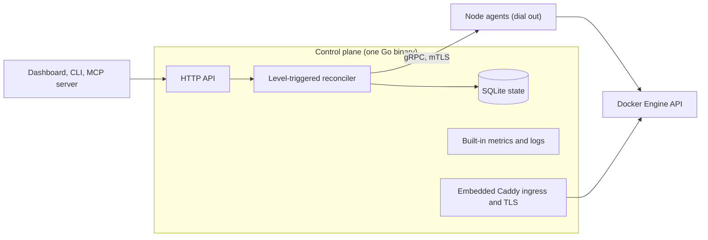

<!-- translated-from: README.md blob:9c194248e518399035b29933ea71854d30fc19ec lang:zh-Hans -->
<div align="center">

<h1>Levelrail</h1>
<p><strong>自托管 PaaS：通过 git push 部署到你自己的服务器，附带日志、指标、HTTPS 和回滚。</strong><br>
单个 Go 二进制文件，Docker 运行时，无需 Kubernetes。Apache 2.0。</p>
<p>
  <a href="../../LICENSE"></a>
  <a href="https://github.com/glincker/levelrail/releases"></a>
  <a href="https://github.com/glincker/levelrail/actions/workflows/ci.yml"></a>
  <a href="../../go.mod"></a>
<br>
  <a href="../../docs/mcp.md"></a>
  <a href="https://docs.levelrail.com"></a>
  <a href="https://discord.gg/Ar5pcaZB99"></a>
  <a href="https://codespaces.new/glincker/levelrail"></a>
</p>
<p>
  <a href="https://levelrail.com">官网</a> &middot;
  <a href="https://docs.levelrail.com">文档</a> &middot;
  <a href="#快速开始-安装自托管的-vercel-替代方案">安装</a> &middot;
  <a href="#可用于生产环境与佐证">可用于生产</a> &middot;
  <a href="#levelrail-vs-coolify-dokploy-caprover-和-dokku-coolify-替代方案">对比</a> &middot;
  <a href="#faq">FAQ</a> &middot;
  <a href="../../docs/roadmap.md">路线图</a> &middot;
  <a href="../../CHANGELOG.md">更新日志</a> &middot;
  <a href="https://github.com/glincker/levelrail/discussions">讨论区</a>
</p>
<!-- i18n-nav:start -->
<p><a href="../../README.md">English</a> &middot; 简体中文 &middot; <a href="README.es.md">Español</a> &middot; <a href="README.pt-BR.md">Português (BR)</a> &middot; <a href="README.de.md">Deutsch</a> &middot; <a href="README.fr.md">Français</a> &middot; <a href="README.ja.md">日本語</a></p>
<!-- i18n-nav:end -->
<picture><source media="(prefers-color-scheme: dark)" srcset="../../docs/assets/brand/social/github-social-1280x640.jpg"></picture>
</div>

> 本译文由 AI 生成，可能存在错误，欢迎指正：请参阅 [docs/i18n/README.md](README.md)。

Levelrail 是一个开源（Apache 2.0）的**自托管 PaaS**，面向希望在自己拥有的服务器上获得 Vercel、Heroku 或 Railway 式工作流的开发者和小型团队。它可以运行在任何 Linux 服务器上，从小型 VPS 到机架服务器都行（实测过的那台主机是 2 vCPU、8 GB 的机器），并把普通服务器变成私有云，提供 Git 部署（通过 forge webhook）、HTTPS、带已验证备份的数据库、指标、日志和告警，无需 Kubernetes，也无需另行搭建监控栈。

**状态：** 1.0 之前（v0.x）。按[功能状态](../../docs/feature-status.md)，单服务器已可用于生产；多节点处于 beta 阶段。

## 我该选哪种安装方式？

| 我是... | 运行 | 文档 |
| --- | --- | --- |
| 有一台 Linux 服务器（VPS 或裸金属），想部署应用 | `curl -fsSL https://levelrail.com/install.sh \| sudo sh` | [安装](../../docs/installing.md) |
| 想先在本地试用 | 在 [Codespaces](https://codespaces.new/glincker/levelrail) 中打开开发容器 | [安装](../../docs/installing.md#option-3-build-from-source) |
| 只需要在笔记本上使用 CLI | `brew install glincker/tap/levelrail-cli` 或 `npm install -g levelrail-cli` | [仅安装 CLI](../../docs/installing.md#installing-just-the-cli) |
| 在运行 Docker，想要一个容器 | `docker pull ghcr.io/glincker/levelrail` | [Docker](../../docs/installing.md#option-2-docker) |
| 使用编码 agent | `npx skills add https://github.com/glincker/levelrail --skill levelrail` | [MCP 服务器](../../docs/mcp.md) |

服务器端仅支持在 Linux 上安装。macOS 和 Windows 仅支持 CLI。

## 目录

[快速开始](#快速开始-安装自托管的-vercel-替代方案) &middot; [工作原理](#工作原理) &middot; [验证你安装的内容](#验证你安装的内容) &middot; [为什么选择 Levelrail](#为什么选择-levelrail) &middot; [可用于生产](#可用于生产环境与佐证) &middot; [Coolify 替代方案](#levelrail-vs-coolify-dokploy-caprover-和-dokku-coolify-替代方案) &middot; [功能](#你能获得什么) &middot; [指南](#指南) &middot; [FAQ](#faq) &middot; [面向 AI agent](#面向-ai-agent-与爬虫)

## 快速开始 (安装自托管的 Vercel 替代方案)

你需要一台带有 systemd 且拥有 root 权限的 Linux 服务器（`amd64` 或 `arm64`）。如果缺少 Docker，安装程序会自动安装。

### 1. 安装服务器

```bash
curl -fsSL https://levelrail.com/install.sh | sudo sh
```

> **注意：** 在启用 Let's Encrypt 之前，HTTPS 使用自签名证书。首次登录时会提供为 `<dashed-ip>.sslip.io` 一键申请免费证书的选项，你也可以添加自己的域名。

输出的最后几行包含仪表盘地址和一次性设置链接：

```text
Levelrail vX.Y.Z installed and running.

Open the dashboard:
  http://203.0.113.10:8080/login#setup=<token>
```

### 2. 创建管理员账号

打开设置链接并设置密码。令牌位于 `#` 片段中，因此不会到达服务器及其日志；弄丢了？`sudo APP_DATA_DIR=/var/lib/levelrail-data levelrail setup-token` 会再次打印它。首次登录会打开一个页面，一键为 `<dashed-ip>.sslip.io` 启用免费证书（无需 DNS），并部署你的第一个应用。

### 3. 部署应用

在服务器上，安装程序已经把 `levelrail-cli` 放到了 `/usr/local/bin`。先登录一次，然后导入一个仓库（`levelrail-cli apps create --interactive` 会逐步询问所有信息）：

```bash
levelrail-cli login --api-url http://<server-ip>:8080 --code ABCD-EF23
levelrail-cli import https://github.com/your-org/your-app --deploy
```

想用容器、固定版本或从源码构建？请参阅[安装](../../docs/installing.md)。想要像 Dokku 一样轻量，或者全部功能都开启？`install.sh --profile minimal|standard|suite`，参见[服务器配置档](../../docs/profiles.md)。从其他平台迁移？请参阅[迁移到 Levelrail](../../docs/migrate-to-levelrail.md)：Coolify、Dokploy、CapRover、Dokku 和 compose 文件都会先做一次试运行，旧服务器继续提供服务。

设置完成后，仪表盘首页会显示一张**连接你的 CLI** 卡片。点击 **显示我的命令**，把这一行粘贴到终端，CLI 就会使用几分钟后过期的一次性代码登录（无需密码，也没有审批步骤）：

```text
logged in as "you@example.com"
token tk_9fQ2x saved to ~/.config/levelrail-cli/credentials under profile "default", expires 2027-01-18
```

在新设备上用密码登录需要审批：CLI 会打印用于审批的仪表盘页面和需要输入的数字。`login --device` 同样仍然可用。

不带 `--deploy` 时，`import` 只会打印部署计划。要查看应用的地址，请运行 `levelrail-cli open your-app`。它会先打印自定义域名，然后是自动分配的 URL。

### 或者让你的编码 agent 来完成

只需安装一次该 skill，然后用日常语言告诉你的 agent。它会部署、等待发布真正收敛、在失败时读取失败原因，并安全地回滚：

```bash
npx skills add https://github.com/glincker/levelrail --skill levelrail
```

> 把这个仓库部署到我的 Levelrail，上线后告诉我。

该 skill 同时收录在 [skills.sh](https://www.skills.sh/glincker/levelrail/levelrail)。详情：[Agent](../../docs/agents.md)。

### 如果出现故障

| 步骤 | 你看到的错误 | 解决方法 |
| --- | --- | --- |
| 安装 | `control plane did not become healthy within 60s` | 运行 `systemctl status levelrail` 和 `journalctl -u levelrail -n 100 --no-pager`。端口已被占用是常见原因。 |
| 安装 | `could not list releases from GitHub. Set LEVELRAIL_VERSION=vX.Y.Z to pin one.` | 服务器无法访问 GitHub。请检查出站 HTTPS，或固定一个版本。 |
| 安装 | `checksum mismatch for ...` | 不要继续。请重新运行安装程序。不要为了绕过它而设置 `LEVELRAIL_SKIP_CHECKSUM=1`。 |
| 登录 | `start device login: ... connection refused` | CLI 指向了错误的地址。运行 `export APP_API_URL=http://127.0.0.1:<dashboard port>` 后重试。 |
| 导入 | `plan import: ... connection refused` | 控制平面没有运行。用 `systemctl start levelrail` 启动它。 |

更多解决方法：[故障排查](../../docs/troubleshooting.md)。完整的安装选项（Docker 镜像、固定版本、源码构建）：[安装](../../docs/installing.md)。用 `levelrail-cli up` 从本地项目部署：[一条命令快速开始](../../docs/quickstart-one-command.md)。服务器配置档（`install.sh --profile minimal|standard|suite`）：[服务器配置档](../../docs/profiles.md)。从其他平台迁移？`levelrail-cli import platform coolify|dokploy|caprover --dry-run` 会先显示将要创建的内容，旧服务器继续提供服务。完整指南：[迁移到 Levelrail](../../docs/migrate-to-levelrail.md)。在发布开源项目？可以在其 README 中添加一键按钮：[部署到 Levelrail 按钮](../../docs/deploy-button.md)。

<table>
  <tr>
    <td width="50%" valign="top" align="center">
      <br>
      <sub><b>安装，然后部署</b></sub>
    </td>
    <td width="50%" valign="top" align="center">
      <br>
      <sub><b>带门控的部署，一步回滚</b></sub>
    </td>
  </tr>
</table>

### 仅安装 CLI

适用于你的笔记本或 CI runner，用来控制已经运行 Levelrail 的服务器：

```bash
brew install glincker/tap/levelrail-cli
npm install -g levelrail-cli
curl -fsSL https://levelrail.com/install-cli.sh | sh
irm https://levelrail.com/install-cli.ps1 | iex
```

前两条适用于所有受支持的平台，第三条适用于 macOS 和 Linux，最后一条适用于 Windows PowerShell。

## 工作原理



控制平面把期望状态保存在嵌入式 SQLite 中，由 reconciler 让 Docker 与之保持一致；由于每次都基于观测到的状态工作，因此可以安全地重试。每个节点运行一个 agent，通过 mTLS 主动连接控制平面，并直接与 Docker Engine API 通信，所以节点不需要任何入站端口。指标和日志按节点存储并统一查询。Caddy 以内嵌方式提供入口和证书。详情：[架构](../../docs/architecture.md)。

## 验证你安装的内容

发布版本会提供 `checksums.txt` 的 Sigstore 签名和构建来源证明。请把 `v0.1.0` 替换为发布标签。

```bash
V=v0.1.0
BASE=https://github.com/glincker/levelrail/releases/download/$V
curl -fsSLO $BASE/checksums.txt -O $BASE/checksums.txt.sigstore.json -O $BASE/levelrail-linux-amd64
cosign verify-blob --bundle checksums.txt.sigstore.json \
  --certificate-identity-regexp 'https://github.com/glincker/levelrail/\.github/workflows/release\.yml@.*' \
  --certificate-oidc-issuer https://token.actions.githubusercontent.com checksums.txt
sha256sum --check --ignore-missing checksums.txt
gh attestation verify levelrail-linux-amd64 --repo glincker/levelrail
```

安装程序会自行检查校验和。容器镜像发布在 GHCR（`ghcr.io/glincker/levelrail`，多架构）。更多：[安装](../../docs/installing.md)。

## 为什么选择 Levelrail

- **轻量。** 空闲时约 200 MB 内存和大约 1.5% 的单个 CPU，测量环境为 2 vCPU、8 GB 的 Linux 测试机，没有应用负载，使用默认功能集（一次运行，2026-10-19）。[数据与方法](../../docs/benchmarks.md)。
- **用 agent，而不是 SSH。** 每个节点运行一个小型 agent，通过 mTLS 主动连接，并直接与 Docker 的 Engine API 通信。没有入站端口，不调用 `docker` CLI，没有轮询循环。
- **内置可观测性。** 每节点 15 秒分辨率的指标、可搜索的日志、部署标记、链路追踪、SLO 燃烧率、告警收件箱和空闲占用健康页。无需安装 Grafana 栈。
- **保护你的部署。** 以就绪检查为门控的发布、为回滚固定的镜像、出错时自动回滚的金丝雀发布、部署差异对比、审批和冻结。
- **默认安全。** 可验证的哈希链审计日志、带 SSRF 防护的出站调用、带密钥轮换的信封加密密钥、限定范围的令牌、passkey 和 TOTP 双因素认证、OAuth 和 OIDC 登录、IAM 策略、签名发布。SAML 单点登录和 SCIM 用户配置作为 [beta 功能](../../docs/sso-saml.md)提供，默认关闭。
- **为 AI agent 而建。** 一个 MCP 服务器，提供 240 多个按需加载工具集中的工具（默认列表很小，约 2.4k tokens；参见[工具面](../../docs/mcp-tool-surface.md)）、限定范围令牌的权限模型和一个 agent skill。

## 可用于生产环境与佐证

单服务器部署如今已可用于生产。多节点和少数较新的功能被标记为 beta，每个标签都链接到相应证据。

| 声明 | 证据 |
| --- | --- |
| 每个功能都标记为稳定或 beta | [功能状态](../../docs/feature-status.md)：每个标签背后的测试、实机 e2e 运行和文档 |
| 能经受故障 | [韧性](../../docs/resilience.md)：磁盘写满、agent 链路中断、数据库损坏时的引导式恢复、安全模式启动、reconcile 风暴防护 |
| 安全的升级与回滚 | 经过测试的升级矩阵、拒绝降级、一键[回滚](../../docs/rollback.md)和干净关机 |
| 实测，而非承诺 | [基准测试](../../docs/benchmarks.md)：空闲占用、入口吞吐量、限制，每个数字旁都附有方法 |
| 经过验证的备份 | 每个备份都会重新下载并校验，并有定期的恢复演练 |
| 可发现篡改的安全性 | 可验证的审计链、[安全策略](../../.github/SECURITY.md)、签名发布和 SBOM 扫描 |

## Levelrail vs Coolify, Dokploy, CapRover 和 Dokku (Coolify 替代方案)

这一类别中的大多数自托管平台通过 SSH 登录并调用 `docker` CLI 来管理服务器，再解析文本输出，这往往会导致轮询循环。Levelrail 改用反向连接的 agent 和电平触发的 reconciler。

| | Levelrail | Coolify | Dokploy | CapRover | Dokku |
| --- | --- | --- | --- | --- | --- |
| 节点控制 | 反向连接的 agent | SSH + CLI | SSH + Engine API | Swarm API | 本地 bash |
| 编排 | 电平触发的 reconciler | Compose | Swarm | Swarm | Bash 调度器 |
| 内置指标和日志 | 是 | 可选附加组件 | 独立二进制文件 | 否 | 否 |
| 回滚 | 固定镜像，以就绪检查为门控 | 健康检查默认关闭 | Swarm 回滚 | 手动 | 默认调度器：无 |
| 备份验证 | 自动，覆盖全部 8 种引擎 | 非空检查 | 无 | 无 | 无备份 |
| SSO 和用户配置 | OAuth（20 个提供商）和通用 OIDC；SAML 和 SCIM（beta，默认关闭） | 见其文档 | 见其文档 | 见其文档 | 见其文档 |
| 审计日志 | 哈希链、可验证、CSV 导出、转发到 syslog、webhook 或存储桶 | 见其文档 | 见其文档 | 见其文档 | 见其文档 |
| IAM | 按应用或数据库的 Allow 和 Deny 策略、限定范围的令牌 | 见其文档 | 见其文档 | 见其文档 | 见其文档 |

这只是定位说明，不是排名，这里的每个项目都值得使用。Levelrail 落后的地方：它是这里最年轻的项目，用户更少，生产环境的运行经验也更少，其 SAML 单点登录和 SCIM 用户配置仍为 beta（[详情](../../docs/sso-saml.md)）。它的模板目录（约 360 项）与 Coolify 处于同一量级，但只有一部分样本做过端到端部署（[ADR 015](../../adr/015-service-template-catalog-reversal.md)）。完整且附有来源的对比见[对比](../../docs/comparison.md)。

## 你能获得什么

- **部署：** 推送到你的 git 托管平台（GitHub、GitLab、Bitbucket、Gitea webhook），部署由 forge webhook 触发（原生 `git push` 远程仓库为 beta，默认关闭），每个拉取请求一个预览环境（GitHub 上稳定，GitLab 和 Bitbucket 上为 beta），框架预设（Next.js、Go、React、Spring Boot 等），Dockerfile、Compose 或镜像部署，金丝雀发布和蓝绿发布。以就绪检查为门控的切换已在单节点上通过实机测试，零失败请求；多节点为 beta。[部署应用](../../docs/deploying-apps.md)
- **域名和 TLS：** 内嵌 Caddy 入口。默认证书为内部（自签名）证书。公共 Let's Encrypt 只需一个开关，并已在一次实机运行中验证；续期和 DNS-01 通配符证书尚未验证。可以上传自定义证书。按应用的滥用防护。[域名](../../docs/domains-and-ingress.md)
- **数据库：** Postgres、MySQL、MariaDB、MongoDB、Redis、KeyDB、Dragonfly 和 ClickHouse，支持定时备份、Postgres 时间点恢复、恢复和密码轮换。[数据库](../../docs/managing-databases.md)
- **一个搜索框搜遍一切：** 用 Cmd+K 搜索应用、数据库、节点、模板和操作，并按你的权限过滤。[搜索](../../docs/search.md)
- **服务器：** 使用一次性令牌添加节点，WireGuard 网格，可用区和故障域分散，放置情景模拟。[多节点](../../docs/multi-node.md)
- **模板：** 约 360 个一键服务，并有冒烟测试拉起前 50 个（目前 48 个通过，[状态](../../docs/templates-status.md)）。[目录](../../docs/template-catalog.md)
- **身份与访问：** 密码、passkey、TOTP、支持 20 个提供商的 OAuth 以及通用 OIDC、IAM 策略、团队、可导出 CSV 的哈希链审计日志。SAML 单点登录和 SCIM 用户配置为 beta，默认关闭。[身份与访问](../../docs/identity-and-access.md)，[SAML 和 SCIM](../../docs/sso-saml.md)
- **插件：** 带签名的插件市场，支持一键安装、仪表盘面板和官方告警渠道。[插件](../../docs/plugins.md)
- **自动化：** 仪表盘、CLI 和 MCP 服务器背后是同一套 HTTP API。AI 永远不在 reconcile 路径中。[CLI](../../docs/cli-reference.md)，[AI 控制](../../docs/ai-control.md)
- **流水线、预览、成本预算、空闲休眠、状态页**等更多功能。参见[产品导览](https://docs.levelrail.com/product-tour)。

<table>
  <tr>
    <td width="33%" valign="top"><a href="../../docs/product-tour.mdx"><picture><source media="(prefers-color-scheme: dark)" srcset="../../docs/assets/screenshots/dashboard-home.png"></picture></a><br><sub><b>控制平面一览</b></sub></td>
    <td width="33%" valign="top"><a href="../../docs/frameworks.md"><picture><source media="(prefers-color-scheme: dark)" srcset="../../docs/assets/screenshots/framework-preset-picker.png"></picture></a><br><sub><b>选择框架预设，构建设置自动填好</b></sub></td>
    <td width="33%" valign="top"><a href="../../docs/template-catalog.md"><picture><source media="(prefers-color-scheme: dark)" srcset="../../docs/assets/screenshots/templates-catalog.png"></picture></a><br><sub><b>从模板目录安装常见服务</b></sub></td>
  </tr>
  <tr>
    <td width="33%" valign="top"><a href="../../docs/deploying-apps.md"><picture><source media="(prefers-color-scheme: dark)" srcset="../../docs/assets/screenshots/deploy-live-log.png"></picture></a><br><sub><b>实时部署</b></sub></td>
    <td width="33%" valign="top"><a href="../../docs/load-balancing.md"><picture><source media="(prefers-color-scheme: dark)" srcset="../../docs/assets/screenshots/load-balancer.png"></picture></a><br><sub><b>带健康检查的多副本负载均衡</b></sub></td>
    <td width="33%" valign="top"><a href="../../docs/deploying-apps.md"><picture><source media="(prefers-color-scheme: dark)" srcset="../../docs/assets/screenshots/apps-list.png"></picture></a><br><sub><b>每个应用、它的健康状况和最近一次部署</b></sub></td>
  </tr>
</table>

更多界面（指标、日志、备份、域名、安全、插件）见[产品导览](https://docs.levelrail.com/product-tour)。

所有截图均取自真实运行的控制平面。

## 指南

分步骤的演练，每一篇都在真实安装环境中测试过：

| 指南 | 你将学到什么 |
| --- | --- |
| [部署带 Postgres 的 Next.js 应用](https://github.com/glincker/levelrail/discussions/1239) | 从仓库到 HTTPS，约十分钟 |
| [部署带 Postgres 的 Django 应用](https://github.com/glincker/levelrail/discussions/1243) | 外加每个人都会遇到的四个错误 |
| [通过 GitHub 推送即部署](https://github.com/glincker/levelrail/discussions/1244) | Webhook、预览和投递日志 |
| [部署如何保持安全](https://github.com/glincker/levelrail/discussions/1246) | 健康检查门控、蓝绿切换、回滚 |
| [无需整套监控栈的日志、链路追踪和错误排查](https://github.com/glincker/levelrail/discussions/1240) | 可观测性与 Grafana |
| [在小型 VPS 上缩容到零](https://github.com/glincker/levelrail/discussions/1242) | 在一台机器上运行许多项目 |
| [Levelrail vs Coolify, Dokploy, CapRover, Dokku 和 Kamal](https://github.com/glincker/levelrail/discussions/1235) | 各自适合的场景 |

## 为你的项目添加部署按钮

维护开源应用？让大家几次点击就能在自己的服务器上运行它。

[](../../docs/deploy-button.md)

可复制粘贴的代码片段和四种徽章样式：[部署按钮](../../docs/deploy-button.md)和[品牌套件](../../docs/brand.md)。

## 接下来

仅为计划，不是承诺。日期只是目标，事项可能调整或取消。完整列表见[路线图](../../docs/roadmap.md)。

- 在真实主机上运行多节点网格，并给出空闲占用数据。
- 公共 ACME 检查：临近过期时的续期和 DNS-01 通配符证书。
- 跨版本进行更多升级和降级测试。
- 发布快照和环境绑定。
- 第一个稳定版本，只有在加固证据齐备时才会发布。未设定日期。

## FAQ

**Levelrail 可以用于生产吗？** 单服务器部署可用于生产；多节点和一些较新的功能为 beta。每个标签都在[功能状态](../../docs/feature-status.md)中。该项目处于 1.0 之前。

**需要 Kubernetes 吗？** 不需要。它是一个带 Docker 运行时的单个 Go 二进制文件，Kubernetes 兼容层是有意设定的非目标（[对比](../../docs/comparison.md)）。

**费用是多少？** 没有费用。它采用 Apache 2.0，只有一个版本，没有许可证密钥，也没有付费档。你只需为自己的服务器付费（[定价](../../docs/pricing.md)）。

**它与 Coolify 或 Dokploy 有什么不同？** 节点由反向连接的 agent 和电平触发的 reconciler 管理，而不是 SSH 和 `docker` CLI，并且内置指标和日志。参见[对比表](#levelrail-vs-coolify-dokploy-caprover-和-dokku-coolify-替代方案)，其中也包括 Levelrail 落后的地方。

**可以从 Coolify 迁移吗？** 可以。`levelrail-cli import platform coolify --dry-run` 会先显示将要创建的内容，旧服务器继续提供服务。Dokploy、CapRover、Dokku 和 compose 文件也同样适用：[迁移到 Levelrail](../../docs/migrate-to-levelrail.md)。

**支持 AI agent 和 MCP 吗？** 支持。`levelrail-mcp` 提供同一套 API 和权限模型，并附带一个 agent skill。AI 永远不在 reconcile 路径中：[MCP](../../docs/mcp.md)，[AI 控制](../../docs/ai-control.md)。

**如何升级？** 使用 Settings > Updates 或 `levelrail-cli upgrade --plan`。升级会验证发布版本、对你的数据做快照，并在新版本不健康时自动回滚：[安全升级](../../docs/upgrade-safely.md)。

**我的数据存储在哪里？** 在你自己的服务器上。控制平面默认把 SQLite、主密钥和设置令牌保存在 `/var/lib/levelrail-data`；指标和日志保留在各个节点上（[安装](../../docs/installing.md)，[架构](../../docs/architecture.md)）。

## 面向 AI agent 与爬虫

- **Agent skill：** [`skills/levelrail/SKILL.md`](../../skills/levelrail/SKILL.md) 教会编码 agent 安全地部署、等待、诊断和回滚。
- **MCP 服务器：** `levelrail-mcp` 提供同一套 API 和权限模型。请从 `read-only` 模式开始。参见 [MCP](../../docs/mcp.md) 和 [AI 控制](../../docs/ai-control.md)。
- **仓库指南：** [`AGENTS.md`](../../AGENTS.md) 介绍如何在此代码库中工作，[`llms.txt`](../../llms.txt) 是索引。面向 LLM 的文档：[llms.txt](https://docs.levelrail.com/llms.txt) 和 [llms-full.txt](https://docs.levelrail.com/llms-full.txt)。

## 社区与支持

- [GitHub Discussions](https://github.com/glincker/levelrail/discussions) 用于提问、分享想法和成果展示，[Issues](https://github.com/glincker/levelrail/issues) 用于报告 bug。
- [GLINR Discord](https://discord.gg/Ar5pcaZB99)：与维护者实时交流，位于 `#levelrail` 论坛频道。
- 直接求助请发邮件至 [support@levelrail.com](mailto:support@levelrail.com)，私下报告漏洞请参阅[安全策略](../../.github/SECURITY.md)。
- [贡献指南](../../.github/CONTRIBUTING.md)：开发循环、测试和提交规范。从源码构建需要 Go 1.26 或更高版本以及 Docker：参见[安装](../../docs/installing.md#option-3-build-from-source)。

## 给仓库加星

如果 Levelrail 帮你省下了一个周末，在 [GitHub 上点一个星](https://github.com/glincker/levelrail)能帮助其他自托管用户发现它。Bug 报告和坦诚的反馈帮助更大。

[](https://star-history.com/#glincker/levelrail&Date)

<a href="https://github.com/glincker/levelrail/graphs/contributors"></a>

## 许可证

Apache 2.0，参见 [LICENSE](../../LICENSE)。

## 作者

Levelrail 由 Gagan Deep Singh 打造，他是 [GLINR STUDIOS](https://glinr.com) 和 [theSVG](https://thesvg.org) 的创始人。姊妹项目：[theSVG](https://thesvg.org)（品牌图标库）、[theauth](https://github.com/glincker/theauth)（面向 AI agent 和人类的开源身份认证）和 [AskVerdict AI](https://askverdict.ai)。欢迎到 [thegdsks.com](https://thegdsks.com) 打个招呼。

<div align="center">

<a href="https://glinr.com">
  <picture>
    <source media="(prefers-color-scheme: dark)" srcset="../../docs/assets/brand/glincker-light.svg">
    
  </picture>
</a>

<sub>由 <a href="https://glinr.com"><b>GLINR STUDIOS</b></a> 提供支持 &middot; 图标来自 <a href="https://thesvg.org/icon/glincker">theSVG</a></sub>

</div>
