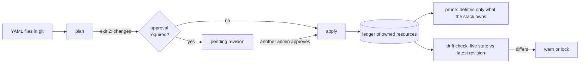

There is no state file. The control plane keeps a ledger of what each stack owns, and every step below reads live state through the ordinary API with your token.

## Files to plan

Every document is checked against the [schema](/iac/reference) first. If any document has an issue, nothing is planned. Then live state is read with your permissions and a plan is computed: create, update with a field level diff, delete (only with prune) or no change. Env values show as `(hidden)`. `levelrail-cli diff -f infra/` is a plan that exits 2 when something would change.

The plan carries a hash. The CLI, dashboard and MCP send it back so an apply proceeds only if live state still matches what was reviewed.

## Approve and apply

Apply runs each item through the existing endpoint and is safe to repeat: a re-run plans again and does only what is missing. The first failed item stops the run unless `--continue-on-error` is set. A stack can require approval, in which case an apply is stored as a pending revision until another administrator approves it. In apply mode, exit 2 then means "awaiting approval". Details: [Stacks](/stacks#approvals).

## Ledger and prune

A stack owns the resources it created or adopted. Prune deletes only owned resources the files no longer declare, and never projects or databases. A stack must allow prune, and a large delete needs an explicit confirmation. Things made by hand, or by another stack, are never touched. See [Ownership and prune](/stacks#ownership-and-prune).

## Drift

A checker plans each stack's latest revision against live state on a timer. A difference is recorded and raises an attention item (`warn`), or also refuses manual edits to owned resources (`lock`). See [Drift](/stacks#drift).

## Values per environment

`${{ env.NAME }}` placeholders are filled at apply time, in this order: `--var`, `--values FILE`, `--var-file`, then names allowed with `--allow-env`. The control plane never reads its own environment for them. Secrets are never in the files: refer to them with `secretRef` and pass values with `--secret`. See [Platform as code](/platform-as-code#secrets).

## Exit codes

| Code | Meaning |
| --- | --- |
| 0 | No changes, or the changes were applied |
| 1 | An error: invalid files, a failed or denied item, an unreachable server |
| 2 | Changes are pending (`diff`, `--dry-run --exit-code`), or in apply mode a revision awaits approval |

Error codes on plan items and API errors are listed in [IaC errors](/iac/errors).
