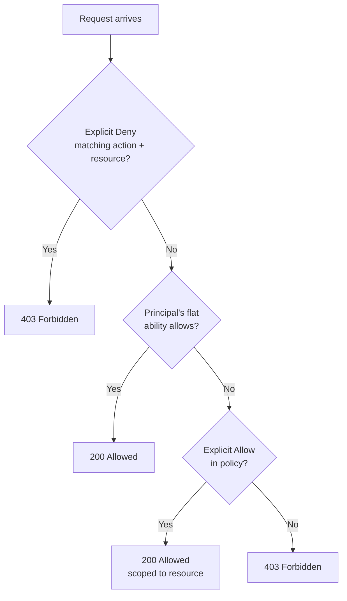
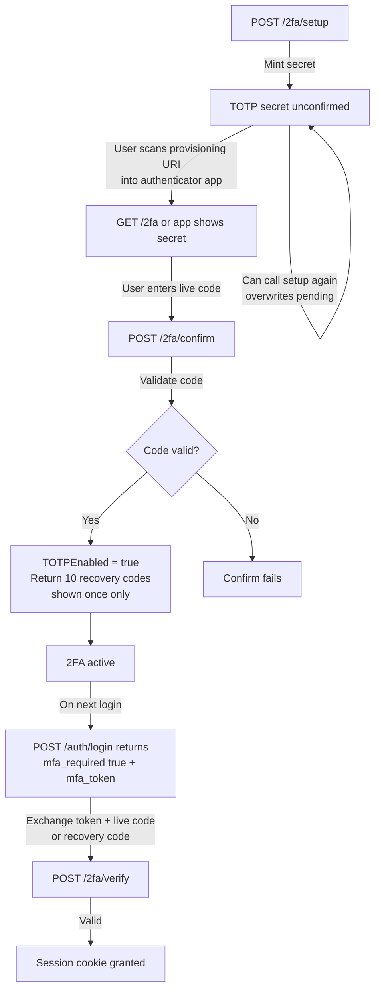
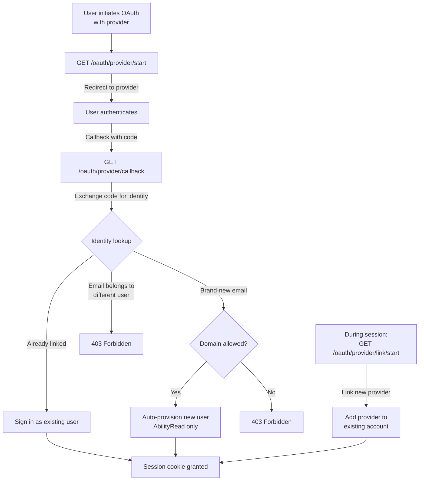

This page covers who can sign in, what they can do once they are in, and the record of what they did. You can add a teammate with a role or invite them by email, scope a CI token down to one app, turn on two-factor auth, passkeys, OAuth or sign-in codes, and review who changed what in the audit log.

Start with [Common tasks](#common-tasks). The sections after it explain how each mechanism behaves.

<Accordion title="For contributors: where this lives in the source">
- Backend: `internal/api/{auth,users,roles,abilities,iam,iam_handlers,invites,tokens,twofactor,oauth,oauth_settings,device_auth,audit,audit_retention}.go`
- CLI: `cmd/levelrail-cli/{users,iam,invites,tokens,auth}*.go`
- Dashboard: `web/src/routes/settings/{users,iam-policies,security,tokens,oauth,cli-access,audit-log}.tsx`
- OAuth sign-in decision logic: `completeOAuthSignin` in `internal/api/oauth.go`
</Accordion>

## Common tasks

<Steps>
<Step title="Bootstrap the first admin">

Do this once, before anyone can sign in. Without these variables the control plane prints a one-time setup token instead (see [Bootstrap](#bootstrap-exactly-one-path-to-the-first-admin)).

<CodeGroup>
```bash Environment
export APP_ADMIN_USERNAME=admin@example.com
export APP_ADMIN_PASSWORD='a-real-password'
# restart the control plane
```
```bash Verify with curl
curl -s -c cookies.txt -X POST https://your-control-plane/api/v1/auth/login \
  -H 'Content-Type: application/json' \
  -d '{"username":"admin@example.com","password":"a-real-password"}'
```
</CodeGroup>

</Step>
<Step title="Create a teammate with a curated role">

No hand-picked abilities needed.

```bash
levelrail-cli users create --email ops@example.com --password 'temporary-pw' --role operator
```

```json
{ "id": "user_abc123", "email": "ops@example.com", "role": "operator", "abilities": ["read", "read:sensitive", "write", "deploy"], ... }
```

</Step>
<Step title="Invite a teammate by email">

The invitee sets their own password.

```bash
levelrail-cli invites create --email priya@example.com --role viewer
```

```json
{ "id": "inv_1", "email": "priya@example.com", "role": "viewer", "link": "https://your-control-plane/accept-invite?token=...", "expires_at": "..." }
```

</Step>
<Step title="Scope a CI token down to one app">

Use an IAM policy, which is tighter than any flat role can express.

<CodeGroup>
```bash Create token
levelrail-cli tokens create --name "ci-checkout" --abilities deploy
# token tok_xyz, plaintext shown once
```
```bash Create policy
levelrail-cli iam policies create --name "checkout-only" \
  --document '{"Statement":[{"Effect":"Allow","Action":["deploy"],"Resource":["app:checkout"]}]}'
# policy pol_abc
```
```bash Attach policy to token
levelrail-cli iam policies attach pol_abc --principal-type token --principal-id tok_xyz
```
</CodeGroup>

That token can now deploy `checkout` even without a global `deploy` ability. To block a resource a broader role would otherwise allow, write an `Effect: "Deny"` statement instead.

<Tip>
Check the result before relying on it: `levelrail-cli iam simulate --principal token:tok_xyz --action deploy --resource app:checkout` asks the platform's real evaluator and changes nothing.
</Tip>

</Step>
<Step title="Turn on two-factor auth">

Run this as the signed-in account.

<CodeGroup>
```bash Setup
levelrail-cli auth 2fa setup
# secret + otpauth:// provisioning URI, scan it into an authenticator app
```
```bash Confirm with TOTP code
levelrail-cli auth 2fa enable --code 123456
# 10 recovery codes, shown once, store them somewhere safe
```
</CodeGroup>

</Step>
<Step title="Log the CLI in with the device-code flow">

Use this from a machine with no direct HTTPS access to the control plane. It works over plain HTTP.

```bash
levelrail-cli auth login --device
# prints a user_code and a URL; approve it from
# /settings/cli-access on a browser that already has a session
```

</Step>
<Step title="Review who changed what">

```bash
levelrail-cli audit-log --client-kind cli --method POST
levelrail-cli audit-log --format csv --output-file audit-export.csv
```

</Step>
</Steps>

## Why two permission models instead of one

Most self-hosted platforms pick one shape and live with its downside.

- Flat roles (admin/member/viewer) are easy to reason about but cannot express "this CI token may deploy exactly one app and nothing else."
- A full IAM policy engine can express that, but it is overkill for "give Priya everything, give the contractor read-only."

This platform keeps both, layered:

| Layer | What it is |
| --- | --- |
| Abilities | A flat vocabulary every user and every API token carries directly: `read`, `read:sensitive`, `write`, `write:sensitive`, `deploy`, `root`. |
| Roles | Named presets over the same ability list: `admin`, `operator`, `viewer`, plus custom roles (see [Access control](/access-control)). A convenience for the common case, never a second storage location for permissions. |
| IAM policies | Optional, additive documents of Allow/Deny statements scoped to one resource (`app:web`, `database:main`, or `*`). Attach to a user or token to grant or revoke access to a specific app without changing its ability list. |

Evaluation: an explicit Deny in an attached policy always wins, even over `root`. Everything else falls back to the flat abilities exactly as if no policy existed.

## How it actually works

### Principals: a session, or a token

Every gated route resolves the request to exactly one principal before deciding anything: a session cookie (mapped to a `store.User` row) or a bearer token (with its own stored `Abilities`).

**Sessions**

Sessions are an in-memory map keyed by an opaque token (`sessionStore`), with a TTL of 24h by default (overridable with `APP_SESSION_TTL`, a Go duration string). A restart clears every live session (an accepted tradeoff for a single-node control plane).

**Session cookie security**

The session cookie's `Secure` flag follows the request: it is set when the request arrived over TLS, or through the embedded Caddy ingress (a loopback peer sending `X-Forwarded-Proto: https`). `X-Forwarded-Proto` from any other peer is ignored, so a remote client cannot spoof it. A fresh install reached at `http://<server-ip>:8080` therefore works out of the box, and the dashboard shows a persistent "connection is not encrypted" banner until you move to HTTPS.

Once you set an `https://` **dashboard URL** (Domains page, `levelrail-cli settings dashboard-url set --url https://...`, or `PUT /api/v1/settings/dashboard-url`), sign-in over plain HTTP is refused with a `403` pointing at that URL. This covers password login, 2FA verification, and invite acceptance. An `https://` URL can only be saved from a request that already arrived over HTTPS (or from the server itself), so saving it cannot lock you out.

<Warning>
If the https URL breaks later, set `APP_ALLOW_INSECURE_LOGIN=true` on the control plane and restart it to recover.
</Warning>

### Abilities and roles

| Ability | Grants |
| --- | --- |
| `read` | View apps, logs, metrics, deploy history |
| `read:sensitive` | View secrets and other private config |
| `write` | Change config, restart, manage domains and env vars |
| `write:sensitive` | Rotate secrets |
| `deploy` | Trigger a deploy |
| `root` | Everything. Exclusive: combining `root` with anything else is rejected at validation time |

Tokens can additionally carry `signin:approve`, which is never implied by any other ability. See [The `signin:approve` ability](#sign-in-with-a-code).

A built-in role sets a principal's `Abilities` to one of three fixed sets in one action:

| Role | Abilities |
| --- | --- |
| `admin` | `root` |
| `operator` | `read`, `read:sensitive`, `write`, `deploy` |
| `viewer` | `read` |

`GET /api/v1/roles` lists the roles; a user or token row does not remember "I was created via the operator role." Custom roles are managed with `levelrail-cli roles` (see [Access control](/access-control)). The dashboard and CLI show a `role` for display by matching a principal's abilities against the presets; anything that doesn't match exactly shows as "custom," which is expected, not an error state.

### IAM policies: Allow/Deny over a resource

A policy document uses AWS IAM's shape, hand-typed or generated:

```json
{
  "Statement": [
    { "Effect": "Allow", "Action": ["deploy"], "Resource": ["app:checkout"] },
    { "Effect": "Deny", "Action": ["write:sensitive"], "Resource": ["*"] }
  ]
}
```

| Field | Values |
| --- | --- |
| `Action` | Ability strings or `*` |
| `Resource` | `app:<name>`, `database:<name>`, `node:<id>`, `environment:<id>`, `environment-kind:<kind>`, or `*`. A trailing `*` matches as a prefix (`app:*` matches every app). |

**Evaluation order** (`authorizeResource`, `internal/api/iam.go`)

Checked on every mutating or sensitive route scoped to a specific app or database (get, update, delete, deploy, rollback, restart, clone, exec, secrets, tags, domain config, backups, and so on):



1. An explicit Deny matching the ability and resource, in any attached policy, always wins, even for a `root` principal.
2. Otherwise, the principal's own flat abilities decide, unchanged from having no policies attached.
3. Otherwise, an explicit Allow in an attached policy can still grant access the flat abilities don't, scoped to that one resource.

**Attachment.** A policy attaches to a `user` or a `token` (`principal_type`), by that principal's id. A malformed stored document can never grant or deny anything; it is treated as if it doesn't mention the pair being checked.

**Lists.** A Deny policy on `app:<name>` hides that app from `GET /api/v1/apps`, `apps-summary`, `apps-metrics`, deployments, certificates (including the auto-generated `sslip.io` hostname), `GET /api/v1/network/topology` (apps and databases) and the container names in `GET /api/v1/system/containers`, and returns `403` on every `/apps/{name}/...` route.

**References in a request body or query.** The same check applies to a resource a request names outside its path: a database attached by name, a target environment or node, a promotion target, a compose or deploy-spec service name that already belongs to another app, a git source's additional services, a pipeline step that deploys another app, a standalone domain pointing at an app, or an `?app=` filter. A refused reference answers exactly like an unknown one, so the response never confirms that a hidden resource exists. Server-computed fan-outs (environment clone, protect-all, cutover reports, restore drills) skip resources the caller cannot see instead of failing. `internal/api/body_ref_authz_guard_test.go` fails the build when a handler reads such a field without one of these checks.

**Test before you trust.** `iam simulate` answers "can this principal do this on this resource" with the real evaluator, `iam effective` shows everything a principal can do grouped by ability, `iam analyze` runs static checks over every policy, and `iam templates` creates ready-made policies. A newly attached Deny takes effect on the very next request.

`test/e2e/iam_policy_enforcement_test.go` covers this end to end: it drives a real admin session through the real HTTP API to mint a user and a token, attach Deny and Allow policies, and confirm the resulting 403 and 200 responses.

### Bootstrap: exactly one path to the first admin

On startup, `BootstrapAdmin` creates a user from `APP_ADMIN_USERNAME` and `APP_ADMIN_PASSWORD` only if zero users exist. It is a no-op on later restarts, so a password change doesn't get silently reverted.

Without those env vars and with no user yet, the control plane generates a one-time setup token, writes it to `<data dir>/setup-token` (mode `0600`), and logs it once.

- `GET /api/v1/auth/setup-status` (public) returns `{"needs_setup": true}` until the first admin exists, and the login page switches to its setup form on its own.
- `POST /api/v1/auth/register` requires the token in `setup_token` (constant-time compare) and deletes the file on success, so whoever reaches the dashboard first can't claim the instance without shell access to the server.
- `install.sh` prints the token and a `http://<ip>:8080/login#setup=<token>` link; `sudo APP_DATA_DIR=/var/lib/levelrail-data levelrail setup-token` prints it again (`docker compose exec levelrail levelrail setup-token` for a compose install).

`POST /api/v1/auth/register` is gated at the database layer to succeed exactly once (a unique constraint, not an application check), so concurrent first-registration attempts cannot create two "first" admins. Either path grants `AbilityRoot` because no one else exists yet.

<Tip>
Development only: `APP_DEV_MODE=1` seeds a fixed `dev`/`dev` admin for local development. Never use it in a real deployment.
</Tip>

**Subsequent users.** Every user after the first is created by an existing root user, either directly (`POST /api/v1/auth/users`) or via an accepted invite.

<Note>
A root user cannot edit their own abilities or delete their own account, and the last remaining user can never be deleted. Both return a hard 400, not a warning.
</Note>

### Two-factor authentication (TOTP)

Requires a master key configured on the control plane (`internal/secrets`). Without one, every 2FA route returns `501`.



1. `POST /api/v1/auth/2fa/setup`: mint a fresh TOTP secret and store it unconfirmed. Calling it again before confirming overwrites the pending secret.
2. `POST /api/v1/auth/2fa/confirm`: validate one live code, flip `TOTPEnabled`, and return 10 recovery codes in plaintext. This is the one and only time they are shown.
3. On login, `POST /api/v1/auth/login` returns `mfa_required: true` plus a short-lived `mfa_token` (5 minutes) instead of a session. Exchange it with a live code (or a recovery code) via `POST /api/v1/auth/2fa/verify` for the session cookie.

**Disabling and recovery codes.** `POST /api/v1/auth/2fa/disable` re-verifies the second factor itself, not the account password, because a password-only re-check would undermine 2FA. Regenerating recovery codes invalidates the entire previous set.

**Single-use codes.** A TOTP code is accepted once. The control plane remembers the newest time step it accepted for each user (`users.totp_last_step`, migration `0350`), so a code that was just used or replayed inside its roughly 90 second validity window is refused with `invalid code`. The check is atomic, so two simultaneous logins presenting the same code cannot both pass. The step is claimed at login (`/2fa/verify`), not at `/2fa/confirm`, so the code you enrol with can still be used once to sign in. Recovery codes are single-use too.

**Rate limiting.** Both the login-time verify step and every setup/confirm/disable call are rate limited (exponential backoff with a handful of free failures), separately from the password rate limiter.

### Passkeys (WebAuthn)

Sign in with Touch ID, Windows Hello, or a security key instead of a password. No master key required: a credential's public key is ordinary key material, not a secret, so it never goes through `internal/secrets`.

| Action | Endpoints |
| --- | --- |
| Register (needs an existing session) | `POST /api/v1/auth/passkeys/register/begin`, then `.../register/finish` |
| List own credentials | `GET /api/v1/auth/passkeys` |
| Revoke | `DELETE /api/v1/auth/passkeys/{id}` |
| Sign in | `POST /api/v1/auth/passkey-login/begin`, then `.../finish` |

Passkey sign-in works two ways. Username-first: the operator types a username and the browser's passkey prompt proves possession. Usernameless: the sign-in page offers **Sign in with a passkey** (and, where the browser supports conditional UI, lists saved passkeys in the username field's autofill), so no username is typed. The usernameless call is `POST /api/v1/auth/passkey-login/begin` with `{"discoverable": true}`; the finish call is the same. It uses the same single-use challenges, rate limits and approval policy as username-first sign-in, and every failure at the finish step returns the same `401` whatever the reason (bad signature, unknown credential, disabled account), so it cannot be used to find out which accounts exist. New passkeys are registered with `residentKey: preferred`, so authenticators that can store a discoverable credential do; a key that cannot (some older security keys) still works username-first. The passkey list shows whether each credential is synced or bound to one device, but not whether it is discoverable, because the sign-in library does not report that. There is no CLI verb for usernameless sign-in: it needs a browser's WebAuthn prompt. A successful passkey sign-in completes the session the same way a password does, without an additional TOTP prompt even if the account has 2FA enabled (the same shape OAuth sign-in has).

Every registration and login challenge is single-use and expires in 5 minutes. The relying party ID and origin are derived from the request's own `Host` header, since there is no single fixed domain to configure on a self-hosted platform.

### OAuth sign-in

Eighteen providers are supported. Group to role mapping, account creation policy, allowed domains and sign-in by email domain are covered in [OAuth and OIDC single sign-on](/sso-oidc) (beta). Every one uses the same callback URL shape, `https://<your-dashboard-host>/api/v1/auth/oauth/<provider>/callback`, and the same flow: PKCE, single-use state, an envelope-encrypted client secret, and the link-account flow below.

| Provider | Where to create the OAuth app | Scopes requested |
| --- | --- | --- |
| `google` | Google Cloud console, APIs and Services, Credentials, OAuth client ID (web application). | `openid email profile` |
| `github` | GitHub, Settings, Developer settings, OAuth Apps. | `read:user user:email` |
| `microsoft` | Microsoft Entra admin center, App registrations (common multi-tenant endpoint). | `openid email profile User.Read` |
| `gitlab` | GitLab, User settings, Applications (set "Confidential", tick `openid`, `profile`, `email`). | `openid email profile` |
| `bitbucket` | Bitbucket, Workspace settings, OAuth consumers (grant Account: Read and Email). | `account email` |
| `discord` | Discord Developer Portal, Applications, OAuth2. | `identify email` |
| `slack` | api.slack.com/apps, your app, OAuth and Permissions (Sign in with Slack). | `openid email profile` |
| `linkedin` | LinkedIn Developer Portal, your app, Products (add "Sign In with LinkedIn using OpenID Connect"). | `openid email profile` |
| `twitch` | Twitch Developer Console, Applications, Register Your Application (client type Confidential). | `openid user:read:email` |
| `facebook` | Meta for Developers, your app, Facebook Login (add the callback under Valid OAuth Redirect URIs). | `email public_profile` |
| `linear` | Linear, Settings, API, OAuth applications. | `read` |
| `vercel` | Vercel, Team settings, Apps ("Sign in with Vercel"). | `openid email profile` |
| `huggingface` | Hugging Face, Settings, Connected Apps, Create new OAuth app. | `openid profile email` |
| `figma` | Figma, Developers, My apps. | `current_user:read` |
| `salesforce` | Salesforce Setup, App Manager, New Connected App (enable OAuth, add the `openid`, `email`, `profile` scopes). | `openid email profile` |
| `codeberg` | Codeberg, Settings, Applications, Manage OAuth2 applications (confidential client). | provider default |
| `dropbox` | Dropbox App Console, Create app (scoped access, add the `account_info.read` permission). | `account_info.read` |
| `kakao` | Kakao Developers, your app, Kakao Login (enable the email consent item). | `account_email profile_nickname profile_image` |
| `patreon` | Patreon Developers, Clients and API Keys, Create Client. | `identity identity[email]` |
| `cognito` | AWS Cognito, your user pool, App integrations, app client (confidential, with a secret); needs the user pool ID. | `openid profile email` |
| `oidc` | Your identity provider's admin console; needs an issuer URL. | `openid email profile` |

For Amazon Cognito, put the **User pool ID** (for example `us-east-1_AbC123`) in the row's `issuer_url` field; the region is read from its prefix and the issuer is built from it.

For a self-hosted GitLab, set the optional **Instance URL** on the GitLab row (the `issuer_url` field over the API). It must be an `https` address, the same rule the OIDC issuer follows, and blank means gitlab.com.

Sign-in requires a verified email, so providers that cannot supply one are not offered. Apple is not supported: its client secret is a signed JWT built from a team ID, key ID and private key, which the provider settings do not hold. X is not supported: its API does not return an email address without elevated app access.

Settings are per-provider rows (`GET`/`PUT /api/v1/settings/oauth[/{provider}]`), gated at `AbilityRoot` to change. Enabling a provider requires a client ID and a client secret (OIDC also requires an issuer URL). The secret is write-only over the API; `GET` only reveals `has_client_secret`.



| Case | Result |
| --- | --- |
| Already-linked identity | Signs in as its existing owner. |
| Brand-new email | Refused with `sso_not_provisioned` unless the provider's **Create an account on first sign-in** is on (default off). When on, it creates a user with the mapped role or the default role (`viewer`), never a role that holds `root`. A root user can grant more later via `PUT /api/v1/users/{id}/abilities`. Providers that were enabled before this setting existed keep creating accounts. See [OAuth and OIDC single sign-on](/sso-oidc). |
| Email already belongs to another account | Refused outright. Auto-linking would let an anonymous sign-in take over an unrelated account. |
| Linking a provider to an existing account | Needs a live session: `GET /api/v1/auth/oauth/{provider}/link/start`. |
| `AllowedEmailDomain` set on the provider | A new signup outside that domain is refused. |

### Team invites

`POST /api/v1/invites` mints a token for one named email, with either `--role` or `--abilities`.

- Privilege check: The caller cannot invite someone with an ability they don't hold themselves. `AbilityWrite` gates the route, but that per-ability cap is the actual boundary.
- Accept link: The response always includes the plaintext accept link, whether or not SMTP is configured, so a control plane with no email is still fully usable by copy and paste.
- Acceptance: Default TTL is 7 days (`APP_INVITE_TTL`). `POST /api/v1/invites/accept` creates a normal local-password user through the same path as `POST /api/v1/auth/users`, so an invited account is indistinguishable from an admin-created one.
- Visibility: A non-root caller only sees invites they created. A root caller sees every pending invite.

<Warning>
Set the dashboard URL before inviting people by email. The link is absolute only when the control plane knows its own origin: the primary domain if one is set, otherwise the dashboard URL (Domains page, or `levelrail-cli settings dashboard-url set`). With neither, the link is a bare path (`/accept-invite?token=...`) that only works if pasted after the dashboard's address. The request's `Host` header is never used to build the link. The password reset email follows the same rule.
</Warning>

`GET /api/v1/users` follows the same visibility idea: a `root` caller lists every account, any other caller (a `viewer`, an `operator`, a scoped token) gets only their own record, or an empty list for a token. Emails and ability sets of colleagues are not visible to read-tier callers.

### API tokens

Scoped, revocable bearer credentials for the CLI, CI, and MCP integrations. Minted with the same ability vocabulary users carry, plus an optional expiry (`expires_in_days`, 0 means never). The plaintext is returned exactly once at creation; every later read (`GET /api/v1/auth/tokens`) shows only metadata. The security policy can cap the lifetime of new tokens and disable tokens that go unused, after a notice: see [API token hygiene](/security-center#api-token-hygiene).

**Session-only management.** Creating and revoking tokens is deliberately session-only, never bearer-token authenticated: a token can never mint or revoke another token. This is why the CLI's `tokens create`/`revoke` and `auth login` prompt for username and password instead of accepting `--token`. Listing metadata (`GET /api/v1/auth/tokens`) also accepts a bearer token that holds `root`.

**Device-code flow.** `POST /api/v1/auth/device/start` and `/token` (`levelrail-cli auth login --device`) sidestep the plain-HTTP session-cookie gap.

- The CLI polls with a random device code.
- An operator approves it from the dashboard's CLI Access page (`/settings/cli-access`) using their existing session.
- The resulting token inherits exactly that operator's abilities. The CLI never picks the permissions.

**Rotating a CLI token.** The command center and the CLI Access page offer Rotate on tokens a CLI sign-in created. It revokes the current token (`DELETE /api/v1/auth/tokens/{id}`), so that CLI stops working, then shows a fresh one-time pairing command to run on the CLI. Nothing rotates automatically, and the old token is never shown.

**Dev fixture tokens.** When the server runs with `APP_DEV_MODE=1` in a non-release build, the tokens seeded from `test/fixtures/dev-fixtures.yml` carry `dev_fixture: true` in `GET /api/v1/auth/tokens`. They have publicly known secrets, are reseeded on every dev-mode start while they stay in the fixtures file, and are never created in release builds, where `dev_fixture` is never set. The CLI Access page lists them in a collapsed group below your real tokens.

### Session links

A session link is a one-time login URL, not a credential you type. Mint one from an authenticated context and hand the URL to whatever needs to sign in next: CI, an AI agent driving the dashboard through browser automation, or a fresh incognito window. Opening it signs that browser in immediately.

`POST /api/v1/auth/session-links` mints one. It is gated `root`, because the link is root-equivalent: anyone who gets hold of the token before it's used can sign in as whoever minted it.

<Tabs>
<Tab title="CLI">

```bash
levelrail-cli auth session-link
# prints the ready-to-open URL and nothing else
```

</Tab>
<Tab title="API">

```bash
curl -s -X POST https://your-control-plane/api/v1/auth/session-links \
  -H "Authorization: Bearer $TOKEN"
```

```json
{ "token": "st_...", "url": "https://your-control-plane/login?session_link=st_..." }
```

Open the `url` in a browser. `/login?session_link=<token>` consumes the token on page load (`POST /api/v1/auth/session-links/consume` with the token in the JSON body, public, gated by possession of the token; the old `GET .../{token}/consume` form answers 405) and establishes a session, the same way a normal login does.

</Tab>
</Tabs>

**Security model**

- Short-lived: The token expires 2 minutes after minting (default, `APP_AUTH_ENGINE_SESSION_LINK_TTL`), whether or not it's used.
- Single-use: Consuming it is an atomic claim; if two requests race on the same token, at most one succeeds and the other gets the same "invalid or expired" error a stale token would.
- Can't escalate: The session carries exactly the minting identity's own abilities, snapshotted at mint time. Minting already requires `root`.
- A link minted on behalf of an API token (rather than a logged-in user) produces a session pinned to that token's ability snapshot. Revoking the token afterward does not end a session already established from it, the same way revoking a token never ends sessions a user already has open.

### Sign in with a code

The sign-in page offers Sign in with a code instead. You type your username or email and get a one-time code you type back in, no password.

<Steps>
<Step title="Request">
`POST /api/v1/auth/login-code/request` always answers `202` with the same message and takes at least `APP_LOGIN_CODE_MIN_RESPONSE` (default 300ms), whether the account exists, may use codes, or not. An account that cannot get a code still gets a decoy challenge, so redeeming behaves the same way too.
</Step>
<Step title="Bind to the browser">
The response sets an httpOnly, `SameSite=Strict` cookie bound to that browser. The code only works together with that cookie, so a code read over someone's shoulder is useless in another browser.
</Step>
<Step title="Read the code">
The code goes to the account's own open dashboard sessions (a banner on every page, the [attention center](/attention-center), and **Settings > Security**), each showing the requester's IP address, browser and time, and to the account's email when email is set up. Run `levelrail-cli auth code` to print it from a terminal.
</Step>
<Step title="Redeem">
`POST /api/v1/auth/login-code/redeem` with the code signs the browser in. If the account has two-factor authentication on, the code replaces only the password: the response asks for the TOTP or a recovery code next, exactly like a password sign-in.
</Step>
</Steps>

**Properties**

- 8 characters from a 32 symbol alphabet with no lookalikes (Crockford base32), from `crypto/rand`. Dashes, spaces, lower case and `O`, `I`, `L` typed for `0`, `1`, `1` are accepted.
- Single use, stored only as an HMAC keyed with a per-challenge salt and, when the control plane has its encryption key, a server secret, so a copy of the database alone cannot test guesses. Compared in constant time. The plaintext lives in control plane memory until used or expired; after a restart a waiting code can no longer be shown, so ask for a new one.
- The requester's browser is shown as a short label such as "Firefox on Linux", built from a fixed list of names. The raw User-Agent text never reaches an email or the dashboard.
- The request, redeem and poll routes accept only `Content-Type: application/json` and refuse a cross-site `Origin` or `Sec-Fetch-Site`.
- Codes never appear in logs, the audit log, the attention feed or any list endpoint. The only route that returns one is `POST /api/v1/auth/sign-in-requests/codes/{id}/reveal`, for the account's own session or a token owned by that user that holds `signin:approve`, and each reveal is audited.

**Limits and defaults**

| Setting | Default | Meaning |
| --- | --- | --- |
| `APP_LOGIN_CODE_TTL` | 10 minutes | How long a code is valid |
| `APP_LOGIN_CODE_MAX_ATTEMPTS` | 5 | Wrong tries before the challenge dies (reserved before comparison, so parallel guesses cannot exceed it) |
| `APP_LOGIN_CODE_RATE_PER_IP_PER_MINUTE` | 5 | Requests per IP |
| `APP_LOGIN_CODE_RATE_PER_ACCOUNT_PER_MINUTE` | 3 | Requests per account (keyed by the typed name) |
| `APP_LOGIN_CODE_RATE_GLOBAL_PER_MINUTE` | 60 | Requests overall |
| `APP_LOGIN_CODE_REDEEM_RATE_PER_IP_PER_MINUTE` | 10 | Redeem attempts per IP |
| `APP_LOGIN_CODE_MAX_LIVE` | 3 | Codes asked for by strangers that wait per account |
| `APP_LOGIN_CODE_EMAILS_PER_ACCOUNT_PER_HOUR` | 4 | Emails per account per hour |

A zero or negative value falls back to its default instead of switching the protection off.

<Accordion title="Rate-limit and live-code details">

- A request spends from the rate budgets only when all of them have room, so requests refused by one limit never drain another.
- A browser already signed in to the account, or trusted for it, draws from its own account budget, so a stranger typing your name cannot use it up.
- Past `APP_LOGIN_CODE_MAX_LIVE`, a new stranger request expires the oldest, so nobody can hold the slots and keep the owner out. Only the first live code is emailed.
- A request from a browser already signed in to, or trusted for, the account skips the live-code cap and is always emailed, within the hourly email budget.
- The attention center shows one item per account with a count, not one per request.

</Accordion>

**The `signin:approve` ability.** A code is worth a session, so showing one needs either a signed-in session of that account or a token that holds `signin:approve`. That ability is never implied: `root`, `write:sensitive` and every device login (`levelrail-cli auth login --device`) leave it out, so a leaked CLI token cannot turn itself into a dashboard session. Users and roles can never hold it. The one exception is deciding a waiting new-browser sign-in, which an unscoped `root` token of the same user may also do (see below).

Mint such a token only from a signed-in session: **Settings > API tokens > Create token > Approve my sign-ins**, or:

```bash
levelrail-cli tokens create --name approver --abilities signin:approve --expires-in-days 30
```

Such a token must expire within `APP_SIGNIN_APPROVE_TOKEN_MAX_DAYS` (default 30) days and cannot be an agent token. It is revoked when the account's password is changed or reset, when it signs out its other sessions, and by `recover-admin` (audited as `new_device.approver_tokens_revoked`). Listing waiting requests and managing trusted browsers still accept `write:sensitive`.

**Who may use codes.** The `auth.code_login` setting decides: **Settings > Security**, `levelrail-cli auth code-login`, or `PUT /api/v1/settings/auth/code-login` (root). It is off for admin (root) accounts and on for everyone else until an admin saves it; `APP_AUTH_CODE_LOGIN_ADMINS` and `APP_AUTH_CODE_LOGIN_OTHERS` change those defaults.

### New-browser approval

When a password sign-in is correct but comes from a browser without a trusted-device cookie, and the account already has a live session somewhere else, the sign-in pauses. The new browser shows a waiting screen; every other session of that account sees a banner and an attention item with the requester's IP address, browser and time, and can **Approve** or **Deny**.

A token owned by the user that holds `signin:approve` can decide too: `levelrail-cli auth code` lists the request, then `levelrail-cli auth approve <id> --match <number>` or `auth deny <id>` decides it. So can an unscoped `root` token of that same user, but only for the setup admin inside the first-login window (`APP_FIRST_LOGIN_TRUST_WINDOW`), so it unblocks a headless first run and nothing later. `login --device` tokens drop `root` unless the server runs with `APP_DEVICE_TOKEN_ALLOW_ROOT=true`, so on a default install `setup admin` followed by `login --device` does not leave a root token: either set that variable for the first run, or skip the approval entirely by signing in from the address that ran `setup admin` (see below). A root token can only approve with the number the waiting browser shows (never the password shortcut), can never reveal a code, and is refused when it is an agent token, scoped to a team, project or stack, outside the window, or owned by another account. A sign-in a root token approved opens a session but earns no 30-day trusted browser, and a password change, reset or "sign out other sessions" retires any such approval still waiting. A second sign-in attempt from the same waiting browser returns the request that is already open instead of creating another.

**First sign-in on a fresh install.** The setup admin's first password sign-in does not wait for approval, once, when all of these hold: the account is the first user, it was created within `APP_FIRST_LOGIN_TRUST_WINDOW` (a Go duration, default `30m`; `0` or any value that does not parse, such as `off` or `false`, turns this off and logs a warning), no browser is trusted yet, no live session exists other than the one `setup admin` or the setup page opened (created within `APP_FIRST_LOGIN_SETUP_SESSION_GRACE` of the account, default `2m`), and, while that setup session is still live, the sign-in comes from the same address that registered the account or carries the setup session cookie. The trust is spent atomically and recorded on the account, so two simultaneous sign-ins cannot both win and revoking the trusted browser never reopens it. That browser becomes trusted and the sign-in is audited as `new_device.first_login_trusted`. It never applies to later users, to passkey or single sign-on sign-ins, or once a trusted browser or any other session exists.

**Number matching.** The waiting browser shows a two digit number. Approving means typing that number (in the dashboard, or `--match NN` in the CLI); a wrong number denies the sign-in, so approving a prompt you did not expect does not let anyone in. The number never appears in a list, the attention feed or the CLI output, only in the waiting browser.

| Setting | Default | Meaning |
| --- | --- | --- |
| `APP_AUTH_DEVICE_APPROVAL_TTL` | 10 minutes | How long an approval waits |
| `APP_AUTH_DEVICE_APPROVAL_RATE_PER_ACCOUNT_PER_HOUR` | 6 | Approvals created per account per hour |
| `APP_AUTH_TRUSTED_DEVICE_TTL` | 30 days (90 day ceiling) | Trusted-device cookie lifetime. Browsers already trusted keep their expiry |
| `APP_AUTH_APPROVAL_SCOPE` | password only | `all_methods` also pauses passkey and OAuth/OIDC sign-ins |
| `APP_AUTH_NEW_DEVICE_APPROVAL` | on | `false` turns the pause off for everyone |

**Behavior**

- Only one approval waits per account: a new paused sign-in replaces the previous one (audited as `new_device.superseded`).
- Once approved, the waiting browser gets its session exactly once (`POST /api/v1/auth/login-approval/poll`, bound to that browser's cookie). If the paused sign-in's session cannot be revoked, the login fails with an error and no approval is created.
- Accounts with two-factor authentication on are not paused: password plus TOTP still signs in without a separate approval. Passing TOTP does not trust the browser on its own; tick **Remember this browser for N days** on the two-factor step (off by default) to trust it.
- An account with no other live session signs in as before, so the last way in is never blocked.
- Setting `auth.approval_scope` to `all_methods` (**Security center > Policy**, `levelrail-cli security policy set --approval-scope all_methods`, or `APP_AUTH_APPROVAL_SCOPE`) pauses passkey and OAuth/OIDC sign-ins from a new browser too. A held OAuth sign-in returns to the sign-in page to wait. Each account can also require approval for itself with **Require approval for new browsers on my account**. See [Security center](/security-center#approval-scope).
- A sign-in from a browser and network the account has not used before emails the owner a single-use **this wasn't me** link that signs that session out, drops trusted browsers and flags the account for a new password. See [New sign-in alerts](/security-center#new-sign-in-alerts).

**Trusted browsers.** An approved browser, or one that signed in with a code, gets a trusted-device cookie: a random token stored only as a hash. Signing in again from that browser extends the same entry instead of adding one, and its next password sign-in goes straight through. Revoke one under **Settings > Security > Trusted browsers** or with `levelrail-cli auth devices revoke <id>`.

**Sign in the CLI from the dashboard.** The first thing a new user does is sign the CLI in, so there are two guided paths, both safe against a stolen password:

- *Pairing code.* The dashboard home shows a **Connect your CLI** card (`POST /api/v1/auth/cli-pairing`). It prints `levelrail-cli login --api-url <url> --code XXXX-XXXX`. The code has 40 bits of entropy, lives `APP_CLI_PAIRING_TTL` (default 5 minutes, 15 maximum), works once, and only a signed-in browser session can ask for it: a bearer token, a session link or an anonymous caller cannot. Only its SHA-256 is stored. Asking for a new code, changing or resetting the password, or signing out other sessions revokes the older ones. Redeeming it (`POST /api/v1/auth/cli-pairing/redeem`) is rate limited per IP (`APP_CLI_PAIR_PER_MINUTE`, default 10) and per code (5 wrong guesses burn it), and every refusal looks the same. The token it mints carries the account's abilities except `root`, like a device login, never `signin:approve`, and expires like a device token.
- *Approval.* A password sign-in from a new device prints the page to approve it on (`/approve-sign-in`, which also appears as a card on the dashboard home within seconds), the number to type, a countdown and how to cancel. The CLI waits `--approval-timeout` (default 3 minutes, `APP_LOGIN_APPROVAL_TIMEOUT`), backing off between polls, and opens the page with `--open` at a desktop terminal. Without a terminal it fails at once with the fix unless `--wait` is set.

A password alone never signs in a new device while another session of the account is live, and a pairing code is useless without a signed-in session that issued it. Audit actions: `cli_pairing.created`, `cli_pairing.paired`, `cli_pairing.failed` (never the code itself), `cli_pairing.revoked`, plus the existing `new_device.*` entries for approvals.

Every trusted browser of an account is revoked when its password is changed or reset, when it signs out its other sessions, when `recover-admin` resets it, and when the user is deleted. The same events, plus turning two-factor authentication off or removing a passkey, also cancel the account's waiting approvals (approved ones not yet collected included) and lock its live sign-in codes. Expired entries are removed by the periodic sweep.

<Warning>
Break-glass: if you are stuck waiting for an approval no one can give, sign in with a code sent to your email, approve from the CLI with a `signin:approve` token, sign out the other session, or wait for it to expire. As a last resort set `APP_AUTH_NEW_DEVICE_APPROVAL=false` on the control plane and restart it, which turns the pause off for everyone and for every sign-in method, whatever `auth.approval_scope` and the per-account switches say. `recover-admin` on the server still works.
</Warning>

<Accordion title="Sign-in audit event names">

Every step writes one audit row with a stable action, never the code: `login_code.requested`, `login_code.delivered` (email at send time, dashboard or CLI at each reveal), `login_code.redeemed`, `login_code.failed`, `login_code.locked`, `login_code.expired`, `new_device.requested`, `new_device.approved`, `new_device.denied`, `new_device.expired`, `new_device.superseded`, `new_device.first_login_trusted`, `new_device.trust_revoked` and `new_device.approver_tokens_revoked`.

The security center adds its own `security.*` events, listed in [Security center](/security-center#audit-events). Requests from someone who is not signed in are recorded with the actor `Sign-in` and the target user id when the account exists.

</Accordion>

### Account lifecycle

Disabling, forced password changes and deletion run through the sign-in library, so each takes effect in one place:

- **Disabled** accounts (today set by [SCIM](/scim) deprovisioning) are refused by every sign-in method, and disabling revokes their sessions, API tokens and remembered devices in the same call. The Users page marks them **Disabled**.
- **Require password change** (Users page, or `levelrail-cli users require-password-change <id>`) ends the user's sessions at once. Every sign-in is then refused with "a password change is required" until the user sets a new password with forgot password on the sign-in page; `--off` clears it. It is refused for your own account and for accounts without a password.
- **Remove** deletes the account and, through the library, every session, API token, passkey, TOTP secret, linked identity and directory membership it had.

### Audit log

Every request gated above `AbilityRead` (write, deploy, root-tier, and `read:sensitive`) gets one row:

| Field | Notes |
| --- | --- |
| Actor | Type, id, and resolved display name |
| Ability | The ability checked |
| Request | HTTP method, path, and status code |
| Remote address | Caller address |
| Timestamp | When the request completed |
| Caller surface | `cli`, `dashboard`, `mcp`, or `api`, sniffed from `User-Agent` |

Recording is best-effort and runs after the real request completes. A failed audit write is logged and dropped, never turned into a failed request.

**Query.** `GET /api/v1/audit-log` is cursor-paginated (`?before`, an RFC3339 timestamp) and filterable by `?path`, `?method`, `?client_kind`, and `?agent` (the agent label of the token, see [AI assistant](/ai-assistant#agent-identity)). Use `?format=csv` to return rows as a downloadable attachment for compliance export. Cells that start with `=`, `+`, `-`, `@` or a tab get a leading `'` in the CSV, so a token named `=HYPERLINK(...)` is not evaluated as a formula when the export is opened in a spreadsheet.

**Retention.** Defaults to 90 days (`APP_AUDIT_LOG_RETENTION_DAYS`). Sign-in, step-up, token and policy events, secret reveals and exports, and reads of env or secret routes (action `sensitive_read`) are kept longer: 365 days by default (`APP_AUDIT_LOG_SECURITY_RETENTION_DAYS`, never shorter than the general window). The system sweeps automatically on an interval (`APP_AUDIT_LOG_SWEEP_INTERVAL`) and is purgeable on demand via `POST /api/v1/audit-log/purge`.

**Tamper evidence.** Every row is chained to the one before it with an HMAC under a random key that is wrapped by the master key, and a signed checkpoint is written every 64 rows. `levelrail-cli audit-verify` (or the badge on the audit log page, or `GET /api/v1/audit-log/verify`) reports rows that were edited, removed or cut off the end, and exits 1 on a failure. Purging keeps a compact link for each removed run, so retention does not break the chain. Rows written before the upgrade are not chained.

**Streaming to a SIEM.** Stream the log to Splunk, syslog or an OpenTelemetry collector with [data export](/data-export#splunk-syslog-and-opentelemetry-sinks). Every event carries `chain_seq`, `chain_prev`, `chain_hash` and `chain_alg`, so a receiver can check that sequence numbers are contiguous and that each `chain_prev` equals the previous row's `chain_hash`. Recomputing a hash needs the wrapped chain key and the full row, so run `levelrail-cli audit-verify` on the control plane for a complete check. Fields are listed in [Audit event schema](/audit-event-schema).

**Secret values.** Values the secrets manager has stored or handed out are masked in audit rows, deploy and build logs, container log storage and the control plane's own log. A value shorter than 8 characters is not masked.

## API reference

<AccordionGroup>
<Accordion title="Sessions and account">

| Method | Path | Ability |
| --- | --- | --- |
| `POST` | `/api/v1/auth/register` | public (first user only, setup token required) |
| `GET` | `/api/v1/auth/setup-status` | public |
| `POST` | `/api/v1/auth/login` | public |
| `POST` | `/api/v1/auth/logout` | session |
| `GET` | `/api/v1/auth/whoami` | session or bearer token |
| `GET` | `/api/v1/auth/session` | session |
| `PUT` | `/api/v1/auth/password` | session |
| `POST` | `/api/v1/auth/sessions/revoke-others` | session |

</Accordion>
<Accordion title="Two-factor authentication">

| Method | Path | Ability |
| --- | --- | --- |
| `GET` | `/api/v1/auth/2fa` | session |
| `POST` | `/api/v1/auth/2fa/setup` | session |
| `POST` | `/api/v1/auth/2fa/confirm` | session |
| `POST` | `/api/v1/auth/2fa/disable` | session |
| `POST` | `/api/v1/auth/2fa/recovery-codes/regenerate` | session |
| `POST` | `/api/v1/auth/2fa/verify` | public (mfa_token required) |

</Accordion>
<Accordion title="Passkeys">

| Method | Path | Ability |
| --- | --- | --- |
| `GET` | `/api/v1/auth/passkeys` | session |
| `POST` | `/api/v1/auth/passkeys/register/begin` | session |
| `POST` | `/api/v1/auth/passkeys/register/finish` | session |
| `DELETE` | `/api/v1/auth/passkeys/{id}` | session |
| `POST` | `/api/v1/auth/passkey-login/begin` | public |
| `POST` | `/api/v1/auth/passkey-login/finish` | public |

</Accordion>
<Accordion title="OAuth sign-in">

| Method | Path | Ability |
| --- | --- | --- |
| `GET` | `/api/v1/auth/oauth/providers` | public |
| `GET` | `/api/v1/auth/oauth/{provider}/start` | public |
| `GET` | `/api/v1/auth/oauth/{provider}/callback` | public |
| `GET` | `/api/v1/auth/oauth/{provider}/link/start` | session |
| `GET` | `/api/v1/settings/oauth` | `read` |
| `PUT` | `/api/v1/settings/oauth/{provider}` | `root` |

</Accordion>
<Accordion title="Device login (CLI)">

| Method | Path | Ability |
| --- | --- | --- |
| `POST` | `/api/v1/auth/device/start` | public |
| `POST` | `/api/v1/auth/device/token` | public |
| `GET` | `/api/v1/auth/device/requests` | session |
| `POST` | `/api/v1/auth/device/{user_code}/approve` | session |
| `POST` | `/api/v1/auth/device/{user_code}/deny` | session |

</Accordion>
<Accordion title="Sign-in codes, approvals and trusted browsers">

| Method | Path | Ability |
| --- | --- | --- |
| `POST` | `/api/v1/auth/login-code/request` | public |
| `POST` | `/api/v1/auth/login-code/redeem` | public (code + cookie required) |
| `POST` | `/api/v1/auth/login-approval/poll` | public (browser cookie required) |
| `GET` | `/api/v1/auth/sign-in-requests` | session, or token with `write:sensitive` |
| `POST` | `/api/v1/auth/sign-in-requests/codes/{id}/reveal` | session, or token with `signin:approve` |
| `POST` | `/api/v1/auth/login-approvals/{id}/approve` | session, or token with `signin:approve`, or unscoped root token of the same user |
| `POST` | `/api/v1/auth/login-approvals/{id}/deny` | session, or token with `signin:approve`, or unscoped root token of the same user |
| `GET` | `/api/v1/auth/trusted-devices` | session, or token with `write:sensitive` |
| `DELETE` | `/api/v1/auth/trusted-devices/{id}` | session, or token with `write:sensitive` |
| `GET` | `/api/v1/settings/auth/code-login` | `read` |
| `PUT` | `/api/v1/settings/auth/code-login` | `root` |

</Accordion>
<Accordion title="Users and roles">

| Method | Path | Ability |
| --- | --- | --- |
| `POST` | `/api/v1/auth/users` | `root` |
| `GET` | `/api/v1/users` | `read` |
| `PUT` | `/api/v1/users/{id}/abilities` | `root` |
| `DELETE` | `/api/v1/users/{id}` | `root` |
| `PUT` | `/api/v1/users/{id}/password-change-required` | `root` |
| `GET` | `/api/v1/roles` | `read` |

Custom role and environment grant routes are documented in [Access control](/access-control).

</Accordion>
<Accordion title="API tokens">

| Method | Path | Ability |
| --- | --- | --- |
| `POST` | `/api/v1/auth/tokens` | session |
| `GET` | `/api/v1/auth/tokens` | session, or bearer token with `root` |
| `DELETE` | `/api/v1/auth/tokens/{id}` | session |

</Accordion>
<Accordion title="Session links">

| Method | Path | Ability |
| --- | --- | --- |
| `POST` | `/api/v1/auth/session-links` | `root` |
| `POST` | `/api/v1/auth/session-links/consume` | public (token required) |

</Accordion>
<Accordion title="Invites">

| Method | Path | Ability |
| --- | --- | --- |
| `POST` | `/api/v1/invites` | `write` |
| `GET` | `/api/v1/invites` | `read` |
| `DELETE` | `/api/v1/invites/{id}` | `write` |
| `POST` | `/api/v1/invites/accept` | public (invite token required) |

</Accordion>
<Accordion title="IAM policies">

| Method | Path | Ability |
| --- | --- | --- |
| `POST` | `/api/v1/iam/policies` | `root` |
| `GET` | `/api/v1/iam/policies` | `read` |
| `GET` | `/api/v1/iam/policies/{id}` | `read` |
| `PUT` | `/api/v1/iam/policies/{id}` | `root` |
| `DELETE` | `/api/v1/iam/policies/{id}` | `root` |
| `GET` | `/api/v1/iam/policies/{id}/attachments` | `read` |
| `POST` | `/api/v1/iam/policies/{id}/attachments` | `root` |
| `DELETE` | `/api/v1/iam/policies/{id}/attachments/{principal_type}/{principal_id}` | `root` |
| `GET` | `/api/v1/iam/simulate` | `read` |
| `GET` | `/api/v1/iam/analyze` | `read` |
| `GET` | `/api/v1/iam/principals/{principal_type}/{principal_id}/effective` | `read` |
| `GET` | `/api/v1/iam/policy-templates` | `read` |
| `POST` | `/api/v1/iam/policy-templates/{id}/apply` | `root` |

</Accordion>
<Accordion title="Audit log">

| Method | Path | Ability |
| --- | --- | --- |
| `GET` | `/api/v1/audit-log?limit=&before=&path=&method=&client_kind=&format=` | `root` |
| `GET` | `/api/v1/audit-log/export` | `root` |
| `POST` | `/api/v1/audit-log/purge` | `root` |

</Accordion>
</AccordionGroup>

## CLI

```bash
# Users and roles
levelrail-cli users list
levelrail-cli users create --email EMAIL --password PASSWORD (--role admin|operator|viewer | --abilities LIST)
levelrail-cli users set-abilities <id> (--role ROLE | --abilities LIST)
levelrail-cli users delete <id>
levelrail-cli users require-password-change <id> [--off]
levelrail-cli users roles

# IAM policies
levelrail-cli iam policies create --name NAME --document DOC   # DOC: inline JSON or file://path
levelrail-cli iam policies list
levelrail-cli iam policies get <id>
levelrail-cli iam policies update <id> --name NAME --document DOC
levelrail-cli iam policies delete <id>
levelrail-cli iam policies attach <id> --principal-type user|token --principal-id ID
levelrail-cli iam policies detach <id> --principal-type user|token --principal-id ID
levelrail-cli iam policies attachments <id>
levelrail-cli iam simulate --principal user:ID|token:ID --action ABILITY --resource RESOURCE
levelrail-cli iam effective --principal user:ID|token:ID
levelrail-cli iam analyze

# Invites
levelrail-cli invites create --email EMAIL (--role ROLE | --abilities LIST)
levelrail-cli invites list
levelrail-cli invites revoke <id>

# API tokens (session-only: prompts for --username/--password)
levelrail-cli tokens create --name NAME (--abilities LIST | --preset observer|deployer|operator) [--expires-in-days N] [--agent NAME]
levelrail-cli tokens list
levelrail-cli tokens revoke <id>

# Auth: login, identity check, two-factor
levelrail-cli auth login [--code XXXX-XXXX | --device] [--open] [--wait] [--approval-timeout DUR] [--token-name NAME] [--abilities LIST] [--expires-in-days N]
levelrail-cli auth whoami
levelrail-cli auth session-link
levelrail-cli auth code                       # waiting sign-in codes and new-browser sign-ins
levelrail-cli auth approve <id> --match <n>   # approve a new-browser sign-in by typing its number (signin:approve token)
levelrail-cli auth deny <id>
levelrail-cli auth devices [revoke <id>]      # trusted browsers
levelrail-cli auth code-login [--admins true|false] [--others true|false]
levelrail-cli auth 2fa status
levelrail-cli auth 2fa setup
levelrail-cli auth 2fa enable --code CODE
levelrail-cli auth 2fa disable (--code CODE | --recovery-code CODE)
levelrail-cli auth 2fa recovery-codes --code CODE

# OAuth sign-in configuration
levelrail-cli settings oauth list
levelrail-cli settings oauth set <google|github|oidc> --client-id ID --client-secret SECRET [--enabled=false] [--issuer-url URL] [--allowed-email-domain DOMAIN]

# Audit log
levelrail-cli audit-log [--limit N] [--before TIME] [--path PATH] [--method METHOD] [--client-kind cli|dashboard|mcp|api] [--format csv] [--output-file FILE]
levelrail-cli audit-purge
```

<Accordion title="Known limits">

- **No per-team or per-project access boundary**
  IAM policies scope to individual resources (`app:name`, `database:name`) or a wildcard. There is no organization- or project-level grouping in the permission model. The Organizations settings page groups projects for display and navigation only; it is unrelated to access control.

- **Directory sync covers SCIM 2.0 only**
  Sign-in covers Google, GitHub, Microsoft, GitLab, Bitbucket, Discord, Slack, LinkedIn, Twitch, Facebook, Linear, Vercel, Hugging Face, Figma, Salesforce, Codeberg, Amazon Cognito, Dropbox, Kakao, Patreon, generic OIDC and [SAML 2.0](/sso-saml) (beta); accounts and groups sync through [SCIM](/scim). There is no LDAP sync.

- There is no per-team or per-project access boundary. IAM policies scope to individual resources (`app:name`, `database:name`) or a wildcard. The Organizations settings page groups projects for display and navigation only.
- SAML sign-in and SCIM provisioning are beta (the `saml-scim` feature, off by default). They are built on the sign-in library, with Levelrail's own checks in front, and were run against Keycloak 26.0.8 and SimpleSAMLphp 1.15 in a local lab, not against Okta or Entra ID. See [SAML](/sso-saml) and [SCIM](/scim).
- Dashboard sessions are stored in the database and survive a restart. Sessions minted from API-token session links are held in memory and end on restart.

</Accordion>

## Next steps

<CardGroup cols={2}>
<Card title="Access control" href="/access-control">

Custom roles, IAM policies and environment grants.

</Card>
<Card title="Environments" href="/environments">

Global environments, kinds and protected moves.

</Card>
<Card title="Security overview" href="/security">

How secrets, sessions, TLS and access control fit together.

</Card>
<Card title="AI assistant integration" href="/ai-assistant">

Scope an API token for an MCP client or an AI agent.

</Card>
<Card title="CLI reference" href="/cli-reference">

API tokens and device-code authentication workflows.

</Card>
<Card title="Managing databases" href="/managing-databases">

Backup target credentials use envelope encryption, gated at `write:sensitive`.

</Card>
</CardGroup>
