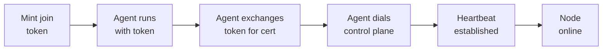

<div className="flex flex-wrap items-center gap-2 not-prose"><span className="inline-flex h-9 w-9 items-center justify-center rounded-lg bg-white p-1.5 ring-1 ring-black/10"></span></div>

Everything on this page is optional. A fresh install runs entirely on the control plane's own local node, and nothing here has to be touched to make it work.

## What this covers

| Task | Where |
| --- | --- |
| Add a worker (token, SSH, or cloud) | [Enrolling a second node](#enrolling-a-second-node) |
| Check whether a node is healthy | [Node health and heartbeat](#node-health-and-heartbeat) |
| Take a node out of rotation | [Cordon, drain, uncordon](#cordon-drain-uncordon) |
| Move an app or database | [Verified moves](#verified-moves) |
| Control where things run | [Labels and placement selectors](#labels-and-placement-selectors) |
| Turn on cross-node networking | [WireGuard mesh and internal DNS](#wireguard-mesh-and-internal-dns) |
| Fix an expiring or expired agent certificate | [Agent certificates: renewal and re-enrollment](#agent-certificates-renewal-and-re-enrollment) |

<Note>
The platform is single-node-first. The dashboard node picker only renders once a node besides the local one exists. A `node_id` of the empty string is a real, permanent value meaning "the local node". Auto-placement only picks a remote node when one is registered, schedulable and online.
</Note>

## Enrolling a second node

Enrollment exchanges a one-time join token for a client certificate. The agent dials out to the control plane, and the control plane never initiates a connection. For a cloud server created for you, see [Node provisioning](/node-provisioning). To have the control plane set up a machine over SSH, see [Enrolling over SSH](#enrolling-over-ssh-instead-of-by-hand).

<Warning>
Set the advertise host first. Before enrolling a real (non-local) node, set `APP_AGENT_ADVERTISE_HOST` on the control plane to the host or IP the remote agent uses in `APP_CONTROL_PLANE_ADDR`. It defaults to `127.0.0.1`, which only matches a single-machine test. With a mismatch, enrollment still succeeds (the first certificate exchange pins the CA fingerprint, not the hostname) and the node appears in `nodes list`, but its session then fails TLS hostname verification on every attempt and the node stays `pending` forever.
</Warning>



<Steps>
<Step title="Mint a join token">

<Tabs>
<Tab title="Dashboard">

Open the Nodes page and click **Add node**. The dialog shows the `docker` and `binary` commands with copy buttons, plus the expiry time.

</Tab>
<Tab title="CLI">

```bash
levelrail-cli nodes join-token
# or, in one command that also prints the enroll command:
levelrail-cli nodes add --name w2 --mesh
```

A token you no longer need (a leaked command, an abandoned setup) can be revoked before it expires. The Nodes page lists unused tokens with a Revoke button, or use `levelrail-cli nodes join-tokens` and `levelrail-cli nodes revoke-join-token <id>|--all`. Nodes that already enrolled are not affected.

</Tab>
<Tab title="API">

```bash
curl -X POST -H "Authorization: Bearer $TOKEN" \
  https://control-plane.example.com/api/v1/nodes/join-tokens
```

</Tab>
</Tabs>

The token is single use and is returned in plaintext exactly once, because the server stores only its hash. It is valid for 15 minutes by default (`APP_NODE_JOIN_TOKEN_TTL`, clamped to 1 minute through 24 hours). If it expires unused, mint a new one. Tokens cannot be renewed.

The request body is optional:

| Field | Meaning |
| --- | --- |
| `control_plane_addr` | `host:port` the agent dials. |
| `node_name` | Lowercase letters, digits and dashes, starting with a letter. |
| `mesh` | Join the WireGuard mesh. |

When the server knows or was given the control plane address, the response carries `join_commands` with a ready-made `docker` command and `binary` command.

</Step>
<Step title="Run the agent on the new machine">

<Tabs>
<Tab title="Docker">

The agent image runs as root on purpose: it drives `/var/run/docker.sock` (root-equivalent on the host anyway) and creates a WireGuard device for the mesh.

```bash
sudo mkdir -p /var/lib/levelrail-agent-data && sudo chmod 700 /var/lib/levelrail-agent-data
docker run -d --name levelrail-agent --restart unless-stopped --network host \
  -v /var/run/docker.sock:/var/run/docker.sock \
  -v /var/lib/levelrail-agent-data:/var/lib/levelrail-agent-data \
  -e APP_CONTROL_PLANE_ADDR=controlplane.example.com:9443 \
  -e APP_JOIN_TOKEN=<token from step 1> \
  -e APP_CA_FINGERPRINT=<ca fingerprint from step 1> \
  -e APP_NODE_NAME=worker-1 \
  -e APP_AGENT_IDENTITY_FILE=/var/lib/levelrail-agent-data/identity.json \
  ghcr.io/glincker/levelrail-agent:beta
```

Add `--user 0:0` for images older than `v0.2.0-beta.16`, which defaulted to a non-root user that could not write into a root-owned directory.

</Tab>
<Tab title="Binary or package">

Install the `.deb` or `.rpm` packages attached to releases after `v0.2.0-beta.15` (see [Docker: without a container](/docker#without-a-container)), or run the binary as root. Releases before `v0.2.0-beta.16` have no agent binary asset, so use the image or a later release.

```bash
sudo APP_CONTROL_PLANE_ADDR=controlplane.example.com:9443 \
APP_JOIN_TOKEN=<token from step 1> \
APP_CA_FINGERPRINT=<ca fingerprint from step 1> \
APP_AGENT_IDENTITY_FILE=/var/lib/levelrail-agent/identity.json \
./levelrail-agent-linux-amd64
```

</Tab>
</Tabs>

| Variable | Meaning |
| --- | --- |
| `APP_CONTROL_PLANE_ADDR` | `host:port` of the control plane's agent gRPC listener. Required. |
| `APP_JOIN_TOKEN` | The token from step 1. Single use. |
| `APP_CA_FINGERPRINT` | The control plane's CA fingerprint, shown next to the token. Recommended: the agent then refuses to enroll, and never sends the token, unless the control plane's certificate chains to this CA. Without it, the agent trusts whatever answers at the address on first use. |
| `APP_NODE_NAME` | Optional. Defaults to the machine hostname. |
| `APP_AGENT_IDENTITY_FILE` | Where to save the identity, mode `0600`. Default `./levelrail-agent-identity.json`. |

On first run the agent generates its own private key, sends only a certificate signing request with the join token, and saves the signed certificate, its key and the control plane's CA certificate locally. The private key never leaves the machine. On later runs it skips enrollment and reconnects with the saved certificate, which it renews on its own (see [Agent certificates](#agent-certificates-renewal-and-re-enrollment)).

The agent checks that the identity directory is writable before it sends the token. If it is not, it exits naming the directory and says the token was not used, so you can fix permissions and retry with the same token.

</Step>
<Step title="Confirm it registered">

```bash
levelrail-cli nodes list
```

The node appears as soon as enrollment is saved, with `status: pending` until its first heartbeat, then `online`.

</Step>
<Step title="Use it for placement">

Once connected, the node is a normal placement target. Pick it in an app or database create form, move an existing resource onto it, or let [auto-placement](#simple-spread-placement-auto-placement) send new resources there.

A node accepts app workloads by default but not build workloads. See [Build node routing](/build-node-routing) to enable builds.

</Step>
</Steps>

<Accordion title="Node stuck in pending (never connected)">

A node `pending` for more than five minutes (`APP_NODE_PENDING_STALE_AFTER`) is flagged "Never connected" in the dashboard, and `nodes list` prints `pending (never connected)` with the next step. The token was spent but the agent never opened a session, so it cannot be retried.

1. Check the agent logs on the host. The usual causes are an unwritable identity directory or a wrong `APP_AGENT_ADVERTISE_HOST`.
2. Click Clean up node on the node page (or run `levelrail-cli nodes delete <id>`). A node that never connects is also removed automatically after `APP_NODE_PENDING_EXPIRE_AFTER` (default one hour, `0` disables), which frees its name.
3. Enroll again with a new token.

</Accordion>

## Enrolling over SSH instead of by hand

Steps 1 and 2 above can be automated: the control plane SSHes into the machine, mints the token and installs the agent for you.

<Tabs>
<Tab title="Dashboard">

Nodes page, **Add node**, then **Connect over SSH**. After the host and port, the **Verify server** step shows the server's host key fingerprints. Confirm one before the credential fields appear. The wizard shows each stage plus a live log tail.

</Tab>
<Tab title="CLI">

```bash
levelrail-cli nodes ssh-provision \
  --host 192.0.2.10 --user root --key-file ~/.ssh/id_ed25519 \
  --name home-server --control-plane-addr controlplane.example.com:9443
```

| Flag | Meaning |
| --- | --- |
| `--key-file` | Private key for key auth (with `--passphrase` if encrypted). |
| `--password` | Password auth instead of a key, prompted without echo. |
| `--port` | Non-default SSH port (default 22). |
| `--role build` | Make it a build node (default `general`). |
| `--host-key-fingerprint SHA256:...` | Pin the host key non-interactively, for scripts. |
| `--insecure-skip-host-key-check` | Skip verification entirely (warned and audited). |

Without a pin flag, the command prints the server's host key fingerprints and asks you to confirm before it reads any credential.

Track a run with `levelrail-cli nodes ssh-provisions show <id>`.

</Tab>
<Tab title="API">

`POST /api/v1/nodes/ssh-provision` accepts a host, port (default 22), username, either a private key (optionally passphrase-protected) or a password, and the server's host key fingerprint. Poll `GET /api/v1/ssh-node-provisions/{id}`, which carries the accumulated install log and the detected OS and architecture.

Status moves through `connecting`, `detecting`, `installing`, `enrolling`, `ready`, or `failed` with a reason.

</Tab>
</Tabs>

What it does in the background:

1. Verifies the host key against the pinned fingerprint, connects, and detects the OS, architecture, and whether Docker and systemd are present. Only Linux with systemd is supported (the same requirement `install.sh` has). An unsupported host fails here with a clear reason before anything is changed.
2. Installs Docker via `get.docker.com` if it is missing.
3. Writes the agent's environment file and a systemd unit, then enables and starts it (the same steps cloud-init runs on a new VM, see [Node provisioning](/node-provisioning)).
4. Confirms the service stays active, surfacing the last `journalctl` lines as the failure reason if it does not.

The SSH credential is held only in memory for this one call and is never written to the database or logged. The join token is written to a root-only (`0600`) environment file on the target host. Tokens minted for SSH enrollment are valid for 30 minutes, and for cloud provisioning 60 minutes, regardless of `APP_NODE_JOIN_TOKEN_TTL`.

### Host key verification

Credentials only go to a server whose host key the operator has seen (trust on first use with explicit confirmation).

<Steps>
<Step title="Read the host keys">

`POST /api/v1/nodes/ssh-provision/preflight` with `{"host": "...", "port": 22}` reads the server's host keys without authenticating: the handshake is aborted right after key exchange, so no username, password or key is sent. It returns each key's type and SHA256 fingerprint, the same format `ssh-keygen -l` prints:

```json
{"host_keys": [{"type": "ssh-ed25519", "fingerprint": "SHA256:..."}]}
```

</Step>
<Step title="Compare with the server">

```bash
ssh-keygen -lf /etc/ssh/ssh_host_ed25519_key.pub
```

Or use your provider's console output.

</Step>
<Step title="Send the confirmed value back">

Pass it as `host_key_fingerprint` on `POST /api/v1/nodes/ssh-provision`. The install refuses to authenticate to a server presenting any other key, and the failure names both the expected and observed fingerprints. A fingerprint you already know (pinned out of band) works without calling the preflight.

</Step>
</Steps>

The request is rejected with `400` when it carries neither a fingerprint nor `insecure_skip_host_key_check: true`. That explicit opt out accepts any key, returns a warning in `warnings`, and writes a `node_ssh_provision.host_key_skipped` audit entry. The pinned fingerprint is stored with the provision (`host_key_fingerprint`, `host_key_verified`). Both routes need the `root` ability and are audited.

## Node health and heartbeat


```bash
levelrail-cli nodes health <id>
```

This calls `GET /api/v1/nodes/{id}/health`: it returns the stored `Heartbeat` condition and re-checks any node-scoped alerts (patch status, disk space, resource usage). A node that enrolled but never connected shows `NeverConnected`, not an error.

### How heartbeats work

A connected agent sends a `Heartbeat` frame up its Session stream at a regular interval (default 15 seconds, `APP_NODE_HEARTBEAT_INTERVAL`, read agent-side). The control plane only touches `last_seen_at` when one arrives, never merely because the stream is still open.

| Failure | What happens |
| --- | --- |
| Graceful disconnect | The agent exits cleanly and the node flips to `offline` immediately. |
| Hard disconnect | The `internal/reconcile/nodehealth` controller compares `last_seen_at` against `APP_NODE_HEARTBEAT_TIMEOUT` (default 45 seconds) on every pass. A node past it that is still `online` flips to `offline` with a `Heartbeat` condition explaining why. |
| Frozen process (for example `SIGSTOP`) | The TCP and TLS connection can stay open indefinitely. The HTTP/2 PING keepalive is the backstop: the transport notices the peer stopped responding, ends the connection, and the hard-disconnect path follows. |

The keepalive is configured with `APP_NODE_KEEPALIVE_TIME` and `APP_NODE_KEEPALIVE_TIMEOUT` (default 10s/10s on the control plane; the agent mirrors this with env vars of the same name).

### The control plane's local node

On the Network page the control plane's own server is always the first card, **This server (control plane)**, whether or not the mesh is on. Apps and databases with an empty placement, or placed on the control plane's own node ID, belong to it. The **Unplaced** card only appears for resources placed on a node ID the control plane does not know.

The local node uses the same health system: it heartbeats itself rather than through gRPC, and is never permanently `online` by fiat. It runs inside the control plane process, so there is no network link to secure and no agent certificate: its node page says so, shows the control plane's own version and platform, and has no certificate, fingerprint, renewal or revoke controls.

<Note>
Cordon is tracked as a separate `schedulable` flag, not a status value. A node can be `online` and cordoned, or `offline` and schedulable.
</Note>

### Connection history

Every node status change (online, offline, cordoned) is recorded, the newest 200 per node. See it on the node detail page's "Connection history" card, or from the CLI:

```bash
levelrail-cli nodes events <id> [--limit N]
```

`GET /api/v1/nodes/{id}/events?limit=N` returns the same list, newest first.

## Cordon, drain, uncordon

**Cordon** marks a node unschedulable for new placements without moving anything already running. **Drain** moves everything off the node, using the same [verified moves](#verified-moves) described below.

```bash
levelrail-cli nodes cordon <id>
levelrail-cli nodes uncordon <id>
levelrail-cli nodes drain <id> [--target <node-id>] [--wait]
levelrail-cli nodes drains <id>
```

### Cordon / uncordon

`POST /api/v1/nodes/{id}/cordon` and `.../uncordon` are idempotent. A cordoned node is excluded from auto-placement and refused as an explicit placement target (`400`).

### Drain

`POST /api/v1/nodes/{id}/drain?target_node_id=` starts a drain job and returns `202` with a `NodeDrain`. The node is cordoned immediately, and a second drain on a node that is already draining returns `409`.

| Aspect | Behavior |
| --- | --- |
| Order | Databases move first, then apps. An app follows its database's node when that node is eligible. |
| With `--target` | Everything goes to the specified node. |
| Without `--target` | Each resource goes to the least loaded eligible node. |
| Execution | Each resource is a verified move, run one after another. |
| On failure | The drain stops at the first failed move and leaves the node cordoned. Fix the cause, then drain again or uncordon. |
| GPU apps | Only move to a node with a working nvidia runtime and enough free GPUs. An app no node can host stays put and is listed under `blocked` with a per-node reason. See [GPU scheduling](/ai-models#gpu-scheduling). |
| Models | Cannot be moved, so any model on the node is always listed as blocked. |

Progress is a job: poll `GET /api/v1/node-drains/{id}`, or use `nodes drain <id> --wait`. `nodes drains <id>` and `GET /api/v1/nodes/{id}/drains` list the newest 20.

A `NodeDrain` carries `status` (`running`, `succeeded`, `failed`), an `error`, the `blocked` list and the `moves` in the order they ran. The node page's **Drain** dialog polls it every couple of seconds and lists each move with its phase; the **Drains** card keeps the history.

### Deleting a node

`DELETE /api/v1/nodes/{id}` (CLI: `nodes delete <id>`)

- Refused with `409` while the node still has anything placed on it. Drain first.
- Otherwise idempotent: deleting an already-deleted node ID succeeds.
- Closes the node's live agent session, so a deleted node's agent is disconnected.

## Resource-aware placement (auto-placement)

When you create an app or database without specifying a node, the server decides placement.

- `APP_AUTO_PLACEMENT` (default enabled): if `false`, always place on the local node.
- If enabled, it filters out nodes that are cordoned, offline, missing a selector label, or cannot fit the workload's CPU and memory requests, then picks the node that keeps the most headroom. Ties go to the node with fewer resources, then to the lexicographically smallest node ID.
- When nodes exist but none has room, the create fails with `409` and the shortfall per node. With no usable node at all, it falls back to the local node.
- An explicit `node_id` (or an explicit empty string meaning "local, on purpose") always overrides auto-placement and is validated against cordoned and unknown-node checks.
- Create responses carry `auto_placed: true` with the `node_id` picked, and the dashboard shows a toast, so it is never a silent decision.

<Note>
This is a fit check plus a spread, not bin-packing, and there are no affinity rules. Capacity, the overcommit policy, unknown-capacity handling and the "why here" explanation are in [Resource-aware placement](/resource-aware-placement).
</Note>

GPU apps: a new app with `resources.gpu` is only auto-placed on a node with a working nvidia runtime and enough free GPUs (least loaded among those), falling back to the local host if it fits. If none fits, the create is refused with `409` and the reason per node; pass `node_id` to override. See [GPU scheduling](/ai-models#gpu-scheduling).

## Verified moves

A move relocates one app or database to another node, checking each step and rolling back when the target cannot run it.

<Tabs>
<Tab title="CLI">

```bash
levelrail-cli nodes move app web --to <node-id> --wait
levelrail-cli nodes move database main --to <node-id> --wait
```

Omit `--to` to let the scheduler pick the least loaded eligible node.

</Tab>
<Tab title="Dashboard">

The **Move** button on the app or database **Placement** card runs the same move and shows each phase live, with an **Automatic** target option.

</Tab>
<Tab title="API">

`POST /api/v1/apps/{name}/move` and `POST /api/v1/databases/{name}/move` with `{"node_id": "..."}` (an empty `node_id` means automatic). They return `202` with a `NodeMove`. Poll `GET /api/v1/node-moves/{id}`, or list with `GET /api/v1/node-moves?kind=&resource=&drain_id=&status=&limit=`.

</Tab>
</Tabs>

Errors: `400` (same node, label mismatch, cordoned or offline target, no eligible node), `404`, `409` (that resource is already moving) and `501` (not configured).

### Phases

A move walks `preflight`, `stop_source`, `copy_volumes`, `place`, `verify`, `stop_old`, `finalize`, then `done`. If something fails after the source was touched it enters `rollback`. The final `status` is `succeeded`, `failed` or `rolled_back`, and every step records its outcome (`ok`, `retry`, `waiting` or `failed`).

- Stateless (no volumes): stage, verify, switch, stop. The new copy is started and checked on the target before the old one is stopped, so there should be no downtime.
- Stateful (volumes, and every database): stop, copy, start. Downtime lasts until the copy finishes.

While the target comes up, ingress holds incoming requests instead of failing them.

### Tuning and guarantees

| Variable | Default | Meaning |
| --- | --- | --- |
| `APP_NODE_MOVE_VERIFY_TIMEOUT` | `5m` | How long the target has to become healthy before the move rolls back. |
| `APP_NODE_MOVE_MAX_ATTEMPTS` | `5` | Attempts for a retryable step. |
| `APP_NODE_MOVE_INTERVAL` | `3s` | Delay between attempts. |

- Moves resume after a control plane restart, and there is one move per resource at a time.
- Apps with host bind mounts are refused, because only Docker named volumes can be copied.
- A database moves with its data volume (and its WAL archive when point-in-time recovery is on). Apps that depend on it are restarted afterwards.

## Labels and placement selectors

Label nodes, then restrict where an app or database may run with a selector.

```bash
levelrail-cli nodes labels <id> disk=ssd
levelrail-cli nodes placement app web disk=ssd
levelrail-cli nodes placement database main disk=ssd
```

- `GET` and `PUT /api/v1/nodes/{id}/labels` read and replace a node's whole label set. Keys are lowercase letters, digits, `.`, `_`, `-` and `/`, 1 to 63 characters. Values are letters, digits, `.`, `_` and `-`, 1 to 63 characters. At most 32 labels. Invalid input returns `400` with the reason.
- `GET` and `PUT /api/v1/apps/{name}/placement` (and the same for `databases`) read and set a `node_selector`. The response lists `eligible_node_ids` and the `rejected` nodes with a reason each. Setting a selector never moves anything by itself.
- The dashboard has a **Labels** card on the node page and a **Placement** card on the app and database pages.

### Failure domains: region, zone and provider

Three label keys have a meaning to the scheduler: `region`, `zone` and `provider`.

```bash
levelrail-cli nodes labels <id> region=eu zone=a provider=hetzner
levelrail-cli nodes zones
```

When at least one eligible node has a `zone` label, placement spreads across zones by default: the zone holding the fewest replicas of the same workload wins, then the zone carrying the fewest workloads overall, then the usual headroom order. Drains and auto-placement use the same ranking, so draining a node prefers another zone. If no node has a zone label nothing changes. A node with no `region` label shows the free-text region set on the node, if any. `GET /api/v1/nodes/zones` returns each zone with its nodes and workload counts, and the **Failure domains** card on the nodes page shows the same view, with a button to the node page when no zone is set yet.

For the guided add-node flow that detects these labels from cloud metadata, see [Add a node anywhere](/add-node-anywhere). Placement also spreads across providers, and an app whose replicas all share one zone gets a warning.

### Dry runs: where would it land, and what if a zone dies

Both checks use the real scheduler on a copy of the fleet and change nothing.

```bash
levelrail-cli nodes simulate --memory 512 --count 3
levelrail-cli nodes failure --zone a
```

- `nodes simulate` places `--count` identical apps in turn, each seeing the load the previous ones added, and prints the node, zone and reason for each, or why one is refused. `GET /api/v1/nodes/placement-simulation?cpu_milli=&memory_mib=&count=&selector=` returns the same.
- `nodes failure` removes a zone (or one node with `--node`), reschedules every app and database on it onto the survivors, largest memory request first, and lists those with nowhere to go. `GET /api/v1/nodes/failure-simulation?zone=a` returns the same.
- The **What if** panel on the Failure domains card on the nodes page runs both.

This answers the scheduling question from reported capacity. It does not measure how long requests fail while a zone is lost; that run is not yet measured (see [benchmarks](/benchmarks)). Nodes that report no capacity are ranked last and flagged as unverified.

### When a node stays unreachable (beta)

An opt-in, deterministic policy decides what happens once a node has sent no heartbeat for longer than its grace period. The default is `off`; `notify` only reports it and `auto` also moves what is safe to move.

- Stateless apps (no volumes) are placed on a healthy node by the normal scheduler.
- Apps with node-local volumes and all databases are never moved automatically, because that would lose or split their data. They show as **needs your decision** with three choices: **Wait**, **Restore on another node** (places it on a healthy node, then restore its data from a backup there) or **Mark node lost**, which also moves the stateless apps now.
- A node that drops again while recovering does not cause new moves. When it returns, stale copies of anything moved are stopped first, and the node is made schedulable again after a hold period.
- Every automatic action is written to the audit log.

```bash
levelrail-cli nodes failure-policy set <id> --mode auto --grace 300
levelrail-cli nodes lost <id> --dry-run
levelrail-cli nodes failure-resolve <id> app <name> --wait
```

Defaults come from `APP_NODE_FAILURE_MODE`, `APP_NODE_FAILURE_GRACE` (5m), `APP_NODE_FAILURE_RECOVERY_HOLD` (2m) and `APP_NODE_FAILURE_INTERVAL` (15s). The node page has a **Failure handling** card with the same settings, and unresolved nodes appear on the attention list. Each app lives on one node today, so there is no "other replicas keep serving" case yet. This has been tested with fakes, not on real hosts.

### The spread scheduler

When a move or a drain has no explicit target, the scheduler picks the eligible node with the most headroom, breaking ties by load and then node id. A node is not eligible when it is cordoned, offline, missing a label the selector requires, or short of the CPU or memory the resource requests. See [Resource-aware placement](/resource-aware-placement).

## Moving an app with its volumes

<Tabs>
<Tab title="Simple move">

`PUT /apps/{name}/node` (CLI: `levelrail-cli apps set-node <name> <node-id>`) changes only `node_id`. The reconciler creates fresh empty volumes on the new node and the old volumes stay behind. Fine for stateless apps, wrong for apps with state.

</Tab>
<Tab title="Move with volumes">

`POST /api/v1/apps/{name}/move-with-volumes` does a proper migration.

- Dashboard: the "Take its volumes with it" checkbox. The dialog previews the plan before you confirm: stop the app, copy each named volume, switch placement, start it on the destination, with the expected downtime and rollback story spelled out.
- CLI: `levelrail-cli apps set-node <name> <node-id> --with-volumes`. It polls `GET /apps/{name}/moves/{id}` until complete, then prints the finished move record (or the failure reason and the step it reached). `apps clear-node <name> [--with-volumes]` is the counterpart for returning to the local node.

</Tab>
</Tabs>

### Steps

1. Stop: the app is suspended and its containers torn down on the current node (synchronously), so nothing writes to volumes during archival.
2. Move each volume: every named volume is tarred from the source node and untarred on the destination, one at a time, over the same transport volume backups use. No S3 bucket is needed, because both nodes' Docker daemons are directly reachable from the control plane.
3. Update placement: only after all volumes copy successfully does `node_id` change.
4. Resume: the suspension clears and the reconciler starts the app on the new node with the already-populated volumes.

### Tracking progress

Every step is recorded on a `store.AppVolumeMove` row. Poll with `GET /apps/{name}/moves/{id}` or check history with `GET /apps/{name}/moves`. If step 2 fails on the second of three volumes, the row shows:

- `stop_app: succeeded`
- `move_volume:app-<name>-cache: succeeded`
- `move_volume:app-<name>-uploads: failed`
- (nothing past that)

<Warning>
This is not atomic and has no automatic health gate or rollback. If any step fails, the app is left suspended (stopped) and `node_id` never changes until all volumes have copied. Retrying is safe: archiving is read-only and restoring is a full overwrite. Clean up unreferenced volumes on the destination by hand if needed.
</Warning>

<Accordion title="Special cases">

- No named volumes, or already on the destination node: takes the simple move path. The response comes back `status: "succeeded"`, no polling needed.
- Bind mounts (`app.yaml` host-path mounts): never moved by this path. Archive and restore primitives exist only for Docker-managed named volumes.

</Accordion>

## Viewing what's placed on a node

There is no dedicated "workloads on this node" list. These show it indirectly:

- Network page and `levelrail-cli nodes topology`: every node with the apps and databases placed on it. See [Network topology](/network-topology).
- App and database detail pages: a Placement card shows the current node, the selector, eligible nodes and the move action.
- Placement names: an app or database with no explicit node shows "This server" plus the hostname rather than a blank. API responses carry `node_name` and `node_is_local` beside `node_id`. "Unassigned" appears only when the stored node no longer exists, with a "Move to this server" action.
- Nodes page: one row per node with status, usage bars, resource count, agent version and last seen, and a menu for cordon, drain and delete (delete asks you to type the node name).
- Drain and delete: both enumerate everything on the node server-side, which is why deleting a node with placements fails instead of orphaning them.

## WireGuard mesh and internal DNS

An app's database connection string is baked into the container environment at creation time, so it does not rewrite itself when a database moves. The fix is DNS names from the start. `internal/reconcile/mesh` keeps the mapping current: every pass it reads node and placement data, distributes WireGuard configuration, and rebuilds the internal DNS zone (`<brand-short-name>.internal`, for example `levelrail.internal`).

When mesh is enabled, database env vars (like `DATABASE_URL`, or any `{ from: postgres.main.url }` reference in `app.yaml`) automatically resolve to the database's mesh DNS name, so an app on one node can connect to a database on another with no app-side changes. Without mesh, they resolve to the database container's Docker name, reachable only within that node's Docker network.

### Enabling the mesh on the control plane

Turn it on from **Network > Mesh networking** in the dashboard, or with the CLI (default: off):

```bash
levelrail-cli network mesh status     # state plus the readiness checks
levelrail-cli network mesh enable     # root only; refused while a check fails
levelrail-cli network mesh disable    # --force when other nodes are enrolled
```

The readiness list checks WireGuard support (kernel module, or wireguard-go with root and `/dev/net/tun`), that the UDP port is free, whether `ufw` is blocking it, and whether a public address is set for agents to dial. A failing check blocks enabling and shows a fix hint. The choice is saved and applies on the next control plane restart. Setting `APP_MESH_ENABLED` on the server pins the mesh on or off and wins over the saved choice (the card then shows it as read-only). A mesh setup failure is logged and the control plane still starts.

Enabling brings up the control plane's own WireGuard device, interface and mesh address, its own DNS server, and a self-peer entry for the local node.

| Variable | Default | Meaning |
| --- | --- | --- |
| `APP_MESH_ENABLED` | off | Set to `1` to enable the mesh. |
| `APP_MESH_CIDR` | `10.0.0.0/8` (picked automatically) | WireGuard mesh subnet. An invalid override is logged as a warning and the default is used. |
| `APP_MESH_DNS_ADDR` | `:5390` | Bind address of the internal DNS server. |

<Accordion title="Single-node DNS caveat: containers do not query port 5390">

Docker container DNS accepts only a bare IP address, never a custom port. With the default `:5390`, no container actually queries the mesh DNS server and containers fall back to Docker's embedded resolver. To make containers use it:

1. Set `APP_MESH_DNS_ADDR=:53`.
2. Grant the process permission to bind port 53 (for example via `setcap` on Linux).
3. Restart the control plane.

Mesh failures (disabled, DNS not on 53, and so on) log warnings but never break anything.

</Accordion>

### Multi-node mesh requirements

The control plane sends `ApplyMesh` and `RotateMeshKey` requests to each enrolled agent, and the agent applies them to its own WireGuard device when started with `APP_MESH_ENABLED=1`. This has been exercised against fakes and a single host with a real TUN device, not between two real hosts, so treat cross-host mesh as lightly proven.

<Steps>
<Step title="Give every agent the privileges">

Run as root with `--cap-add NET_ADMIN --device /dev/net/tun -e APP_MESH_ENABLED=1` (the image already runs as root). Nothing else is needed: no extra sysctls and no `ip` binary. Without these the agent keeps serving containers and logs `mesh networking disabled on this node`. Nodes enrolled through the dashboard's SSH or cloud provisioning flows get all of this automatically when the control plane itself runs with `APP_MESH_ENABLED=1`.

</Step>
<Step title="Open the hub">

The control plane is the hub: agents send WireGuard handshakes to `APP_AGENT_ADVERTISE_HOST` on UDP `51820`. Set that variable to the control plane's public host, and allow **inbound UDP 51820** on its firewall and cloud security group. A loopback advertise host leaves agents with no endpoint (`no known endpoint for peer`); `levelrail-cli doctor` reports this as `mesh_hub_endpoint`.

</Step>
<Step title="Match the brand">

The interface name comes from the brand short name. The agent image carries the default `brand.yaml`; override with `APP_BRAND_SHORT_NAME` (or mount your own at `APP_BRAND_FILE`) if you rebrand the control plane.

</Step>
</Steps>

Worker to worker WireGuard endpoints are recorded from where each agent connects, on UDP `51820`, so workers reach each other directly without extra configuration.

### Viewing mesh status

<Tabs>
<Tab title="CLI">

```bash
levelrail-cli nodes mesh
```

</Tab>
<Tab title="API">

```bash
curl -H "Authorization: Bearer $TOKEN" \
  https://control-plane.example.com/api/v1/mesh
```

</Tab>
</Tabs>

| Field | Meaning |
| --- | --- |
| Backend | `kernel` (WireGuard kernel module), `userspace` (wireguard-go fallback), or `disabled`. |
| Interface | The WireGuard device name, derived from the brand short name (for example `levelrail0`), on the control plane and every agent. |
| Mesh address | The local node's assigned IP in the mesh. |
| Public key | The local node's WireGuard public key. |
| Last rotation | Timestamp and state if a key rotation is in progress (confirming or confirmed). |
| Peers | One per enrolled node: mesh address, last handshake, health status, and whether it has a live device entry. |

A peer with `live: false` is registered in the node inventory but the mesh device has no live entry yet (the reconciler has not reached it this pass, or peering has not converged).

### Pair diagnostics

```bash
levelrail-cli nodes connectivity
```

`GET /api/v1/mesh/connectivity` returns every node's WireGuard view of every other node as pairs, each `ok`, `degraded`, `down` or `unknown`, with a per-direction link state (`healthy`, `stale`, `never`, `no_peer`, `unknown`), last handshake, endpoint and a `hint` for a bad pair. It returns `501` when the mesh is off. The Network page shows the same matrix under **Node connectivity**.

### Rotating a node's mesh key

Generates a fresh WireGuard keypair for a node and makes it that node's live mesh identity immediately. Works for any node with a live session, local or remote.

<Tabs>
<Tab title="CLI">

```bash
levelrail-cli nodes rotate-key <node-id>
```

</Tab>
<Tab title="API">

```bash
curl -X POST -H "Authorization: Bearer $TOKEN" \
  https://control-plane.example.com/api/v1/nodes/<node-id>/mesh/rotate-key
```

</Tab>
</Tabs>

- The new public key is recorded and the mesh reconciler propagates it to every peer on its next pass.
- Watch the `rotation` field in `levelrail-cli nodes mesh` to see when every reachable peer has caught up. A brief reconnect blip on mesh traffic is possible until then.
- A remote node with no live agent session fails the rotation. Both routes return `501` when mesh networking is not enabled.

If a peer looks stuck, `levelrail-cli nodes rejoin-mesh <node-id>` (`POST /api/v1/nodes/{id}/mesh/rejoin`) forces an immediate mesh reconcile. It is a fleet-wide resync, not a per-node operation.

### Cross-node database connections

With the mesh on, an app on one node can use a database on another.

- The app's `DATABASE_URL` uses `<db>.<zone>:<mesh port>`.
- The name is pinned in the container's `/etc/hosts` to the database node's mesh address, so no DNS server has to be reachable from the container.
- Mesh ports are allocated from `APP_MESH_DB_PORT_MIN` to `APP_MESH_DB_PORT_MAX` (default `21000` to `21999`).
- A database is published on its node's mesh address only once an app on another node uses it, and never on a wildcard or public address.
- Without the mesh, a move that would split an app from its database is refused, except inside a drain.

### Routing to apps on remote nodes

<Note>
The embedded Caddy ingress ([Domains and ingress](/domains-and-ingress)) runs in the control plane's own process. A worker node has **no public listener**: nothing is bound to 80/443 there. Ingress reaches an app on a worker through that node's mesh address, so its domains and its `<app>.<ip>.sslip.io` hostname work with normal TLS.
</Note>

How a remote app is reached:

1. The app controller publishes the container's main port on the worker's **mesh address** (for example `10.181.0.2:32768`), never on `0.0.0.0` and never on a public interface.
2. The ingress controller dials `<mesh-ip>:<host-port>` and obtains the TLS certificate for the hostname as usual (ACME for custom domains and sslip.io names, or your uploaded certificate).
3. The path counts as healthy when the node has a mesh address and the control plane's WireGuard device has a handshake with it from the last 3 minutes.

How this interacts with `bind_address` and `host_port`:

| App setting on a remote node | Published on the worker as |
| --- | --- |
| `private` (default) | the node's mesh IP while the path is healthy, else `127.0.0.1` |
| `public` | `0.0.0.0` (your explicit choice, also reachable over the mesh) |
| a literal IP | that IP, unchanged (ingress routes only if it is the mesh IP or a wildcard) |
| `host_port` pinned | the pinned port on the same address as above |

Only the app's main port moves. App streams, [managed databases](/managing-databases) and every unpublished container port are untouched: a database is never bound to the mesh address by this feature.

<Warning>
If the mesh path is down (mesh off, node not joined, no recent handshake), the app is **not** routed: a browser gets a TLS handshake failure while the app reports healthy. Levelrail reports this as the `NoMeshIngressPath` reason on the app's `CrossNodeIngress` condition, in `levelrail-cli doctor` (`cross_node_ingress`), in preflight and on the Traffic page, each with the cause and a fix.
</Warning>

```bash
levelrail-cli nodes mesh                                              # see which peer has no handshake
levelrail-cli apps set-node <name> <the control plane's own node id>  # or move it back
```

The condition clears on the next reconcile pass after the mesh is healthy. Typical causes:

| Reason shown | Fix |
| --- | --- |
| `mesh networking is off` | Enable it on the Network page (or `levelrail-cli network mesh enable`) and restart the control plane. |
| `the node has not joined the mesh yet` | Check `levelrail-cli nodes mesh`. |
| `no recent WireGuard handshake` | Open UDP 51820 between the hosts. |
| `publishes its port on loopback only` | Transient: the app controller republishes it on its next pass. |

<Accordion title="The mesh came up after the app was deployed">

The reconciler is level-triggered: when it sees a running container whose main port is still on loopback and the path is now healthy, it removes that container and recreates it with the mesh bind (a brief restart; the app was unreachable through ingress anyway). A mesh flap never recreates a container: once bound, it stays bound while the path is down, and the condition reports the outage.

This does not move databases or app streams onto the mesh, and auto-placement still prefers the control plane's own node for apps created with a domain.

</Accordion>

## How agent trust works

An agent dials out to the control plane; nothing connects in. Trust is established once, by the operator, and then checked on every connection.

1. **Join token.** The operator mints a single-use token (15 minutes). It is stored hashed and spent before anything else happens, so a failed enrollment never leaves it reusable. Only the token's id is ever logged or shown in security events, never the token.
2. **CA fingerprint pin.** Before the agent sends the token it can check the control plane's CA against the SHA-256 fingerprint the join command carries (`APP_CA_FINGERPRINT`). With a pin, an impostor control plane is refused before it sees the token. Without one the agent trusts the control plane on first use and says so in its log; the node page shows **Not pinned**.
3. **Agent-side key.** The agent generates its own private key and sends a certificate request. The control plane signs it and never sees the key.
4. **Mutual TLS on every connection.** The agent verifies the control plane against the CA it stored at enrollment. The control plane verifies the agent's certificate on every handshake (chain to its CA, client auth usage, validity window), then again when the session opens, and checks that the certificate's fingerprint is the one recorded for that node (or the previous one, inside the renewal overlap). A revoked node is refused here too.
5. **Renewal.** At a fraction of the certificate's lifetime the agent renews over its authenticated connection (see [Automatic renewal](#automatic-renewal)).
6. **Revocation.** Revoking sets a flag the control plane checks on every connection and closes the live session at once. There is no CRL or OCSP: the control plane is the only verifier, so a flag is enough.

### Seeing what was verified

The node page's Agent card (root accounts) shows the control plane CA fingerprint, the agent certificate's fingerprint, serial, issue and expiry time with a lifetime bar, the next scheduled renewal, the last renewal and any renewal failure with its next retry, who generated the private key, and a 24 hour count of accepted and rejected connection checks. The status line is computed from recent real events: it reads **Connection verified: mutual TLS, certificate matches this node** only while the node is online and its newest accepted connection presented a certificate the node record still accepts.

Below it, a timeline lists security events, newest first, with a **Rejected only** filter. The same is available from the CLI:

```bash
levelrail-cli nodes security <id> [--rejected] [--limit N]
levelrail-cli nodes cert renew <id>
levelrail-cli nodes cert drill <id>
```

The **Rotation drill** button (and `nodes cert drill`) rotates the certificate end to end and reports each step: the node is online with a valid certificate, the agent was asked to renew, a new certificate arrived, the node is still connected. The previous certificate stays accepted through the grace window and is never revoked, so a failed drill leaves the node as it was.

To compare the CA fingerprint by hand, read it from the node page and compare it with `APP_CA_FINGERPRINT` in the agent's environment, or the value its enrollment command printed. They must match exactly.

Events recorded, each with a source address and a reason:

| Event | Outcome | Notes |
| --- | --- | --- |
| Enrollment and re-enrollment | accepted or rejected | Join token id, never the token. A refused token is recorded without a node. |
| CA pin at enrollment | accepted, warning | `pinned and verified`, `verified against the CA already on the node`, or `not pinned` (warning). |
| Connection check | accepted or rejected | Rejected reasons: `expired`, `not yet valid`, `certificate from a different CA`, `fingerprint does not match this node's record`, `unknown node`, `revoked`, `no certificate presented`. |
| Certificate issued | info | Serial, not before, not after and fingerprint, at enrollment, renewal and re-enrollment. |
| Renewal failed | failed | Recorded when the control plane refuses or fails to sign a renewal. |
| Revoke, renew requested, re-enroll token issued | info | The operator who did it. |

The log is bounded. Identical events inside `APP_NODE_SECURITY_COALESCE_WINDOW` (default `10m`) merge into one row with a count, a burst of identical rejections costs a handful of database writes however fast it arrives, each node keeps at most `APP_NODE_SECURITY_EVENTS_PER_NODE` rows (default `500`), and rows older than `APP_NODE_SECURITY_EVENT_RETENTION` (default `720h`) are deleted.

### When a fingerprint mismatch appears

- **The agent refuses to enroll and logs a CA fingerprint mismatch.** It aborted before sending its join token, so the token is still valid. Check that the fingerprint in the command is the one on the node page, that the agent is dialing the address you expect, and that nothing sits between them rewriting TLS. Do not remove the pin to make it work.
- **A connection is rejected as `fingerprint does not match this node's record`.** A certificate that chains to your CA but is not the one the node record holds reached the control plane. After a renewal the previous certificate is accepted for `APP_AGENT_CERT_RENEW_GRACE` (default `24h`), so a mismatch past that window means a stale identity file restored from a backup, or a copy of the identity on another machine. Re-enroll the node, which retires every earlier certificate.
- **Rejected as `certificate from a different CA`.** The control plane's CA was regenerated, or something else is presenting a certificate. Compare the CA fingerprint with the agent's.
- **Rejected as `not yet valid`.** The agent's clock is more than about an hour behind. Fix the clock.
- **Repeated rejections from an address you do not know.** They are coalesced and counted; nothing about them needs action unless the node itself stops connecting.

### Security note: what is and is not verified

Verified:

- The control plane's CA against the pinned fingerprint at enrollment, when a pin is given.
- The agent's certificate on every handshake: chain to the control plane's CA, client authentication usage, validity window. This is checked again when the session opens, independent of how the listener is configured.
- That the presented certificate's SHA-256 fingerprint is the node's current one, or its previous one inside the renewal overlap, and that the node is not revoked.
- The new certificate on renewal, by the agent, before it replaces the old one: it must name the node, match the local key, chain to the CA, and pass a test connection.

Not verified, or only partly:

- **Without a pin, enrollment is trust on first use.** An attacker in the path at that moment can impersonate the control plane.
- **The pin result is the agent's own report.** The control plane records what the agent says it checked and cannot prove it. A pin mismatch is only visible in the agent's log, because the agent aborts before sending anything the control plane could record.
- **Hostnames are not checked at enrollment.** The pinned CA is the trust anchor, not the address.
- **An open session is not re-verified.** Expiry is checked at the handshake, so a session that outlives its certificate stays open until it reconnects. Revocation does close the live session.
- **Rejections before the chain verifies are attributed by the certificate's claimed name.** That name is attacker controlled; a name that is not a known node is recorded without a node.
- **The security log is operational history, not a tamper-evident audit trail.** It lives in the control plane database; use the audit log for who did what.
- **Early-beta nodes.** A node enrolled when the control plane still generated keys shows "re-enroll required" and is never renewed. Use Re-enroll on its page; the new key is made on the node.
- **Clock skew.** Certificates are issued valid from one hour before issue time, so an agent clock up to about an hour behind still verifies them. Further behind, the agent refuses a new certificate (keeping the old one) and the control plane rejects the connection as not yet valid.

## Agent certificates: renewal and re-enrollment

Each agent authenticates with a client certificate issued by the control plane's own CA (90 days by default, `APP_AGENT_CERT_VALIDITY` on the control plane). The design and its rejected alternatives are in [ADR 021](https://github.com/glincker/levelrail/blob/main/adr/021-agent-cert-lifecycle.md).

### Seeing expiry

| Where | What you get |
| --- | --- |
| Dashboard | Every node row shows "Cert expires in N days", amber inside the warning window and red once critical, expired or revoked. The node page's Agent card (root accounts) shows the trust panel described in [How agent trust works](#how-agent-trust-works); the control plane's own node shows only its version and platform, because it has no agent certificate. |
| CLI | `nodes list` has `CERT` and `AGENT` columns; `nodes get` shows the details. |
| API | `GET /api/v1/nodes` and `GET /api/v1/nodes/{id}` carry `cert` (`state` is `ok`, `expiring`, `critical`, `expired`, `revoked` or `unknown`, plus `days_remaining`, `not_after`, `renewed_at`, `generation`, `key_origin`) and `agent` (`version`, `commit`, `os`, `arch`, `outdated`). |
| Alerts | A `node_cert_expiring` rule fires while any node's certificate is inside `APP_NODE_CERT_EXPIRY_WARNING` (default `504h`, 21 days; a rule's `for_duration` overrides it) or has expired. `APP_NODE_CERT_EXPIRY_CRITICAL` (default `168h`) sets when the badge turns red. |
| Attention | Expiring, expired and revoked certificates and outdated agents appear on the status page and in `levelrail-cli attention`. |

Healthy agents renew with about 30 days left, so either alert firing means renewal is failing. Existing nodes get an estimated expiry (enrollment time plus 90 days) until they next connect.

### Automatic renewal

When a certificate is two thirds of the way through its lifetime (`APP_AGENT_CERT_RENEW_FRACTION` on the agent, default `0.67`, plus up to 5% of the lifetime in jitter so nodes enrolled together do not renew together), the agent generates a fresh key and asks the control plane to sign it over its existing authenticated connection. Nothing needs restarting.

The schedule is derived from the certificate on disk, and the jitter from its serial number, so an agent restart, a reconnect or a control plane restart resumes the same schedule instead of starting over. After a successful renewal the agent never renews again sooner than one minute, so a misconfigured lifetime cannot turn into a renewal loop. **Renew now** on the node page (root accounts), `levelrail-cli nodes cert renew <id>` or `POST /api/v1/nodes/{id}/cert/renew` asks a connected agent to renew immediately; the request is audited and shown in the node's security events.

1. The control plane signs the request and records the new certificate. The previous one stays accepted for a grace window (`APP_AGENT_CERT_RENEW_GRACE`, default `24h`), so a lost response or a control plane restart never locks the node out.
2. The agent writes the new identity next to the old one (temp file, fsync, rename, the old one kept as `<identity file>.prev`) and tests it with a separate connection.
3. If the test passes the agent switches over and drops the backup. If it fails it restores the old identity and retries with backoff (1 minute doubling to 1 hour). The agent never runs without a valid certificate: the old one stays in use until the new one has passed its test connection.

The agent reports its next scheduled renewal and any failure (error, time, consecutive failures, next retry) to the control plane, so the node page shows them. A renewal that keeps failing is also what makes the `node_cert_expiring` alert and the attention item fire once the certificate is inside the warning window.

An agent stopped mid-renewal settles it on its next start: it keeps whichever identity the control plane accepts.

<Note>
Every agent key is generated on the node. An agent too old to send a certificate request is refused with an "upgrade the agent" error, its join token is not spent, and the attempt shows in the security log. Nodes enrolled by an early beta keep running until their certificate expires, are not renewed, and show "re-enroll required" until you use Re-enroll. There is no setting to turn this back on.
</Note>

### Re-enrolling a node

A node that was offline past its certificate's expiry, or whose certificate was revoked, cannot renew. Re-enroll it instead; it keeps its node ID, placements and history.

<Steps>
<Step title="Mint a re-enroll token">

Dashboard: open the node and click **Re-enroll node**. CLI: `levelrail-cli nodes reenroll-token <id>`. Both mint a single-use token bound to that node, valid for 15 minutes, and show the command once.

</Step>
<Step title="Run the command on the node">

```bash
APP_CONTROL_PLANE_ADDR=<control-plane-host>:9443 \
APP_REENROLL_TOKEN=<token> \
APP_CA_FINGERPRINT=<fingerprint> \
./levelrail-agent reenroll
```

The agent verifies the control plane against the CA in its existing identity file (or the fingerprint when the file is gone), generates a new key, and saves the new identity. A running agent picks it up at its next reconnect, so no restart is needed; a stopped agent just needs starting.

</Step>
</Steps>

A token minted for one node cannot re-enroll another, and a join token cannot be used to re-enroll. When the agent sees its certificate expired or refused, it logs the exact re-enroll command instead of retrying in a tight loop.

### Revoking a certificate

**Revoke certificate** on the node page, `levelrail-cli nodes revoke-cert <id>`, or `POST /api/v1/nodes/{id}/revoke-cert` makes the control plane refuse the node's certificate and closes its live session immediately.

<Warning>
Workloads already on the node keep running but can no longer be managed. Only a re-enroll token brings the node back.
</Warning>

### Agent version

Every agent reports its version, commit, OS and architecture when its session opens. Set `APP_AGENT_MIN_VERSION` on the control plane (for example `v0.9.0`) to flag older agents, and agents too old to report a version, as outdated in the node list, node page, CLI and attention list. Unset, no agent is flagged. Upgrading agents is still manual: stop the agent, replace the binary, start it again.

## Node-level metrics

```bash
levelrail-cli nodes metrics <id> --metric cpu_percent
```

`GET /api/v1/nodes/{id}/metrics` returns summed container metrics, not host metrics, except for disk.

| Metrics | Source |
| --- | --- |
| `cpu_percent`, `memory_usage_bytes`, `network_rx_bytes`, `network_tx_bytes`, `disk_read_bytes`, `disk_write_bytes` | The *sum* of every placed app service's per-container samples. Not a read of the host's free or total memory or CPU. |
| `disk_used_bytes`, `disk_total_bytes` | Real per-node host readings written by `HostDiskCollector`. |

- `memory_limit_bytes` is excluded because summing unconstrained container limits would multiply the host's memory by N.
- The dashboard labels summed metrics with "summed across N containers".
- `resource_count` is how many placed services contributed a sample in the queried range, a rough occupancy signal.
- Databases placed on a node are excluded from the sum (only app services are included). Including them is separate future work.

### Fleet-wide utilization

```bash
levelrail-cli nodes resource-usage
levelrail-cli nodes capacity-forecast <id>   # projects when disk or memory runs out
```

### Capacity guardrails and free space

Each node is watched for disk, inode, memory and swap headroom against warn and critical thresholds (env defaults `APP_NODE_DISK_WARN_FREE_PCT`, `APP_NODE_DISK_CRIT_FREE_PCT`, and the matching `INODE`, `MEM` and `SWAP` variables; per-node overrides live in the node's Capacity card). Warn raises an attention item and a notice. At critical, new builds and deploys on that node are refused with a clear reason while the running version keeps serving.

The Free space button previews a cleanup grouped by class, then asks for confirmation. Only dangling images, idle build cache and stopped containers are removed. Images kept for rollback and volumes are shown but never deleted. Auto-clean is opt-in per node and off by default. Cleanup runs on the control plane node only for now; remote nodes report capacity and block, but you free their space on the host.

```bash
levelrail-cli nodes capacity <node>              # use "local" for the control plane node
levelrail-cli nodes cleanup <node> --dry-run     # preview
levelrail-cli nodes cleanup <node> --yes         # remove the safe classes
```

`GET /api/v1/nodes/resource-usage` is the fleet-wide counterpart: one snapshot with every node's latest CPU, memory and disk reading plus a rollup, read by the node list's CPU/Memory/Disk columns and the dashboard's fleet summary card. The same caveats apply: CPU and memory are summed from containers, and disk is a real host reading that today is populated only for the node running the control plane. See [Observability](/observability) for the response shape.

## OS patch status

```bash
levelrail-cli nodes patch-status <id>
```

`GET /api/v1/nodes/{id}/patch-status` reads the latest OS patch sample. Collection runs every `APP_OS_PATCH_CHECK_INTERVAL` (default 1 hour), with a lookback of up to 48 hours to cover slow or just-restarted collectors.

| Response | Meaning |
| --- | --- |
| `checked: false` | No sample yet, no supported package manager detected, or the collector has not run. |
| `checked: true, total: 0` | Genuinely up to date. |
| `checked: true, total: N` | Updates available, with a separate `security` count (the number worth acting on urgently). |

The dashboard renders this as a single status badge, not a chart, since it is one current fact.

## Troubleshooting

### A node stays in "pending" status and never becomes "online"

The node has enrolled but the control plane and agent have not successfully established a heartbeat yet.

Likely cause: the agent cannot reach the control plane at the address in APP_CONTROL_PLANE_ADDR, or TLS verification is failing (e.g., the CA fingerprint does not match).

How to confirm: run `levelrail-cli nodes health <node-id>` to see the condition reason. Also check the agent logs on the node with `docker logs levelrail-agent` (if running as a container) or `journalctl -u levelrail-agent -n 50` (if running as a service).

Fix: verify that the agent can reach the control plane address from the node (try `ping` or `nc -zv` to the host and port in APP_CONTROL_PLANE_ADDR). If the address is wrong, reenroll the agent with a correct token using `levelrail-cli nodes reenroll-token <id>`. If the CA fingerprint was provided and does not match, the error will be explicit in the agent logs; regenerate a new enrollment token.

### A node shows "heartbeat stale" and is marked offline

The control plane has not received a heartbeat from the node in the expected interval.

Likely cause: the agent has crashed, lost network connectivity, or the connection was idle long enough to be dropped by a firewall or NAT.

How to confirm: run `levelrail-cli nodes health <node-id>` to see how long ago the last heartbeat was received. Check if the agent process is running on the node (docker ps, systemctl status, or ps aux) and review its logs.

Fix: restart the agent. If it crashes repeatedly, check the logs for errors (permission denied, Docker socket not found, etc.). If it was a network blip, restarting usually recovers it. For chronic reconnection issues, increase the heartbeat timeout with `APP_NODE_HEARTBEAT_TIMEOUT` on the control plane (default 2 minutes) or improve the node's network stability.

### Apps or databases cannot be placed on the new node

The node is online and healthy but placement or moves are failing.

Likely cause: the node is cordoned (temporarily blocked from accepting new workloads), or does not have the workload type enabled (e.g., app placement is disabled when only builds are allowed).

How to confirm: run `levelrail-cli nodes get <node-id>` and check the `state` and `workload_config` fields. Also try `levelrail-cli apps get <app-name>` and check its placement constraints.

Fix: if the node is cordoned, uncordon it with `levelrail-cli nodes uncordon <node-id>`. If the workload type is disabled, enable it with `levelrail-cli nodes workloads <node-id> --accepts-app=true --accepts-build=true`. For placement constraints, check that any labels or selectors on the app match labels on the node.

### The mesh is offline or nodes cannot reach each other

The WireGuard mesh is not connecting nodes.

Likely cause: the mesh was not enabled during enrollment, WireGuard is not available on the node, or a firewall is blocking UDP 51820 (or the configured mesh port).

How to confirm: run `levelrail-cli nodes connectivity` to see mesh status for each node, or check `levelrail-cli nodes mesh` to view the mesh config. On the node, check if the WireGuard device exists with `ip link show wg0` (or the configured device name).

Fix: if the mesh was not enabled on enrollment, reenroll the node with mesh enabled or update the mesh config on the node. Ensure UDP traffic on the mesh port (default 51820) is open between all nodes, including the control plane. If WireGuard is not installed, the agent logs will say so; install it with `sudo apt-get install wireguard` (Ubuntu/Debian) or `sudo dnf install wireguard-tools` (RHEL/Fedora) and restart the agent.

### A node move or drain is stuck or failed

Moving an app or database to another node is not completing.

Likely cause: the target node is unhealthy or not accepting workloads, the app or database is too large to move quickly, or a network partition interrupted the operation.

How to confirm: run `levelrail-cli nodes moves` to list all ongoing moves and their status. Check the target node's health with `levelrail-cli nodes health <target-node-id>`, and check if volumes are being synchronized (check the node's disk usage with `levelrail-cli nodes resource-usage`).

Fix: if the target node is unhealthy, fix its health issue first. If the move is hung, you can drain the node with a different target node using `levelrail-cli nodes drain <source-node> --target <other-node>`. Large moves with big volumes can take a long time; monitor progress with `levelrail-cli nodes resource-usage` or the dashboard.

Still stuck? Run `levelrail-cli nodes list` and `levelrail-cli nodes health <node-id>` and attach their output to an issue on [GitHub](https://github.com/glincker/levelrail/issues).

## API reference

Node routes require the `root` ability, not `read` or `write`, because node management is control-plane administration.

| Method | Path | Ability |
| --- | --- | --- |
| `GET` | `/api/v1/nodes` | `root` |
| `GET` | `/api/v1/nodes/{id}` | `root` |
| `DELETE` | `/api/v1/nodes/{id}` | `root` |
| `PUT` | `/api/v1/nodes/{id}/workloads` | `root` |
| `PUT` | `/api/v1/nodes/{id}/region` | `root` |
| `POST` | `/api/v1/nodes/join-tokens` | `root` |
| `POST` | `/api/v1/nodes/provision` | `root` |
| `GET` | `/api/v1/node-provisions` | `root` |
| `GET` | `/api/v1/node-provisions/{id}` | `root` |
| `POST` | `/api/v1/nodes/ssh-provision` | `root` |
| `POST` | `/api/v1/nodes/ssh-provision/preflight` | `root` |
| `GET` | `/api/v1/ssh-node-provisions` | `root` |
| `GET` | `/api/v1/ssh-node-provisions/{id}` | `root` |
| `GET` | `/api/v1/nodes/{id}/health` | `root` |
| `POST` | `/api/v1/nodes/{id}/cordon` | `root` |
| `POST` | `/api/v1/nodes/{id}/uncordon` | `root` |
| `POST` | `/api/v1/nodes/{id}/drain?target_node_id=` | `root` |
| `GET` | `/api/v1/nodes/{id}/metrics?metric=&from=&to=&step=` | `root` |
| `GET` | `/api/v1/nodes/{id}/patch-status` | `root` |
| `GET` | `/api/v1/nodes/{id}/events` | `root` |
| `POST` | `/api/v1/nodes/{id}/mesh/rotate-key` | `root` |
| `POST` | `/api/v1/nodes/{id}/mesh/rejoin` | `root` |
| `GET` | `/api/v1/nodes/resource-usage` | `root` |
| `GET` | `/api/v1/nodes/{id}/capacity-forecast` | `root` |
| `GET` | `/api/v1/nodes/{id}/capacity` | `root` |
| `PUT` | `/api/v1/nodes/{id}/guardrails` | `root` |
| `POST` | `/api/v1/nodes/{id}/cleanup` | `root` |
| `GET` | `/api/v1/nodes/{id}/cleanup-runs` | `root` |
| `GET` | `/api/v1/network/topology` | `read` |
| `POST` | `/api/v1/nodes/{id}/reenroll-token` | `root` (scoped to `node:{id}`) |
| `POST` | `/api/v1/nodes/{id}/revoke-cert` | `root` (scoped to `node:{id}`) |
| `GET` | `/api/v1/nodes/{id}/security` | `root` (scoped to `node:{id}`) |
| `GET` | `/api/v1/nodes/{id}/security/events` | `root` (scoped to `node:{id}`) |
| `POST` | `/api/v1/nodes/{id}/cert/renew` | `root` (scoped to `node:{id}`) |
| `GET` | `/api/v1/mesh` | `root` |
| `GET` | `/api/v1/mesh/connectivity` | `root` |
| `POST` | `/api/v1/apps/{name}/move` | `root` |
| `POST` | `/api/v1/databases/{name}/move` | `root` |
| `GET` | `/api/v1/node-moves?kind=&resource=&drain_id=&status=&limit=` | `root` |
| `GET` | `/api/v1/node-moves/{id}` | `root` |
| `GET` | `/api/v1/nodes/{id}/drains` | `root` |
| `GET` | `/api/v1/node-drains/{id}` | `root` |
| `GET` | `/api/v1/nodes/zones` | `root` |
| `GET` | `/api/v1/nodes/{id}/labels` | `root` |
| `PUT` | `/api/v1/nodes/{id}/labels` | `root` |
| `GET` | `/api/v1/apps/{name}/placement` | `root` |
| `PUT` | `/api/v1/apps/{name}/placement` | `root` |
| `GET` | `/api/v1/databases/{name}/placement` | `root` |
| `PUT` | `/api/v1/databases/{name}/placement` | `root` |
| `PUT` | `/api/v1/apps/{name}/node` | `root` |
| `POST` | `/api/v1/apps/{name}/move-with-volumes` | `root` |
| `GET` | `/api/v1/apps/{name}/moves` | `read` |
| `GET` | `/api/v1/apps/{name}/moves/{id}` | `read` |

`GET /api/v1/nodes/{id}` also carries an `alert_status` field when telemetry is configured, a live re-evaluation of that node's patch status, disk space and resource usage alerts. `PUT /api/v1/apps/{name}/node` and `move-with-volumes` are `root` too, because `move-with-volumes` changes placement and does a full-overwrite restore of every named volume.

## CLI

```bash
levelrail-cli nodes list [flags]
levelrail-cli nodes get <id> [flags]
levelrail-cli nodes delete <id> [flags]
levelrail-cli nodes join-token [flags]
levelrail-cli nodes ssh-provision --host ADDR --user NAME (--key-file PATH | --password) --name NAME [--host-key-fingerprint SHA256:... | --insecure-skip-host-key-check] [flags]
levelrail-cli nodes ssh-provisions list|show <id> [flags]
levelrail-cli nodes providers list|set-credential [flags]
levelrail-cli nodes provision --provider NAME --region ID --size ID --name NAME [flags]
levelrail-cli nodes provisions list|show <id> [flags]
levelrail-cli nodes cordon <id> [flags]
levelrail-cli nodes uncordon <id> [flags]
levelrail-cli nodes drain <id> [--target <node-id>] [--wait] [flags]
levelrail-cli nodes drains <id> [flags]
levelrail-cli nodes add [--name NAME] [--mesh] [flags]
levelrail-cli nodes move app|database <name> [--to <node-id>] [--wait] [flags]
levelrail-cli nodes labels <id> [key=value ...] [flags]
levelrail-cli nodes zones [flags]
levelrail-cli nodes simulate [--cpu MILLI] [--memory MIB] [--count N] [--selector k=v] [flags]
levelrail-cli nodes failure --zone Z | --node ID [flags]
levelrail-cli nodes placement app|database <name> [key=value ...] [flags]
levelrail-cli nodes connectivity [flags]
levelrail-cli nodes workloads <id> --accepts-app=BOOL --accepts-build=BOOL [flags]
levelrail-cli nodes health <id> [flags]
levelrail-cli nodes patch-status <id> [flags]
levelrail-cli nodes metrics <id> --metric NAME [--since DURATION | --from TIME --to TIME] [--step DURATION] [flags]
levelrail-cli nodes events <id> [--limit N] [flags]
levelrail-cli nodes resource-usage [flags]
levelrail-cli nodes capacity-forecast <id> [flags]
levelrail-cli nodes topology [flags]
levelrail-cli nodes traffic [flags]
levelrail-cli nodes mesh [flags]
levelrail-cli nodes rotate-key <id> [flags]
levelrail-cli nodes rejoin-mesh <id> [flags]
levelrail-cli nodes reenroll-token <id> [flags]
levelrail-cli nodes revoke-cert <id> [flags]
levelrail-cli nodes security <id> [--rejected] [--limit N] [flags]
levelrail-cli nodes cert renew <id> [flags]
levelrail-cli apps set-node <name> <node-id> [--with-volumes] [flags]
levelrail-cli apps clear-node <name> [--with-volumes] [flags]
```

<Note>
`nodes workloads` is a full replace of both flags, not a per-field patch. Both `--accepts-app` and `--accepts-build` are required on every call, so one flag can never silently reset to `false`. See [Build node routing](/build-node-routing) for what `accepts_build_workloads` does.
</Note>

## Not built yet

<AccordionGroup>
<Accordion title="Bin-packing and affinity rules">

Placement is resource-aware (see [Resource-aware placement](/resource-aware-placement)), but it is a fit check plus a spread. Bin-packing and affinity rules are a deliberate non-goal until a measured need appears.

</Accordion>
<Accordion title="Agent self-update">

Upgrading an agent is still manual: stop it, replace the binary or image, start it again. The control plane only flags outdated agents.

</Accordion>
<Accordion title="Node-specific change history">

Cordon, drain and workload changes appear in the platform audit log (`GET /api/v1/audit-log`). Only connection events (online, offline, cordoned) have a per-node history view.

</Accordion>
</AccordionGroup>

## Related pages

<CardGroup cols={2}>
<Card title="Node provisioning" href="/node-provisioning">
Create nodes at a cloud provider.
</Card>
<Card title="Build node routing" href="/build-node-routing">
Choose which node runs builds.
</Card>
<Card title="Network topology" href="/network-topology">
See every node with its apps, databases and connections.
</Card>
<Card title="Domains and ingress" href="/domains-and-ingress">
How the control plane's ingress routes to apps.
</Card>
<Card title="Backups and storage" href="/backups-and-storage">
Move app volumes to another node.
</Card>
<Card title="Observability" href="/observability">
Per-node metrics, resource usage and patch status.
</Card>
</CardGroup>
