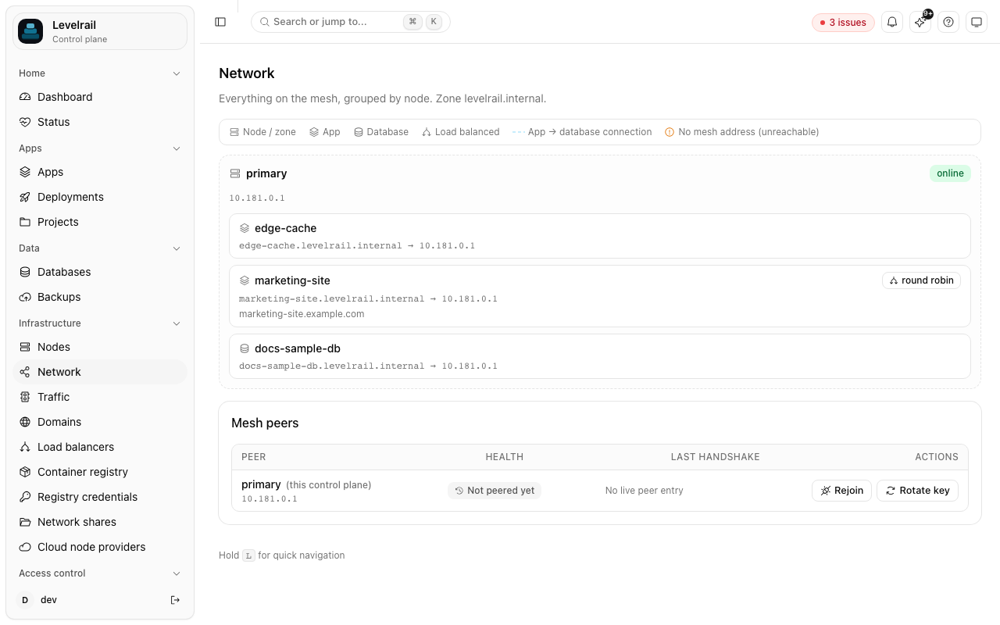
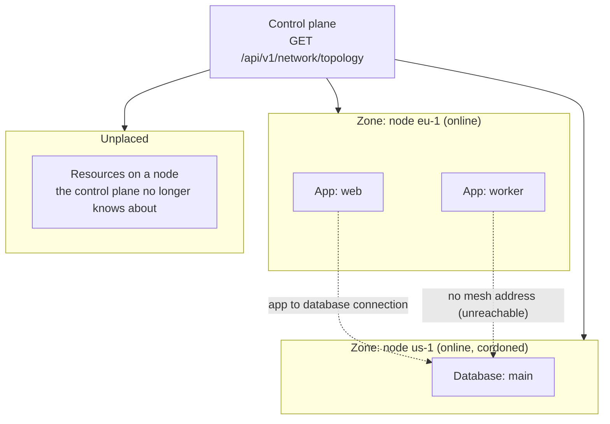

The **Network** page shows every node, app, database, and load-balanced service on the mesh at once, grouped by node, with a note under each app for the database it connects to. It is read-only and built from data the dashboard already has, so it needs no configuration. Find it under **Infrastructure > Network**.

## Zones

The first card is always **This server (control plane)**, with its hostname and address. Apps and databases with an empty placement, or placed on the control plane's own node, are listed there, so a single server shows one card and no warnings. Every other enrolled node is its own card, labeled with the node's optional **Region** field (set on the node's detail page; free text) or its name.

Resources placed on a node ID the control plane does not know (for example, a deleted node) land in an **Unplaced** card that names the stale node IDs, instead of being dropped. Move them to this server from the app or database, or re-add the node.

A node card's header also shows the node's status (`online`, `offline`, `pending`) and a separate **Cordoned** badge when the node isn't schedulable, plus its mesh address or "Not on the mesh yet" when it has none.

Each resource row shows its internal DNS name (with a copy button) and, for an app, its port. With the mesh off the row carries a neutral **local** tag. The summary row above the cards shows servers, mesh state, the internal zone, and the resource count.

## Mesh networking card

The **Mesh networking** card shows whether the mesh is off, on, waiting for a restart, or failed to start, with a readiness checklist and an **Enable mesh** button (administrators only). See [Multi-node](/multi-node#enabling-the-mesh-on-the-control-plane) for what each check means and the CLI (`levelrail-cli network mesh status|enable|disable`). The API is `GET` and `PUT /api/v1/mesh/settings`.

The Network page also has a **Restart control plane** button (administrators only), used when the mesh is waiting for a restart. The CLI equivalent is `levelrail-cli system restart --wait`, see [CLI reference](/cli-reference#system-restart).

## Reading the connections

An app row shows **Connects to `<database>`** whenever the app has a connection to it, from either the [connections feature](/connecting-apps-to-databases) or the older single-attachment flow. Both are combined here, so this view reflects every app-to-database link regardless of which mechanism created it.

When the mesh is on, an app or database with no mesh address shows a "No mesh address" warning: it exists in the desired state but the mesh reconciler hasn't given it an address yet, so any cross-node connection to or from it will not resolve until that changes. A remote app also needs a healthy mesh path before the control plane's ingress can serve its domains: see [Routing to apps on remote nodes](/multi-node#routing-to-apps-on-remote-nodes).

## Legend

- **Node / zone**: a managed node, grouped by region.
- **App** / **Database**: a deployed app or [managed database](/managing-databases), placed under the node it runs on.
- **Load balanced**: a service the reconciler is load-balancing across its own replicas (this platform balances a service's own replicas, not multiple distinct backends).
- **Connects to**: a note under an app for each database it connects to.
- **No mesh address**: the mesh is on but the resource has no mesh address yet. Never shown while the mesh is off.
- **local**: the resource is on this server and reachable directly.

## From the CLI and API

`levelrail-cli nodes topology` prints the same summary as a table, and `--json` prints the raw response. The API is `GET /api/v1/network/topology` (`read` ability), documented in the [API reference](/api-reference).

## Troubleshooting

### Apps show "No mesh address" even though the mesh is enabled

The mesh is on but the app hasn't been assigned an internal DNS name yet.

Likely cause: the mesh reconciler hasn't run since the app was deployed, or the WireGuard device is not healthy on some nodes.

How to confirm: open the Infrastructure > Network page and look for the "No mesh address" warning. Also run `levelrail-cli network mesh status` to check if the mesh is healthy.

Fix: wait a minute for the reconciler to run. If the warning persists, check mesh status with `levelrail-cli network mesh status` and look for any failure reasons. If the mesh shows failures, restart the control plane with `levelrail-cli system restart --wait` and give the mesh a moment to establish peer connections.

### Apps on different nodes cannot reach each other

An app on one node cannot connect to an app or database on another node by internal DNS name.

Likely cause: the mesh is off, or there is a network partition between the nodes.

How to confirm: open Infrastructure > Network and check if the mesh is on (the Mesh networking card should show "On"). Also run `levelrail-cli nodes connectivity` to see which node pairs can reach each other.

Fix: if the mesh is off, enable it with Infrastructure > Network > **Enable mesh** or `levelrail-cli network mesh enable`. If connectivity is broken between specific nodes, check that UDP 51820 is open between them (or the configured mesh port), and that all nodes have the WireGuard device (`ip link show wg0` on the node). If WireGuard is missing, install it and restart the agent.

