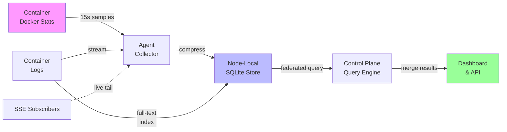

<div className="flex flex-wrap items-center gap-2 not-prose"><span className="inline-flex h-9 w-9 items-center justify-center rounded-lg bg-white p-1.5 ring-1 ring-black/10"></span><span className="inline-flex h-9 w-9 items-center justify-center rounded-lg bg-white p-1.5 ring-1 ring-black/10"></span><span className="inline-flex h-9 w-9 items-center justify-center rounded-lg bg-white p-1.5 ring-1 ring-black/10"></span><span className="inline-flex h-9 w-9 items-center justify-center rounded-lg bg-white p-1.5 ring-1 ring-black/10"></span><span className="inline-flex h-9 w-9 items-center justify-center rounded-lg bg-white p-1.5 ring-1 ring-black/10"></span></div>

Every app gets CPU, memory, network, disk IO and request metrics without any setup. You also get full-text log search with live tail, and alert rules that can notify you by email, Slack, Discord, or a webhook. Metrics and logs stay in each node's local store and the control plane queries them on demand, so there is no separate observability stack to install.

## What this covers

| You want to | Go to |
| --- | --- |
| Query a metric or search logs right now | [Quick start](#quick-start) |
| Find out why an app is slow or down | [Investigating a spike](#investigating-a-spike), [Failure context](#failure-context) |
| Get paged when something breaks | [Alert rules](#alert-rules), [Notification channels](#notification-channels) |
| Stop alert noise during maintenance | [Silences, maintenance windows, and noise control](#silences-maintenance-windows-and-noise-control) |
| Change retention or sampling | [Rollups and retention](#rollups-and-retention) |
| Script it | [API reference](#api-reference), [CLI](#cli) |

<Accordion title="For contributors: where this lives in the source">
- `internal/telemetry`: storage and query
- `internal/alerting`: rule evaluation and notification
- `internal/api/metrics.go`, `node_metrics.go`, `database_metrics.go`: metrics handlers
- `logs.go`, `live_logs.go`, `logs_download.go`: log handlers
- `app_resource_usage.go`, `alerts.go`, `notification_channels.go`: supporting handlers
</Accordion>

## Quick start

<Steps>
<Step title="Query one app's CPU over the last hour, in 5-minute buckets">

<CodeGroup>
```bash curl
curl -s -H "Authorization: Bearer $TOKEN" \
  "https://your-control-plane/api/v1/apps/my-app/metrics?metric=cpu_percent&step=5m"
```
```bash CLI
levelrail-cli apps metrics my-app --metric cpu_percent --since 1h --step 5m
```
</CodeGroup>

Response:

```json
{ "metric": "cpu_percent", "points": [
  { "timestamp": "2026-09-12T09:00:00Z", "value": 4.2, "count": 20 },
  { "timestamp": "2026-09-12T09:05:00Z", "value": 5.1, "count": 20 }
] }
```

</Step>
<Step title="Search that app's logs for an error">

<CodeGroup>
```bash curl
curl -s -H "Authorization: Bearer $TOKEN" \
  "https://your-control-plane/api/v1/apps/my-app/logs?from=2026-09-11T00:00:00Z&q=panic"
```
```bash CLI
levelrail-cli apps logs my-app --since 24h --q panic
```
</CodeGroup>

</Step>
<Step title="Connect a Slack channel and test it">

```bash
levelrail-cli channels create --name "on-call" --kind slack --notify-url https://hooks.slack.com/services/...
levelrail-cli channels test <id>
```

</Step>
<Step title="Create a threshold alert that notifies through the channel">

```bash
levelrail-cli apps alerts create my-app --name "high CPU" --kind threshold \
  --metric cpu_percent --comparator ">" --threshold 90 --for-duration 5m \
  --channel-id <channel-id>
```

<Warning>
A rule created without `--channel-id` (and without `--notify-url`) is saved but notifies nobody. The CLI prints a warning, the API returns it in `warnings`, and the dashboard dialog shows a notice.
</Warning>

</Step>
<Step title="Watch it fire">

`levelrail-cli apps alerts list my-app` shows `FIRING=true` once the condition holds for 5 minutes. A delivery row appears under `levelrail-cli channels deliveries <channel-id>`.

</Step>
</Steps>

## Investigating a spike

`GET /api/v1/apps/{name}/investigate?from=&to=` returns everything that explains one time window in a single response. The window can be at most `APP_INVESTIGATE_MAX_SPAN` (default 24h).

- `summary` and `baseline`: request count, rate, 4xx and 5xx share, p50, p95 and p99 for the window and for the equal-length window before it.
- `top_routes` and `status_codes`: the ten busiest route templates with share, 5xx share and mean latency, and the exact status code counts.
- `timeline`: one ascending list of deploys, rollbacks, config, env, secret, domain, scale and [load balancer](/load-balancing) changes (from the same sources as [What changed before an alert](#what-changed-before-an-alert), with the most recent effective change flagged `likely_cause`), container restarts (a burst collapses into one entry with a count), and resource saturation (CPU or memory held at or above a threshold for several samples). It looks back `APP_INVESTIGATE_LOOKBACK` before the window, because the cause usually comes before the symptom.

| Variable | Default | Meaning |
| --- | --- | --- |
| `APP_SATURATION_CPU_PERCENT` | 90 | CPU percent that counts as saturated |
| `APP_SATURATION_MEMORY_PERCENT` | 90 | Memory usage as a percent of its limit that counts as saturated |
| `APP_SATURATION_MIN_SAMPLES` | 2 | Consecutive samples required, so one blip is ignored |
| `APP_INVESTIGATE_LOOKBACK` | 30m | How far before the window changes are collected |
| `APP_INVESTIGATE_MAX_SPAN` | 24h | Widest window accepted |

<Tabs>
<Tab title="Dashboard">
On the app's Metrics tab, click anywhere on a chart to select that moment. The investigation panel opens with the same data. Deploy markers on every chart open the deploy (status, image, commit) on click, and "View logs at this time" opens the Logs tab with the window already set.
</Tab>
<Tab title="CLI">
```bash
levelrail-cli metrics investigate <app> [--at T --window 10m | --from T --to T]
```
</Tab>
<Tab title="API">
```bash
curl -s -H "Authorization: Bearer $TOKEN" \
  "https://your-control-plane/api/v1/apps/my-app/investigate?from=2026-09-12T03:00:00Z&to=2026-09-12T03:30:00Z"
```
</Tab>
</Tabs>

## Failure context

`GET /api/v1/apps/{name}/failure-context` tells you why an app is down without opening the log viewer.

| State | When |
| --- | --- |
| `crashlooping` | At least `APP_FAILURE_CONTEXT_RESTARTS` (default 3) restarts in the last `APP_FAILURE_CONTEXT_WINDOW` (default 15m) |
| `deploy_failed` | The newest deploy attempt failed |
| `healthy` | Neither of the above |

For a crashloop the response carries the last `APP_FAILURE_CONTEXT_LINES` (default 200) lines of the most recently active container, with the total available. For a failed build it carries the tail of the build output. For any other failed deploy it carries the app's runtime log tail.

The app overview page shows it automatically when the state is not `healthy`, and `levelrail-cli logs failure <app>` prints it.

Notifications carry the same context. A firing crashloop alert attaches the last 200 lines, and so does a failed deploy notification. Chat channels get the last 10 lines (capped at 1200 characters). The generic webhook payload gets `log_lines` with up to 200 and the `attempt_id`.

## Dashboard pages

<AccordionGroup>
<Accordion title="Per-app, database and node metrics" defaultOpen>
- `/apps/$name/metrics` (`MetricsDashboard`): CPU, memory, disk IO, network IO, request rate, error rate, p50/p95/p99 latency and restarts. A range picker (15 minutes to 30 days, or a custom window, kept in the URL so it is a permalink), a "compare to previous period" toggle, and deploy and restart markers on every chart. Series are downsampled server side. Click a deploy marker for its status, image and commit, or click the chart to open the investigation panel for that moment.
- `/databases/$name/metrics` (`DatabaseMetricsDashboard`): the same charts scoped to a [managed database](/managing-databases).
- Node metrics (`NodeMetricsDashboard`): the sum-across-placed-services view plus real disk and patch readings.
</Accordion>
<Accordion title="App health timeline">
`/apps/$name/overview` shows `AppHealthTimeline`, a compact 24h/7d strip answering "what happened to this app, and when". It plots:

- Deploy markers: green succeeded, red failed, blue running.
- Container restarts: amber, bucketed so a burst reads as one marker with a count.
- Shaded error windows: a failed deploy from start to finish, or a crashloop of 3 or more restarts with under 15 minutes between them.

Markers are keyboard focusable with aria labels and show details on hover or focus. Enter or click opens the deploy's logs (deploys) or the app's logs (restarts). It reads only existing data (`GET /api/v1/apps/{name}/deploy-attempts` and the `container_restart_count` metric), so there is no new API or CLI surface: the same data is available from `levelrail-cli apps deploys list` and the metrics API. If telemetry is not configured, only deploys are shown.
</Accordion>
<Accordion title="Logs and slow queries">
- `/apps/$name/logs`: two tabs, `Live` (LiveLogViewer, default) and `Search` (LogSearchPanel). Search filters by text, level, stream, container and structured JSON fields (`key=value`, `key!=value`, `key~text`, `key>n`), takes `from`/`to` from the URL (the investigation panel links here), and "Copy permalink" copies the exact filter and time range. The live tail can be paused without losing lines.
- `/apps/$name/deploys/$deployId/logs` is separate: it tails a specific deploy attempt's output.
- `/databases/$name/logs`: the same live/search pair (LiveDatabaseLogViewer, DatabaseLogSearchPanel) for managed databases.
- `/databases/$name/slow-queries` (`DatabaseSlowQueriesPanel`): the slow query log for Postgres and MySQL, sortable by duration or timestamp with a minimum-duration filter.
</Accordion>
<Accordion title="Fleet overview and alerts">
- **Dashboard home**: `FleetUtilizationSummary` shows a compact fleet-wide CPU/memory/disk card (backed by `GET /api/v1/nodes/resource-usage`, polled every 30 seconds), above `TopResourceConsumers` (ranks every app by latest CPU, memory and network reading, backed by `GET /api/v1/apps/resource-usage`) and `FleetResourceChart` (a 30-minute rolling history of total CPU and memory across all apps, polled every 30 seconds from the same endpoint). All three render nothing when telemetry is unconfigured or no samples exist.
- **Nodes list** (`/nodes`): the CPU, Memory and Disk columns read the same `GET /api/v1/nodes/resource-usage` snapshot, keyed by node ID.
- `/apps/$name/alerts` (`AlertRulesPanel`): lists, creates, edits and deletes alert rules, and shows each rule's current firing state.
- **Settings -> Notification channels** (`NotificationChannelTable`): connect, edit, delete, test, and view delivery history for channels.
</Accordion>
</AccordionGroup>

## Live tailing vs stored search vs download


Live tail, stored search and download are three ways to read the same log store.

Log collection resumes where it stopped. After a control plane restart, or when a container exits and its log stream reconnects, collection continues from the newest stored line for that container. It does not re-read Docker's whole buffer, so lines are not duplicated.

| Read | Endpoint | Use it for |
| --- | --- | --- |
| Live tail (SSE) | `GET /api/v1/apps/{name}/logs/stream` | Watching an app right now |
| Stored search | `GET /api/v1/apps/{name}/logs` | "Why was this app slow at 3am last Tuesday" |
| Download | `GET /api/v1/apps/{name}/logs/download` | Support tickets and archives |
| Compact query | `levelrail-cli logs query <app>`, MCP `query_logs` | Agents and quick triage |
| Database logs | `/api/v1/databases/{name}/logs`, `/logs/stream` | Same as apps, for managed databases |

<AccordionGroup>
<Accordion title="Live tail details" defaultOpen>
- Opens with a short backfill: the last 5 minutes, capped at 200 lines, oldest first. If that window is empty, it widens to 1 hour, then 24 hours, then 7 days, so a quiet container still shows its last output.
- Streams every new line as `LogCollector` receives it from Docker.
- The handler subscribes to the live broadcaster before running the backfill query, so there are no gaps.
</Accordion>
<Accordion title="Stored search parameters">
| Parameter | Meaning |
| --- | --- |
| `from`, `to` | RFC3339 window, default last hour |
| `q` | Full-text phrase |
| `stream` | `stdout` or `stderr` |
| `container` | Container id prefix |
| `field` | Repeatable structured JSON filter, at most 8 |
| `level` | Minimum level: trace, debug, info, warn, error, fatal |
| `limit` | Keep only the newest N matches |

- Field filters look like `field=status=500`, `field=route~/pay`, `field=latency>=250`. Dotted keys such as `req.user.id` reach nested objects. A line that is not JSON, or lacks the key, matches only `!=`.
- `level` keeps lines at or above it, using the JSON `level` or `severity` field or a level token near the start of a plain line. Lines with no detectable level are dropped when it is set.
- Each entry carries its `container` id and, when detected, a `level`. The response lists the `containers` that matched (before the container filter) with line counts, and `total` (matches before `limit`).
</Accordion>
<Accordion title="Compact query for agents">
`levelrail-cli logs query <app>` and the MCP `query_logs` tool filter by level, time window (`--since` and `--until`, a duration or RFC3339), deploy attempt (`--deploy`, the window from that attempt's start to the next attempt's start) and text (`--text`).

It returns an excerpt of the newest matching lines, never a full dump: at most `--max-lines` lines (default 100) and a byte cap (default 8 KB, set with `--max-bytes` or `APP_MCP_LOG_MAX_BYTES`), plus counts and a notice such as `showing 40 of 1,812 matching lines (newest), use since/until or level to narrow`. It uses stored search with `level` and `limit`. `--json` prints the excerpt as one object.
</Accordion>
<Accordion title="Download and database logs">
**Download** takes the same `from`, `to` and `q` filters as stored search and returns a plain-text attachment (not JSON), capped at 5,000 lines. There is no CLI command today: use the browser download, or `curl` with query params and a bearer token.

**Database logs** mirror the app endpoints exactly (same query params, same SSE shape) and use the resource ID prefix `database:` instead of `service:`. There is no download endpoint for databases yet.
</Accordion>
<Accordion title="Reading lines in the log viewer (client side)">
- Each row gets a subtle level tag (ERR, WRN, INF, DBG) detected from JSON `level` or `severity` keys, `level=WARN` style key/value pairs, or a leading `ERROR`, `WARN`, `INFO` or `DEBUG` prefix.
- The level chips (All, Errors, Warnings, Info, Debug) filter by detected level. Errors also includes every stderr line.
- Click a row to expand it: JSON lines are pretty printed, other lines wrap in full, and Copy line copies the raw text.
- "Jump to first error" scrolls to the first error or stderr line in the current view.
</Accordion>
</AccordionGroup>

## Service level objectives

An app's Alerts section shows one card per `slo_burn` rule: the error budget remaining for the window, a status (healthy, burning, paging, or no traffic) and the burn rate of each alert tier, computed from the app's ingress request metrics exactly as the rule evaluates them (`GET /api/v1/apps/{name}/slo-preview`, `levelrail-cli apps alerts slo`). An app that serves traffic with no SLO is offered a one click rule instead.

## Database slow query log

`GET /api/v1/databases/{name}/slow-queries` returns structured slow-query entries (timestamp, duration, query text, rows examined where the engine reports it). Default `limit` is 100.

| Engine | Source | Notes |
| --- | --- | --- |
| Postgres | `log_min_duration_statement` is always set on the container (default 1000ms), so statements at or above it are logged as `duration: N ms  statement: ...` into the container log stream. The handler reads them from the log store. | No rows-examined count. |
| MySQL | The built-in slow query log is enabled (`slow-query-log=1`, `long-query-time` from the same threshold), writing a file in the container's data directory. The handler execs into the running container and reads the last 4,000 lines. | Needs exec support configured on the control plane (same as `apps/{name}/exec`), otherwise 501. |
| Redis, MongoDB, MariaDB, KeyDB, Dragonfly, ClickHouse | Not supported | Returns 400. |

<Note>
The threshold is control-plane-wide, not per database: `APP_DATABASE_SLOW_QUERY_THRESHOLD_MS` (default 1000). Changing it takes effect on the database's next reconcile (container recreate).
</Note>

<Accordion title="Why MySQL reads a file instead of the log stream">
MySQL 8's FILE log sink cannot reliably open `/dev/stderr` from inside a container (it fails with `Could not use /dev/stderr for logging`), so there is no working Docker-log-stream source for this engine. The handler uses the same `docker.Runtime.Exec` primitive backups already use to run `pg_dump` and `mysqldump`. Redis's SLOWLOG is a live-server command against an in-memory ring buffer, not something that appears in log output, so it is not planned for this endpoint.
</Accordion>

## Traces

Apps can send OpenTelemetry traces to the control plane and read them as waterfalls on the app's Traces page. See [Tracing](/tracing).

Apps can also report errors with any Sentry SDK and read them as grouped issues tied to deploys. See [Error tracking](/error-tracking).

## Exporting to OpenTelemetry

Metrics and logs can be pushed to an OTLP/HTTP collector, opt-in per destination. Pull-based, node-local collection stays the default and nothing leaves the node until you add a destination. The export set includes per-app container metrics, platform self metrics (reconcile lag, deploy duration and queue depth, agent connections) and container logs. See [Data export](/data-export#otlp-logs) and `levelrail-cli otel destinations`.

## External log drains

`PUT /api/v1/apps/{name}/log-drain` forwards an app's container log stream to an external HTTP endpoint or syslog target. The drain is in addition to, never instead of, the node-local store: it taps the same `LogBroadcaster` a live SSE viewer subscribes to.

- Configure it from the app's log-drain card in the dashboard, or with `levelrail-cli apps log-drain set`.
- Clearing a drain (`DELETE`) stops the external forward only. Historical search and live tail on this control plane are unaffected either way.

## What gets collected

**Per app or database** (`service:<name>` and `database:<name>`): the collector writes 7 metrics, matching `web/src/types/metrics.ts`'s `MetricName`.

| Metric | Meaning |
| --- | --- |
| `cpu_percent` | CPU use |
| `memory_usage_bytes`, `memory_limit_bytes` | Memory use and limit |
| `network_rx_bytes`, `network_tx_bytes` | Network IO |
| `disk_read_bytes`, `disk_write_bytes` | Disk IO |

**Per node** (`node:<id>`): `GET /api/v1/nodes/{id}/metrics` returns two kinds of reading.

1. **Sum across placed services** for `cpu_percent`, `memory_usage_bytes`, `network_rx_bytes`, `network_tx_bytes`, `disk_read_bytes`, `disk_write_bytes`. This is a sum of already-collected per-container samples, not true host utilization (`internal/agent` has no host-level stats collection). `memory_limit_bytes` is excluded to avoid multiplying the host's approximate total memory by N containers.
2. **Real per-node readings** for disk usage and OS patch counts (`disk_used_bytes`, `disk_total_bytes`, `os_patches_available`, `os_security_patches_available`), collected directly by `HostDiskCollector` and `HostPatchCollector`.

The response includes `resource_count`: how many placed services contributed a sample (for summed metrics), or `1` or `0` for whether host data exists (for real per-node metrics).

**Request metrics (RED)**, measured at the ingress with no app changes: see [Request metrics](#request-metrics-red).

<Note>
Container restart count, build duration and deploy frequency are recorded as discrete events or computed client-side from deploy-attempt history, not as continuous collectors.
</Note>

## Request metrics (RED)

Every proxy and static route in the embedded Caddy goes through a small `request_stats` handler (`internal/ingress/request_stats.go`). It times the request and counts it into fixed in-memory counters per route host. Idle cost is near zero and nothing is written to log files.

- Query strings and client addresses are never read.
- Request paths are reduced to a bounded route template (see [Route and status breakdown](#route-and-status-breakdown)), so cardinality stays bounded.
- The sampler drains the counters every 15 seconds, maps hosts to apps through the ingress route table, and writes only non-zero values under the app's `service:<name>` resource id. Platform routes (dashboard, registry, models) are not attributed to an app.
- Requests rejected by the WAF or rate limiter count as 4xx. Load balancer and proxy failures (502, 503, 504 raised by the reverse proxy) also count under `http_upstream_errors`.

Metrics are per-tick counter deltas, and a tick with no traffic writes nothing.

| Metric | Meaning |
| --- | --- |
| `http_requests` | Requests finished |
| `http_responses_2xx`, `_3xx`, `_4xx`, `_5xx` | Requests by status class |
| `http_upstream_errors` | Proxy failures (502, 503, 504) returned by the reverse proxy |
| `http_bytes_in`, `http_bytes_out` | Request content length and response body bytes |
| `http_latency_bucket_<le>` | Latency histogram, upper bounds 5, 10, 25, 50, 100, 250, 500, 1000, 2500, 5000, 10000 ms plus `inf` |

Percentiles are estimated from the summed histogram buckets (linear interpolation inside a bucket), so they merge correctly across time buckets, rollup tiers and nodes.

<Tabs>
<Tab title="Dashboard">
The Metrics tab of an app.
</Tab>
<Tab title="CLI">
```bash
levelrail-cli apps requests <name>
```
</Tab>
<Tab title="API">
`GET /api/v1/apps/{name}/requests?from=&to=&step=` returns rate, 4xx and 5xx error rate, p50, p95, p99, bytes, upstream errors and a summary. `GET /api/v1/apps/{name}` also carries a `requests` summary (rate, error rates, p95 over `APP_REQUESTS_SUMMARY_WINDOW`, default 5m) that later features such as auto-rollback and SLO alerts can consume.
</Tab>
<Tab title="MCP and Go">
The `get_app_requests` MCP tool. In Go, `telemetry.SummarizeRequests(ctx, querier, app, window, now)`.
</Tab>
</Tabs>

## Route and status breakdown

To tell you which route made the 3am spike slow, the request handler also counts, per app and minute, requests, 4xx, 5xx and total latency per **route template**, and requests per **exact status code**.

Only the URL path is read. A path is cut to its first segments, and any segment that looks like an identifier (digits, hex, UUID, long tokens) becomes `:id`, so `/api/users/42/orders/9f86d081...` is stored as `/api/users/:id/*`. Distinct routes per tick are capped, with the rest folded into `other`.

| Variable | Default | Meaning |
| --- | --- | --- |
| `APP_REQUEST_ROUTES` | on | Set to `off` to stop recording routes. Exact status codes are still counted |
| `APP_REQUEST_ROUTE_MAX` | 50 | Distinct routes kept per tick before `other` |
| `APP_REQUEST_ROUTE_DEPTH` | 3 | Path segments kept in a template |

The breakdown is stored in `telemetry.db` at one minute resolution and pruned with `APP_METRICS_RETENTION_1M`. It is node-local like the rest of the telemetry and merges across nodes through the same query layer.

## Referrers and countries

The app Traffic tab, `levelrail-cli traffic <app> --window 7d` and the `get_app_traffic` MCP tool also show the top referrer hosts and top countries, next to per replica percentiles. The Traffic tab charts draw a line at every deploy, so a latency step at 3am can be matched to the release that caused it.

Only the host of the `Referer` header is kept (never the path or query), and requests with no referrer count as `direct`. Requests whose referrer is the app's own host are skipped as `direct`. Countries appear only when a geo source is active (`APP_GEOIP_DB` or a trusted country header such as `CF-IPCountry`); with none, the countries list is empty and nothing is looked up. No client address is stored, and no script runs in the visitor's browser.

| Variable | Default | Meaning |
| --- | --- | --- |
| `APP_REQUEST_AUDIENCE_MAX` | 32 | Distinct referrer hosts and countries kept per tick before `other` |

The counts live in `telemetry.db` at one minute resolution, pruned with `APP_METRICS_RETENTION_1M`, and merge across nodes through the same query layer. Windows are `5m`, `1h`, `24h` and `7d`.

## Downsampling and period comparison

Every series query bounds its size instead of returning raw 15 second samples for a long range.

- `max_points=N` on `GET /api/v1/apps/{name}/metrics` and `/requests` widens the bucket to the smallest round step (15s up to 24h) that keeps the series within N points. The dashboard and CLI send 600. `APP_METRICS_MAX_POINTS` (default 600, at most 5000) is the largest value the server honours. A 7 day range at 15 second resolution is 40,320 raw samples and comes back as 336 points.
- Each metric point carries `max`, the largest raw sample in its bucket, so a one minute spike survives averaging into a 30 minute bucket.
- `compare=previous` adds `previous_points`, the equal-length window before `from`, with timestamps shifted forward so it overlays the current series. `/requests` also returns `previous_summary`.
- Queries pick raw, 1 minute or 1 hour rollup tiers (see [Rollups and retention](#rollups-and-retention)), so a long range never scans raw rows.

## Resource-usage ranking

`GET /api/v1/apps/resource-usage` tells you what every app is doing right now in one call, so a page load does not fire one query per app.

- Every app that exists is included, including ones with no samples yet (a freshly deployed app appears as a zero-usage row, not missing).
- Each field (`cpu_percent`, `memory_usage_bytes`, `memory_limit_bytes`, `network_rx_bytes`, `network_tx_bytes`) is present only when a sample has been recorded.
- One `LatestByMetric` call per metric, not one query per app.

## Batched apps overview

`GET /api/v1/apps-metrics` returns, in one response, every app the caller can read with its latest CPU and memory, a one hour request rate, 5xx error rate, p95 latency, a 12 point request-rate sparkline (5 minute buckets) and the last deploy time.

- Pass `?names=a,b` to limit it.
- The dashboard apps list and home tiles read only this endpoint, so a page of apps costs one request instead of two per row.
- The number of apps included is capped by `APP_APPS_METRICS_MAX` (default 200).
- CLI: `levelrail-cli apps overview [name ...]`.

## Fleet utilization

`GET /api/v1/nodes/resource-usage` tells you how full your servers are in one call. It is the node-scoped counterpart to `apps/resource-usage`, read by the node list's CPU, memory and disk columns and the dashboard's fleet summary card. The response is `{ "nodes": [...], "fleet": {...} }`.

**Each node row**

- `cpu_percent` and `memory_usage_bytes` are the sum of every placed service's latest sample (sum of containers, not a true host read).
- `memory_total_bytes`, `disk_used_bytes` and `disk_total_bytes` are real host reads, but today only the node running the control plane populates the disk fields (see [Not built yet](#not-built-yet-deliberate-gaps)). A field is absent, not zero, when nothing has reported it.
- Memory attribution: `levelrail_memory_bytes`, `other_containers_memory_bytes` (with the largest few in `other_containers`) and `system_memory_bytes` split a node's used memory, and always sum with the placed-services figure to the used total (`memory_total_bytes` minus `memory_available_bytes`).

<Accordion title="How remote nodes report memory">
The local node reads its own figures. A remote node's agent sends a periodic host report (memory total and available, its own process RSS, and its running containers that carry no Levelrail instance label, top 5 by memory), and the control plane merges it into the same row, so `memory_total_bytes` and `memory_available_bytes` are populated for remote nodes too. Reports are held in memory and expire after 3 minutes. An agent that predates host reports sends none, and its row keeps the placed-services-only shape.
</Accordion>

**The `fleet` rollup** sums every node's numbers.

- `total_cpu_percent` is a raw sum, not a percentage of fleet capacity (no node reports its core count).
- `memory_used_percent` and `disk_used_percent` are only computed from nodes that reported a capacity figure. `nodes_with_memory_capacity` and `nodes_with_disk_capacity` say how many of `node_count` that covers, so a 3-node fleet where only 1 node has host metrics reads as "1/3 nodes reporting", never as if the percentage covered the whole fleet.

## Capacity forecast

`GET /api/v1/nodes/{id}/capacity-forecast` estimates how long until disk or memory runs out at the current rate. It is a rough heads-up built from the same `disk_used_bytes`, `disk_total_bytes`, `memory_total_bytes` and `memory_available_bytes` host samples the fleet views already read, not a second collector.

The method (`kit/forecast`) is an ordinary-least-squares line fit over the lookback window's samples, projected forward to the resource's total capacity. It assumes the recent rate of change continues in a straight line, which real usage rarely does (a cleanup, a larger image, a burst of logs all bend the line). Every response carries a plain-English disclaimer in `note`.

```json
{
  "node_id": "node_a",
  "lookback_window": "336h0m0s",
  "disk": {
    "current_used_bytes": 42000000000,
    "total_bytes": 50000000000,
    "slope_bytes_per_day": 400000000,
    "days_until_full": 20,
    "projected_full_at": "2026-10-22T00:00:00Z",
    "sample_count": 120,
    "coverage_window": "240h0m0s"
  },
  "memory": null,
  "note": "Rough projection from the recent usage trend, assuming it continues in a straight line. This is a heads-up, not a guarantee: real usage rarely grows this predictably."
}
```

<Warning>
`disk` and `memory` are `null`, not a zero-value object, when there is not enough history (fewer than 6 samples, or samples spanning less than 6 hours) or when the fitted trend is flat or improving (slope `<= 0`). Read absence as "nothing to warn about", never as "0 days left". The node detail page's forecast card follows the same rule and renders nothing when both are absent.
</Warning>

- The lookback window defaults to 14 days and is overridable with `APP_CAPACITY_FORECAST_LOOKBACK` (a Go duration string, e.g. `720h`).
- It is a deterministic, read-and-suggest layer: never an external model, never applied automatically.
- CLI: `levelrail-cli nodes capacity-forecast <id>`.

## Health & readiness score

`GET /api/v1/apps/{name}/health-score` combines signals this page otherwise shows one at a time into a pass, warn or fail verdict per category. It is computed live on every call (no new reconciler loop, no cache) and is read only: every category reads data an existing endpoint already exposes.

| Category | Pass | Warn | Fail |
| --- | --- | --- | --- |
| Deploy health | Last 5 finished deploy attempts all succeeded | Some recent attempts failed, or no finished attempts yet | Most recent attempt failed, or a `crashloop` alert rule is currently firing |
| Security | TLS healthy for every domain and every `{ secret: true, required: true }` env var has a stored value | Certificate expiring soon, or no certificate issued yet for a domain | Certificate expired, or a required secret is missing |
| Resilience | Readiness/liveness probe configured and every named volume's most recent backup succeeded | No health check configured, a volume has no backup schedule, or a scheduled backup has never run | Most recent backup attempt failed for a volume |
| Observability | At least one enabled alert rule with a notification channel or `notify_url` attached | Alert rules exist but are disabled or have nowhere to notify | No alert rules configured for this app |

The TLS check reuses `alerting.ListCertificates`, the same computation behind `GET /api/v1/certificates` and a `cert_expiry` rule, scoped to the app's own domains. The crashloop check reads a `crashloop` rule's persisted `firing` state, not the live in-memory restart tracker.

Dashboard: the **Health & readiness** panel on an app's Overview tab (`AppHealthScorePanel`), polling every 30 seconds while open. CLI: `levelrail-cli apps health-score <name>`.

## Alert rules

Rules of every kind live in one table (`alert_rules`). The evaluation loop (`internal/alerting.Engine`) runs every 30 seconds (`alertEvaluationInterval`, fixed, not env-configurable).

Each rule tracks its own pending and firing state and notifies only on transitions (firing or resolved), never on every tick it stays in the same state. That way people do not learn to ignore repeated alerts.

<Accordion title="Rule kinds and their configuration" defaultOpen>

| Kind | Scope | What it watches | Key fields |
| --- | --- | --- | --- |
| `threshold` | one app's own metric | latest value of `metric` vs `threshold`, debounced by `for_duration` | `metric`, `comparator` (`>`, `<`, `>=`, `<=`), `threshold`, `for_duration` |
| `crashloop` | one app | container restarts within a rolling window | `restart_count_threshold`, `restart_window` |
| `slo_burn` | one app | error budget burn rate over the app's ingress request metrics, see [SLO burn-rate alerts](#slo-burn-rate-alerts) | `slo` (target, optional latency limit) |
| `scheduled_task_failure` | one app's own scheduled task | consecutive failed runs of one task | `scheduled_task_id`, `restart_count_threshold` (reused as the failure-count threshold) |
| `scheduled_task_missed` | one app's own scheduled task | consecutive skipped occurrences of one task | `scheduled_task_id`, `restart_count_threshold` (default 1) |
| `scheduled_task_running_long` | one app's own scheduled task | a run in flight past its warning threshold | `scheduled_task_id` |
| `domain_health` | one app's own domains | a DNS check gone bad (not resolving, or resolving somewhere else) on any of the app's configured domains | `for_duration` (optional debounce) |
| `domain_not_resolving` | every domain, or one app's | a domain whose DNS check has found no record for the whole window | `for_duration` (default 30m) |
| `backup_missing` | one database (platform-wide) or one app's own volume | last successful backup trailing its own cron schedule's expected interval by more than a grace period | `backup_resource_kind` (`database` or `volume`), `backup_database_name` or `backup_service_name`/`backup_volume_name`, `for_duration` (reused as the overdue grace period, default 6h) |
| `cert_expiry` | platform-wide | every stored TLS certificate approaching or past expiry, or stuck mid-renewal | none required |
| `cert_expiring` | platform-wide, or one hostname | any certificate whose expiry falls within the window | `threshold` (days, default 14), `resource_id` `domain:<name>` to watch one hostname |
| `cert_renewal_stalled` | platform-wide | a renewal that has not moved the certificate's expiry for the stalled threshold (`APP_CERT_RENEWAL_STALLED_THRESHOLD`, default 6h), or an ACME failure that has persisted that long | none required |
| `patch_status` | platform-wide | every node's pending OS security patch count | none required (threshold is a control-plane default or env var, not a rule field) |
| `node_disk_space` | platform-wide | every node's disk-used percentage | none required |
| `node_resource_usage` | platform-wide | every node's summed placed-container CPU and memory | none required |
| `node_offline` | platform-wide | any node whose status is offline (agent stopped heartbeating); resolves when all are back | none required |
| `node_cert_expiring` | platform-wide | any node's agent certificate inside the warning window (renewal failing) or expired; revoked nodes are left out (see [agent certificates](/multi-node#agent-certificates-renewal-and-re-enrollment)) | `for_duration` (optional, overrides `APP_NODE_CERT_EXPIRY_WARNING`, default 21 days) |
| `control_plane_backup_stale` | platform-wide | the newest control plane self-backup snapshot (see [control plane backup](/control-plane-backup)) being older than a maximum age; quiet when scheduled backups are disabled or no snapshot exists yet | `for_duration` (reused as the maximum age, default 3d) |
| `restore_drill_failed` | platform-wide | a resource's latest restore drill is failed (see [backups and storage](/backups-and-storage)) | none required |
| `log_archive_stale` | platform-wide | a log archive policy's last run failed, or it has not succeeded within a maximum age (see [log archive](/log-archive)) | `for_duration` (reused as the maximum age, default three intervals, at least 2h) |
| `version_skew` | platform-wide | the running build is behind the latest release on the configured update channel | none required |
| `budget_threshold` | platform-wide | any project or team budget is at its warning level, over its limit or forecast to overrun this month | none required, see [usage and cost](/usage-and-cost) |

</Accordion>

<Note>
Three more domain kinds are planned and not evaluated yet: `dns_drift` (records differ from the last known state), `zone_not_delegated` (a zone's delegation is not active after a window) and `proxy_route_error` (a proxy route write or reachability check fails). A rule with one of these kinds is rejected today.
</Note>

### Platform-wide rules and thresholds

Platform-wide rules are created through an app's `/apps/{name}/alerts` URL, but that URL only decides where the rule is listed. The rule evaluates every certificate, node, or disk across the entire control plane regardless of which app created it.

Thresholds have defaults and can be overridden per control plane, not per rule.

| Signal | Default | Env var |
| --- | --- | --- |
| Cert expiry warning window | 14 days | none |
| Patch status | 1 pending security patch | `APP_ALERT_PATCH_STATUS_THRESHOLD` |
| Node disk space | 90% used | `APP_ALERT_NODE_DISK_SPACE_THRESHOLD_PERCENT` |
| Node CPU | 80% | `APP_ALERT_NODE_CPU_THRESHOLD_PERCENT` |
| Node memory | 4 GiB | `APP_ALERT_NODE_MEMORY_THRESHOLD_BYTES` |
| Domain health check interval | built-in default | `APP_ALERT_DOMAIN_HEALTH_CHECK_INTERVAL` |
| Backup missing grace period | 6h | `APP_ALERT_BACKUP_MISSING_GRACE_PERIOD` (or per rule via `for_duration`) |

<Accordion title="Backup missing rule logic">
The `backup_missing` rule has no cadence logic of its own. It reads the same `backup_schedule` cron expression and `backup_history` rows that `internal/backup.Scheduler` uses, computes the expected interval from the cron expression (`kit/cronexpr`), and fires once the last succeeded attempt is older than that interval plus a grace period.

- A target with attempts but no success in the lookback fires, anchored to its oldest attempt (a silently-failing backup reads the same as one that stopped).
- A target with no schedule or no history yet stays quiet on day one.
</Accordion>

### Crashloop handling

**Alert attachment.** A firing `crashloop` rule attaches the last 200 lines of the crashlooping container's logs (from the last 15 minutes, see `crashloopLogLines` and `crashloopLogLookback` in `internal/alerting/engine.go`) to the notification. No API endpoint reconstructs those exact lines after the fact: `GET /api/v1/apps/{name}/failure-context` returns the current tail, and `AlertRulesPanel` links to the app's log view.

**Restart backoff.** The reconciler does not restart a container that keeps exiting on every Docker event.

- The first restart is immediate. Each further restart of the same container waits twice as long as the last: `APP_RESTART_BACKOFF_BASE` (default `5s`), doubling up to `APP_RESTART_BACKOFF_MAX` (default `2m`).
- The delay starts over once the container has stayed up for `APP_RESTART_BACKOFF_RESET` (default `10m`).
- While waiting, the app's `Ready` condition is `False` with reason `CrashLoopBackOff` and a message such as `keeps exiting (2 restarts), next restart in 9s`. `levelrail-cli apps status <name>` shows it.
- Set `APP_RESTART_BACKOFF_BASE=0` to restore restart-immediately behavior.
- The backoff is in memory, so a control plane restart clears it.

<Note>
The 2 minute maximum keeps a crashlooping app above the usual crashloop rule threshold (3 restarts in 10 minutes), so the rule keeps firing instead of resolving between restarts.
</Note>

### Auto-rollback

Alerts notify. By default they do not fix anything, and a failed deploy keeps retrying the same bad image until you step in (the reconciler is level-triggered, never edge-triggered). Auto-rollback is the escape hatch: it is opt-in, per app, and off by default.

<Tabs>
<Tab title="On crashloop">
```bash
levelrail-cli apps auto-rollback enable <app>
levelrail-cli apps auto-rollback status <app>
levelrail-cli apps auto-rollback disable <app>
```

Dashboard: the app's Deploys tab has an "Auto-rollback on crashloop" toggle above the deploy history list.

Once enabled, the first time a `crashloop` rule for that app transitions to firing, the control plane redeploys the most recent successful deploy attempt's image that differs from the current (crashlooping) one. It uses the same trigger path as the dashboard's "Rollback to this build" button and `apps rollback` (`POST /api/v1/apps/{name}/deploys`). The resulting deploy attempt shows in deploy history with source `auto_rollback`.
</Tab>
<Tab title="On SLO burn">
Three modes rather than on/off:

```bash
levelrail-cli apps auto-rollback-slo-burn set <app> auto             # roll back immediately, same as crashloop
levelrail-cli apps auto-rollback-slo-burn set <app> dry_run          # log what would have rolled back, never deploy
levelrail-cli apps auto-rollback-slo-burn set <app> pause_for_human  # open a pending deploy approval instead of deploying directly
levelrail-cli apps auto-rollback-slo-burn set <app> off              # default
levelrail-cli apps auto-rollback-slo-burn status <app>
```

Dashboard: the app's Deploys tab has an "Auto-rollback on SLO burn" mode selector next to the crashloop toggle.

- `auto` rolls back through the same `TriggerImageDeploy` path on the rule's pending-to-firing transition (and again if a genuinely new bad deploy lands while the rule stays continuously firing).
- `dry_run` never deploys. It records a `slo_burn_would_rollback` event in [alert history](#alert-history) so you can see what would have happened before turning `auto` on.
- `pause_for_human` opens a pending entry in `GET /api/v1/deploy-approvals` (the same queue a protected-environment deploy uses), so a teammate approves or rejects the rollback. It shows on the app's Deploys tab and the cross-app `/approvals` page.
</Tab>
</Tabs>

Guardrails, same for both:

- Fires at most once per crashloop (or firing) episode, because it only runs on the rule's pending-to-firing transition.
- If there is no older successful image to fall back to (never deployed before, or already at the oldest recorded image), it does nothing and leaves the alert to notify alone.
- Independent of the rule's own notification, which fires either way.

## Silences, maintenance windows, and noise control

Everything in this section sits between rule evaluation and notification. A rule keeps evaluating, keeps its own firing state, and is always recorded in [alert history](#alert-history). These controls decide only whether a notification goes out.

| Control | What it does |
| --- | --- |
| `for_duration` | Keeps a rule pending until its condition has held that long (threshold, domain health and other debounced kinds) |
| Consecutive failures | Condition must be true on N evaluation ticks (30 seconds apart) in a row. Per rule `consecutive_failures`, or `APP_ALERT_CONSECUTIVE_FAILURES` (default `1`, meaning off) |
| Silence | Mute matching alerts for a bounded time |
| Maintenance window | A recurring silence |
| Node-down inhibition | One node-offline alert instead of one per app |
| Flapping | Notify once with a summary, then hold |
| Grouping | Combine firing alerts into one message |
| Channel rate limit | Cap notifications per channel |

<Accordion title="Silences">
A silence has matchers (rule IDs, apps, nodes, rule kinds, severities, labels), a start and end, a creator and a reason.

- Every matcher you give must match. A list inside one matcher matches any of its entries.
- A silence needs at least one matcher, so it can never mute everything by accident.
- Silences last at most 90 days. One that ends early (`End now`, `alerts silences delete`) is kept as history, as are expired ones.
- App matchers apply to app-scoped rules (threshold, crashloop, scheduled task, domain health, backup missing). Platform-wide rules such as certificate expiry have no app and are matched by rule ID, kind, severity or label.
- Node matchers apply to apps placed on that node (by node name or ID).
- Rules carry an optional `severity` (`info`, `warning`, default `warning`, or `critical`) and `labels` for silences to match on.
- If a rule fires while silenced and is still firing when the silence ends, the held notification is sent then. If it resolves while silenced, no "resolved" message is sent for a firing you never heard about. Both cases are recorded in history.

**Quick silence.** Silence one rule for 1h, 4h or 24h from the rule's row, from the dashboard's Recent alerts card, with `levelrail-cli alerts silence <app> <rule-id> --for 4h`, or with the `silence_alert_rule` MCP tool.
</Accordion>

<Accordion title="Maintenance windows and node-down inhibition">
**Maintenance windows** are a recurring silence: a 5-field cron expression for each start, a duration, and an IANA timezone, applied to all alerts, a set of apps, or a set of nodes. The cron is evaluated on the wall clock in that timezone, so "03:00 Europe/Berlin" stays at 03:00 across daylight saving changes and the window keeps its nominal length. Windows are listed with whether they are active now and their next start.

**Node-down inhibition.** While a node is offline, alerts of apps placed on it are held (recorded as `inhibited`). Held alerts are released if the app is still firing after the node returns. Platform-wide rules, including the node-offline rule itself, are never inhibited.
</Accordion>

<Accordion title="Flapping, grouping and rate limits">
**Flapping.** A rule that fires more than `flap_threshold` times inside `flap_window` (defaults `APP_ALERT_FLAP_THRESHOLD=5`, `APP_ALERT_FLAP_WINDOW=30m`; `0` disables) is marked flapping. It notifies once with a summary, further fires and resolves are held (recorded as `flapping`), and one "stable" message is sent when its fires drop to half the threshold. Per-rule overrides: `flap_threshold`, `flap_window`.

**Grouping and deduplication.** With `APP_ALERT_GROUP_WINDOW` set (for example `2m`; default off), firing alerts for the same delivery target and app are buffered and sent as one message listing every alert with a count. A rule that fires twice in the window counts once, and a fire that resolves before the window closes sends nothing. Buffered alerts are flushed on shutdown.

**Per-channel rate limit.** At most `APP_ALERT_CHANNEL_RATE_LIMIT` notifications (default `30`; `0` disables) per `APP_ALERT_CHANNEL_RATE_WINDOW` (default `10m`) go to one channel. Excess notifications are recorded as `ratelimited`. Deploy notifications are not counted.
</Accordion>

<Note>
All noise state except silences, windows and history is in memory. A control plane restart forgets pending groups, streaks, flap counters and held notifications. Rule firing state itself is persisted, so a still-firing rule does not re-notify after a restart.
</Note>

| Variable | Default | Meaning |
| --- | --- | --- |
| `APP_ALERT_CONSECUTIVE_FAILURES` | `1` | Ticks a condition must hold before firing (per rule: `consecutive_failures`) |
| `APP_ALERT_FLAP_THRESHOLD` | `5` | Fires within the window that mark a rule flapping (per rule: `flap_threshold`) |
| `APP_ALERT_FLAP_WINDOW` | `30m` | Flapping window (per rule: `flap_window`) |
| `APP_ALERT_GROUP_WINDOW` | off | How long firing alerts are buffered into one message |
| `APP_ALERT_CHANNEL_RATE_LIMIT` | `30` | Notifications per channel per rate window |
| `APP_ALERT_CHANNEL_RATE_WINDOW` | `10m` | Rate limit window |
| `APP_ALERT_HISTORY_RETENTION` | `30d` | How long alert history is kept |

## Alert history

Every state change and notification decision is recorded: the rule, app, node, severity, the event (`fired`, `resolved`, `flapping`, `flap_ended`, plus `slo_burn_would_rollback` for auto-rollback on SLO burn's `dry_run` mode), and the outcome.

| Outcome | Meaning |
| --- | --- |
| `sent` | The notification was delivered |
| `failed` | Delivery failed; the error is stored |
| `silenced` | A silence or maintenance window matched (`silence_id` names it) |
| `inhibited` | The app's node was offline |
| `grouped` | Folded into one grouped message, or resolved before its group was sent |
| `ratelimited` | The channel rate limit was reached |
| `flapping` | Held because the rule is flapping |
| `skipped` | The rule or its channel is disabled, or (on a `slo_burn_would_rollback` event) `dry_run` mode logging what it would have done |

Where to see it:

- Dashboard: per app on `/apps/{name}/alerts`, and globally on `/alerts` (with outcome and event filters).
- CLI: `levelrail-cli alerts history`.
- API: `GET /api/v1/alert-history`.
- MCP: `list_alert_history`.

Entries are pruned after `APP_ALERT_HISTORY_RETENTION`. Who created, changed or removed a silence, window or rule is recorded separately in the generic audit log (`GET /api/v1/audit-log`), which covers every write request.

## What changed before an alert

Every firing app alert, its history entry, `diagnose` and the dashboard alert rows show what changed on the app in the last 30 minutes: deploys (with digest and who), rollbacks, config, domain, scaling and load balancer changes, freeze and maintenance events, and env or secret key names (never values). They come from the app event log, deploy attempts and the audit log, merged newest first by `internal/changes`.

The most recent change that took effect before the alert (a deploy, rollback, config, env, secret, domain, scaling or load balancer change) is tagged **Likely cause**. It is a heuristic: the nearest earlier change, not a proven culprit, and it never picks a restart, freeze or maintenance event or a failed deploy.

<Tabs>
<Tab title="Notifications">
Webhook, Slack, Discord, Telegram, email and the rest carry the top 5 changes, an "and N more" line and a link to the app's alerts page. The generic webhook adds `recent_changes` and `changes_link` fields. Discord and PagerDuty messages are capped to their receiver limits with the changes section kept.
</Tab>
<Tab title="API">
- `GET /api/v1/apps/{name}/changes?until=&window=` returns the list.
- `GET /api/v1/alert-history?include=changes` attaches it to fired entries.
- `GET /api/v1/apps/{name}/diagnose` includes it as `recent_changes`.
</Tab>
<Tab title="CLI and MCP">
- CLI: `levelrail-cli apps diagnose <app>` and `levelrail-cli alerts history --changes`.
- MCP: `diagnose_app_failure`, and `list_alert_history` with `include_changes`.
</Tab>
<Tab title="Dashboard">
Expand a fired row in the alert history or the dashboard's recent alerts card. Firing rules on an app's alerts page show the block inline.
</Tab>
</Tabs>

| Env var | Default | Meaning |
| --- | --- | --- |
| `APP_ALERT_CHANGE_WINDOW` | `30m` | How far back changes are collected |
| `APP_ALERT_CHANGE_MAX` | `20` | Cap on entries kept per alert |
| `APP_DASHBOARD_URL` | unset | Base URL for notification links; falls back to `http://<APP_PUBLIC_HOST>:<port>`, and with neither set no link is added |

## SLO burn-rate alerts

A `slo_burn` rule watches a request-based SLO over the app's ingress request metrics: availability (requests without a 5xx) or latency (requests under a limit, rounded down to the nearest histogram bound), with a target such as 99.9 over a 30 day budget window.

It uses the multiwindow multi-burn-rate method: a tier fires only when the burn rate is at or above its factor over both its long and its short window, so a brief blip does not page and a real outage does. Burn rate is how many times faster than sustainable the error budget is being spent.

| Tier | Factor | Windows | Severity |
| --- | --- | --- | --- |
| `page_fast` | 14.4x | 1h and 5m | critical (page) |
| `page_slow` | 6x | 6h and 30m | critical (page) |
| `ticket_fast` | 3x | 1d and 2h | warning (ticket) |
| `ticket_slow` | 1x | 3d and 6h | warning (ticket) |

An app with no traffic, or fewer than `APP_SLO_MIN_REQUESTS` requests in a tier's long window, never fires. An app newer than a window is judged on the traffic it has. Hysteresis, silences and maintenance windows apply as for any rule.

| Variable | Default | Meaning |
| --- | --- | --- |
| `APP_SLO_<TIER>_FACTOR`, `_LONG`, `_SHORT` | table above | Per-tier override (`<TIER>` is `PAGE_FAST`, `PAGE_SLOW`, `TICKET_FAST` or `TICKET_SLOW`) |
| `APP_SLO_WINDOW` | `720h` | Error budget window |
| `APP_SLO_MIN_REQUESTS` | `10` | Minimum requests in a tier's long window |
| `APP_SLO_EVAL_INTERVAL` | `1m` | Evaluation interval |

- Create with `levelrail-cli apps alerts create <app> --name NAME --kind slo_burn --slo 99.9` (add `--slo-latency-ms 300` for a latency SLO), or from the Create rule dialog, which previews the error budget remaining and the current burn rates live.
- Preview without creating a rule: `levelrail-cli apps alerts slo <app> [--slo 99.9]`, `GET /api/v1/apps/{name}/slo-preview`, or the `get_slo_status` MCP tool.
- An app with traffic and no SLO rule gets a suggestion on its alerts page to create a default 99.9% availability SLO.

## Alert templates

An app's alerts page has an "Add recommended rules" button with an app type (web, worker, database). A web app gets crash loop, 5xx rate above 5%, p95 above 1s, CPU above 90% and a 99.9% availability SLO; workers and databases get crash loop and CPU. Rules that already exist by name are skipped, so it is safe to press twice. The new rules notify the first connected channel.

- CLI: `levelrail-cli apps alerts template <app> --profile-type web [--channel ID]`
- API: `GET /api/v1/alert-templates`, `POST /api/v1/apps/{name}/alerts/apply-template`

## Notification channels

Channels are global destinations you connect once (Settings -> Notification channels). Attach them to alert rules by `channel_id` instead of retyping webhook URLs on every rule.

**Supported kinds** (18, mapped to payload builders in `internal/alerting/notify.go`): `generic`, `slack`, `discord`, `telegram`, `email`, `pushover`, `pagerduty`, `teams`, `resend`, `ntfy`, `gotify`, `mattermost`, `lark`, `rocketchat`, `opsgenie`, `webex`, `googlechat`, `webpush`.

For most kinds, `notify_url` is a webhook URL. A few pack credentials into that one field (Pushover's user key and app token, PagerDuty's routing key). Two are exceptions:

- `email` sends through the control plane's SMTP sender (Settings -> Email, or `APP_SMTP_HOST`, `APP_SMTP_PORT`, `APP_SMTP_USERNAME`, `APP_SMTP_PASSWORD`, `APP_SMTP_FROM`).
- `webpush` ignores `notify_url`: the destination is every browser subscription registered under Settings -> Notification channels -> Browser push.

Both return a "not configured" error if the control plane has no master key set.

### Quiet hours

A channel can hold non-critical alerts during a daily window (Settings -> Notification channels -> edit). Warning and info alerts that fire inside the window are recorded in alert history as `quiet_hours` and sent when the window ends if they are still firing; if they resolve first, nothing is sent. Critical alerts always notify. The window is evaluated in the time zone you choose, and an end earlier than the start spans midnight.

- CLI: `levelrail-cli channels quiet-hours <id> --start 22:00 --end 07:00 --timezone Europe/Berlin`, `--clear` to remove
- API: `GET`, `PUT`, `DELETE /api/v1/notification-channels/{id}/quiet-hours`

### Destination checks and visibility

<Warning>
`notify_url` often is the credential (a Slack webhook URL, a Telegram bot token, a PagerDuty routing key). A channel's credential (and its interactive approval signing secret) is envelope encrypted under the master key and decrypted only when a message is actually sent; `alerting.db` holds just a masked placeholder. See [Notification channel secrets](/security#notification-channel-secrets).
</Warning>

- **Save-time checks.** Creating or editing a channel whose `notify_url` is not an absolute `http` or `https` URL, or points at loopback, a private range, link-local or `localhost`, is refused with a `400` that names the cause. Every send goes through the same SSRF guard and would be rejected anyway.
- **Private networks.** A self-hosted target on a private network (a Mattermost, a Gotify, an internal webhook receiver) needs `APP_NOTIFY_ALLOW_PRIVATE_NETWORKS=true` in the control plane's environment, set before the channel is created.
- **Hostnames** are checked by resolving them when you save. One that does not resolve yet is accepted, and the guard still applies on every send. `email`, `pagerduty`, `opsgenie`, `resend` and `webpush` hold an address or key rather than a URL, so they are not checked this way.
- **Who sees the destination.** A caller without `read:sensitive` (the `viewer` role, or a plain `read` token) gets `https://host/(hidden)` or `(hidden)` instead of the value when listing channels, an app's deploy notification targets, an app's alert rules and an app's log drain. `email` addresses stay visible. For an encrypted channel every caller, `operator` and `admin` included, sees only the placeholder. Saving a channel with the hidden placeholder keeps the stored value, and the test button sends through it. A deploy target or alert rule that carries its own `notify_url` instead of a `channel_id` is not encrypted, so attach a channel instead.

### Browser push (`webpush`)

Sends an OS-level notification to every registered browser using the Web Push protocol (RFC 8030/8291) with a VAPID keypair this control plane generates once and stores through `internal/secrets` (service `webpush`). Unlike every other kind, it works even when no dashboard tab is open or focused.

| Endpoint | Purpose |
| --- | --- |
| `GET /api/v1/settings/push-subscriptions/vapid-public-key` | The public half, which the dashboard passes to the browser's `PushManager.subscribe` |
| `POST /api/v1/settings/push-subscriptions` | Registers a subscription (endpoint plus the two subscribe-time keys) for the logged-in account |
| `GET`, `DELETE` on `/api/v1/settings/push-subscriptions` | List and revoke the caller's own registered browsers |

- All of these routes, and any `webpush`-kind send, return 501 ("not configured") when the control plane has no master key set.
- CLI: `levelrail-cli push-subscriptions list` and `revoke <id>`. There is no `register` subcommand, since a subscription's endpoint and keys only ever come from a real browser's Push API.

### Retries, test-send and delivery history

Every kind, including `email`, retries up to 3 times on a transient failure with the same 500ms-then-1s backoff, through two send paths.

| Path | Retries on | Fails on first attempt |
| --- | --- | --- |
| HTTP kinds (`postJSONWithAuth`) | Transport errors (DNS, TLS, connection refused, timeout), 5xx or 429 | Any other status (malformed payload, bad credential, 404'd URL) |
| `email` (`sendEmailWithRetry`) | Transport failures (DNS, dial, TLS handshake, client timeout, any non-SMTP backend such as SES), SMTP 4xx replies | SMTP 5xx replies (bad recipient, bad auth, policy rejection) |

Retrying a request that is wrong to begin with only delays the real error.

**Test-send** sends a test message through the channel's kind and URL:

- `POST /api/v1/notification-channels/test`: before saving (kind and `notify_url` in the body).
- `POST /api/v1/notification-channels/{id}/test`: against an existing channel.

Both run synchronously with a 10-second timeout. Only the existing-channel variant records a delivery-history row.

**Delivery history.** `GET /api/v1/notification-channels/{id}/deliveries` lists every recorded send for a channel, newest first: test sends plus real deploy-outcome and alert-rule dispatches. Cursor pagination via `?before` (RFC3339 timestamp), default 50 rows, capped at 200.

<Note>
Deleting a channel still attached to a rule or deploy-notify target succeeds. The foreign key's `ON DELETE SET NULL` clears the reference instead of failing (unlike deleting a backup target).
</Note>

## Why node-local, not a central store

Most platforms in this category, and hosted observability vendors, centralize: they ship every metric and log line to one place, index it there, and query it there. Every container on every node then writes to that store, and the central index keeps growing whether or not anyone queries it.

Levelrail keeps metrics and logs where they are collected, in each node's own SQLite-backed store (the same `modernc.org/sqlite` used elsewhere in the control plane). The control plane queries agents on demand instead of ingesting continuously.

<Tip>
Today there is exactly one node (control plane and agent share a process, see `internal/agent`'s in-memory transport), so a "federated query" fans out to a single source. When a second node appears, nothing changes for you. The same queries and dashboards work against more sources.
</Tip>

## How it actually works



**Metrics collection.** `internal/telemetry.Collector` samples every running container's Docker stats every 15 seconds (`metricsCollectionInterval` in `cmd/levelrail/main.go`). Samples are stored under resource IDs:

| Resource ID | Used for |
| --- | --- |
| `service:<name>` | An app |
| `database:<name>` | A managed database |
| `node:<id>` | Per-node readings such as disk usage |

The same scheme is used across `internal/alerting`, the log store and resource-usage ranking, so an app's metrics, logs and alert rules all sit under the one identifier its reconciler uses.

**Log collection.** `internal/telemetry`'s log collector reads each container's Docker log stream directly (not the json-file driver's raw files), chunks and compresses it, and indexes it for full-text search. A `LogBroadcaster` sends each line to live SSE subscribers at the same moment it is written to the store, so live tailing and historical search read the same pipe.

## Rollups and retention

Raw 15 second samples are rolled up into 1 minute and 1 hour buckets by a background job (`telemetry.Maintainer`).

- Each run computes at most `APP_METRICS_ROLLUP_MAX_BUCKETS` closed buckets per tier and commits them together with a per-tier watermark in one transaction, so an interrupted run resumes where it stopped and recomputing a bucket is idempotent.
- Counters (`http_*`) are summed, gauges are averaged.
- Queries pick a tier by range (raw up to `APP_METRICS_RAW_QUERY_MAX_RANGE`, 1 minute up to `APP_METRICS_MINUTE_QUERY_MAX_RANGE`, otherwise 1 hour), move to a coarser tier when the finer one no longer retains the range start, and fill the not yet rolled up tail from the finer tier.
- Retention uses fixed sweeps, not query-time filtering. `runMetricsRetentionSweep` and `runLogsRetentionSweep` (in `cmd/levelrail/main.go`) delete anything older than the window once per hour. The sweep interval itself is not configurable.

| Variable | Default | Meaning |
| --- | --- | --- |
| `APP_METRICS_RETENTION` | 360h (15 days), 7 days on a data disk under 20 GiB, 3 days on the minimal [profile](/profiles) | Raw sample retention (Go duration string) |
| `APP_METRICS_RETENTION_1M` | 720h (30 days) | 1 minute rollup retention |
| `APP_METRICS_RETENTION_1H` | 8760h (365 days) | 1 hour rollup retention |
| `APP_LOGS_RETENTION` | 360h (15 days), shortened the same way | Log retention (same format) |
| `APP_METRICS_MAX_DB_BYTES` | 1073741824 | Live size cap for `telemetry.db`, 0 disables |
| `APP_METRICS_RAW_QUERY_MAX_RANGE` | 6h | Widest range served from raw samples |
| `APP_METRICS_MINUTE_QUERY_MAX_RANGE` | 168h | Widest range served from 1 minute rollups |
| `APP_METRICS_ROLLUP_LAG` | 30s | Delay before a bucket is closed |
| `APP_METRICS_ROLLUP_MAX_BUCKETS` | 1440 | Buckets computed per tier per run |

<Note>
When the database exceeds the size cap, the oldest tenth of the finest tier is deleted, but only rows already covered by the next tier, so raw samples that are not yet rolled up are never dropped for size. The cap measures the whole file, which also holds logs. Only metric tiers are pruned, so a database dominated by logs can stay over the cap (a warning is logged).
</Note>

## API reference

| Method | Path | Ability |
| --- | --- | --- |
| `GET` | `/api/v1/apps/{name}/health-score` | `read` |
| `GET` | `/api/v1/apps/{name}/metrics?metric=...&from=...&to=...&step=...&max_points=...&compare=previous` | `read` |
| `GET` | `/api/v1/apps/{name}/requests?from=...&to=...&step=...&max_points=...&compare=previous` | `read` |
| `GET` | `/api/v1/apps/{name}/investigate?from=...&to=...` | `read` |
| `GET` | `/api/v1/apps/{name}/failure-context` | `read` |
| `POST` | `/api/v1/prometheus/read` (Prometheus remote read) | `read` |
| `GET` | `/api/v1/loki/query_range` (Loki-compatible log read, see [Loki API](loki-api)) | `read` |
| `GET` | `/api/v1/databases/{name}/metrics` | `read` |
| `GET` | `/api/v1/nodes/{id}/metrics` | `root` |
| `GET` | `/api/v1/apps/resource-usage` | `read` |
| `GET` | `/api/v1/apps-metrics` | `read` |
| `GET` | `/api/v1/nodes/resource-usage` | `root` |
| `GET` | `/api/v1/nodes/{id}/capacity-forecast` | `root` |
| `GET` | `/api/v1/apps/{name}/logs?from=...&to=...&q=...&level=...&stream=...&container=...&field=...` | `read` |
| `GET` | `/api/v1/apps/{name}/logs/stream` (SSE) | `read` |
| `GET` | `/api/v1/apps/{name}/logs/download` | `read` |
| `GET` | `/api/v1/databases/{name}/logs` | `read` |
| `GET` | `/api/v1/databases/{name}/logs/stream` (SSE) | `read` |
| `GET` | `/api/v1/databases/{name}/slow-queries?from=...&to=...&limit=...&offset=...` | `read` |
| `GET` | `/api/v1/apps/{name}/log-drain` | `read` |
| `PUT` | `/api/v1/apps/{name}/log-drain` | `write` (sensitive) |
| `DELETE` | `/api/v1/apps/{name}/log-drain` | `write` (sensitive) |
| `POST` | `/api/v1/apps/{name}/alerts` | `write` |
| `GET` | `/api/v1/apps/{name}/alerts` | `read` |
| `PUT` | `/api/v1/apps/{name}/alerts/{id}` | `write` |
| `DELETE` | `/api/v1/apps/{name}/alerts/{id}` | `write` |
| `POST` | `/api/v1/apps/{name}/alerts/{id}/silence` | `write` |
| `GET` | `/api/v1/apps/{name}/alert-history` | `read` |
| `GET` | `/api/v1/alert-silences?include_expired=true` | `read` |
| `POST` | `/api/v1/alert-silences` | `write` |
| `DELETE` | `/api/v1/alert-silences/{id}` (ends the silence now, keeps it in history) | `write` |
| `GET` | `/api/v1/alert-maintenance-windows` | `read` |
| `POST` | `/api/v1/alert-maintenance-windows` | `write` |
| `PUT` | `/api/v1/alert-maintenance-windows/{id}` | `write` |
| `DELETE` | `/api/v1/alert-maintenance-windows/{id}` | `write` |
| `GET` | `/api/v1/alert-history?app=...&rule_id=...&outcome=...&event=...&since=...&limit=...` | `read` |
| `GET` | `/api/v1/notification-channels` | `read` |
| `POST` | `/api/v1/notification-channels` | `write` |
| `PUT` | `/api/v1/notification-channels/{id}` | `write` |
| `DELETE` | `/api/v1/notification-channels/{id}` | `write` |
| `POST` | `/api/v1/notification-channels/test` | `write` |
| `POST` | `/api/v1/notification-channels/{id}/test` | `write` |
| `GET` | `/api/v1/notification-channels/{id}/deliveries?limit=...&before=...` | `read` |

## CLI

<AccordionGroup>
<Accordion title="Metrics and resource usage" defaultOpen>
```bash
levelrail-cli apps health-score <name>

levelrail-cli apps metrics <name> --metric NAME [--since 1h | --from RFC3339 --to RFC3339] [--step 60s]
levelrail-cli databases metrics <name> --metric NAME [--since 1h | --from ... --to ...] [--step 60s]
levelrail-cli nodes metrics <id> --metric NAME [--since 1h | --from ... --to ...] [--step 60s]
levelrail-cli apps resource-usage
levelrail-cli nodes resource-usage
levelrail-cli nodes capacity-forecast <id>

levelrail-cli metrics query <app> --metric NAME [--since 1h | --from T --to T] [--max-points N] [--compare]
levelrail-cli metrics top [--by cpu|memory|network] [--limit N]
levelrail-cli metrics investigate <app> [--at T --window 10m | --from T --to T]
```
</Accordion>
<Accordion title="Logs and slow queries">
```bash
levelrail-cli apps logs <name> [--since 1h | --from ... --to ...] [--q PHRASE] [--tail N]
levelrail-cli apps logs <name> --follow

levelrail-cli logs search <app> [--q T] [--level L] [--container ID] [--stream S] [--field k=v]... [--since 1h] [--limit N]
levelrail-cli logs query <app> [--level L] [--since T] [--until T] [--deploy ID] [--text T] [--max-lines N] [--max-bytes N]
levelrail-cli logs failure <app>

levelrail-cli databases slow-queries <name> [--since 1h | --from ... --to ...] [--limit N] [--offset N]

levelrail-cli apps log-drain get <name>
levelrail-cli apps log-drain set <name> --type http|syslog --target TARGET [--disabled]
levelrail-cli apps log-drain clear <name>
```
</Accordion>
<Accordion title="Alert rules">
```bash
levelrail-cli apps alerts list <app>
levelrail-cli apps alerts create <app> --name NAME --kind threshold --metric METRIC --comparator OP --threshold N [--for-duration 2m] [--channel-id ID]
levelrail-cli apps alerts create <app> --name NAME --kind crashloop --restart-count-threshold N --restart-window DURATION
levelrail-cli apps alerts create <app> --name NAME --kind cert_expiry
levelrail-cli apps alerts create <app> --name NAME --kind patch_status
levelrail-cli apps alerts create <app> --name NAME --kind node_disk_space
levelrail-cli apps alerts create <app> --name NAME --kind node_resource_usage
levelrail-cli apps alerts create <app> --name NAME --kind node_offline
levelrail-cli apps alerts create <app> --name NAME --kind scheduled_task_failure --scheduled-task-id ID --restart-count-threshold N
levelrail-cli apps alerts create <app> --name NAME --kind domain_health [--for-duration 2m]
levelrail-cli apps alerts create <app> --name NAME --kind control_plane_backup_stale [--for-duration 72h]
levelrail-cli apps alerts update <app> <id> --name NAME --kind KIND [flags]
levelrail-cli apps alerts delete <app> <id>
# any create or update also takes: --severity info|warning|critical --consecutive-failures N
#   --flap-threshold N --flap-window 30m --label key=value
# a PUT replaces the whole rule, so pass these again on every update
```
</Accordion>
<Accordion title="Silences, maintenance windows and history">
```bash
levelrail-cli alerts silences list [--all]
levelrail-cli alerts silences create --for 4h [--rule ID] [--app NAME] [--node NAME] [--kind KIND] [--severity S] [--metric M] [--label k=v] [--reason TEXT]
levelrail-cli alerts silences delete <id>
levelrail-cli alerts silence <app> <rule-id> [--for 1h] [--reason TEXT]
levelrail-cli alerts maintenance list
levelrail-cli alerts maintenance create --name NAME --cron "0 3 * * 0" --duration 2h [--tz Europe/Berlin] [--scope all|app|node] [--target NAME]...
levelrail-cli alerts maintenance update <id> [same flags]
levelrail-cli alerts maintenance delete <id>
levelrail-cli alerts history [--app NAME] [--rule ID] [--outcome OUTCOME] [--event EVENT] [--since TIME] [--limit N]
```
</Accordion>
<Accordion title="Channels and browser push">
```bash
levelrail-cli channels list
levelrail-cli channels create --name NAME --kind KIND --notify-url URL
levelrail-cli channels update <id> --name NAME --kind KIND [flags]
levelrail-cli channels delete <id>
levelrail-cli channels test <id>
levelrail-cli channels deliveries <id> [--limit N]

levelrail-cli push-subscriptions list
levelrail-cli push-subscriptions revoke <id>
```

`--kind` accepts the 18 channel kinds listed under [Notification channels](#notification-channels).
</Accordion>
</AccordionGroup>

## Not built yet (deliberate gaps)

<AccordionGroup>
<Accordion title="Metrics collectors">
- Request metrics only cover traffic that passes through this control plane's embedded Caddy (proxy and static routes). WebSocket and long-lived streams are recorded when they end, so their latency is the connection lifetime.
- Multi-node request federation reuses the `MetricsSource` interface but has only been exercised in process, since remote nodes do not run their own ingress yet.
</Accordion>
<Accordion title="Node metrics">
- True host-level readings (real free/total CPU or memory) for any node other than the one running the control plane. `GET /api/v1/nodes/{id}/metrics` and `GET /api/v1/nodes/resource-usage` both sum already-collected per-container samples. A remote node's `memory_total_bytes` and `memory_available_bytes` come from its agent's host report on `nodes/resource-usage` only (not as time series), and its `disk_used_bytes` and `disk_total_bytes` stay absent rather than wrong. A future per-node agent writing host samples under the same `node:<id>` resource-ID format would show up in both endpoints automatically.
- No node reports its own CPU core count, so the fleet-wide `total_cpu_percent` is a raw sum, not a percentage of fleet CPU capacity.
- Databases placed on a node do not appear in summed CPU and memory metrics.
</Accordion>
<Accordion title="CLI and API">
- No `levelrail-cli apps logs download` wrapper (the endpoint exists and works via `curl`).
- No download endpoint for database logs.
- The slow query threshold is control-plane-wide (`APP_DATABASE_SLOW_QUERY_THRESHOLD_MS`), not configurable per database.
- Postgres slow-query parsing only captures the single log line the `duration:` entry occupies. A query long enough to wrap, or followed by a `DETAIL` or parameters line, is not stitched back together.
- The crashloop alert's attached lines are not stored with the alert. `GET /api/v1/apps/{name}/failure-context` returns the current tail instead.
- The route breakdown is a bounded template of the URL path (first 3 segments, ids collapsed), not full paths, and it is not recorded for non-ingress traffic.
- The investigation timeline does not include alert fire and resolve events yet. Use `levelrail-cli alerts history`.
</Accordion>
<Accordion title="Fixed configuration and scope">
- The alert evaluation interval (30s) is fixed, not env-configurable (unlike per-kind thresholds).
- No alert-rule-specific change history (visible only in the generic `GET /api/v1/audit-log`).
- Grouping, streak, flap and held-notification state is in memory and does not survive a control plane restart.
- Silences and history are global, not scoped by IAM policy on individual apps: any principal with the base `read` or `write` ability can list or create them for any app.
</Accordion>
</AccordionGroup>

## Troubleshooting

### Metrics missing or incomplete for an app

Likely cause: The app was just created and metrics have not been collected yet (first sample takes up to 15 seconds), or the app has no traffic.

How to confirm: Check the app status: `levelrail-cli apps status <app>` should show it is running. Try generating some traffic: `curl https://<app-domain>` or run a load test. Wait 30 seconds and query metrics again: `levelrail-cli apps metrics <app> --metric cpu_percent`.

Fix: No action needed for a just-created app; wait for the first sample. For an idle app, generate traffic to see metrics. If an app is running but metrics are still missing after 2 minutes, check if the app is actually receiving traffic.

Still stuck: Check the control plane logs for telemetry errors: `levelrail logs --since 5m | grep telemetry`.

### Alert not firing even though threshold is exceeded

Likely cause: The rule is disabled, silenced, in a flapping state, or the metric is not being collected.

How to confirm: Check the rule: `levelrail-cli apps alerts list <app>` shows enabled/disabled status. Check if it is silenced: `levelrail-cli alerts silences list` shows active silences. Run the metric query manually: `levelrail-cli apps metrics <app> --metric <metric-name>` to confirm the metric is above the threshold.

Fix: Enable the rule if it is disabled: `levelrail-cli apps alerts update <app> <rule-id>`. Remove any silence: `levelrail-cli alerts silences delete <silence-id>`. If the metric is not being collected, ensure the app is running and has traffic.

Still stuck: Check rule details with `levelrail-cli apps alerts get <app> <rule-id> --json | jq`.

### Notification channel test fails

Likely cause: The URL is invalid, the service is unreachable, or the credentials are wrong.

How to confirm: Test the channel: `levelrail-cli channels test <channel-id>`. Check the delivery history: `levelrail-cli channels deliveries <channel-id>` shows recent send attempts and any errors.

Fix: Verify the webhook URL is correct and the service is reachable. For Slack, regenerate the webhook URL if it has expired. For email, ensure the email address is correct. Update the channel: `levelrail-cli channels update <channel-id> --notify-url <new-url>`, then test again.

Still stuck: See [Notification channels](/observability#notification-channels) for setup per provider.

### Logs not showing up in the explorer

Likely cause: The app was just created (first logs take a moment), or the app is not generating any logs.

How to confirm: Check if the app is running: `levelrail-cli apps status <app>`. Verify it is actually writing logs: check the source code to ensure logs are being emitted. Query the logs: `levelrail-cli apps logs <app> --since 5m`.

Fix: Wait a moment for logs to be collected and indexed. If the app is not emitting logs, that is expected (silence from a healthy app is normal). Generate some activity: make a request to the app, or check application logs in the source (container stdout/stderr).

Still stuck: Check if logs exist at all: `levelrail-cli apps logs <app> --since 24h | head -20`.

### Slow query analysis not showing top queries

Likely cause: The database is new and has not had slow queries yet, or the slow query threshold is too high.

How to confirm: Check if slow queries are being logged: `levelrail-cli databases slow-queries <name> --limit 5` returns nothing or a short list. For Postgres, check the `log_min_duration_statement` setting on the database.

Fix: Lower the slow query threshold if it is too high: on the control plane, set `APP_DATABASE_SLOW_QUERY_THRESHOLD_MS` to a lower value (default is 1000 ms). Run a slow query intentionally to test: `psql ... -c "SELECT COUNT(*) FROM <large-table>"`. Wait for the next sample interval (15 seconds) and check again.

Still stuck: See [Slow queries](/observability#slow-queries-database-logs) for per-database configuration.

### Alert history shows many flapping alerts

Likely cause: The metric is oscillating around the threshold, causing the alert to fire and resolve repeatedly.

How to confirm: Check the alert history: `levelrail-cli alerts history --app <app> --rule <rule-id>` shows fire and resolve events. Look for rapid alternation. Check the metric graph: `levelrail-cli apps metrics <app> --metric <metric-name>` shows the value oscillating.

Fix: Adjust the rule's flap threshold or flap window to require more consecutive violations before firing: `levelrail-cli apps alerts update <app> <rule-id> --flap-threshold 3 --flap-window 5m`. This prevents noise while keeping the alert useful.

Still stuck: See [Alert rules](/observability#alert-rules) for flap configuration details.

## See also

To transform logs before storage or export, see [Log pipelines](/log-pipelines) for rules that redact secrets, drop noise, parse JSON fields and handle multiline records. To cap how much one app can store and find the noisiest apps, see [Log volume budgets](/log-budgets).

<CardGroup cols={2}>
  <Card title="Public status page" href="/status-page">
    Opt-in read-only page with component status, uptime bars and incidents.
  </Card>
  <Card title="API Reference" href="/api-reference#telemetry">
    Full telemetry endpoint documentation.
  </Card>
  <Card title="Feature Catalog" href="/feature-catalog">
    Metrics and logs in the platform overview.
  </Card>
  <Card title="Architecture" href="/architecture">
    Telemetry design decisions and phase 2 rationale.
  </Card>
</CardGroup>

## Default certificate expiry alerts

The seeded `Certificate expires within N days` rules (14, 7, 3 and 1 days) are tuned to stay quiet:

- One alert per certificate. When a certificate matches several windows, only the tightest window notifies. Wider windows resolve silently, and severity rises as time runs out.
- Certificates the platform handles itself are skipped: the internal self-signed certificate used for local, sslip and dev hosts, and ACME certificates whose automatic renewal is not yet overdue. You are alerted when renewal is failing, stalled or overdue, or when the certificate is inside the last-resort window.
- Notify once when the state changes, then at most one reminder per interval until the certificate is renewed, which resolves the alert on its own.
- The default destination is the Inbox and the dashboard. Email and other channels are opt-in per rule. The Inbox card shows the domain, issuer, time left and why, with a `Renew now` or `Check DNS and retry` button, a `Connect a notification channel` button when no channel exists, and an `Also email me` toggle that is available only when an email provider is connected and your address is verified.
- Opt-in emails carry the same facts plus buttons that open the domain page, the Inbox and notification settings. The buttons need a public dashboard address (`APP_DASHBOARD_URL` or `APP_PUBLIC_HOST`); without one the email has no links. Links open pages only, the fix still needs a signed-in click.

| Variable | Default | Meaning |
| --- | --- | --- |
| `APP_DEFAULT_ALERT_CERT_DAYS` | `14,7,3,1` | Windows seeded on first boot |
| `APP_ALERT_CERT_LAST_RESORT_HOURS` | `72` | Alert regardless of renewal state inside this window |
| `APP_ALERT_CERT_REMINDER_INTERVAL` | `24h` | Minimum gap between reminders |
| `APP_ALERT_CERT_RENEW_RATIO` | `0.333` | Fraction of lifetime left at which the ingress renews |

API: `GET` and `PUT /api/v1/alert-defaults/cert-expiry/email` read and set the email opt-in.

