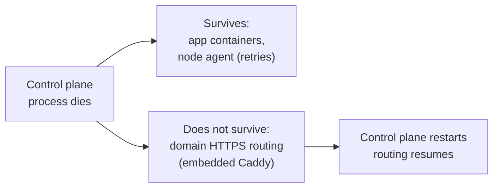

If the control plane process is killed outright, app containers that are already running keep running and keep serving traffic on their own. A node agent never takes a destructive action when it loses the connection. It retries with backoff until the control plane comes back.

Domain-based HTTPS routing does not survive. The embedded Caddy instance runs inside the control plane process, so routing is down from the moment the process exits until a new one reconciles ingress. How long that lasts depends only on how fast the control plane restarts.

For the measured downtime windows, what a restart does on its first reconcile pass, and what the measurements do not cover, read [Resilience: what survives a control plane crash](/resilience).
