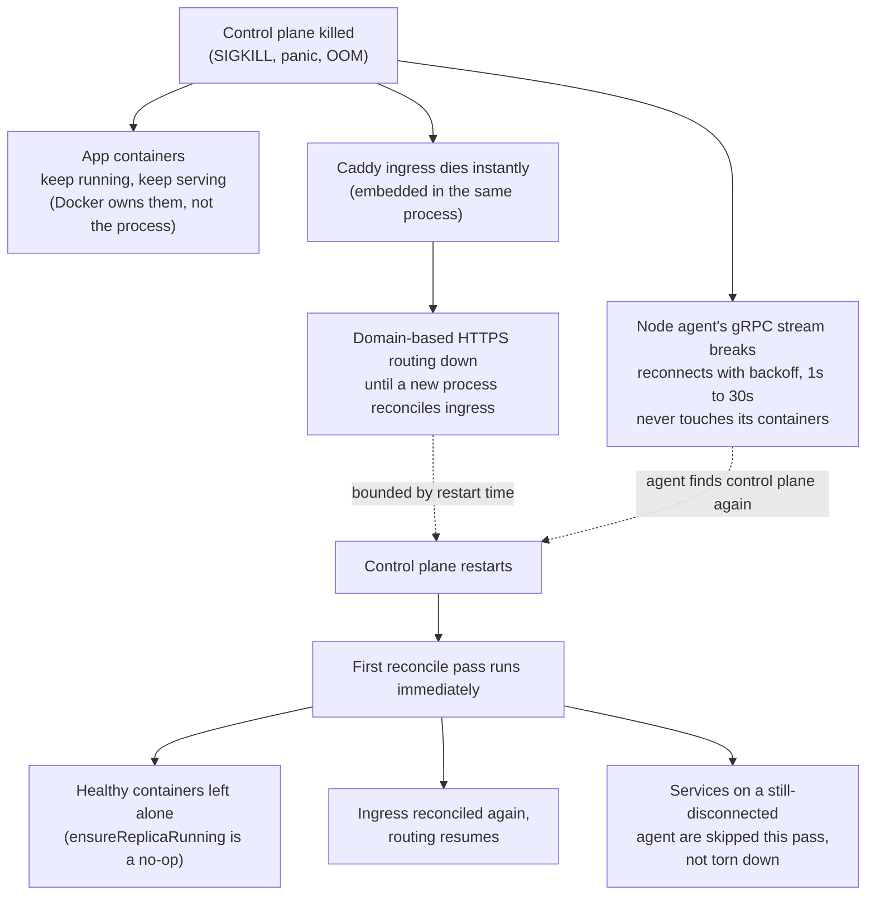

This page answers one question: if the `levelrail` process dies outright (a panic, an OOM kill, `kill -9`, the host rebooting the process), what happens to your running apps and to node agents?

The answer has two halves, because the control plane is one process that owns two different things: the reconcile loop that manages containers, and an embedded Caddy instance (the reverse proxy that routes traffic to them). See [architecture.md](/architecture) and ADR 005. The two halves fail differently, and this page measures both.

Everything below was measured against a real control plane binary, real Docker containers, a real node agent process, and a real `SIGKILL`.

<Accordion title="For contributors: the tests behind this page">
`test/e2e/reconcile/break_glass_control_plane_death_test.go` and `test/e2e/reconcile/break_glass_agent_reconnect_test.go`. Run them yourself with `go test -run TestBreakGlass -v ./test/e2e/...` (needs a local Docker daemon).
</Accordion>

## The crash-and-recovery timeline



## What survives

**A running app container is not a child of the control plane process.** Docker owns its lifecycle, not `levelrail`. When the control plane is killed:

- Every already-running container keeps running, unaffected.
- It keeps serving traffic directly on its published host port. Answering a request does not depend on the control plane process being alive.
- This holds for containers on the local node and for containers on a remote node through an enrolled agent. The agent owns the container through its own Docker connection, not through the control plane's process tree.

**A node agent keeps running and never takes a destructive local action on disconnect.** The instant its connection to the control plane breaks, the agent's session logic returns an error. Nothing on that path stops, removes, or otherwise touches a container the agent placed. The agent process's own reconnect loop does the retrying, with exponential backoff (1s up to 30s) and a log line ("session ended, reconnecting") on every attempt. It never gives up on its own.

## What does not survive

**Caddy's routing dies in the same instant the control plane does, unless systemd holds the sockets.** (With socket activation, the default for new installs, the listening sockets outlive the process and connections queue instead of being refused, see [measured windows](#ingress-availability-windows-measured).) This follows from an architecture decision, not a bug: Caddy runs embedded inside the control plane process, not as a sibling container with its own lifecycle. No separate proxy process is left to keep serving while the control plane is down.

Concretely: from the moment the control plane process exits to the moment a new one starts and reconciles ingress at least once, **domain-based HTTPS routing is down**. A request to your app's domain fails during that window even though the container behind it never stopped. A request straight to the container's published host port succeeds the whole time; a request through the domain does not.

This is a real outage window. Its length depends on how fast the control plane process comes back (a process supervisor restarting it in seconds, versus a human noticing and running `docker start` by hand). The reconciler cannot shorten it, because the reconciler is down too.

**In-flight reconcile work is lost, not resumed mid-step.** If a deploy, a build, or a container removal was in progress when the process died, that specific in-flight operation does not continue from where it left off. It does not need to. Every controller here is level-triggered and idempotent (see [architecture.md](/architecture#control-plane)), so a restart works out what to do from scratch by diffing desired state against whatever Docker reports, the same as on any other reconcile pass.

## What happens when it restarts

The restarted control plane runs a reconcile pass immediately on startup, without waiting for the resync tick. That pass reads desired state from the same SQLite database and observed state from the same Docker daemon it was managing before. Measured directly:

- A container that is already running and healthy is left alone: not recreated, not restarted. Its restart count and container ID stay exactly what they were. The reconciler acts only when it sees a container that is missing or not running.
- Ingress resumes once the ingress controller reconciles again, which happens on that same first pass. The domain starts routing without touching the container behind it.
- If the container is on a remote node whose agent has not reconnected yet, that service is skipped for the pass instead of erroring or being torn down (logged as "skipping service for this reconcile pass: node transport unavailable"). It picks back up on its own once the agent's reconnect loop finds the control plane again. You do not need to restart the agent.

## What happens to traffic when the control plane restarts

Worked out from the code, not measured on a live box (no Docker or Caddy was available when this was written, see the end of this section). Ingress is one embedded Caddy inside the control plane process, on every install, including multi-node ones: remote nodes run agents and containers, never a proxy. Apps on a remote node are reached through the control plane's Caddy over the WireGuard mesh, so they are exactly as available as the control plane's ingress.

| Part | Control plane stopped or restarting | Why |
| --- | --- | --- |
| App containers, local and remote | keep running and serving on their own ports | Docker and the agent own them |
| Listening sockets 80 and 443 | held by systemd with socket activation, otherwise closed | ADR 025 |
| Requests that arrive in the gap | queued in the socket backlog (socket activation) or refused | kernel, not Caddy |
| Established keep-alive and WebSocket connections | closed: 3s grace for in-flight requests, then cut. Clients must reconnect. | the connection lives in the dying process; no design here passes an open connection to a new process |
| Caddy routes | gone with the process; rebuilt from the database | Caddy keeps its config in memory only |
| TLS certificates | stored in SQLite, so they are not lost; loaded again when Caddy starts | certificate storage is the database |
| Waking and held requests (sleeping app, `503` hold window) | lost, the hold window restarts empty | `HoldTracker` is in memory, and the wake hook is served by the control plane itself |
| Remote node agents | keep their containers, reconnect with backoff | see above |

Where traffic dropped even with socket activation, in order:

1. **Process stop to process start.** Requests queue. This is the 1.3s (local) to 4s (small droplet) wait in the table below.
2. **Process start to the first ingress apply.** Caddy used to start only when the ingress controller first ran, which is after the store opens, every optional subsystem is built and the engine's first pass reaches the ingress controller (it runs in the dynamic set, after the fixed controllers), a delay that grows with the number of apps. Until then the sockets were held but nobody accepted: connections hung. This is the part that scales with the install, and the part this release removes.
3. **TLS handshakes in flight at the instant the old process stops.** A handful, unchanged (see below).

### Route snapshot

Every applied Caddy config is also written to `ingress-snapshot.bin` in the data directory (atomic write, mode 0600). The config carries DNS tokens, imported private keys and basic auth hashes, so the file is sealed with AES-GCM under a key derived from the master key and is unreadable without it. At startup, right after the store opens and before any reconcile, the control plane loads the snapshot into Caddy. Established routes are served from the previous process's last good table while the first pass runs; the first pass then replaces it in place (Caddy reloads without closing listeners), or skips the reload when nothing changed.

The snapshot is ignored, never trusted blindly, when it is missing, truncated, tampered with, sealed with another master key, built for a different listener setup (socket activation switched on or off), or rejected by Caddy (for example after a downgrade). The control plane then does what it always did and waits for the first pass. A snapshot can be stale by the downtime: a route to an app deleted meanwhile serves until the first pass, which is seconds. The wake token and hold routes in it are likewise replaced by the first pass.

`levelrail-cli doctor` and the System status page report `ingress_survives_control_plane`: ok when systemd holds the sockets and a snapshot is saved, a warning with the exact command when it does not (`LEVELRAIL_SOCKET_ACTIVATION=1 ./install.sh upgrade`), or the reason when the snapshot cannot be written (no master key, full disk).

### What is still not covered

- **One ingress process.** If the host or the whole control plane process stays down, routing stops for every app, including apps on healthy remote nodes. Independence from a host loss needs several ingress nodes sharing certificate state (ADR 033, the next step). It is not built here, and a second proxy process on the same host would not help, because it shares the host's fate and the certificate lock with the first.
- **Self-upgrade hand-off without systemd.** An upgrade is a restart; with socket activation it is covered. Without systemd (Docker Compose, dev runs) there is no process that outlives the control plane to hold the sockets, and passing listeners between two overlapping processes was rejected in ADR 025. Those installs still refuse connections for the length of a restart.
- **Open connections and WebSockets** are cut on every restart.
- **Not proven live.** The snapshot logic (round trip, corruption, truncation, wrong key, listener mismatch, startup before the first reconcile, Caddy rejecting it) is covered by unit tests with a fake config loader. Nothing here was run against real Docker and Caddy. To prove it on a Linux box with socket activation on: deploy an app, run `levelrail-cli bench run --url https://APP/ --rate 500 --duration 90s --restart-control-plane --json`, and read `ingress_kept_serving` and `dropped_requests`. Compare with `LEVELRAIL_SOCKET_ACTIVATION=0` to see the refused-connection case.

## Ingress availability windows (measured)

Measured locally on an Apple silicon laptop (real Docker, a real `traefik/whoami` container, the embedded Caddy over HTTPS with HTTP/2) with a load generator sending 200 requests per second. The same scenarios on the 2 vCPU droplets earlier were slower (about 4s for a restart, 1s for a kill). Read these numbers for the shape and the relative improvement, not as what a small VPS will give you.

| Scenario | Before | After |
| --- | --- | --- |
| Control plane restart (`SIGTERM`, then start) | every connection refused for about 1.7s (335 of 4984 requests failed) | with socket activation: nothing refused, requests wait up to about 1.3s, 0 to 28 of about 2700 requests fail with a TLS handshake error at the instant the old process stops |
| Kill the only serving container | 54 requests got a raw `502` over 265ms | 58 got a styled `503` with `Retry-After` over 285ms (the window is the time the reconciler takes to repoint ingress, so it did not shrink) |
| Kill one replica of a pool | not measured | 40 of 40 requests succeeded with one dead upstream (retried onto the live one) |
| Redeploy or restart an app (blue-green) | 0 errors | 0 errors |
| Request in flight when the old process stops | connection closed | finishes (3s grace period under socket activation) |

Where the windows cannot be removed:

- **Without socket activation a restart still refuses connections** for the length of the restart. Socket activation is on by default for new installs. An install that predates it needs `LEVELRAIL_SOCKET_ACTIVATION=1 ./install.sh upgrade` ([how](/domains-and-ingress#surviving-a-control-plane-restart)).
- **Even with it, the instant the old process stops, a handful of TLS handshakes already in progress can fail** (most likely Caddy unloading its certificate cache while the listener is still draining, which we did not confirm). Browsers retry these; a script without retries may see an error.
- **A killed single-replica container still has a window** of about the reconciler's reaction time (a few hundred milliseconds locally, up to a second on a small server) in which requests get the friendly `503`. Retrying the same address cannot help because the replacement usually gets a new port. Use two replicas for a service that must not drop requests.
- **`recreate` deploys are down by design** while the old container stops and the new one starts. Visitors get the styled `503` and a page that reloads itself, not a dead connection or a TLS error.
- **A pinned host port** still needs a stop-then-start swap, see [deploy safety](/deploy-safety#pinned-host-ports).
- **A control plane crash** (not a restart) with socket activation queues connections until `Restart=on-failure` brings it back, 5 seconds by default (`RestartSec`). Connections wait that long and may time out at the client.

## Database integrity and guided restore

The control plane keeps its state in one SQLite file. A damaged file is the failure the other sections cannot hide, so it is checked and recoverable without a terminal.

- **Periodic check.** A cheap `quick_check` runs every 6 hours (`APP_INTEGRITY_CHECK_INTERVAL`, `0` turns it off) and a full `integrity_check` once a week (`APP_INTEGRITY_FULL_INTERVAL`). The loop is listed on the health page like every other background loop.
- **Check at boot.** Before the database opens, a `quick_check` runs on the file. A damaged file sends the process to [safe mode](#safe-mode) instead of crashing into it.
- **Guided restore.** Settings, Control plane health shows the state, the snapshots and a Restore button per snapshot. The CLI is `system integrity` (state), `system integrity --check [--full]` and `system integrity --restore NAME|latest`. A damaged database also raises a critical finding with a one-click fix that picks the newest snapshot that still verifies.
- **How a restore is applied.** The snapshot is verified (checksum, full integrity check, schema not newer than this binary) and a marker is written. The next start swaps it in before the database opens, so no open connection ever sees the file change. The damaged file is kept beside it as `levelrail.db.before-restore-<time>`. A snapshot that changed after it was staged is refused and the marker is removed so a bad restore cannot repeat on every boot.
- **Scope.** Restoring brings back state as of the snapshot. Take snapshots often (`APP_CONTROL_PLANE_BACKUP_INTERVAL`), and keep an off-box copy ([disaster-recovery.md](/disaster-recovery)). The master key is not in a snapshot.

The restore drill is a test: it snapshots a database, damages the live file in a temp directory, detects it at boot, stages and applies the restore, and reads the data back (`internal/integrity`).

## Safe mode

If the control plane cannot start, restarting it again will not help and a supervisor loop only burns CPU and fills the log. The boot ledger (`boot-ledger.json` in the data directory) counts consecutive starts that never stayed up for `APP_BOOT_HEALTHY_AFTER` (30s).

| Failed starts | What happens |
| --- | --- |
| 1 or 2 | The next start waits first, 2s then 4s, doubling up to `APP_BOOT_BACKOFF_MAX` (60s). The wait is logged. |
| `APP_SAFE_MODE_AFTER_FAILURES` (3) | Safe mode: the process stays up and serves only a recovery page. No more restarts. |
| Any start | A damaged database file, or a store that fails to open or migrate, goes straight to safe mode. |

Safe mode serves a read-only page on the normal HTTP address. It shows the reason, and unlocks details and actions with a recovery code that only a person with host access can read: `<data dir>/safe-mode-token`. Wrong codes are rate limited. The actions are Retry boot and Restore (the newest verified snapshot, or a chosen one). Both clear the ledger and ask the supervisor to restart (exit code 75). Without a supervisor the restore is staged and the page says to start the service again. Stopping the process without acting leaves one more attempt for the next start, so fixing the cause (for example starting Docker) and restarting the service works.

Your apps are not touched: containers keep running and serving. Embedded ingress is part of the control plane process, so routing follows the rules above.

## Reconcile storm protection

A burst of Docker events or API nudges used to start one full reconcile pass each. Now:

- **Global budget.** Event and nudge triggered passes draw from a token bucket (`APP_RECONCILE_PASS_BURST` 20, `APP_RECONCILE_PASSES_PER_SEC` 4). When it is empty the triggers are merged into one deferred pass. This is safe because every controller is level-triggered: the deferred pass sees the latest state, nothing is lost. The periodic resync is never limited.
- **Per resource limit.** Each controller has its own bucket (`APP_RECONCILE_RESOURCE_BURST` 40, `APP_RECONCILE_RESOURCE_PER_SEC` 4).
- **Circuit breaker.** After `APP_RECONCILE_BREAKER_FAILURES` (5) failed runs in a row a controller is paused for `APP_RECONCILE_BREAKER_BASE` (15s), doubling per further failure up to `APP_RECONCILE_BREAKER_MAX` (10 minutes), then one trial run decides whether it closes. A panic in a controller is recovered, logged with its stack and counted as a failure, so one broken resource cannot crash the process or stop the others.
- **Visible and fixable.** The health page lists every controller that tripped or was throttled, with its last error, and raises a finding with a Reset protection button (`system health --fix reset_reconcile_guard`).

`TestEventChurnFuzz` hammers an engine with random events and nudges and checks the pass count stays inside the budget, a failing controller stops after its threshold, and the final desired state still converges.

## Data plane while the control plane is down

What is tested, and what is not (see also ADR 025 and the route snapshot above):

- **Control plane subsystems stalled, process alive.** A real embedded Caddy keeps answering from the last applied routes while every attempt to apply a new config fails for 10 simulated minutes, and the original config applies again afterwards (`TestDriverKeepsRoutingThroughStalledControlPlane`). A failed apply rolls back to the running config, it never leaves ingress empty.
- **Process down for 10 minutes.** The sealed route snapshot is on disk. At the next start it is loaded into Caddy before the database is needed, with the certificate store unavailable (`TestSnapshotRestoreNeedsNoDatabase`).
- **TLS renewals during a database outage.** A renewal that cannot be saved fails loudly and certmagic retries it on its next maintenance pass. A database that is down never reads as "certificate missing", so no needless re-issue happens when it returns, and stored certificates are untouched (`TestCertStorageOutageIsRetriableNotMissing`). Certificates already loaded in Caddy's memory keep serving.

Limits that remain: while the process is down nothing renews certificates and nothing probes app health (container health probes and the reconciler run in the control plane process). Containers are created with Docker restart policy `no`, so a container that exits, or a host that reboots, during an outage stays down until the control plane is back.

The Nodes page has a **Resilience check** card (`levelrail-cli resilience check`, API `GET /api/v1/system/resilience`) showing the route snapshot, certificate cache and per node agent link. **Simulate control plane outage** (`--simulate`) is a dry run: it opens the sealed snapshot the way a restart would and stops nothing. A missing or failed snapshot has a **Fix** button (`--fix`) that rewrites it from the applied config. Metrics and logs stay on each node and are pulled on demand, so nothing is buffered or lost while an agent is disconnected. Ingress is one process, so the table above still applies for a stopped process. Several ingress nodes sharing certificate state are the next step (ADR 033).

## What this page does not cover

- **Data loss.** This page is about a process crash where the disk is intact. If the disk holding `levelrail.db` is lost or corrupted, see [disaster-recovery.md](/disaster-recovery) for off-box backups and the master key escrow you need to recover.
- **Multiple control plane replicas, or an external load balancer in front of the control plane itself.** There is exactly one control plane process today, so there is no failover between two control planes to measure.
- **A crash during the brief window `caddy.Load` is applying a new config.** This page measures a crash of a system that has already converged, which is the common case. A crash mid-config-apply is a narrower race the tests above do not cover.
- **Multi-replica app failover during the ingress outage window.** If an app has more than one replica, Caddy stops routing to all of them during the outage. This page does not measure whether one replica coming back before another changes anything, because ingress is down for all of them until the control plane restarts.

## Deploys under live traffic

Measured on a 2 vCPU droplet running a build of this branch's predecessor (v0.2.0-beta.15), with a load generator on a second droplet sending 50 requests per second over HTTPS through the ingress for the whole deploy. The request counts are real. The box was shared with other test workloads, so a few stray errors per run are not blamed on the deploy.

| Scenario | Result |
| --- | --- |
| Blue-green, fast start app | 0 errors in about 2500 requests |
| Blue-green, app that takes 10s to become ready | 0 errors in 3000 requests, cutover after readiness |
| Rollback to the held previous release | 0 errors |
| Recreate | about 2s of 502 responses (stop, start, ingress repoint). Since this release a styled 503 with `Retry-After` that reloads itself, and the domain keeps its certificate |
| Rolling with 2 replicas | about 1s of 502 (old replica 0 removed before ingress moved) |
| Deploy whose readiness never passes | old release served every request, deploy marked failed, reason shown in `apps status` and `attention` |
| Deploy that is OOM-killed during readiness | old release kept serving, reason `OOMKilledDuringReadiness` |
| `docker kill` of the serving container | about 1s of 502 until ingress moved to the held release. Since this release a styled 503 for the same window |
| Pinned host port, blue-green | broken in this run: the second container could not bind, was left running without its port and reported Ready (fixed since, see below) |
| Control plane restart | ingress is down for about 4s (embedded Caddy), containers unaffected. With `LEVELRAIL_SOCKET_ACTIVATION=1` connections queue instead of being refused, see [measured windows](#ingress-availability-windows-measured) |

Fixes shipped from these runs: pinned host port handoff with restore on failure, removal of half-started containers, a check that a pinned port is actually published, rolling deploys keeping the routed replica until cutover, required secrets enforced at reconcile time, default [load balancing](/load-balancing) for multi-replica apps, and ingress config applies skipped when nothing changed. These fixes are covered by unit tests with a fake Docker client; they have not yet been re-measured on a real server.

Not measured on a server: Docker daemon restart mid-run and disk pressure on the host volume (the shared test host could not be disturbed). Containers use restart policy `no`, so after a daemon restart recovery depends on the reconciler's next pass.

## Chaos harness

`levelrail-cli bench chaos` repeats these failures on demand against throwaway local containers that carry a unique `lrchaos-` name prefix and are always removed afterwards. It never touches anything it did not create.

```bash
levelrail-cli bench chaos list
levelrail-cli bench chaos run all --record --json
levelrail-cli bench chaos report
```

`run` needs a CLI built with `-tags chaoslive` (the scenarios embed the control plane) and a local Docker daemon with `node:22-alpine`. It prints a table, or a JSON summary with `--json`, and exits 2 when an assertion fails. `--record` stores the results on the control plane, which the dashboard shows as the Resilience report on the System status page and an agent reads with the `get_resilience_report` MCP tool.

| Scenario | What it asserts |
| --- | --- |
| `kill-container` | the container is healthy and routed again, with recovery time and failed requests recorded |
| `daemon-unreachable` | with the Docker API cut for 6 s mid-deploy, the deploy resumes or fails cleanly and no request fails in the window |
| `control-plane-restart` | the app container is not recreated and keeps answering on its own port while the ingress restarts |
| `disk-pressure` | a filled scratch volume raises the node disk space alert, an idle one does not |
| `oom-during-readiness` | the deploy fails as `OOMKilledDuringReadiness` and the old release serves every request |

The measured numbers, with hardware and date, are in [benchmarks](/benchmarks#chaos-results). The same scenarios run as `go test ./test/e2e/reconcile -run TestChaos_Live` (skipped under `-short`). The first run of `daemon-unreachable` exposed that the ingress dropped every route while the Docker API was unreachable. It now keeps the last known backend per service.

## Failure modes and their fixes

Each row is covered by a test. The scenarios that need no Docker run with `go test -tags chaos ./test/chaos`; the agent and reconciler cases run in the normal short suite.

| Failure | What happens | The condition you see | Fix |
| --- | --- | --- | --- |
| Docker daemon dies mid deploy | The deploy stops, no orphan container is left, the next pass converges | `docker_unreachable` | Check the node, then redeploy |
| Disk fills (ENOSPC) | The write fails, the transaction rolls back, SQLite stays intact and writable | `disk_full` | **Free space now** on System status |
| Disk is nearly full | Deploys, image pulls and backups are refused with HTTP 507 `low_disk` before they start; a rollback is never refused | `disk_full` | **Free space now** runs a forced cleanup pass |
| Agent stream severed | The agent touches no container and reconnects; the control plane skips that node for the pass and picks it up again | node shows offline | None needed, reconnect is automatic |
| Two connections from one node | The newest wins, the older session is closed and cannot unregister or mark the node offline | log line `duplicate connection` | Stop the duplicate agent process |
| OOM kill during readiness | The deploy fails and the previous version keeps serving | `oom_killed` | Raise the memory limit |
| Corrupt or missing image | The deploy fails, the current version keeps serving | `image_corrupt`, `image_pull_failed` | Redeploy, or prune the image cache |

### Disk space guard

The control plane watches its data directory and the Docker root every minute through the shared background loop, with no extra timer. A node's disk is covered by the existing node disk space alert rule.

| Setting | Default | Meaning |
| --- | --- | --- |
| `APP_DISK_LOW_FREE_MB` | 1024 | Below this the volume is Low and a notice is sent once |
| `APP_DISK_CRITICAL_FREE_MB` | 512 | Below this risky operations are refused |
| `APP_DISK_RESERVE_MB` | 16 | Reserve file in the data directory, released at Critical so the database can still commit, restored once space returns |
| `APP_DISK_DOCKER_ROOT` | `/var/lib/docker` | Docker storage path to watch; an unreadable path is reported Unknown and never blocks anything |

`GET /api/v1/resilience/disk` returns the readings and `POST /api/v1/resilience/disk/free-space` runs the cleanup. From a terminal: `bench chaos disk` and `bench chaos free-space`.

### Agent link

An agent reconnects with exponential backoff from 1s to 30s plus up to 50 percent jitter, so a fleet that lost the control plane together does not return together. A session that stayed up for a minute resets the backoff. Commands are not queued while a node is offline: desired state stays in the database and each reconcile pass re-issues what is missing once the node is back, so nothing is lost and nothing is applied twice. Containers keep running on an offline node.

## Next steps

<CardGroup cols={2}>
<Card title="Disaster recovery" href="/disaster-recovery">

What to do when the disk or the whole machine is lost.

</Card>
<Card title="Domains and ingress" href="/domains-and-ingress">

Socket activation, on by default, makes a restart queue connections.

</Card>
</CardGroup>
