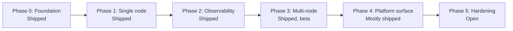

Releases are listed on the [releases page](https://github.com/glincker/levelrail/releases). "Shipped" on this page means built and merged, not proven in production. For per-feature maturity and the evidence behind each label, see [feature status](/feature-status). Release-by-release detail is in the [changelog](/changelog). The decisions behind the build order are in the [ADRs](https://github.com/glincker/levelrail/tree/main/adr).

The 0.8 release line adds an Inbox for alerts and approvals, recoverable upgrades, secret rotation, and provider, region and zone labels on nodes.

The build did not follow the original phase plan in order. Parts of multi-node shipped while some single-node items (real public ACME renewal, a Linux idle-footprint measurement) are still open. This page describes what is true today, not a schedule.

## Phase status

Phase 5 (chaos testing, upgrade and downgrade testing across versions, security review, a published idle-footprint number, a shadow-running period) is the open work. Some of it has started: control-plane death survival, break-glass agent reconnect and a first live ACME run are covered, see [resilience](/resilience) and the [ACME runbook](/acme-verification-runbook). Upgrade testing has started too: a harness upgrades the real v0.8.1 and v0.8.2 binaries with seeded data and checks restore points, automatic restore and the downgrade refusal (see [Upgrade safely](/upgrade-safely#upgrading-real-releases-with-real-data)); a cross-release schema migration is still untested there.

## Shipped

### Deploy path

- App spec (`app.yaml` or `deploy.yaml`) parsing with an embedded JSON Schema. See the [app spec reference](/app-spec-reference).
- Docker Engine API wrapper, with no `docker` CLI shelling.
- Application reconciler with readiness probes gating every cutover and liveness probes on each pass. A container that OOM-kills or exits during the readiness wait fails immediately (`OOMKilledDuringReadiness`, `ExitedDuringReadiness`) instead of retrying a dead address.
- BuildKit builds with live build-log streaming over SSE. Railpack auto-detection, static sites (`build.type: static`), and dedicated [build nodes](/build-node-routing) with a registry-backed cache (a built-in registry can be enabled in Settings).
- Docker Compose as a deploy target for a supported subset of `compose.yaml`, and multi-service apps (`deploy-spec`) with per-service builds and deploys.
- Deploy strategies: rolling, recreate, blue-green. Rollback to retained images, deploy history, deploy comparison, and deterministic build-failure diagnosis.
- Pre and post-deploy hooks. A failing pre-deploy hook blocks cutover and keeps the old container serving.
- Git providers: GitHub (App flow, including GitHub Enterprise Server), GitLab, Bitbucket Cloud and Gitea, with HMAC-verified webhooks and webhook delivery history with replay. See [git integrations](/git-integrations).
- [Preview environments](/previews) per pull request (opt-in), with optional ephemeral databases and PR status comments. See [deploy previews](/deploy-previews).
- Embedded Caddy ingress: automatic TLS (internal issuer by default, public ACME toggleable), zero-config `sslip.io` hostnames, per-domain bring-your-own certificates. See [domains and ingress](/domains-and-ingress).
- Envelope-encrypted secrets with master-key rotation. See [security](/security).
- Container exec and an interactive terminal (dashboard or `apps exec --interactive`), gated to root-level tokens.
- [Service template](/templates-and-registry) catalog: about 360 entries (see [template catalog](/template-catalog)), reversing the original non-goal in [ADR 015](https://github.com/glincker/levelrail/blob/main/adr/015-service-template-catalog-reversal.md).

### Data

- Nine managed database engines: Postgres, Redis, MySQL, MongoDB, MariaDB, KeyDB, Valkey, Dragonfly and ClickHouse, with scheduled backups, restore, verification, metrics and log search. Meilisearch, Qdrant, Typesense and Memcached are built but not yet verified on a live Docker daemon. See [managing databases](/managing-databases).
- Point-in-time restore for Postgres (opt-in WAL archiving, restore to a timestamp inside the recoverable window) and for MySQL and MariaDB (opt-in binary log archiving, restore into a new database), restore into a new resource, and app volume backups to S3-compatible targets. See [backups and storage](/backups-and-storage).
- TLS on newly created Postgres, Redis, MySQL, MariaDB and MongoDB databases. Databases created before this feature are not switched.
- Control-plane backups. See [control-plane backup](/control-plane-backup).

### Observability

- Node-local metrics (15s resolution) and log store with full-text and JSON search, federated across nodes, and a Prometheus remote-read endpoint. Deploy markers appear on metric charts.
- Crashloop detection with the last 200 log lines surfaced in the UI.
- Alerting with 25 rule kinds and 18 notification channel kinds, with retries for transient failures and delivery history.
- Attention list, [status page](/status-page), capacity forecast, right-sizing suggestions and certificate renewal visibility. See [observability](/observability).

### Multi-node

- Agent transport: in-process for a single node, gRPC with mTLS for remote nodes, with reconnection and version negotiation.
- Node registry, join tokens, cordon, drain, heartbeats and connection history.
- Manual placement, moving an app with its volumes, WireGuard mesh with cross-node service DNS, and distributed certificate storage.

The join flow is verified across two real Docker daemons, but not across a real WAN. The mesh itself is not verified on real hosts. See [multi-node](/multi-node).

### Identity and access

- Multi-user accounts with TOTP and recovery codes, OIDC sign-in, scoped API tokens, named roles (admin, operator, viewer), and IAM-style resource-scoped policies. See [identity and access](/identity-and-access).
- Organizations, projects and environments with layered shared env vars, protected environments, two-person deploy approvals, environment promotion and cloning.
- Audit log with search, CSV export and retention.
- Team invites, rate limiting, security headers (HSTS is opt-in).
- A theauth-library auth path exists behind default-off flags. See [auth engine](/auth-engine).

### Operator surfaces

- Dashboard, `levelrail-cli` (profiles, `--output` and `--query`, shell completion, device login, `doctor`, `apps create --interactive`) and `install.sh`.
- Migration CLI: `levelrail-cli migrate coolify`, `dokploy` and `caprover`. See [migrating from Coolify, Dokploy and CapRover](/migrating-from-coolify-dokploy-and-caprover).
- MCP server (`cmd/levelrail-mcp`): over 240 tools, grouped into toolsets that an agent enables on demand. See [MCP tool surface](/mcp-tool-surface) for the exact, generated numbers, and the [AI assistant](/ai-assistant) page. Tokens are checked against the same abilities as the REST API.

### Shipped but off by default or beta

These exist and are tested, but are gated or carry a beta label. See [feature status](/feature-status) and [experimental features](/experimental-features).

- In-app AI chat, AI models on GPU nodes, [load balancer](/load-balancing), [platform as code](/platform-as-code), Cloudflare Tunnel (all behind `APP_EXPERIMENTAL`).
- Pipelines, feature flags, deploy freeze, supply chain scanning, [log archive](/log-archive), [scheduled deploys](/scheduled-deploys), deploy cost estimate.

## Open work

- Real public ACME: one live run against Let's Encrypt on a public VPS is recorded in the [runbook](/acme-verification-runbook). Renewal close to expiry, DNS-01 wildcards and a deliberate failure against the production CA are not yet exercised live.
- Multi-node on real hosts: the WireGuard mesh and cross-host remote transport are unverified outside fakes and local Docker daemons.
- Idle footprint on Linux: measured in a Docker Desktop container (not bare metal) with a harness and opt-in regression guard. A bare metal or VPS number is still open. See [performance](/performance).
- Load and failover numbers: the harness exists (`levelrail-cli bench run`), no published results yet. See [benchmarks](/benchmarks).
- Template coverage: a sample of the roughly 360 templates is deployed by e2e tests, not the whole catalog.
- Other database engines: PITR covers Postgres, MySQL and MariaDB only (MongoDB has no oplog here), and the remaining engines have no TLS by default.
- Stable release: none yet. Upgrade and downgrade testing across versions with real data is part of Phase 5.

## Out of scope

- Container runtime: Docker Engine API only.
- Scheduler: no bin-packing, affinity rules or autoscaling.
- Service mesh: WireGuard plus DNS only.
- Windows or non-Linux nodes.
- Managed cloud offering: not before the self-hosted version has real users.
- AI in the reconciliation path: AI is a read-and-suggest layer on top of the API.
- Kubernetes compatibility: no CRDs, no custom orchestration standard.

## See also

<CardGroup cols={2}>
<Card title="Feature status" href="/feature-status">

Maturity labels and the evidence behind each one.

</Card>
<Card title="Multi-node deployment" href="/multi-node">

Add and manage more than one server.

</Card>
</CardGroup>
