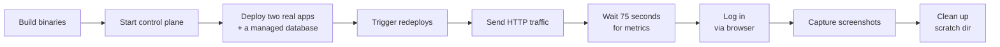

The PNG files in `docs/assets/screenshots/` are captured from a real, running control plane. They show real deployed containers, real metrics, and real log lines, with no mocking or hand-editing.

Screenshots are produced by `scripts/screenshots/capture.sh`, a manual maintainer tool (not a CI job). Deploying real containers and accumulating metrics takes a couple of minutes, too slow for every PR. Re-run it by hand whenever the dashboard changes significantly and existing screenshots look stale.

<Accordion title="Prerequisites">
- Docker, running locally (`docker info` should succeed)
- Go and Node.js/npm (to build the control plane, CLI, and frontend)
- Python 3 with Playwright installed, and [shot-scraper](https://shot-scraper.datasette.io/):
  ```
  pip install playwright shot-scraper
  playwright install chromium
  ```
</Accordion>

## Running it

```
scripts/screenshots/capture.sh
```

The web bundle is built with demo disk-pressure thresholds (`VITE_DISK_*`), and each shot waits up to 90 seconds for its page to load. Pages that never reach the load event are left out of `shots.yml` rather than failing the run.

Before any shot is taken, `scripts/screenshots/leak_check.py` loads every page in the config and fails the run if it shows a public IP, an email, a sslip.io host, this machine's hostname, or an app error page. Private and loopback addresses are allowed. The pipeline pins demo addresses (documentation ranges) for the public host, advertise host, mesh, and app network pool so no real address reaches a shot.

Each run writes every entry in `shots.yml` twice: the dark theme under the listed filename, and the light theme with a `-light` suffix (for example `app-overview-light.png`). Only the pages it can reach are captured, and output is optimized to stay under about 400 KB per image.
The script runs the whole pipeline, from building binaries to capturing screenshots:



<Accordion title="Full pipeline details">
1. Build fresh binaries into a scratch directory
2. Start a control plane against a separate scratch data directory
3. Deploy two real apps from public images, plus a real managed Postgres database
4. Trigger real redeploys to build deploy history
5. Send real HTTP traffic to the apps
6. Set an example secret, a domain, and a [load balancer](/load-balancing) so the environment, domains, and load balancer pages aren't empty. Also seed a pipeline with one run, an export destination, and an archive so the pipeline, storage, and archive pages have content
7. Wait about 75 seconds for metrics to accumulate at 15-second resolution
8. Log in through the real `/login` form
9. Capture screenshots with `shot-scraper`

It cleans up after itself on exit (including on failure): the deployed apps and database are deleted, the control plane process is stopped, and the scratch directory is removed. It's safe to re-run any time; each run picks a free local port rather than assuming one is available, and overwrites the configured PNGs in place.

Set `KEEP_SCRATCH=1` to leave the scratch directory (binaries, data dir, server log, session state) in place after a run, useful for debugging a failed capture.
</Accordion>

<Accordion title="Why not dev-mode's fixed tokens?">

The control plane binary builds with `-tags embedweb` to serve the real built frontend (same as a user would run). This also compiles out the `APP_DEV_MODE` bypass, so dev-mode's fixed tokens aren't available.

Instead, the script:

1. Bootstraps a real admin account using `APP_ADMIN_USERNAME`/`APP_ADMIN_PASSWORD`
2. Logs into the browser through the actual login form
3. Authenticates the CLI using the real device-login flow (`levelrail-cli auth login --device`)
4. Approves the login through the browser

All credentials are freshly created for each run and never leave the scratch data directory.
</Accordion>

## Demo mode captures

`capture.sh` deploys two real apps minutes before shooting, so charts are thin and the dashboard is sparse. For populated hero pages (dashboard home, apps list, metrics, deploy history, deployments, nodes, alerts, inbox) use `scripts/screenshots/capture-demo.sh` instead. It seeds 14 days of fictional history with `levelrail demo seed`, serves it with `levelrail demo serve` on a free loopback port from 8095 up, and logs in as the read-only demo account (`demo` / `demo-readonly`). No Docker is needed.

```
scripts/screenshots/capture-demo.sh
```

Prerequisites are Go, Node/npm, Python 3 with Playwright, and shot-scraper. Set `OUT_DIR` to write somewhere other than `docs/assets/screenshots`. It writes the same file names as `capture.sh` (dark, plus `-light`), so it refreshes those images in place. The demo banner, guided tour, blocked-write toast and floating help bubble are hidden per shot, with the tour marked done in the saved browser state.

Use `capture.sh` for settings, setup and anything that needs real containers (logs, load balancer, database detail). The page list for the demo run lives in `scripts/screenshots/shots-demo.yml`.

## Files

- `scripts/screenshots/shots.yml`: the `shot-scraper multi` config, one entry per PNG.
- `scripts/screenshots/login_state.py`: logs into a running control plane through the real login form and saves the session as a Playwright storage state file, reused across every shot.
- `scripts/screenshots/capture.sh`: orchestrates the whole pipeline.
- `scripts/screenshots/leak_check.py`: scans the shot pages for real identifiers and error pages before capture.

## Screens that need more than one node

Some screens do not exist on a single node: the multi-node topology view, cross-node ingress routing, a second node's own health. `capture.sh` does not cover them. Capture these by hand from a real multi-node cluster you control, with a logged-in browser session, and save the PNGs to `docs/assets/screenshots/` with a `multi-node-` prefix so their source is obvious. Embed them in [Multi-node](/multi-node) or [Network topology](/network-topology).

<Warning>
Never commit a credential, a session token, or a `.env` file from this process. Only the resulting PNGs and doc edits are safe to commit.
</Warning>

If you lose access to the admin account on a cluster you own, `sudo APP_DATA_DIR=<data dir> levelrail recover-admin` resets or creates the first admin directly against the local database (add `-username` and `-password` to pin either, otherwise both are generated). It changes a live credential, so rotate or remove it once you are done.

## See also

- [Getting started](/getting-started) for building and running the control plane locally
- [Identity and access](/identity-and-access) for device login flow details
- [Feature catalog](/feature-catalog) to understand which dashboard pages are captured
- `scripts/screenshots/capture-demo.sh` and `shots-demo.yml`: the Docker-free demo-mode variant.
