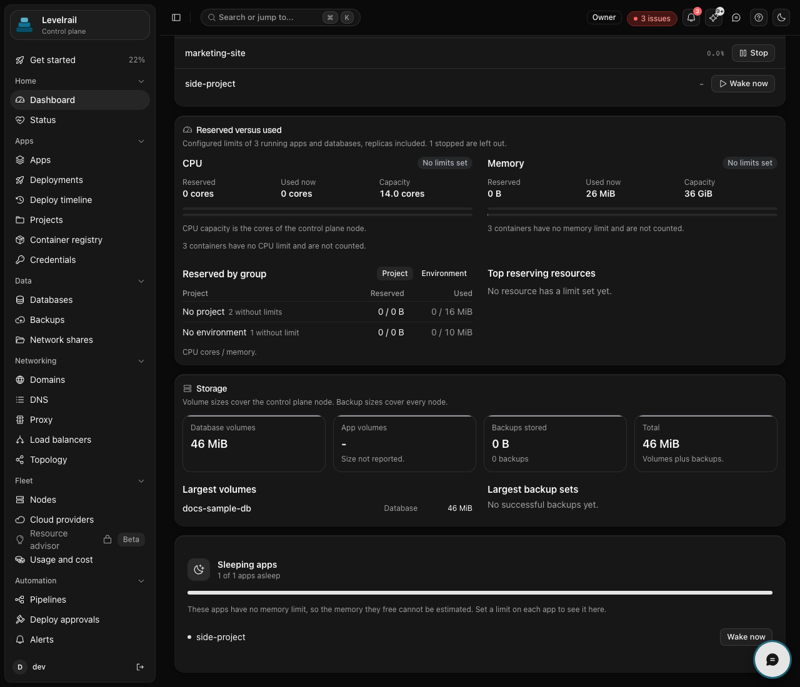
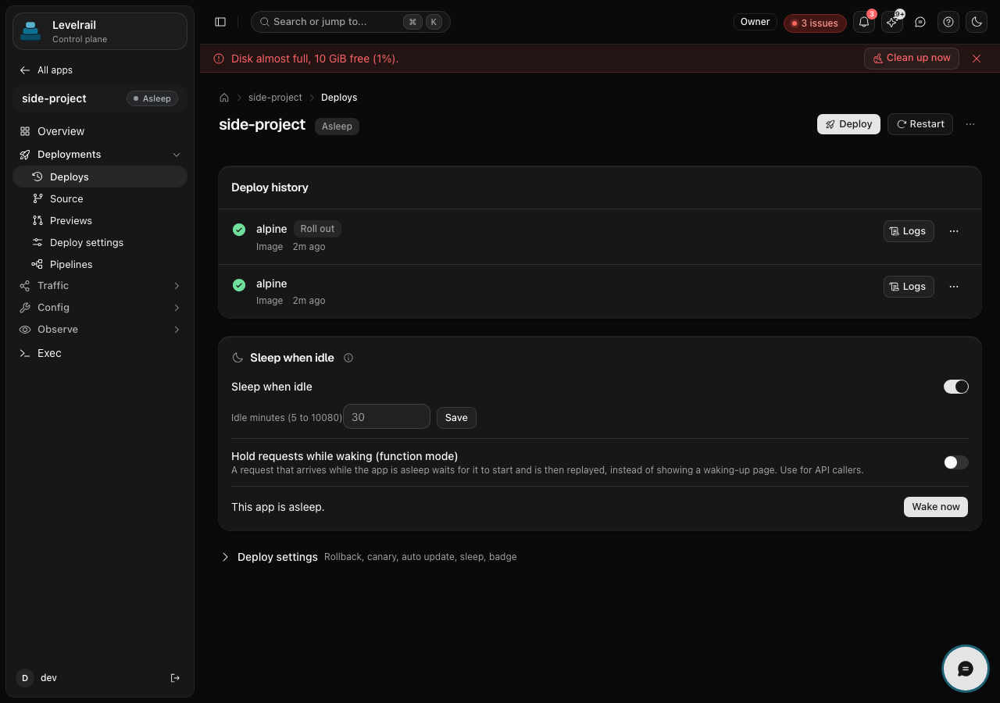

Opt an app into stopping after it has had no requests for a set time. A
sleeping app uses no memory or CPU. The next request to its domain starts it
again. Off by default, per app.

## How it works

- A check runs every minute. An app sleeps only when, for the whole idle time
  you chose (5 minutes to 7 days by default, see Tuning), it had no real request, no network traffic
  above a small floor, and no open connection. The window starts at the later
  of turning sleep on, the last wake, and when the control plane began
  watching, so a control plane restart never sleeps an app on missing data.
- Real requests come from the same per-app request metrics the dashboard
  charts use, minus the ignored paths (see below). Network traffic comes from
  the container's own network counters, sampled every 15 seconds.
- An app never sleeps while a deploy, build or rollback for it is running, and
  not within 5 minutes after any wake, so it cannot flap.
- Sleeping stops the app the same way **Stop** does. Its settings, domains,
  secrets and volumes stay.
- While asleep, the app's domains answer a short "Waking up" page that retries
  on its own. The first request starts the app, so the first visitor waits for
  the cold start.
- Expect seconds, not milliseconds. A wake starts a stopped container, so the
  time is dominated by how long your app takes to boot (a small Go or Node app
  is a second or two, a JVM or framework-heavy app is often over ten). Levelrail
  measures every wake and shows the real figure per app, see
  [Wake time](#wake-time).
- Starting the app by hand clears the sleeping state. Turning sleep off wakes
  the app first.

For API callers that cannot retry an error page, turn on **hold requests while
waking** (`apps sleep enable --hold`): the request waits for the start and is
replayed. See [Functions](/functions).

## Wake time

Every wake is timed from the moment the request arrives to the first ready
signal (the app passed its readiness check). When held requests are let go, that
moment is recorded too. The newest 50 timed wakes per app feed the figures, so
they follow the app as it changes.

- The app's Sleep when idle card, the Sleeping apps card and
  `apps sleep status` show "Usually wakes in about 4.2 s (p95 9.1 s)".
- With no timed wake yet they say so plainly ("No wakes measured yet"). No number
  is guessed.
- `apps sleep list` has a USUALLY WAKES column, `apps sleep history` ends with a
  wake time line.
- The API returns `wake_timing` with `samples`, `ready_last_ms`, `ready_p50_ms`,
  `ready_p95_ms` and the same three `released_*` figures, on the sleep resource,
  the history response and each app of `GET /api/v1/sleep`.

### Hold limit and the waking page

How long a request is held while its app wakes follows the app's own p95 wake
time: p95 times a headroom factor, never below the floor and never above the cap.
With no history the default hold applies. A request that arrives while a wake is
already running is held for what is left of the same window, not turned away.

When the hold limit passes (or hold is off), the visitor gets the waking page
instead of a bare 502 or 504:

- Browsers (`Accept: text/html`) get a 503 page titled "Waking up" with the
  platform brand, the typical wake time when known, and a meta refresh, so it
  reloads on its own.
- API clients (`Accept: application/json`) get a 503 with
  `{"error":"app is waking up","retry_after_seconds":N}`; everything else gets a
  plain text 503.
- All of them carry `Retry-After` (half the typical wake, 1 to 10 seconds, 3 with
  no history) and `Cache-Control: no-store`.

While an app wakes, its readiness is probed every
`APP_SLEEP_WAKE_PROBE_INTERVAL` (250 ms by default) instead of the app's own
interval, and held requests are released on the first ready signal. The normal
interval applies again afterwards.

Pausing a container instead of stopping it could wake in milliseconds, but it
keeps the memory in use and has not been benchmarked here, so it is not offered.

## Running many apps on a small server

Memory is the limit on a small VPS, and most side projects are idle most of
the time. With sleep on, an app that nobody visits holds no memory, so the
box only needs room for the apps in use at once, plus the platform itself.

- Give each app a **memory limit** (App, Settings). The dashboard counts a
  sleeping app's limit as memory it is not using.
- Start with 30 minutes. Shorter saves more memory but makes more visitors
  wait for a cold start.
- Turn on **hold requests while waking** for apps that other services call.
- The dashboard's Usage details shows how many apps are asleep and how much
  memory that frees. The apps list marks each sleeping app with an Asleep
  badge.



## Ignored paths

Health checks and uptime monitors must not keep an app awake. These routes
never count as traffic: `/health`, `/healthz`, `/ready`, `/readyz`, `/livez`,
`/ping`, `/status`, `/up`, the app's readiness and liveness probe paths, and any
path you add with `--ignore-path /metrics` (repeatable) or `ignore_paths` in the
API. Requests are matched on the route as the metrics store keeps it (ids
collapsed, three segments deep). If route counting is off
(`APP_REQUEST_ROUTES=off`) probes cannot be told apart and every request counts.

## Port wake

An app that pins a host port (a Grafana template on `3000`, say) is reached
without the ingress, so a request could never wake it. Port wake fixes that:
while the app sleeps, Levelrail listens on the app's own pinned port, on exactly
the interface the app's exposure setting uses (a private app stays on
`127.0.0.1`, it is never widened). The first connection is held, the app is
woken, and once it answers the connection is handed to it. Connections that
arrive in the first quarter second are held too, so a burst becomes one start.
Docker needs the port to publish it, so Levelrail lets go of it just before the
start; a connection in that short gap is refused and the client retries.

Port wake is on by default for a sleep-enabled app that pins a port. Turn it off
with `--no-port-wake`. It applies only to apps on the control plane's own
server, to ports 1024 and up, and over TCP.

## Limits

Sleep cannot be turned on while any blocker below applies. The API answers 409
with the list, `apps sleep enable` prints it with the fix, and
`apps sleep status` shows the same list before you try.

| Blocker | Why | Fix |
| --- | --- | --- |
| `pinned_port` | A pinned host port bypasses the ingress, and port wake is off or unavailable (remote server, port below 1024) | `apps sleep enable <app> --port-wake`, or unpin the port: `apps exposure <app> --mode proxied` |
| `port_wake_port_in_use` | Another process on the server holds the pinned port while the app sleeps | Stop that process, or unpin the port |
| `database` | A managed database holds state other apps depend on | None, databases never sleep |
| `node_unschedulable` | The app's server is cordoned or drained, so a sleeping app could not be started again | Uncordon the server |
| `canary_target` | A canary release is running | Finish or cancel the canary |

These do not block, but they are shown as warnings because they change what
"idle" can see:

- `no_domain`: no ingress request will ever be seen, only network activity.
- `direct_traffic_only`: pinned port or TCP stream traffic is judged by network
  activity and open connections only.
- `background_work_invisible`: cron jobs and queue workers make no requests. A
  job that works offline for the whole idle time can be stopped.
- `dependency_of_other_apps`: other apps in the same project reach this one over
  the internal network. Turn on hold requests: `apps sleep enable <app> --hold`.
- `trial_deployment`, `multiple_replicas`, `stateful_image`, `last_wake_failed`.

Apps with a deploy freeze or in a protected environment sleep and wake like
any other app, since neither changes what runs.

### Example: a template app with a pinned port

```
$ levelrail-cli apps sleep status grafana
sleep: off
eligible: true
warning: Direct port or TCP traffic: Connections that skip the ingress are only noticed ...
port wake: supported=true active=false ports=[3000]

$ levelrail-cli apps sleep enable grafana --after 30m --ignore-path /api/health
sleep:   after 30 minutes idle
```

With port wake off, the same command is refused:

```
$ levelrail-cli apps sleep enable grafana --after 30m --no-port-wake
Error: sleep when idle cannot be turned on:
  - Pinned host port needs port wake: Traffic on host port 3000 bypasses the ingress ...
    fix: Turn on port wake
```

### Tuning

| Variable | Default | Meaning |
| --- | --- | --- |
| `APP_SLEEP_NETWORK_FLOOR_BYTES_PER_MIN` | `4096` | Container traffic (in plus out) below this per minute counts as idle, so keepalives and probes do not hold an app awake |
| `APP_SLEEP_WAKE_COOLDOWN` | `5m` | No sleep this soon after a wake |
| `APP_SLEEP_IDLE_MIN_MINUTES` | `5` | Shortest idle time that can be set |
| `APP_SLEEP_IDLE_MAX_MINUTES` | `10080` | Longest idle time that can be set (7 days) |
| `APP_SLEEP_IDLE_DEFAULT_MINUTES` | `30` | Idle time used when sleep is turned on without one |
| `APP_SLEEP_HOLD_MIN` | `10s` | Shortest a request is held while its app wakes |
| `APP_SLEEP_HOLD_MAX` | `120s` | Longest a request is held while its app wakes |
| `APP_SLEEP_HOLD_DEFAULT` | `30s` | Hold limit for an app with no wake history |
| `APP_SLEEP_HOLD_HEADROOM` | `1.5` | Hold limit is the app's p95 wake times this factor (at least 1) |
| `APP_SLEEP_WAKE_PROBE_INTERVAL` | `250ms` | Readiness probe interval while an app wakes |
| `APP_SLEEP_PORT_WAKE_TIMEOUT` | `30s` | How long a held port connection waits for the app |
| `APP_SLEEP_PORT_WAKE_COLLECT` | `250ms` | How long the port stays open after the first connection to hold a burst |
| `APP_SLEEP_PORT_WAKE_RETRY` | `2s` | How often a missing port wake listener is retried |
| `APP_SLEEP_PORT_WAKE_MIN_PORT` | `1024` | Lowest port port wake will bind |

A failed port wake (the app never became ready, or could not be started) is
recorded as a `wake_failed` event with the reason, shown as a `last_wake_failed`
warning, and cleared by the next successful wake. It does not retry in a loop:
the next attempt is the next connection.

## CLI

```
levelrail-cli apps sleep enable web --after 30m
levelrail-cli apps sleep enable grafana --after 30m --port-wake --ignore-path /api/health
levelrail-cli apps sleep status web
levelrail-cli apps sleep history web --since 7d --limit 50
levelrail-cli apps sleep list
levelrail-cli apps sleep wake web
levelrail-cli apps sleep disable web
```

## Sleep history

Every sleep and wake is recorded, so you can see what was asleep when, and why.
Each event has a kind (`slept`, `woke`, `enabled`, `disabled`, `wake_failed`),
the time, a reason and who caused it (a user, a token, or `system`).

| Reason | Meaning |
| --- | --- |
| `idle_timeout` | The idle time passed with no requests |
| `manual` | Someone ran sleep now, wake, or turned sleep off while asleep |
| `request` | A request to the app's domain woke it |
| `port` | A connection to the app's pinned host port woke it |
| `api` | Enabled, disabled, or the app was started outside sleep when idle |
| `schedule`, `deploy` | Reserved for scheduled and deploy-triggered wakes |

A wake caused by a request also stores the request path and a coarse source:
the host that was asked for, or `health probe` or `bot` when the request looks
automated. Client addresses are never stored. A `woke` event carries how long
the app had slept and, once the app is healthy, how long the wake took. If the
app does not become healthy within its hold limit (see Wake time) a `wake_failed` event records it.

`levelrail-cli apps sleep status` also prints when the app last slept and woke
and how long it was asleep in the last 7 days. `apps sleep list` adds a SINCE
and a LAST WOKE column.

`GET /api/v1/apps/{name}/sleep/history?since=7d&limit=100` returns the events
plus totals: asleep seconds over 7 and 30 days, wakes in 7 days, average and
95th percentile wake latency, last slept and woke, and memory saved (GiB-hours,
from the app's memory limit, only when it has one).
`GET /api/v1/sleep/overview` lists the apps asleep now with their start time and
the apps that slept the most in the last 7 days. Both need the `read` ability.

Slept and woke also appear in the app's activity timeline. History keeps the
newest 500 events per app; set `APP_SLEEP_EVENTS_KEEP` to change that.

## Dashboard



App, Deploys: the Sleep when idle card has the switch, the idle minutes, and a
Wake now button while the app is asleep. Sleeping apps carry an Asleep badge in
the apps list with how long they have slept, and the dashboard's Usage details
has a Sleeping apps card. A Sleep history card on the app's Deploys page (and its
Overview once sleep is on) draws the last 7 days as asleep and awake runs, shows
the totals, and lists recent events. An app asleep also shows a moon chip with
its time asleep in the app header.

## API

`GET` and `PUT /api/v1/apps/{name}/sleep` and `POST /api/v1/apps/{name}/sleep/wake`.
`GET` returns the setting plus `wake_timing`, `idle_limits` (the allowed and default idle minutes on this server), `blockers`, `warnings` (each with a `code`, `title`,
`detail` and an optional `fix` naming the API call), `eligible`, `settings`
(`idle_minutes`, `hold_requests`, `ignore_paths`, `port_wake`), `port_wake`,
`activity` (last request and network activity, open connections, idle seconds,
`will_sleep_at`), `cold_start_ms_p50` and `estimated_memory_freed_bytes`.
`PUT` takes `idle_minutes` and optionally `hold_requests`, `ignore_paths` and
`port_wake`, and answers 409 with `blockers` when sleep cannot be turned on. `GET /api/v1/apps/sleep/overview`
summarises every app that has sleep on or could. `PUT` and the wake route need
the `deploy` ability, `GET` needs `read`. See the
[API reference](/api-reference).

## Troubleshooting

### Turning sleep on returns an error

**Likely cause:** A blocker applies. The most common is a pinned host port with port wake off or unavailable. The API answers 409 and lists every blocker with its fix.

**How to confirm:** `levelrail-cli apps sleep status <name>` lists the blockers and the command that fixes each. The Sleep when idle card in the app's Deploys tab shows the same list.

**Fix:** Run the fix it prints: `levelrail-cli apps sleep enable <name> --port-wake`, or unpin the host port and route the app through a domain.

### Sleep now says to turn sleep on first, or that the app is already stopped

**Likely cause:** `apps sleep now` and the Sleep now button need sleep to be enabled for the app, and an app you stopped by hand cannot be put to sleep. Both answer 409.

**How to confirm:** `levelrail-cli apps sleep status <name>` shows whether sleep is on and whether the app is asleep.

**Fix:** Run `levelrail-cli apps sleep enable <name> --after 30m` first, or start the app and try again.

### A request to a sleeping app returns 503

**Likely cause:** This is the waking response, by design. The first request starts the app and the page retries on its own. Scripts and API clients get a plain or JSON 503 with a `Retry-After` header and must retry themselves.

**How to confirm:** `levelrail-cli apps sleep status <name>` reports the app as asleep before the request, and shows how long its wakes usually take.

**Fix:** For callers that cannot retry, turn on hold mode: `levelrail-cli apps sleep enable <name> --after 30m --hold`. The request then waits for the app (up to its adaptive hold limit) and gets one `307` redirect back to the same URL once it is ready, so the client must follow redirects (`curl -L`, and most HTTP libraries do for GET).

### The app sleeps while people are using it

**Likely cause:** Activity is judged from ingress requests, container network traffic above the floor, and open connections to pinned ports. A client that keeps a quiet connection to another port, traffic from other apps over the internal network, and offline background jobs are not seen.

**How to confirm:** `levelrail-cli apps sleep status <name>` shows the last request, the last network activity, and the open connections. A flat zero request rate on the Metrics tab while the app is busy means the traffic is not coming through the ingress.

**Fix:** Lower `APP_SLEEP_NETWORK_FLOOR_BYTES_PER_MIN` if real but light traffic is below the floor, turn on hold requests for apps other apps call, or turn sleep off (`levelrail-cli apps sleep disable <name>`).

### The app wakes but requests still fail

**Likely cause:** The app did not become ready in time. Hold mode waits up to the app's hold limit (its p95 wake times 1.5, between 10 and 120 seconds), after which the visitor gets the waking page again while the start continues.

**How to confirm:** `levelrail-cli apps logs <name>` shows the app's startup output. The Deploys tab shows its readiness condition.

**Fix:** Fix whatever slows or breaks startup (a migration on boot, a missing variable). Use a longer idle time for apps with slow starts so they sleep less often.

### The app stays asleep after you started it by hand

**Likely cause:** It should not: starting the app clears the sleeping state on the next check, which runs every minute.

**How to confirm:** Run `levelrail-cli apps sleep status <name>` again after a minute.

**Fix:** If it still reports asleep, run `levelrail-cli apps sleep wake <name>`.

### Still stuck

Collect the output of `levelrail-cli apps sleep status <name>`, `levelrail-cli apps logs <name>` and `levelrail-cli doctor`, then see [Troubleshooting](troubleshooting.md).
